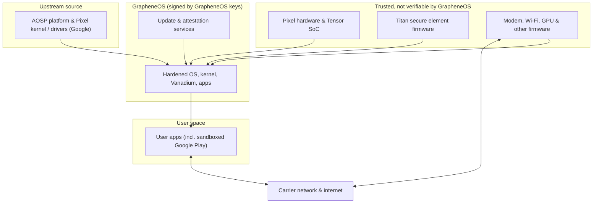

# GrapheneOS Security Assessment — Stage 1

> **Classification:** Client confidential (TLP:AMBER)
> **Version:** 0.1 draft · **Date:** 2026-11-24 · **Author:** Raj · **Reviewer:** _TBD_
>
> **Limitations:** This is a desk-based assessment. It draws on public
> documentation, prior research and analyst knowledge. No hands-on testing, code
> audit or reverse engineering was done in Stage 1. Facts are current as of the
> date above; GrapheneOS and Google change quickly.
>
> **Confidence tags:** **[D]** Documented — stated by GrapheneOS or Google ·
> **[S]** Secondary — press or third-party reporting only · **[A]** Assumed —
> analyst judgement, listed in the assumption register (Appendix A).

---

## 0. Executive Summary

**Verdict.** GrapheneOS on a supported Google Pixel is one of the most
technically secure phone platforms available today. It is a strong fit for
**high-risk individuals** (executives, journalists, activists) facing commercial
spyware and forensic extraction. It can serve a **managed fleet**, but only with
compensating controls, because it offers no fleet console, no vendor support and
little visibility into compromise. **No profile is proof against a determined
nation-state**: the modem and firmware below the OS remain trusted and closed.

**Top strengths**
- **Exploit mitigation well beyond stock Android:** a hardened memory allocator,
  hardware memory tagging on by default, per-app randomization and kernel
  hardening make software bugs much harder to exploit. (§6)
- **Strong physical and forensic resistance:** auto-reboot returns devices to
  their encrypted "before first unlock" state, USB data is blocked while locked,
  a duress PIN wipes the device, and the secure element limits PIN guessing.
  Leaked Cellebrite material reportedly shows no access to locked GrapheneOS
  Pixels. (§4, §8)
- **Privacy controls and no built-in Google services:** per-app network and
  sensor permissions, scoped storage and contacts, and Google Play only as an
  optional, unprivileged app. (§7)
- **Well-designed updates:** signed, rollback-protected, installed even before
  first unlock, with frequent releases. (§3.4)

**Top areas to examine first** (§11)
1. **Dependence on Google** for hardware, firmware, patches and source code,
   which Google has recently made harder to obtain.
2. **Trust concentrated in a small team:** about ten developers, donation
   funded, no published signing-key custody or succession plan, no commercial
   support.
3. **Baseband (modem):** the largest closed attack surface.
4. **GPU drivers:** Mali has a record of real-world spyware exploitation;
   the newer PowerVR stack is largely unstudied.
5. **Detection and incident response:** compromise may go unseen.

**Device recommendation** (§5.3, §12.1)

| Profile | Device |
| --- | --- |
| Baseline individual / managed fleet | Pixel 10a (supported to March 2033) |
| High-risk | Pixel 10 or 10 Pro (supported to August 2032) |
| Pixel 11 | Not yet supported by GrapheneOS; re-evaluate after support ships |

**Recommended next step.** A **Tier 1 Stage 2 engagement of about 16–26 analyst
days** (§14.2) covering patch-lag analysis, governance and signing-key custody,
incident-response design and MDM fit. This answers "can we trust and operate
this?" before committing to deeper technical research on the modem and GPU.

**Open questions for the client** are listed in §14.4. The main ones: which user
groups are in scope, whether certified products are required, and which MDM and
mandatory apps must work.

## 1. Scope, Method & Confidence

### 1.1 Purpose and Audience

A first, desk-based view of GrapheneOS for a client considering it as the basis
of a secure phone: what it protects, how, where it is weak, and which areas
deserve a deeper review first (§11). Written for security leadership and
technical reviewers.

### 1.2 Device Scope

Pixel 8 series to the newest Pixel (Pixel 11 series). The Pixel 8 is the floor
because it is the first generation with hardware memory tagging (MTE) and a
7-year support commitment. Pixel 6 and 7 are still supported by GrapheneOS but
are out of scope; Pixel 6/6 Pro are on legacy extended support and should be
replaced. A non-Pixel device (Motorola Signature 27) is announced and noted in
§4.7.

### 1.3 Method

Review of GrapheneOS documentation, Google and press sources, published
security research and leaked forensic-vendor material, plus analyst
knowledge. Fast-moving facts were checked on 2026-11-23/24.

### 1.4 Confidence Labels

| Tag | Meaning |
| --- | --- |
| **[D] Documented** | Stated by GrapheneOS or Google |
| **[S] Secondary** | Press or third-party reporting only |
| **[O] Observed** | First-hand testing (none in Stage 1) |
| **[A] Assumed** | Analyst judgement; listed in the assumption register |

**Confidence profile of this draft** (tag count, 2026-11-24): about 117
Documented, 30 Secondary, 43 Assumed, 0 Observed. Descriptive sections (§3–§10)
are mostly Documented. The judgements in §5.3, §11, §12, §13 and §14 are analyst
assessments throughout, as stated at the top of each.

### 1.5 Out of Scope for Stage 1

Hands-on testing, source-code audit, reverse engineering, forensic extraction
tests, and client-specific app or MDM testing. These are proposed as Stage 2
work packages (§14).

### 1.6 Assumptions

Every assumption that could change a conclusion is listed in Appendix A with
its impact and how to confirm it. The open questions for the client are in §14.4.

---

## 2. Reference Profiles

The client could not be consulted, so the document is written against three
reference profiles that cover the realistic personas, threat tiers and
deployment models. Persona-to-tier assignments are analyst judgement (A10).

### 2.1 Profiles used throughout the document
- **A — Baseline:** privacy-conscious individual; opportunistic theft and
  commercial forensics (T1–T2)
- **B — High-risk:** executive/VIP, journalist, activist; targeted spyware and
  nation-state (T3–T4); coercion and border seizure
- **C — Managed fleet:** security/IT staff and field staff on organization-owned
  or BYOD devices; loss, coercion, credential theft (T1–T3)
### 2.2 How a profile is chosen (two questions, applied in order)
1. **Threat tier sets the hardening level:** highest credible tier T1–T2 → A
   controls; T3–T4 → B controls.
2. **Ownership sets the management model:** organization-managed (fleet or
   BYOD) → C. If the user also faces T3–T4, apply B controls inside C, written
   **C+B**.
- BYOD at T3–T4 is **not recommended**: a work profile cannot enforce
  device-wide controls (auto-reboot, USB-C mode, no Play, duress PIN), so issue
  a dedicated device instead.

### 2.3 Persona summary (full definitions in Appendix B)

| Persona                               | Main assets                                         | Likely adversaries                                       | Highest credible tier  | Default profile               |
| ------------------------------------- | --------------------------------------------------- | -------------------------------------------------------- | ---------------------- | ----------------------------- |
| P1 Executive / VIP                    | Deal data, board communications, contacts, location | Competitors, commercial spyware customers, states        | T3 (T4 for some roles) | B, or C+B on a fleet          |
| P2 Journalist / activist / high-risk  | Sources, unpublished material, contacts, location   | Commercial spyware customers, states, border agents      | T4                     | B                             |
| P3 Security / IT staff                | Admin credentials, MFA tokens, internal access      | Criminal groups, access brokers, states via supply chain | T3                     | C (C+B for privileged admins) |
| P4 Field / operational staff          | Operational data, location, organization access     | Thieves, local authorities, coercion                     | T2                     | C                             |
| P5 Privacy-conscious individual       | Personal data, accounts, location history           | Thieves, data brokers, ad tracking                       | T1–T2                  | A                             |

### 2.4 Persona × deployment model → profile

| Persona | D1 Individually owned | D2 Organization-owned fleet | D3 BYOD with work profile         | D4 Minimal / comms-only |
| ------- | --------------------- | --------------------------- | --------------------------------- | ----------------------- |
| P1      | B                     | C+B                         | Not recommended → issue D2 device | B                       |
| P2      | B                     | C+B (newsroom / NGO fleet)  | Not recommended → issue D2 device | B                       |
| P3      | A                     | C (C+B if privileged admin) | C                                 | n/a                     |
| P4      | A                     | C                           | C                                 | C (stripped-down)       |
| P5      | A                     | n/a                         | A plus work profile               | A                       |

### 2.5 Threat tier coverage by profile (what each profile is designed to resist)

| Tier                               | A Baseline | B High-risk | C Managed fleet | C+B      |
| ---------------------------------- | ---------- | ----------- | --------------- | -------- |
| T1 Opportunistic theft / loss      | Yes        | Yes         | Yes             | Yes      |
| T2 Commercial forensic extraction  | Yes        | Yes         | Partial¹        | Yes      |
| T3 Commercial spyware (1-/0-click) | Partial²   | Yes         | Partial²        | Yes      |
| T4 Nation-state                    | No         | Partial³    | No              | Partial³ |

¹ Fleet usability settings (longer auto-reboot, sandboxed Play for work apps)
widen the after-first-unlock window.
² Exploit mitigations apply in every profile, but A and C keep more attack
surface (Play services, more apps, more radios on).
³ No profile fully addresses T4: baseband, firmware and supply-chain attacks sit
below the OS. B raises the cost; it does not remove the risk.

---

## 3. GrapheneOS Overview

GrapheneOS is a security-hardened mobile operating system based on the Android
Open Source Project (AOSP). It runs Android apps, but changes large parts of the
operating system underneath them to make exploitation and data extraction harder.
It is developed by a small non-profit team and currently runs only on Google Pixel
phones, with a first Motorola device announced.

### 3.1 Project Background, Governance, Funding and Infrastructure

**History**

| Period | Event | Tag |
| --- | --- | --- |
| Late 2014 | Founded by Daniel Micay as a solo project, starting with hardening work such as porting OpenBSD malloc to Android's C library and PaX kernel patches | [D] |
| Late 2015 – 2018 | A company was incorporated and became the main sponsor; the OS was known as **CopperheadOS** during this period. The project says it was agreed GrapheneOS would stay independently owned and controlled by its founder | [D] |
| 2018 | Split from the sponsor. The project's account says the company's CEO seized infrastructure and donations. This is the project's own account of a contested dispute and has not been independently verified | [D] (one-sided) |
| 2018–2019 | Rebranded to AndroidHardening, then to **GrapheneOS** (the site gives no dates; 2019 for the GrapheneOS name is analyst knowledge) | [D] / [A] |
| March 2023 | **GrapheneOS Foundation** created as a Canadian non-profit to receive and distribute donations | [D] |
| November 2025 | Left France and the hosting provider OVH, citing French pressure on encryption and device access | [D] |
| March 2026 | Long-term partnership with **Motorola** announced; the Motorola Signature 27 is to be the first non-Pixel device | [S] |

**Governance and team**

- The GrapheneOS Foundation is a **Canadian non-profit, not a registered
  charity**, based in Toronto. [D]
- The project describes "multiple full-time and part-time developers" plus
  companies that collaborate with it. [D] Public figures put the core development
  team at **roughly 6–10 full-time developers**. [S] [A06]
- Public documentation does not describe a formal governance structure: no board
  composition, decision process or succession plan. [A]
- The founder has historically been the public face of the project. Whether he
  still leads it day to day, and how key decisions are made, is not documented
  on the official site. [A]

**Funding**

- Mostly **donations** (bank transfer, PayPal, cryptocurrency). The FAQ states it
  is "entirely funded by donations" and will remain a non-profit. [D]
- Company collaborations exist. Motorola contributes engineering time to port
  GrapheneOS to its devices but does **not** fund the project. [S]
- There is **no commercial support offering or service-level agreement**. [D]

**Infrastructure and jurisdiction**

- After leaving OVH in November 2025, update mirrors run on **sponsored servers**
  (US; London as a temporary location). DNS runs on anycast networks with Vultr
  and BuyVM. Email, Matrix, the forum, Mastodon and the **attestation service**
  were moving to Netcup (Germany) short term and **colocated servers in Toronto**
  long term. [D] Whether that move is complete is unverified. [A05]
- Updates are verified by signature with downgrade protection at three layers
  (System Updater, update_engine, verified boot), and the project states that "the
  update server isn't a trusted party". **A compromised or seized mirror could
  delay updates, but could not push malicious ones** unless the signing keys were
  also compromised. [D]

> **Assessment note — why this matters to the client**
> - **Concentration risk.** A team of about ten, funded by donations, with no
>   published governance or succession plan, maintains an OS the client may build
>   a security programme on. Signing-key custody sits with this team (§9.2).
> - **No commercial recourse.** No support contract, SLA or indemnity. An
>   organization would carry the operational risk itself.
> - **Jurisdiction.** The legal entity and long-term infrastructure are in
>   Canada. The 2025 move shows the project will relocate under legal pressure,
>   which is reassuring on intent but shows that service availability can be
>   disrupted (it delayed early Pixel 10 support).
> - **Public disputes.** The project is involved in public conflicts (the
>   CopperheadOS split; disputes with press and other projects). This is a
>   reputational factor for an organization adopting it, not a technical flaw.
>
> Feeds §11 area #2 (Supply chain, governance & infrastructure).

### 3.2 Design Philosophy

- **Security first, then privacy.** GrapheneOS treats strong exploit
  mitigation and sandboxing as the foundation; privacy features are built on top
  of that, not in place of it. [D]
- **Harden AOSP, don't replace it.** It keeps the Android security model (app
  sandbox, verified boot, permission system) and makes it stronger: hardened
  memory allocator, hardware memory tagging, stricter app sandbox, extra
  permissions and reduced attack surface (§6, §7). [D]
- **Hardware requirements are non-negotiable.** Devices must offer, among other
  things, hardware memory tagging (ARM MTE or equivalent), a secure element with
  StrongBox and Weaver, verified boot with user-installed keys, and long-term
  firmware updates. This is why only Pixels qualify today, and why Pixel 11
  support waited for MTE enablement (§4.1, §5). [D]
- **No Google apps or services by default.** Like AOSP, GrapheneOS ships without
  them and says they will never be bundled. Users who need them can install Google
  Play as ordinary sandboxed apps with no special privileges (§7.4). [D]
- **No root access.** GrapheneOS does not provide a way to run apps as root,
  because it would break the verified boot and sandbox guarantees the design
  depends on. Users who want root must make their own unsupported builds. [S]
- **App compatibility is preserved where possible.** Hardening that breaks apps is
  offered as per-app toggles rather than removed, which creates opt-outs worth
  examining (§6.7, §11). [D]

### 3.3 What GrapheneOS Is Not

| Common assumption | Reality | Tag |
| --- | --- | --- |
| A "de-Googled privacy ROM" like /e/OS or CalyxOS | It is a hardening project first; privacy follows from sandboxing. It also allows sandboxed Google Play, which pure de-Googled ROMs don't | [D] |
| Runs on many devices, like LineageOS | Runs only on devices that meet its hardware requirements: currently Pixel 6 and newer (Pixel 6/6 Pro on legacy extended support), with Motorola to follow | [D] |
| Can be rooted or customized freely | No root access (root would break verified boot and the security model; users who want it must make unsupported custom builds); the bootloader is re-locked with GrapheneOS keys after install | [S] / [D] |
| An anonymity tool | It does not hide your identity from the mobile network, carrier or the services you sign into. Anonymity needs separate measures (e.g. Tor, careful account use) | [A] |
| A certified or accredited product | No Common Criteria, FIPS 140 or government accreditation found in any source checked. The FAQ discusses external review, not certification | [A] (absence of evidence) |
| An enterprise product with vendor support | No commercial support, SLA, fleet console or management service. It supports Android Enterprise work profiles via standard MDM (§10) | [D] / [A] |
| Independent of Google | It depends on Google for hardware, firmware, security patches and AOSP source releases (§4, §9.3) | [D] |

> **Assessment note.** For regulated clients, the lack of certification may rule
> GrapheneOS out for some uses regardless of its technical strength. Confirm the
> client's compliance needs (assumption A12).

### 3.4 Release Channels and Versioning

**Channels**

| Channel | Purpose | Tag |
| --- | --- | --- |
| **Alpha** | First public push, after developer testing | [D] |
| **Beta** | Pushed shortly after Alpha. Releases with problems are aborted and replaced by a new Beta release | [D] |
| **Stable** | Promoted after users on Beta have tested it. The project advises Stable for anyone who "cannot tolerate dealing with temporary issues" | [D] |
| **Legacy extended support** | Stopgap releases for end-of-life devices (currently Pixel 6 and 6 Pro). Patch level is frozen; the project advises these are a last resort | [D] |

**Versioning and cadence**

- Builds are numbered as 10-digit values such as **2026111800** (latest as of
  2026-11-24, based on Android 17 QPR2 with the 2026-11-05 Pixel security patch
  level). The number reads as date (YYYYMMDD) plus a two-digit counter; the site
  does not define the format. [D] / [A]
- Releases are frequent: about two dozen between early July and 18 November 2026,
  roughly one a week. [A] (count of changelog entries)

**How updates are delivered**

- Automatic background updates, checking about **every six hours** when
  connected. [D]
- Updates install to a **secondary copy of the OS**, which becomes active only
  after the update completes; if the new version fails to boot, the device rolls
  back. [D]
- Uses **incremental (delta) updates** when available; a full package can upgrade
  from any past version. [D]
- Works while the device is **locked and idle, including before first unlock**,
  so devices kept in the most secure state still get patched. [D]
- Every package is **signed and checked, with downgrade protection**; updates
  carrying a serial-number constraint (i.e. targeted at one device) are
  rejected. [D]
- Users can restrict updates to non-roaming or unmetered networks, require
  charging or a minimum battery level, and opt in to automatic reboot. There is
  **no setting to delay updates**; the only way to stop them is to disable the
  System Updater app, which the project strongly advises against. [D]
- Updates can also be sideloaded from recovery with adb, without enabling adb in
  the OS. [D]

> **Assessment note.** The update design is strong: signed, rollback-protected,
> works before first unlock, and resistant to targeted (per-device) updates.
> The gaps for an organization are:
> - **No staged rollout control.** A fleet cannot pin or defer a version, so a
>   bad Stable release reaches all devices at roughly the same time. The
>   compensating control is to run a few devices on Beta as early warning.
> - **Patch timing depends on Google.** GrapheneOS says it can only fully deliver
>   security updates while the OEM releases them, and Google's switch to
>   quarterly full bulletins and twice-yearly AOSP source drops affects when fixes
>   arrive (§9.3, §11 area #1).

---

## 4. Platform Foundations & Trust Model

GrapheneOS's security rests on hardware it does not control. This section sets
out what it relies on, what it verifies, and what it has to trust blindly.

### 4.1 Why Pixel Only: Hardware Requirements

GrapheneOS publishes a list of requirements a device must meet before it is
supported. [D] The ones that matter most:

| Requirement | Why it matters | Pixels meeting it |
| --- | --- | --- |
| Hardware memory tagging (ARM MTE or equivalent) | Catches most memory-corruption bugs at the point they occur (§6.3) | Pixel 8 and later |
| Secure element with **StrongBox** keystore | Keys live in a separate tamper-resistant chip, not the main processor | Pixel 3 and later (Titan M family) |
| **Weaver** in the secure element | Rate-limits unlock attempts in hardware (§4.3) | Titan M family |
| Verified boot with **user-installed keys** and a re-lockable bootloader | Lets GrapheneOS sign the OS with its own keys and still get full verified boot | Pixels |
| Long-term firmware and driver updates | Without vendor firmware patches, OS patches alone are not enough | Pixel 8+: 7 years |
| Isolation of radios and peripherals (IOMMU) | Stops a compromised modem or Wi-Fi chip reading main memory | Pixels |

Few Android OEMs meet all of these, which is why device support is narrow. The
FAQ's view is that for most devices "the hardware and firmware will prevent
providing a reasonably secure device". [D]

### 4.2 Verified Boot with Custom Keys

- During installation the bootloader is unlocked, GrapheneOS is flashed, and the
  bootloader is **re-locked with the GrapheneOS signing key enrolled** as the
  trusted key. [D]
- From then on, every boot verifies the OS against that key using Android
  Verified Boot (AVB). A modified system partition fails to boot or is
  detected. [D]
- **Rollback protection** prevents booting an older, vulnerable signed version. [D]
- Pixels show a yellow boot warning with the hash of the enrolled key at every
  boot. Users can check that hash against the published GrapheneOS value; the
  Auditor app (§9.4) verifies it cryptographically. [D] / [A]

### 4.3 Titan Secure Element

- **Weaver:** The unlock credential is combined with a secret held by the secure
  element. The chip enforces **escalating delays between failed attempts**, so
  brute-forcing a PIN is limited by hardware, not by the OS. [D]
- **Insider attack resistance:** Secure element firmware can only be updated after
  the owner authenticates, so Google or a supplier cannot silently push firmware
  that weakens throttling on a locked device. [D] (Android / Pixel design)
- **StrongBox:** Hardware-backed key storage used by apps and by attestation
  (§9.4). [D]
- **Generations:** Titan M2 on Pixel 8 to 10a; **Titan M3 on Pixel 11** — new
  silicon and firmware with little public security research yet. [S]
- The October 2025 leaked Cellebrite matrix reportedly shows the vendor
  **cannot brute-force passcodes on Pixels** even on stock Android, which is
  consistent with Weaver doing its job. [S]

### 4.4 Storage Encryption

- **File-based encryption** for user data plus **metadata encryption** for the
  file system, both standard on modern Android. [D]
- Keys are derived from the user's lock-screen credential **and** the Weaver
  secret in the secure element, so data cannot be decrypted off-device and a weak
  PIN is protected by hardware throttling. [D]
- **Before First Unlock (BFU)**, user data keys are not in memory at all. This is
  why GrapheneOS's auto-reboot feature (§8.2) is so effective. [D]
- GrapheneOS raises the maximum password length to 128 characters (stock: 16),
  making a strong passphrase practical. [D]

### 4.5 Baseband, Firmware and Peripheral Isolation

- The cellular modem, Wi-Fi/Bluetooth chip, GPU firmware and other components run
  **closed-source firmware** supplied by Google and its vendors (Samsung,
  MediaTek on Pixel 11, Broadcom, Imagination/Arm). GrapheneOS ships these
  unchanged; it cannot audit or fix them. [D] / [A]
- Pixels isolate these components with an **IOMMU**, so a compromised modem should
  not be able to read or write main memory directly. The attack path then runs
  through the drivers that talk to the component. [D] / [A]
- GrapheneOS reduces exposure with options such as **LTE-only mode** (disables
  2G/3G and 5G legacy fallback paths) and the ability to turn radios off. [A]
- **Residual risk:** The modem is the largest closed attack surface left on the
  device and a known nation-state target. It is §11 area #3.

### 4.6 Trust Boundaries

Reading the diagram: everything in the top box has to be trusted as delivered by
Google and its suppliers. GrapheneOS's protections start at the OS layer.
Verified boot proves the OS is the one GrapheneOS signed; it says nothing about
the firmware beneath it.

### 4.7 Motorola Partnership

- Announced at MWC on 2026-03-01 as a long-term partnership. The **Motorola
  Signature 27** (Qualcomm Snapdragon, with MTE and a secure element, 7-year
  support) is to be the first non-Pixel device; 2027 Razr foldables are next. [S]
- Motorola provides engineers for porting and maintenance; it does **not** fund
  the project. [S]
- Launch date and GrapheneOS availability on the Signature 27 are **not
  confirmed**. [A07]
- **Implications:** A second hardware vendor would reduce single-vendor dependence
  on Google, and Qualcomm's modem and secure element are a different attack
  surface from Tensor's. It also adds a second firmware supply chain to trust and
  splits a small team's attention.

> **Assessment note.** GrapheneOS can only be as strong as the hardware and
> firmware under it. The client's deeper review should focus on what sits below
> the OS: modem firmware and drivers (§11 #3), GPU drivers (#4) and the new Pixel 11
> components (#9).

---

## 5. Device Generation Analysis (Pixel 8 → Latest)

### 5.1 Device Matrix

Status as of 2026-11-24. † = press reports only (Secondary).

| Device | SoC | Modem | GPU | Secure element | Fingerprint | Released | Support end | GrapheneOS |
| --- | --- | --- | --- | --- | --- | --- | --- | --- |
| Pixel 8 / 8 Pro | Tensor G3 | Exynos 5300 | Mali | Titan M2 | Optical | Oct 2023 | Oct 2030 | Supported |
| Pixel 8a | Tensor G3 | Exynos 5300 | Mali | Titan M2 | Optical | May 2024 | May 2031 | Supported |
| Pixel 9 / 9 Pro / 9 Pro XL | Tensor G4 | Exynos 5400 | Mali | Titan M2 | Ultrasonic | Aug 2024 | Aug 2031 | Supported |
| Pixel 9 Pro Fold | Tensor G4 | Exynos 5400 | Mali | Titan M2 | Side capacitive | Sep 2024 | Aug 2031 | Supported |
| Pixel 9a | Tensor G4 | Exynos 5300 | Mali | Titan M2 | Optical | Apr 2025 | Apr 2032 | Supported |
| Pixel 10 / 10 Pro / 10 Pro XL | Tensor G5 | Exynos 5400 | PowerVR DXT† | Titan M2 | Ultrasonic | Aug 2025 | Aug 2032 | Supported |
| Pixel 10 Pro Fold | Tensor G5 | Exynos 5400 | PowerVR† | Titan M2 | Side capacitive | Oct 2025 | Oct 2032 | Supported |
| Pixel 10a | Tensor G4 | Exynos 5400 | Mali | Titan M2† | Optical† | Mar 2026 | Mar 2033 | Supported |
| Pixel 11 / 11 Pro / 11 Pro XL | Tensor G6 | MediaTek M90† | PowerVR C-Series† | Titan M3† | Ultrasonic† | Aug 2026 | Aug 2033† | **Not yet** |
| Pixel 11 Pro Fold | Tensor G6 | MediaTek M90† | PowerVR† | Titan M3† | Side capacitive† | 2026† | † | **Not yet** |

Support end dates for Pixel 8–10a are from the GrapheneOS FAQ ("OEM minimum
support end"); GrapheneOS updates typically end shortly after. [D]

### 5.2 Security-Relevant Differences

**5.2.1 Memory tagging (MTE).** All in-scope devices have MTE, and GrapheneOS uses
it by default for the base OS and known-compatible apps. [D] Pixel 11 shipped
without MTE enabled in Google's software; it was added in Android 17 QPR2, which
is why GrapheneOS support is late. [S]

**5.2.2 GPU driver.** The GPU kernel driver is one of the most-exploited Android
attack surfaces.
- **Mali (G3, G4, Pixel 10a):** a documented history of in-the-wild exploitation
  by commercial spyware vendors — e.g. CVE-2021-39793 (used against Pixel 6),
  CVE-2022-22706, CVE-2023-4211. [S] Well studied, so both attackers and
  defenders know it.
- **PowerVR (G5, G6):** a new driver stack on Pixels, with little public research
  history. Unknown is not the same as safe. [A]

**5.2.3 Modem.**
- Exynos 5300 (Pixel 8, 8a, 9a) and 5400 (Pixel 9, 10, 10a) are Samsung modems
  with a public vulnerability record (e.g. Project Zero's 2023 Exynos modem
  findings). [A]
- The 5400 adds **satellite messaging / SOS**, a new radio path. [S]
- **Pixel 11 switches to MediaTek** — the first change of modem vendor in the
  Tensor era, with its own separate vulnerability history. [S]

**5.2.4 Secure element.** Titan M2 throughout, until the **Titan M3** on Pixel 11. [S]

**5.2.5 Fingerprint.** Optical (8, 8a, 9a, 10a), ultrasonic (9, 10, 11 non-Fold),
side capacitive (Folds). Spoofing resistance differs by type, but GrapheneOS
caps fingerprint attempts at **5** (stock: 20) and offers fingerprint + PIN
two-factor unlock, which removes most of the risk. [D] / [A]

**5.2.6 Radios.** Pro models add UWB, and newer models add satellite. Each radio
is extra attack surface; most can be disabled. [A]

**5.2.7 Support window remaining.** From today: Pixel 8 ≈ 4 years left; Pixel 10a
≈ 6.3 years; Pixel 10 Pro Fold ≈ 6 years. For procurement, newer = longer
lifetime value. [D]

**5.2.8 Foldables.** Two displays, hinge sensors and more drivers mean a larger
attack surface for no security benefit. [A]

**5.2.9 Time to GrapheneOS support.** Pixel 10 support was delayed partly by the
November 2025 infrastructure move; Pixel 11 has been unsupported for over three
months because of MTE gating. **New Pixels should not be planned on day-one
GrapheneOS support.** [D] / [S]

### 5.3 Device Recommendation by Profile

| Profile | Recommended | Acceptable | Avoid | Reasoning |
| --- | --- | --- | --- | --- |
| **A Baseline** | Pixel 10a | Pixel 9a, Pixel 9 / 10 | — | Longest support (Mar 2033), lowest cost, mature Mali/Exynos stack |
| **B High-risk** | Pixel 10 / 10 Pro | Pixel 9 / 9 Pro | Foldables; Pixel 8 series for new purchases; Pixel 11 until supported and settled | Newest supported flagship generation, long support (Aug 2032). GPU trade-off (PowerVR unknown vs Mali known-exploited) does not clearly favour either |
| **C Managed fleet** | Pixel 10a | Pixel 9a, Pixel 10 | Foldables (cost, repair) | Single model across the fleet simplifies attestation and support; long support |
| **C+B** | Pixel 10 | Pixel 9 | As for B | As for B, standardized |

**Pixel 11:** Re-evaluate once GrapheneOS support ships **and** has been through
two or three monthly releases. Its new modem, secure element and GPU generation
deserve a specific review before high-risk use (§11 #9).

---

## 6. Exploit Mitigations

GrapheneOS's main security value is making exploitation of software bugs much
harder. These protections apply in every profile.

### 6.1 hardened_malloc

GrapheneOS's own memory allocator, used across the OS. [D]
- Metadata stored **separately** from allocations, in regions with random bases.
- **Zero-on-free**, with a check on reuse that detects writes after free.
- Random **canaries** and **guard pages** around allocations and slabs.
- **Quarantines** that delay memory reuse, making use-after-free bugs harder to
  exploit.

### 6.2 Hardened Bionic (libc)

Android's C library carries additional hardening that works with
hardened_malloc. [D] (Detail to be expanded in Stage 2.)

### 6.3 Hardware Memory Tagging (MTE)

- Used in **hardened_malloc** for allocations of 128 KB and below, in the **main
  kernel allocators**, and in **Vanadium's** main allocator. [D]
- Enabled by default for the base OS and known-compatible user apps. [D] Base OS
  protections **cannot be turned off**. [D]
- For user apps, an **exploit-protection compatibility mode** can be toggled per
  app. It disables MTE (unless the app opted in), switches to the standard Scudo
  allocator, reduces address space from 48-bit to 39-bit, and allows ptrace. [D]
- MTE crashes are reported to the user, which turns silent memory corruption into
  a visible crash. [A]

### 6.4 Exec-Based App Spawning

Stock Android starts apps by forking a pre-initialized "zygote" process, so every
app shares the same memory layout. GrapheneOS starts each app as a **fresh
process**, giving each its own randomized layout. [D] Cost: about 200 ms slower
app start and more memory. It can be turned off in Settings, which weakens the
protection. [D]

### 6.5 Kernel and Toolchain Hardening

[D] unless noted:
- 48-bit address space and **33 bits of ASLR entropy** (stock: 24).
- Zeroing of freed and newly allocated kernel memory; heap canaries.
- **Forced kernel module signing** with per-build keys; kernel lockdown mode.
- ARMv9 protections: **BTI, PAC, ShadowCallStack, type-based CFI**.
- **ART JIT disabled** in favour of ahead-of-time compilation; dynamic code loading
  blocked for nearly all base OS processes.

### 6.6 Vanadium Browser and WebView

- **JavaScript JIT disabled by default** in the browser, with a per-site toggle. [D]
- **Strict site isolation** in the browser; type-based CFI; zero-initialized
  variables. [D]
- WebGPU, third-party cookies, payments, background sync, sensor APIs and DRM
  disabled by default. [D]
- **WebView is weaker than the browser:** JIT is **enabled by default** for user
  apps (with global and per-app toggles), and WebView **does not support site
  isolation** — all instances share one sandbox. [D]
- Vanadium tracks upstream Chromium; patch latency for in-the-wild Chromium 0-days
  is §11 area #6.

### 6.7 Per-App Compatibility Toggles

| Toggle | What it weakens |
| --- | --- |
| Exploit-protection compatibility mode | MTE, hardened_malloc, address-space size; allows ptrace |
| WebView JIT (per app) | Adds JIT attack surface to that app's web content |
| Secure app spawning (global) | Reverts to zygote forking (shared memory layout) |
| Network / Sensors permissions | Privacy rather than exploit protection |

> **Assessment note.** These toggles are necessary for app compatibility, but each
> one is a silent opt-out. An organization should know how many of its required
> apps need compatibility mode, and should prefer apps that don't (§11 #12).

### 6.8 Coverage by Device Generation

All mitigations above apply to every in-scope device (Pixel 8 and later). The
differences are below the OS: GPU driver, modem and secure element (§5.2).

---

## 7. Privacy, Network & App Model

### 7.1 Network Permission

A per-app toggle that blocks **all direct and indirect network access**,
including localhost. When it is off, "GrapheneOS pretends the network is
down". It is on by default for compatibility and can be turned off at install
time. [D]

### 7.2 Sensors Permission

Blocks access to motion and environmental sensors (accelerometer, gyroscope,
compass, barometer, etc.); blocked apps receive zeroed data. On by default; can
be set off by default for new apps. [D]

### 7.3 Storage Scopes and Contact Scopes

- **Storage Scopes:** an app is told it has the storage permission it asked for,
  but sees only its own files plus files or folders the user chooses. [D]
- **Contact Scopes:** an app gets **no contact access** by default; the user can
  grant specific contacts, groups or data types. Write access is blocked. [D]

### 7.4 Sandboxed Google Play

- Google Play services and the Play Store run as **ordinary sandboxed apps** with
  "absolutely no special access or privileges". [D]
- A **compatibility layer** lets Play work inside the standard app sandbox. [D]
- Installed **per profile**, so it can be confined to one profile (§7.5, §12.6). [D]
- Location requests are redirected to GrapheneOS's own implementation by
  default. [D]
- **eSIM:** existing eSIMs keep working. Adding or managing eSIMs needs
  proprietary Google components that are **off by default** and can be enabled in
  Settings. [D]
- **Android Auto** is supported, installed from the GrapheneOS App Store, with no
  privileged access by default. [D]

> **Assessment note.** The compatibility layer is GrapheneOS code that sits
> between Google's closed-source Play services and the OS. It is a sensible
> design, but it is an IPC surface worth reviewing (§11 #8).

### 7.5 User Profiles, Private Space and Work Profile

- Separate **user profiles** have separate encryption keys, apps and VPN
  settings; GrapheneOS adds an "End session" option to lock a profile's keys
  away again. [D]
- **Private Space** and **work profiles** are available as on Android, each with
  its own VPN configuration. [D]
- Profiles are the main tool for isolating risky apps (e.g. Google Play) from
  sensitive ones.

### 7.6 Default Outbound Connections

GrapheneOS sends these default connections to **its own servers**: [D]

| Connection | Default | Alternatives |
| --- | --- | --- |
| Connectivity checks | GrapheneOS | Google, or disabled |
| Network time | GrapheneOS | Disabled |
| Attestation key provisioning | GrapheneOS | Google |
| GNSS almanac (PSDS) | GrapheneOS proxy | Google |
| SUPL (assisted GPS) | GrapheneOS proxy | Carrier/Google server, or disabled |
| OS updates | GrapheneOS update server (sees IP address and current version only) | — |
| Vanadium component updates | GrapheneOS | — |

### 7.7 Radio and Network Controls

- **Wi-Fi MAC randomization:** always random for scanning; **a new random MAC for
  each connection** by default, with DHCP state flushed between connections.
  Stable IPv6 link-local addresses are disabled. [D]
- Wi-Fi and Bluetooth scanning for location are off by default. [D]
- **LTE-only mode** disables 2G, 3G and 5G, cutting cellular radio attack surface
  (legacy protocols and new 5G code) and exposure to fake base stations. It is a
  documented GrapheneOS feature. [D] Turning off 2G alone is also possible. [D]
- **Always-on VPN with "block connections without VPN"** (standard Android)
  is available per profile. [A]
- **Private DNS** (DNS-over-TLS) is available (standard Android). [A]

### 7.8 Carrier Exposure

- The carrier still sees the device's **IMSI, IMEI, cell location and metadata**
  for calls, SMS and data. GrapheneOS cannot change this. [A]
- A **SIM PIN** protects a removed SIM; PIN scrambling also applies to SIM PIN
  entry. [D]
- The duress PIN **wipes installed eSIMs** along with the device. [D]

### 7.9 App Sourcing Supply Chain

| Source | Trust model | Notes |
| --- | --- | --- |
| **GrapheneOS App Store** | GrapheneOS-signed, signature and downgrade checks | GrapheneOS apps, sandboxed Play, Android Auto, Accrescent |
| **Accrescent** | Security-focused third-party store; developer-signed apps | Recommended by GrapheneOS; small catalogue [A] |
| **Google Play (sandboxed)** | Google-reviewed; developer-signed | Largest catalogue; needs a Google account [D] |
| **F-Droid** | Builds and signs many apps itself; open-source only | GrapheneOS has publicly criticized its signing and update model [A] |
| **Direct APK / Obtainium** | Trust each developer's releases directly | Higher risk; no store-level review |

> **Assessment note.** For most users, the apps they install are a bigger risk
> than the OS. Profiles B and C should define approved apps and sources (§12.6).

### 7.10 Metadata Exposure to GrapheneOS Infrastructure

By default the update, connectivity, time, attestation and location-assist
servers see the device's **IP address and timing**, and the update server sees
the installed version. [D] This is far less than stock Android sends to Google,
but GrapheneOS becomes a party that sees which IP addresses run GrapheneOS
(§11 #13). Users in Profile B can route traffic through a VPN or switch some
services off.

---

## 8. Physical & Forensic Resistance

### 8.1 BFU vs AFU

- **BFU (Before First Unlock):** after a reboot, before the PIN is entered. User
  data keys are not in memory; data is cryptographically inaccessible without
  the PIN, which the secure element throttles. [D]
- **AFU (After First Unlock):** keys are in memory even when the screen is
  locked. An attacker who can exploit the locked device can reach data. [D]
- Most forensic extraction targets AFU devices. **Getting devices back to BFU is
  the main goal** of the features below.

### 8.2 Auto-Reboot Timer

- Reboots the device if it has not been unlocked for a set time: **18 hours by
  default**, configurable from **10 minutes to 72 hours** or off. [D]
- The timer starts at each lock. It runs in `init`; if it crashes, the kernel
  panics and the device reboots anyway. [D]
- Cellebrite's Spring 2026 release reportedly advertises a "Safeguard Mode" meant
  to stop seized devices dropping back to BFU, a direct counter to this feature.
  [S] A short timer reduces the window for that.

### 8.3 USB-C Port Control

Five modes; default **"Charging-only when locked"**. [D]

| Mode | Effect |
| --- | --- |
| Off | No data or charging |
| Charging-only | Never any data |
| Charging-only when locked (**default**) | Data only while unlocked |
| Charging-only when locked, except BFU | Data also allowed before first unlock |
| On | Standard behaviour |

Blocking USB data while locked removes the main attack path forensic tools use.

### 8.4 Duress PIN / Password

A separate PIN or password that **irreversibly wipes the device and its eSIMs**
when entered. No reboot is needed and the wipe cannot be interrupted. It also
works when entered as the second factor of fingerprint unlock. [D]

### 8.5 PIN Scrambling and Two-Factor Fingerprint Unlock

- **PIN scrambling** randomizes the keypad layout for the lock screen and SIM PIN,
  defeating shoulder-surfing and smudge attacks. [D]
- **Two-factor fingerprint unlock** requires a PIN after the fingerprint; wrong
  PINs count toward the normal attempt limit. [D]
- **Fingerprint attempts are capped at 5** in total (stock: 20). [D]

### 8.6 Secure Element Brute-Force Throttling

See §4.3. Even with an exploit against the main OS, guessing the PIN is limited
by the secure element. A **6-digit PIN is the practical minimum**; Profile B
should use a passphrase. [A]

### 8.7 Leaked Forensic-Vendor Capability Matrices

| Leak | What it reportedly shows | Tag |
| --- | --- | --- |
| Oct 2025 Cellebrite "Android OS Access Support Matrix" (screenshotted from a sales briefing; reported by 404 Media; Cellebrite declined to comment) | Covers **Pixel 6–9 only**; Pixel 10, 10a and 11 are not in it. Stock Pixel 6–9 extractable (BFU extraction yields limited data without the passcode; AFU and unlocked yield much more); Cellebrite reportedly cannot brute-force Pixel passcodes. **Locked GrapheneOS Pixels: no access**, apart from builds older than about 2022; possible loss of full extraction even on unlocked GrapheneOS devices | [S] |

**Limits:** These are leaked sales documents, not tests. They cover one vendor
and Pixel 6–9 only, so they say nothing directly about Pixel 10, 10a or 11. They
are months old by the time they surface, and show capability the vendor offers
widely — not what a state agency might have privately. Absence of a capability in
a matrix is evidence, not proof. Lab validation is §11 area #10.

### 8.8 Coercion and Border Scenarios

| Scenario | Profile | Controls |
| --- | --- | --- |
| Device seized at a border, powered on | B | Short auto-reboot (e.g. 30 min–1 h); reboot before crossing; USB charging-only |
| Forced to unlock | B | Duress PIN; minimal data on device; travel profile with sensitive data in a separate profile ended before crossing |
| Theft of an unlocked phone | A, C | Short screen-lock timeout; profiles; remote account revocation |
| Visible GrapheneOS boot screen | B | The yellow boot warning shows a non-stock OS; in some jurisdictions this may itself attract attention. Consider whether a travel device is wiser |

> **Legal caveat.** Entering a duress PIN under legal compulsion or at a border
> may be treated as destruction of evidence or obstruction in some
> jurisdictions. Seek legal advice for each jurisdiction before adopting the
> duress PIN as policy. [A]

---

## 9. Operations & Lifecycle

### 9.1 Update Pipeline

Covered in §3.4: Alpha → Beta → Stable; automatic background updates every ~6
hours; secondary-slot install with rollback; delta updates; works before first
unlock; signed with downgrade protection; no deferral setting. [D]

### 9.2 Signing-Key Custody and Build Transparency

- GrapheneOS lists "hardened local build and signing infrastructure" as a feature
  but does **not publish** where or how the OS signing keys are stored, who holds
  them, or how a compromise would be handled. [D] (absence)
- Anyone can **build GrapheneOS from source**. [D] Whether official builds are
  **reproducible**: the project states official builds can be rebuilt and
  compared file by file, excluding signatures, and publishes SSH-signed source
  tags. [S] (project forum) Proprietary firmware cannot be rebuilt, so this
  verifies the OS only. Independent reproduction is still worth doing (A13, WP2).
- Kernel modules are signed with per-build keys that are discarded. [D]

> **Assessment note.** Key custody is the single most important trust question
> for an organization. It is the core of §11 area #2. [A]
>
> - **What a compromise would mean:** an attacker holding the OS signing key
>   could sign an update that every GrapheneOS device accepts and installs
>   automatically, with no user prompt. [A]
> - **Auditor cannot detect it.** Auditor and attestation check that the device
>   runs an OS signed with the expected key at the expected patch level. A
>   malicious update signed with the genuine key passes those checks. [A]
> - **Recovery** would need a new signing key and a reinstall of every device
>   (unlock, flash, re-lock), because verified boot trusts the old key until it is
>   replaced. [A]
> - Reproducible builds (above) help others spot a release that does not match
>   its source, but only if someone rebuilds and compares it. [A]

### 9.3 Patch Timing vs Google

- GrapheneOS ships Pixel security patches as Google releases them; the latest
  release carries the 2026-11-05 patch level. [D]
- Google now publishes **full Android security bulletins quarterly** (monthly
  bulletins carry only high-risk fixes) and **AOSP source only in Q2 and Q4**.
  Pixel monthly patches continue. [D] / [S]
- Google no longer publishes Pixel device trees, and Pixel kernel source is
  harder to obtain. [S] This makes GrapheneOS's porting work slower and more
  dependent on reverse-engineering Google's releases (§11 area #1).

### 9.4 Auditor and Hardware Attestation

- The **Auditor** app uses Android's hardware attestation to verify that a device
  runs genuine, unmodified GrapheneOS with the expected signing key and patch
  level. [D]
- It uses **pairing**: the first verification pins a hardware-backed key, and
  later checks confirm both integrity and that it is the **same device**. [D]
- Verification can be done **locally** (one phone scanning another's QR code) or
  through the **attestation.app** service, which can email alerts if a device
  stops checking in or fails. [D]
- For a fleet, the remote service gives a basic integrity dashboard, but it is a
  GrapheneOS-run service (hosting moving to Canada; §3.1). [D] / [A]
- **Data protection:** attestation.app stores device identifiers, attestation
  history and alert e-mail addresses on GrapheneOS-run infrastructure. [A]
  Organisations may need a data-protection review before using it, or can
  self-host the open-source attestation server instead. [A]
- Attestation verifies OS integrity and patch level, **not device settings**
  (auto-reboot, USB-C mode, duress PIN and so on; §10.2). [A]

### 9.5 Installation and Procurement

- Install using the **web installer** (WebUSB in a Chromium browser) or the
  command-line installer. Both unlock, flash and re-lock the bootloader. [D]
- The device must allow **OEM unlocking**. Carrier-locked units — notably many
  **Verizon** Pixels — cannot be used. Buy unlocked devices from Google or trusted
  retailers. [A]
- Verify the install with Auditor (§9.4) and the boot-key hash (§4.2).
- For Profile B, consider buying in person or through an intermediary to reduce
  the risk of interdiction. [A]

### 9.6 Backup and Recovery

- There is **no cloud backup by default**. The built-in option (Seedvault) is
  limited; many users rely on app-level exports (e.g. Signal's encrypted backup).
  [A]
- **Trade-off:** less backup means less data exposed in a backup provider, but a
  higher risk of data loss. For Profile C, organization data should live in
  managed services, not on the device.

### 9.7 Detection and Incident Response

- **No root and no mobile threat-defence agent** with deep system access, by
  design. This keeps the attack surface small but means **compromise may go
  unnoticed**. [A]
- **Auditor proves OS integrity**, not the absence of an in-memory or
  user-space implant. [D] / [A]
- MTE crash reports can show exploitation attempts, and users can share them with
  GrapheneOS. [A]
- Triage tools such as **MVT** (Mobile Verification Toolkit) can analyse backups
  and adb output, with limits on a non-rooted device. [A]
- **Realistic response:** treat a suspected device as compromised; **reflash and
  replace**, revoke credentials, and rotate account sessions. Document this in a
  runbook (Profile C). [A]

> **Assessment note.** This is a gap for any organization with a security
> operations function. It is §11 area #5.

---

## 10. Enterprise & Compatibility

### 10.1 Android Enterprise and MDM

- **Work profiles** are supported, and standard Android Enterprise MDM apps can
  manage them. [D] / [A]
- GrapheneOS's documentation **does not cover full device-owner (fully managed)
  provisioning** or list MDM products that work. [D] (absence) Compatibility
  depends on each MDM; some need Google Play services (use sandboxed Play in the
  managed profile). [A]

### 10.2 No Fleet Console

There is no GrapheneOS management console, support contract or bulk
provisioning tool. [D] / [A] Compensating controls:
- MDM for the work profile;
- the attestation.app service (or a self-hosted equivalent) for integrity;
- a documented build standard and hardening checklist (§12.7);
- a few devices on Beta as an early-warning channel.

**Gaps that compensating controls do not close:**
- **Lost-device remote wipe.** With no Google services there is no device-wide
  remote wipe (no Find My Device). A work-profile MDM wipe removes only the work
  profile; the rest of the device stays intact. [A] Rely on encryption, a short
  auto-reboot timer and credential revocation instead.
- **Fleet enforcement.** A work profile cannot enforce or verify device-wide
  settings: auto-reboot timer, USB-C mode, PIN scrambling, cellular mode or duress
  PIN. Auditor and attestation verify OS integrity and patch level, not
  settings. The organisation therefore cannot detect configuration drift; these
  settings rely on users keeping them. [A]

### 10.3 Play Integrity and Banking / Corporate Apps

- GrapheneOS passes Play Integrity's basic check but **fails the device-integrity
  and strong-integrity checks**, because Google does not certify it. Apps that
  enforce those checks will refuse to run. [D]
- GrapheneOS asks app developers to use **standard hardware attestation and
  allow GrapheneOS's signing keys** instead; it publishes a guide. [D]
- Many banking apps work with sandboxed Play; some explicitly allow GrapheneOS,
  some block it (e.g. Revolut, publicly disputed in 2026). [S]
- **Corporate apps** (MDM agents, VPN, conditional access) need testing one by one.

### 10.4 Feature Compatibility

| Feature | Status | Tag |
| --- | --- | --- |
| Android Auto | Supported via sandboxed Play compatibility layer | [D] |
| eSIM | Existing eSIMs work; adding eSIMs needs an opt-in toggle | [D] |
| Google Wallet tap-to-pay | Not available: requires a Google-certified OS. Some bank apps and Curve Pay offer NFC payments instead | [S] |
| RCS (Google Messages) | Works via sandboxed Play, including end-to-end encrypted chats, but can break with carrier or Google changes | [S] |
| Wear OS | Mixed user reports; some watches (incl. Pixel Watch) work with sandboxed Play | [S] |
| Push notifications | Via sandboxed Play (FCM) or app-specific alternatives | [D] / [A] |

### 10.5 Usability vs Security by Profile

| Profile | Main usability costs |
| --- | --- |
| A | Some apps need sandboxed Play; occasional app breakage |
| B | No Play means fewer apps and no Google push; short auto-reboot means frequent PIN entry; duress PIN needs training |
| C | MDM compatibility testing; no vendor support; release timing outside IT's control |

---

## 11. Areas to Examine First (Ranked)

### 11.1 How Areas Are Rated

- **Likelihood (L)** — how plausible it is that the weakness is exploited or
  matters in practice, given §4–§10.
- **Impact (I)** — what happens if it does: device compromise, data exposure,
  fleet-wide failure, or loss of the security guarantees the client is buying.
- **Risk = L × I**, rated High / Medium / Low. **Risk sets the rank.**
- **Verify effort** — how much Stage 2 work it takes to confirm or rule out. It
  feeds costing (§14) and does **not** affect rank.

All ratings are analyst judgement from desk research [A], to be revised with
client input and Stage 2 results.

### 11.2 Ranked Areas

| # | Area | Why it raises eyebrows | L | I | Risk | Verify effort | Devices | Profiles | Proposed Stage 2 test |
| --- | --- | --- | --- | --- | --- | --- | --- | --- | --- |
| 1 | Upstream dependency on Google | Device trees no longer published; Pixel kernel source by request; AOSP source only Q2/Q4; full bulletins quarterly; all firmware closed (§9.3) | H | H | **H** | M | All; G5+ most | A, B, C | Patch-lag timeline over 12 months; track upstream changes and porting delays |
| 2 | Supply chain, governance & infrastructure | ~10-person donation-funded team; **signing-key custody not published**; reproducibility claimed but not independently confirmed; no succession plan; infrastructure relocated under legal pressure (§3.1, §9.2) | M | H | **H** | M | All | B, C | Governance and key-custody interview; reproducible-build test; hosting review |
| 3 | Baseband / cellular stack | Largest closed attack surface; nation-state target; satellite path on 5400; MediaTek on Pixel 11 (§4.5, §5.2.3) | M | H | **H** | H | All; Pixel 11 new | B | Modem CVE history per generation; IOMMU isolation review; firmware RE scope |
| 4 | GPU driver (Mali and PowerVR) | Mali: repeated in-the-wild spyware use; PowerVR: new stack, little public research (§5.2.2) | M | H | **H** | H | All | B, C | Mali patch-status review; PowerVR attack-surface mapping and fuzzing scope |
| 5 | Detection & incident response | No root, no MTD agent; compromise may go unseen; Auditor proves OS integrity only (§9.7) | H | M | **M** | M | All | B, C | IR runbook dry run; evaluate log, MTE crash and MVT triage options |
| 6 | Browser / WebView | Vanadium patch latency vs Chromium 0-days; **WebView keeps JIT on and lacks site isolation** (§6.6) | M | M | **M** | L | All | A, B | Patch-latency study; WebView usage census of required apps |
| 7 | Enterprise manageability | No fleet console; fully managed MDM undocumented; no staged rollout; Play Integrity blocks some apps (§10) | H | M | **M** | M | All | C | MDM compatibility matrix with client's MDM; corporate app tests |
| 8 | Sandboxed Play compatibility layer | GrapheneOS code bridging closed Play services and the OS; IPC surface; eSIM path (§7.4) | L | H | **M** | M | All | A, C | Code review of the compatibility layer; IPC fuzzing |
| 9 | Pixel 11 new components | Titan M3, MediaTek M90 and new PowerVR arrive together; not yet supported (§5.2) | M | M | **M** | H | Pixel 11 | B | Readiness review after support ships; secure element and modem research scope |
| 10 | Forensic claims | Strong on paper and in leaks, but vendors are adapting (e.g. claimed "Safeguard Mode") (§8) | L | H | **M** | H | All | A, B | Lab extraction tests per generation at default and hardened settings |
| 11 | App sourcing supply chain | Apps, not the OS, are the usual compromise path; store trust models differ (§7.9) | M | M | **M** | L | All | A, B, C | Store trust review; approved-app list |
| 12 | MTE / hardened_malloc opt-outs | Per-app compatibility mode silently drops protections (§6.7) | M | L | **L** | L | All | A, B | Opt-out census of the client's required apps |
| 13 | Default network behaviour | GrapheneOS servers see IP addresses and timing (§7.6, §7.10) | M | L | **L** | L | All | A, B | Traffic capture and analysis |
| 14 | Biometric differences | Sensor types differ, but 5-attempt cap and 2-factor unlock limit the risk (§5.2.5) | L | L | **L** | M | Per device | A, B | Spoof testing per sensor type |

**Changes from the working hypothesis in the plan:**
- **Detection & IR** moved up (from #6 to #5) because likelihood is high: by
  design there is no way to see a compromise.
- **Enterprise manageability** moved up (from #12 to #7) because it decides
  whether Profile C is practical at all.
- **Pixel 11** moved down (from #5 to #9): it cannot be deployed yet, so it is a
  future risk.
- **Browser / WebView** reframed after finding that WebView is weaker than the
  browser.
- **MTE opt-outs** lowered to Low: impact is limited to the apps that use the
  opt-out.

### 11.3 Areas by Profile

How much each area matters to each profile (High / Medium / Low / —):

| # | Area | A Baseline | B High-risk | C Managed fleet | C+B |
| --- | --- | --- | --- | --- | --- |
| 1 | Upstream dependency on Google | M | H | H | H |
| 2 | Supply chain & governance | L | H | H | H |
| 3 | Baseband | L | H | L | H |
| 4 | GPU driver | M | H | M | H |
| 5 | Detection & IR | L | H | H | H |
| 6 | Browser / WebView | M | H | M | H |
| 7 | Enterprise manageability | — | — | H | H |
| 8 | Sandboxed Play layer | M | L (no Play) | H | M |
| 9 | Pixel 11 components | L | M | L | M |
| 10 | Forensic claims | M | H | M | H |
| 11 | App sourcing | H | H | M | M |
| 12 | MTE opt-outs | M | L (no opt-outs) | M | L |
| 13 | Default network behaviour | L | M | L | M |
| 14 | Biometrics | L | L (fingerprint off or 2FA) | L | L |

**Reading the table:** for **Profile B**, the deeper review should start with
areas 1–6 and 10. For **Profile C**, areas 1, 2, 5 and 7 decide whether a
GrapheneOS fleet is viable at all.

---

## 12. Reference Secure-Phone Configurations

These configurations are an analyst assessment [A]. They are starting
configurations to be tailored with the client. Settings paths follow current
GrapheneOS menus and may move between releases.

### 12.1 Hardware Selection

| Profile | Device | Why |
| --- | --- | --- |
| A Baseline | Pixel 10a | Longest support (Mar 2033), lowest cost, mature components |
| B High-risk | Pixel 10a | Same Titan M2 and Exynos 5400 modem as Pixel 10; fewest radios (no UWB); mature, well-studied Mali GPU stack |
| C Managed fleet | Pixel 10a (one model fleet-wide) | Long support, cost, one attestation baseline |
| C+B | Pixel 10a | As B, on the same model as the rest of the fleet |

**Alternative:** Pixel 10 (non-Pro) for any profile where more performance is
needed. **Avoid:** Pro models for Profile B (UWB and extra radios), foldables,
new purchases of Pixel 8, and Pixel 11 until GrapheneOS supports it and support
has settled (§5.3). The GPU difference (Mali on 10a, PowerVR on 10) is a
consideration, not a decisive factor. [A]

**Procurement:**
- Buy **unlocked** units directly from Google or a trusted retailer; never
  carrier-locked (Verizon) or second-hand for Profile B.
- Profile B: buy in person or through an intermediary, and keep chain of custody
  until install.
- Install before first connection to any network where possible.

### 12.2 Installation and Verification

1. Enable OEM unlocking (Settings > System > Developer options), then use the
   **GrapheneOS web installer** from a trusted computer.
2. Flash, then **re-lock the bootloader**; disable OEM unlocking again.
3. Check the **boot-key hash** shown at boot against the published value.
4. Pair with **Auditor** (local pairing between two devices, or the remote
   attestation service for fleets) and record the first attestation.
5. Apply the profile settings (§12.7), then check for and install updates.

### 12.3 Profile A — Baseline

For privacy-conscious individuals and P3/P4 staff on personal devices
(privileged P3 admins should not use personal devices; issue a C+B device). Keeps
defaults where they are already strong; adds app discipline. Sandboxed Play
is allowed where apps need it.

### 12.4 Profile B — High-risk

For P1 and P2. Minimises attack surface and the AFU window:
- **No Google Play** in the Owner profile; if unavoidable, put it in a
  **secondary profile** and end that session when not in use.
- **USB-C: Charging-only** at all times.
- **Auto-reboot: 1 hour** (30 minutes while travelling).
- **Duress PIN** set and practised.
- **LTE-only** mode (this also turns off 2G, 3G and 5G, so 5G speeds are lost).
  Check emergency-call behaviour in LTE-only mode during Stage 2 testing.
- **Always-on VPN with "block connections without VPN"**.
- Strong passphrase; fingerprint **off**, or on with two-factor PIN.
- Network and Sensors permissions **off by default** for new apps.
- WebView JIT **off globally**; no exploit-protection compatibility mode.

### 12.5 Profile C — Managed Fleet

For P3 and P4 on organization devices:
- **Work profile** managed by the organization's MDM, with sandboxed Play
  installed **only in the work profile** if the MDM or apps need it.
- **Attestation:** enrol each device in Auditor/attestation.app with alerting.
- **Compensating controls:** written build standard, hardening checklist (§12.7),
  approved-app list, and **2–3 pilot devices on the Beta channel** as early
  warning.
- **Incident response runbook:** suspected compromise → isolate, revoke
  credentials, reflash and re-enrol; record lost-device and duress-wipe procedure.
- **C+B variant:** apply the Profile B device settings in §12.7 to fleet devices
  issued to P1/P2 and to P3 privileged admins (the highest-risk P3 group, tier
  T3). Other P3 staff use Profile C.
- **Enforcement limit:** the MDM controls only the work profile. Device-wide
  settings in §12.7 (auto-reboot, USB-C, PIN scrambling, cellular mode, duress
  PIN) are set by the user and cannot be enforced or verified (§10.2).

### 12.6 App Policy

| Profile | Google Play | Approved sources | Rule |
| --- | --- | --- | --- |
| A | Allowed (Owner profile) | GrapheneOS App Store, Accrescent, Play | Install only what is needed; review permissions |
| B | Not in Owner profile; optional in an ended secondary profile | GrapheneOS App Store, Accrescent; named exceptions | Approved list only; Network permission off at install, grant per app |
| C | Work profile only | As MDM policy; GrapheneOS App Store | Org apps via MDM; personal apps in the Owner profile at user's risk |

Messaging: prefer **Signal** (or Molly) for sensitive communications across all
profiles. [A]

### 12.7 Hardening Checklist

| Setting | A Baseline | B High-risk | C Managed fleet | How enforced / verified (C) |
| --- | --- | --- | --- | --- |
| Device | Pixel 10a | Pixel 10a | Pixel 10a | Attestation verifies (model and OS) |
| Lock credential | 6+ digit PIN | Passphrase (6+ random words) | 6+ digit PIN (MDM-enforced) | MDM (lock-screen policy set through the work profile) |
| Fingerprint | Allowed | Off, or two-factor with PIN | Two-factor with PIN | User-set; not verifiable (MDM can only disable fingerprint entirely) |
| PIN scrambling | Optional | On | On | User-set; not verifiable |
| Duress PIN | Optional | **On** | Per policy (on for C+B) | User-set; not verifiable |
| Auto-reboot | 18 h (default) or 8 h | **1 h** (30 min when travelling) | 8–12 h | User-set; not verifiable |
| USB-C port | Charging-only when locked (default) | **Charging-only** | Charging-only when locked | User-set; not verifiable |
| Screen-lock timeout | 1 min | 30 s | 1 min (MDM) | MDM (lock-screen policy set through the work profile) |
| Lock-screen notifications | Hide sensitive content | Hide all | Hide sensitive content | MDM (work profile only); user-set for personal apps |
| Sandboxed Google Play | If needed | None in Owner profile | Work profile only | MDM (work profile only); Owner profile not visible |
| Exploit-protection compatibility mode | Only if an app needs it | Never | Exception list only | User-set; not verifiable |
| WebView JIT | Default | Off globally | Off by default | User-set; not verifiable |
| Network permission for new apps | Default (on) | Off at install | Default | User-set; not verifiable |
| Sensors permission for new apps | Default (on) | Off by default | Default | User-set; not verifiable |
| Cellular | 2G off | **LTE-only** (no 2G, 3G or 5G) | 2G off | User-set; not verifiable |
| Wi-Fi MAC | Per-connection random (default) | Per-connection random | Per-connection random | Default; not verifiable |
| Bluetooth / NFC / UWB | As needed | Off when not in use | As needed | User-set; not verifiable |
| Location | As needed | Off by default; SUPL off | As needed | User-set; not verifiable |
| VPN | Optional | **Always-on, block without VPN** | Org VPN always-on in work profile | MDM (work profile only) |
| Private DNS | Optional | On (if VPN doesn't cover DNS) | Per org policy | User-set; not verifiable |
| Updates | Automatic, Stable | Automatic, Stable | Automatic, Stable; pilots on Beta | Attestation verifies (patch level) |
| Auditor / attestation | Optional | Local pairing or remote with alerts | Remote attestation with alerts | Attestation verifies (alerts on missed check-in) |
| Secondary profiles | Optional | Used for risky apps; end session after use | Work profile | MDM (work profile only) |

The last column applies to Profile C (and C+B). "User-set; not verifiable" means
the organisation can neither enforce the setting nor detect if it is changed
(§10.2). Controls there depend on the written build standard, user training and
periodic manual checks. [A]

---

## 13. Comparative Positioning

Ratings are relative and qualitative (analyst judgement, [A]) unless tagged.

### 13.1 GrapheneOS vs Stock Pixel (Android 16/17)

- Same hardware, secure element and verified boot design.
- **Stock Advanced Protection.** Since Android 16 (2025), stock Android offers an
  opt-in **Advanced Protection mode**. It turns on MTE for supported apps and
  components (Pixel 8 and later), a **72-hour inactivity reboot**, USB data
  protection while locked (new connections charge only), blocks 2G and WEP
  Wi-Fi, blocks sideloading, and enforces Play Protect and other Google
  hardening. [D] (Google support page)
- **Where GrapheneOS differs: scope and default strength.** Many controls exist
  on both; GrapheneOS applies them more widely, more strongly, or by default: [D]

| Area | Stock Pixel + Advanced Protection | GrapheneOS |
| --- | --- | --- |
| MTE | Supported apps and some components, when the mode is on | OS and most apps by default |
| Memory allocator | Standard (Scudo) | hardened_malloc |
| App spawning | Zygote (shared address-space layout) | Exec spawning |
| Inactivity reboot | Fixed 72 h | Configurable 10 min–72 h; 18 h default |
| USB-C | Charging-only for new connections when locked | Five modes, including always charging-only |
| 2G / cellular | 2G blocked | 2G off or LTE-only (no 2G, 3G or 5G) |
| Duress PIN | None | Yes, wipes device and eSIMs |
| Per-app Network / Sensors permissions, Scopes | No | Yes |
| Fingerprint attempt cap | 20 | 5 |
| Privileged Google services | Yes (Play services with system privileges) | None; Play optional and sandboxed |

- Stock adds: Google Play Protect, Play Integrity certification (banking and
  Wallet), Google's own detection and theft-protection features, vendor support.
- Forensics: the Oct 2025 Cellebrite matrix (Pixel 6–9 only) shows stock Pixels
  extractable — BFU extraction yields limited data without the passcode, while
  AFU and unlocked yield much more — and locked GrapheneOS Pixels largely not.
  Cellebrite reportedly cannot brute-force Pixel passcodes. Pixel 10, 10a and 11
  are not covered. [S]

### 13.2 GrapheneOS vs iOS with Lockdown Mode

- **iOS strengths:** integrated hardware/software from one vendor; Apple's
  Secure Enclave; Lockdown Mode cuts attack surface (message attachments,
  JIT, wired connections when locked); commercial support; wide app and MDM
  support; inactivity reboot after 3 days (iOS 18.1). [S]
- **GrapheneOS strengths:** MTE across the OS and most apps (Apple's comparable
  Memory Integrity Enforcement — Apple's MTE-based equivalent — arrived only
  with iPhone 17 / iPhone Air hardware and cannot be backported [S]);
  per-app network and sensor control; no mandatory vendor account; user
  control of auto-reboot timing; duress PIN; open source.
- **Both** remain targets of nation-state 0-click chains; neither is proof
  against T4.

### 13.3 GrapheneOS vs Samsung Knox / Hardened Android Enterprise

- **Knox strengths:** certified (Common Criteria, government approvals in
  several countries); mature fleet management (Knox Manage, Knox Suite);
  vendor support and SLAs; broad hardware choice.
- **GrapheneOS strengths:** much stronger exploit mitigation; faster and more
  consistent patching on supported devices; less pre-installed software and
  telemetry.
- **Knox weakness:** larger attack surface (vendor apps, services). Both Knox
  devices and Pixels trust proprietary modem firmware — Pixel 8–10 use Samsung
  Exynos modems — so this is not a Knox-specific weakness.

### 13.4 Summary Comparison

| Dimension | GrapheneOS (Pixel) | Stock Pixel + Advanced Protection | iOS + Lockdown Mode | Samsung Knox |
| --- | --- | --- | --- | --- |
| Exploit mitigation | Very high | High (MTE for supported apps) | High (very high on iPhone 17+) | Medium–High |
| Forensic resistance (locked) | Very high [S] | Medium–High (72 h reboot, USB protection; leak shows Pixel 6–9 extractable) [S] | High | Medium–High |
| Attack surface reduction | High (user-controlled) | Medium (2G, sideloading, WEP blocked) | High (Lockdown) | Medium |
| Privacy from vendor | Very high | Low | Medium | Low–Medium |
| Patch speed | High (bounded by Google) | High | High | Medium |
| Fleet management | Low (work profile MDM only) | High | High | Very high |
| App compatibility | Medium–High | Very high (sideloading blocked) | Very high | Very high |
| Certification | None known | Some | Yes (several) | Yes (several) |
| Vendor support / SLA | None | Yes | Yes | Yes |
| Supply-chain concentration | Small team + Google | Google | Apple | Samsung |

> **Assessment note.** GrapheneOS leads on technical hardening and privacy. It
> trails on manageability, certification and support. The right choice depends
> on whether the client's main risk is targeted exploitation (favours
> GrapheneOS or iOS Lockdown) or fleet governance and compliance (favours Knox or
> iOS).

---

## 14. Recommendations & Proposed Stage 2

### 14.1 Key Findings

1. **Technically, GrapheneOS is among the strongest mobile platforms available.**
   Its exploit mitigations (hardened_malloc, MTE by default, exec spawning,
   kernel hardening) and physical protections (auto-reboot, USB-C control,
   duress PIN, secure-element throttling) go well beyond stock Android. Leaked
   forensic-vendor documents are consistent with this. (§6, §8)
2. **Its biggest risks sit outside its own code.** It depends on Google for
   hardware, firmware, patches and source releases, and Google has recently made
   that harder (no device trees, twice-yearly AOSP source, quarterly bulletins).
   (§4, §9.3)
3. **Trust concentrates in a small team.** About ten developers, donation
   funding, no published key-custody or succession arrangements, and no
   commercial support. (§3.1, §9.2)
4. **What lies beneath the OS is the main technical unknown:** modem firmware,
   GPU drivers, and on Pixel 11 a new modem vendor, secure element and GPU
   generation. (§4.5, §5.2)
5. **It suits high-risk individuals better than managed fleets.** There is no
   fleet console, no staged rollout, limited detection, and Play Integrity blocks
   some apps. A fleet is possible but needs compensating controls. (§9.7, §10)
6. **The reference device today is a Pixel 10-series phone.** Pixel 11 is not yet
   supported. (§5)

### 14.2 Stage 2 Work Packages

Effort is in analyst days, indicative only [A]. Tiers reflect §11 risk and
which profiles the client turns out to need.

| WP | §11 area | Scope | Effort (days) | Tier |
| --- | --- | --- | --- | --- |
| WP1 | 1 Upstream dependency | 12-month patch-lag timeline (Google bulletin → Pixel → GrapheneOS); impact of AOSP schedule change; porting-delay history | 3–5 | **1** |
| WP2 | 2 Supply chain & governance | Key-custody and governance questionnaire/interview; reproducible-build attempt; infrastructure and jurisdiction review | 5–8 | **1** |
| WP3 | 5 Detection & IR | Design and dry-run an IR runbook; test MVT, MTE crash reporting and log options on GrapheneOS | 3–5 | **1** |
| WP4 | 7 Enterprise manageability | MDM compatibility matrix with the client's MDM (work profile and fully managed); corporate-app and Play Integrity tests | 5–8 | **1** (if Profile C) |
| WP5 | 4 GPU driver | Mali patch-status review; PowerVR driver attack-surface mapping; fuzzing scope and harness design | 10–20 | 2 |
| WP6 | 3 Baseband | Exynos 5300/5400 CVE history and patch status; IOMMU isolation review; firmware RE scoping | 15–25 | 2 (Profile B) |
| WP7 | 6 Browser / WebView | Vanadium patch latency vs Chromium in-the-wild 0-days; WebView use in required apps | 2–3 | 2 |
| WP8 | 8 Sandboxed Play layer | Source review of the compatibility layer; IPC fuzzing | 5–10 | 2 |
| WP9 | 10 Forensic claims | Lab extraction tests per generation at default and Profile B settings (needs access to commercial forensic tools) | 10–15 | 2 |
| WP10 | 11, 12 Apps | Approved-app list; compatibility-mode and WebView census of required apps | 2–4 | 2 |
| WP11 | 9 Pixel 11 | Readiness review after GrapheneOS support ships; Titan M3 and MediaTek modem research scope | 5–10 | 3 (later) |
| WP12 | 13 Network | Traffic capture of default connections per profile | 2 | 3 |
| WP13 | 14 Biometrics | Spoof testing per sensor type | 3–5 | 3 |

**Suggested first engagement:** Tier 1 (WP1–WP4), about **16–26 days**. It
answers "can we trust and operate this?" before spending on deep technical
research (Tier 2, about 44–77 days).

### 14.3 Lab Requirements

| Item | Purpose |
| --- | --- |
| One device per SoC generation: **Pixel 8** (G3), **Pixel 9 or 10a** (G4), **Pixel 10** (G5), **Pixel 11** (G6, once supported) | Generation differences (§5) |
| A **stock-OS twin** for each test device | Baseline for comparison |
| Locally built GrapheneOS **userdebug** images | Dynamic instrumentation (Frida, debuggers) needs root, which production builds don't allow |
| IDA Pro / Ghidra; Frida; AFL++ / syzkaller | Reverse engineering, instrumentation, fuzzing |
| Commercial forensic tooling (or a partner lab with it) | WP9; access is usually restricted to law enforcement |
| RF-shielded enclosure and a software-defined radio test network (e.g. srsRAN) | Baseband testing without touching live networks (WP6) |
| The client's MDM tenant and required apps | WP4, WP10 |

### 14.4 Open Questions for the Client

Taken from the assumption register (Appendix A):

1. Which personas and deployment models do you actually have? (A10, A11)
2. Do you need a device now (Pixel 10) or can you wait for Pixel 11? (A01)
3. Are certified products (Common Criteria, FIPS 140) required? (A12)
4. Which MDM do you use, and do you need fully managed devices? (A14)
5. Any restrictions on hardware origin, carriers or regions of use? (A09)
6. Which apps are mandatory (banking, corporate, messaging)? (§10.3, WP10)
7. Is there a security operations function that would need device telemetry?
   (§9.7)

---

## Appendices

## Appendix A — Assumption Register

Every assumption that could change a conclusion. Confirming these with the
client is the first step of Stage 2.

| ID  | Assumption | Impact if wrong | How to confirm |
| --- | ---------- | --------------- | -------------- |
| A01 | The client wants a phone they can deploy now, so the reference device is a supported Pixel 10-series model, not Pixel 11 | Recommendation changes to "wait for Pixel 11" | Ask client; re-check GrapheneOS FAQ before delivery |
| A02 | Pixel 11 uses a MediaTek M90 modem and PowerVR C-Series GPU (press reports only) | §5.2 and §11 #3–#5 change | Google spec sheet or teardown |
| A03 | Pixel 11 GrapheneOS support follows Android 17 QPR2 in AOSP, within weeks | Pixel 11 stays out of scope for longer | GrapheneOS releases page / announcements |
| A04 | Pixel 10a has an optical fingerprint sensor and Titan M2 (one review) | §5.2.5 biometric comparison | Google spec sheet or teardown |
| A05 | Infrastructure move off OVH (Nov 2025) has completed | §3.1 and §11 #2 risk rating | GrapheneOS announcements; DNS/IP ownership lookup |
| A06 | Team size is about 10 full-time developers (self-reported, figures vary) | Bus-factor rating in §11 #2 | Public statements; commit-author analysis |
| A07 | Motorola Signature 27 will ship with GrapheneOS support in 2026–2027 | §4.7 and non-Pixel recommendation | Motorola / GrapheneOS announcements |
| A08 | Pixel monthly patches continue despite quarterly AOSP bulletins, so GrapheneOS patch level stays current | §9.3 patch-lag analysis | Compare GrapheneOS patch levels against Pixel bulletins over 6 months |
| A09 | The client is not restricted to US/EU-sourced hardware or to a specific carrier | §12.1 device choice | Ask client |
| A10 | Highest credible tier per persona is as in §2.3 (e.g. P1 at T3, P2 at T4) | Profile assignment and §11 priorities shift | Ask client which personas they actually have |
| A11 | Organization-owned devices can be issued to high-risk staff instead of BYOD | C+B and the BYOD "not recommended" guidance may not be acceptable | Ask client about device ownership policy |
| A12 | The client has no hard requirement for certified products (Common Criteria, FIPS 140, government accreditation) | GrapheneOS may be ruled out for regulated uses regardless of technical strength | Ask client about compliance obligations |
| A13 | Official GrapheneOS builds are reproducible from source (not stated on the features page) | §9.2 and §11 #2 rating; build-verification Stage 2 work package | GrapheneOS build docs; attempt a reproducible build in Stage 2 |
| A14 | Device-owner (fully managed) MDM provisioning works on GrapheneOS | Profile C design changes to work-profile-only | Test with the client's MDM in Stage 2 |

## Appendix B — Personas, Threat Tiers and Deployment Models

**Personas**

| ID | Persona | Typical concerns |
| --- | --- | --- |
| P1 | Executive / VIP | Corporate espionage, travel risk, high-value communications |
| P2 | Journalist / activist / high-risk individual | Targeted spyware, border seizure, source protection |
| P3 | Security / IT staff | Admin credentials, MFA devices, privileged access |
| P4 | Field / operational staff | Device loss, coercion, operational data |
| P5 | Privacy-conscious individual | Tracking, data brokers, theft |

**Threat tiers**

| ID | Tier | Typical capability |
| --- | --- | --- |
| T1 | Opportunistic theft / loss | Physical access, no exploits |
| T2 | Commercial forensic extraction | Commercial tools (e.g. Cellebrite, GrayKey) after seizure, at borders or in legal process |
| T3 | Commercial spyware vendor | 1-click and 0-click exploit chains sold to governments and others |
| T4 | Nation-state | Private 0-click chains, baseband and firmware attacks, supply-chain interdiction |

**Deployment models**

| ID | Model | Notes |
| --- | --- | --- |
| D1 | Individually owned, user-managed | Full user control |
| D2 | Organization-owned, managed fleet | Organization sets device-wide policy |
| D3 | BYOD with work profile | Organization controls only the work profile |
| D4 | Minimal / communications-only | Single-purpose device, few apps |

## Appendix C — Glossary

| Term | Meaning |
| --- | --- |
| AFU | After First Unlock: encryption keys are in memory even when locked |
| AOSP | Android Open Source Project, Google's open-source Android base |
| ASLR | Address Space Layout Randomization |
| Auditor | GrapheneOS app that verifies a device's OS using hardware attestation |
| AVB | Android Verified Boot: checks at boot that the OS is signed by the enrolled key |
| Baseband | The cellular modem processor and its firmware |
| BFU | Before First Unlock: after reboot, before the PIN is entered; user data keys are not in memory |
| CFI | Control-Flow Integrity: blocks hijacking of program control flow |
| Duress PIN | A PIN that wipes the device when entered |
| Exec spawning | Starting each app as a fresh process instead of forking a shared template (zygote) |
| hardened_malloc | GrapheneOS's hardened memory allocator |
| IOMMU | Hardware that limits which memory a peripheral (e.g. the modem) can access |
| MDM | Mobile Device Management |
| MTE | Memory Tagging Extension: ARM hardware feature that detects memory-safety bugs |
| MVT | Mobile Verification Toolkit, a forensic triage tool for spyware |
| Play Integrity | Google API that apps use to check a device is Google-certified |
| QPR | Quarterly Platform Release of Android |
| Sandboxed Google Play | Google Play services run as ordinary, unprivileged apps |
| StrongBox | Android keystore backed by a separate secure element |
| Titan M2 / M3 | Google's secure element chips in Pixels |
| Vanadium | GrapheneOS's hardened Chromium-based browser and WebView |
| Weaver | Secure-element service that throttles unlock attempts |

## Appendix D — Device Specification Detail

See the device matrix in §5.1. Pixel 11 entries marked † rely on press reports
and should be re-checked against Google's published specifications before
procurement (A02, A04).

## Appendix E — Hardening Settings Reference

Settings locations for the controls in §12.7. Paths quoted from GrapheneOS
documentation are marked [D]; the rest are approximate and should be checked on
a device in Stage 2.

| Control | Path |
| --- | --- |
| USB-C port | Settings > Security & privacy > Exploit protection [D] |
| Duress PIN/password | Settings > Security & privacy > Device unlock > Duress Password [D] |
| Secure app spawning | Settings > Security & privacy > Exploit protection > Secure app spawning [D] |
| Sensors permission default | Settings > Security & privacy > More security & privacy [D] |
| eSIM support | Settings > Network & internet > eSIM support [D] |
| Android Auto permissions | Settings > Apps > Sandboxed Google Play > Android Auto [D] |
| Auto-reboot | Settings > Security & privacy > Exploit protection (approx.) |
| PIN scrambling | Settings > Security & privacy > Device unlock (approx.) |
| Per-app exploit protection | Settings > Apps > (app) (approx.) |
| System Updater | Settings > System > System update (approx.) |

## Appendix F — References and Sources

All URLs accessed 2026-11-23/24. Each claim in the body carries its confidence tag.

- GrapheneOS history: https://grapheneos.org/history/
- GrapheneOS releases: https://grapheneos.org/releases
- GrapheneOS usage guide (Updates): https://grapheneos.org/usage
- GrapheneOS FAQ: https://grapheneos.org/faq
- GrapheneOS infrastructure post, November 2025: https://xcancel.com/GrapheneOS/status/1993035936800584103
- The Register, GrapheneOS leaves OVH: https://www.theregister.com/2025/11/28/grapheneos_ovhcloud/
- 9to5Google, Motorola partnership: https://9to5google.com/2026/03/01/motorola-confirms-grapheneos-partnership-for-a-future-smartphone-porting-features/
- Notebookcheck, Motorola plans: https://www.notebookcheck.net/GrapheneOS-reveals-full-Motorola-plans-7-year-updates-Razr-support-more.1375825.0.html
- GrapheneOS forum, Foundation: https://discuss.grapheneos.org/d/4047-grapheneos-foundation
- GrapheneOS features: https://grapheneos.org/features
- GrapheneOS attestation compatibility guide: https://grapheneos.org/articles/attestation-compatibility-guide
- Android Authority, Cellebrite leak and GrapheneOS: https://www.androidauthority.com/cellebrite-leak-google-pixel-grapheneos-security-3611794/
- Osservatorio Nessuno, phone unlocking tools overview (May 2026): https://osservatorionessuno.org/blog/2026/05/demystifying-phone-unlocking-tools-a-technical-overview/
- TechTarget, spyware vendor exploiting Mali driver (CVE-2023-4211): https://www.techtarget.com/cybersecurity/news/366554254/Spyware-vendor-exploiting-kernel-flaw-in-Arm-Mali-GPU-drivers
- Project Zero, Mind the Gap (Mali, Pixel 6): https://projectzero.google/2022/11/mind-the-gap.html
- Android Authority, Revolut blocking GrapheneOS: https://androidauthority.com/revolut-blocking-grapheneos-3695551
- Android Authority, Tensor G5: https://www.androidauthority.com/google-tensor-g5-3583168/
- TechSpot, Pixel 11 / Tensor G6 / Titan M3: https://www.techspot.com/news/113458-google-unveils-pixel-11-series-featuring-tensor-g6.html
- Android Authority, AOSP twice a year: https://www.androidauthority.com/aosp-source-code-schedule-3630018/
- Android Enterprise, bulletin cadence: https://www.androidenterprise.community/kb/announcements/change-in-cadence-of-android-security-bulletins/12154
- 404 Media, Cellebrite Teams call leak (Oct 2025): https://www.404media.co/someone-snuck-into-a-cellebrite-microsoft-teams-call-and-leaked-phone-unlocking-details/
- GrapheneOS build documentation: https://grapheneos.org/build
- GrapheneOS forum, reproducible builds: https://discuss.grapheneos.org/d/23877-reproducible-builds
- TechTimes, GrapheneOS daily driver / Google Pay blocked (Jul 2026): https://www.techtimes.com/articles/322270/20260730/grapheneos-passes-daily-driver-test-most-apps-work-google-pay-permanently-blocked.htm
- Android Authority, GrapheneOS RCS support: https://androidauthority.com/grapheneos-messaging-rcs-support-secure-paste-3708317
- Apple Security Research, Memory Integrity Enforcement: https://security.apple.com/blog/memory-integrity-enforcement
- TechCrunch, iOS inactivity reboot: https://techcrunch.com/2024/11/14/new-apple-security-feature-reboots-iphones-after-3-days-researchers-confirm
