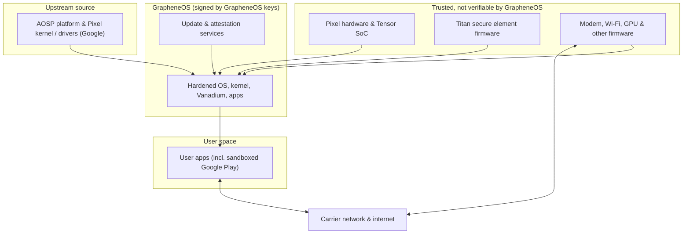

# GrapheneOS Security Assessment — Stage 1

> **Classification:** Client confidential (TLP:AMBER)
> **Version:** 0.1 draft · **Date:** 2026-11-24 · **Author:** Raj · **Reviewer:** _TBD_
>
> **Limitations:** This is a desk-based assessment. It draws on public
> documentation, prior research and analyst knowledge. No hands-on testing, code
> audit or reverse engineering was done in Stage 1. Facts are current as of the
> date above; GrapheneOS and Google change quickly.
>
> **Confidence tags:** **[D]** Primary — first-party statement by the vendor or
> project concerned, CISA KEV, NVD, or the original research publication ·
> **[S]** Secondary — press or third-party coverage only · **[O]** Observed —
> first-hand testing (none in Stage 1) · **[A]** Assessed — analyst judgement
> or inference; key assumptions are listed in Appendix A. Full definitions in
> §1.4.

---

## 0. Executive Summary

Claims in this summary are tagged in the sections referenced.

**Verdict.** GrapheneOS on a supported Google Pixel is one of the most
technically secure phone platforms available today. It is a strong fit for
**high-risk individuals** (executives, journalists, activists) facing commercial
spyware and forensic extraction. It can serve a **managed fleet**, but only with
compensating controls, because it offers no fleet console, no vendor support and
little visibility into compromise. **No profile is proof against a determined
nation-state**: the modem and firmware below the OS remain trusted and closed.

**Top strengths**
- **Exploit mitigation well beyond stock Android:** a hardened memory allocator,
  hardware memory tagging on by default, per-app randomization and kernel
  hardening make software bugs much harder to exploit. (§6)
- **Strong physical and forensic resistance:** auto-reboot returns devices to
  their encrypted "before first unlock" state, USB data is blocked while locked,
  a duress PIN wipes the device, and the secure element limits PIN guessing.
  Leaked forensic-vendor material supports this for Pixel 6–9 (§8.7). (§4, §8)
- **Persistence resistance:** verified boot and rollback protection stop an
  implant surviving a reboot by modifying the OS, so auto-reboot also limits
  how long a memory-resident implant lasts. (§4, §9.7)
- **Privacy controls and no built-in Google services:** per-app network and
  sensor permissions, scoped storage and contacts, and Google Play only as an
  optional, unprivileged app. (§7)
- **Well-designed updates:** signed, rollback-protected, installed even before
  first unlock, with frequent releases. (§9.1)

**Top areas to examine first** (§11)
1. **Dependence on Google** for hardware, firmware, patches and source code.
2. **GPU and accelerator drivers:** Mali exploited in the wild; a published MTE bypass via GPU memory.
3. **Baseband (modem):** now with an in-the-wild Pixel modem exploit (CVE-2026-58704).
4. **Trust in a small team:** 6–10 developers, no published key custody or succession plan.
5. **Messaging and media parsers:** the main 0-click entry point for spyware.
6. **Detection and incident response:** compromise may go unseen.

**Decision constraints**
- **No certification:** no Common Criteria, FIPS or government accreditation (§3.3; A12).
- **Limited fleet control:** a fleet cannot enforce or fully verify device-wide
  settings and has no device-wide remote wipe (§10.2).
- **Legal exposure:** using a duress PIN during a lawful search can expose a
  user to prosecution in some jurisdictions (§8.8).
- **Credible alternatives:** stock Pixel with Advanced Protection, and iOS with
  Lockdown Mode (§13).
- **Not solved by GrapheneOS:** app or account compromise, phishing, carrier
  metadata, and code running inside a compromised messenger.

**Device recommendation** (§5.3): Pixel 10a for all profiles; Pixel 10
(non-Pro) where more performance is needed. Avoid Pro models for high-risk
users, foldables and new Pixel 8 purchases. Pixel 11 is not yet supported
(§5.2.9).

**Recommended next step.** A **Tier 1 Stage 2 engagement of about 20–34 analyst
days** (§14.2) covering patch-lag analysis, governance and signing-key custody,
incident-response design, MDM fit, an attack-surface review of messaging/media
parsers, and (for Profile B) a duress-PIN legal review. This answers "can we
trust and operate this?" before committing to deeper technical research on the
modem and GPU.

**Open questions for the client** are listed in §14.4. The main ones: which user
groups are in scope, whether certified products are required, and which MDM and
mandatory apps must work.

## 1. Scope, Method & Confidence

### 1.1 Purpose and Audience

A first, desk-based view of GrapheneOS for a client considering it as the basis
of a secure phone: what it protects, how, where it is weak, and which areas
deserve a deeper review first (§11). Written for security leadership and
technical reviewers.

### 1.2 Device Scope

Pixel 8 series to the newest Pixel (Pixel 11 series). The Pixel 8 is the floor
because it is the first generation with hardware memory tagging (MTE) and a
7-year support commitment. Pixel 6 and 7 are still supported by GrapheneOS but
are out of scope; Pixel 6/6 Pro are on legacy extended support and should be
replaced. A non-Pixel device (Motorola Signature 27) has been confirmed but is
not yet available (§4.7).

### 1.3 Method

Review of GrapheneOS documentation, Google and press sources, published
security research and leaked forensic-vendor material, plus analyst
knowledge. Fast-moving facts were checked on 2026-11-23/24.

### 1.4 Confidence Labels

| Tag | Meaning |
| --- | --- |
| **[D] Primary** | First-party statement by the vendor or project concerned (GrapheneOS, including developer posts on its forum, X or Mastodon, marked "project statement" where useful; Google, including security bulletins, store spec pages, security blogs, Project Zero and GTIG; Arm; Imagination; MediaTek; Apple; Samsung; Motorola), CISA KEV, NVD, or the original research publication (peer-reviewed paper, conference talk, or NGO technical report such as Amnesty Security Lab or Citizen Lab) |
| **[S] Secondary** | Press or third-party coverage only |
| **[O] Observed** | First-hand testing (none in Stage 1) |
| **[A] Assessed** | Analyst judgement or inference. Assumptions that could change a conclusion are also listed in Appendix A and cited by ID, written "[A] (A05)" |

- **Absence claims** are written "[A] (absence — searched <what>, 2026-11)":
  not finding something is an inference, not proof.
- **Assessment notes** (quoted blocks headed "Assessment note") are [A] unless
  a statement inside them is tagged otherwise.

Descriptive sections (§3–§10) are mostly Primary. §5.3, §11, §12, §13 and
§14 are analyst assessments.

### 1.5 Out of Scope for Stage 1

Hands-on testing, source-code audit, reverse engineering, forensic extraction
tests, and client-specific app or MDM testing. These are proposed as Stage 2
work packages (§14).

### 1.6 Assumptions

Every assumption that could change a conclusion is listed in Appendix A with
its impact and how to confirm it. The open questions for the client are in §14.4.

---

## 2. Reference Profiles

The client could not be consulted, so the document is written against three
reference profiles that cover the realistic personas, threat tiers and
deployment models. Persona-to-tier assignments are analyst judgement [A] (A10).

### 2.1 Profiles used throughout the document
- **A — Baseline:** privacy-conscious individual; opportunistic theft and
  commercial forensics (T1–T2)
- **B — High-risk:** executive/VIP, journalist, activist; targeted spyware and
  nation-state (T3–T4); coercion and border seizure
- **C — Managed fleet:** security/IT staff and field staff on organization-owned
  or BYOD devices; loss, coercion, credential theft (T1–T2; users facing T3,
  such as privileged admins, get C+B)
### 2.2 How a profile is chosen (two questions, applied in order)
1. **Threat tier sets the hardening level:** highest credible tier T1–T2 → A
   controls; T3–T4 → B controls.
2. **Ownership sets the management model:** organization-managed (fleet or
   BYOD) → C. If the user also faces T3–T4, apply B controls inside C, written
   **C+B**.
- BYOD at T3–T4 is **not recommended**: a work profile cannot enforce
  device-wide controls (auto-reboot, USB-C mode, no Play, duress PIN), so issue
  a dedicated device instead.

### 2.3 Persona summary (full definitions in Appendix B)

| Persona                               | Main assets                                         | Likely adversaries                                       | Highest credible tier  | Default profile               |
| ------------------------------------- | --------------------------------------------------- | -------------------------------------------------------- | ---------------------- | ----------------------------- |
| P1 Executive / VIP                    | Deal data, board communications, contacts, location | Competitors, commercial spyware customers, states        | T3 (T4 for some roles) | B, or C+B on a fleet          |
| P2 Journalist / activist / high-risk  | Sources, unpublished material, contacts, location   | Commercial spyware customers, states, border agents      | T4                     | B                             |
| P3 Security / IT staff                | Admin credentials, MFA tokens, internal access      | Criminal groups, access brokers, states via supply chain | T2 (T3 for privileged admins) | C (C+B for privileged admins) |
| P4 Field / operational staff          | Operational data, location, organization access     | Thieves, local authorities, coercion                     | T2                     | C                             |
| P5 Privacy-conscious individual       | Personal data, accounts, location history           | Thieves, data brokers, ad tracking                       | T1–T2                  | A                             |

### 2.4 Persona × deployment model → profile

| Persona | D1 Individually owned | D2 Organization-owned fleet | D3 BYOD with work profile         | D4 Minimal / comms-only |
| ------- | --------------------- | --------------------------- | --------------------------------- | ----------------------- |
| P1      | B                     | C+B                         | Not recommended → issue D2 device | B                       |
| P2      | B                     | C+B (newsroom / NGO fleet)  | Not recommended → issue D2 device | B                       |
| P3      | A (privileged admins: not recommended → issue D2 device) | C (C+B for privileged admins) | C (privileged admins: not recommended → issue D2 device) | n/a                     |
| P4      | A                     | C                           | C                                 | C (stripped-down)       |
| P5      | A                     | n/a                         | A plus work profile               | A                       |

### 2.5 Threat tier coverage by profile (what each profile is designed to resist)

| Tier                               | A Baseline | B High-risk | C Managed fleet | C+B      |
| ---------------------------------- | ---------- | ----------- | --------------- | -------- |
| T1 Opportunistic theft / loss      | Yes        | Yes         | Yes             | Yes      |
| T2 Commercial forensic extraction  | Partial¹   | Yes         | Partial²        | Yes      |
| T3 Commercial spyware (1-/0-click) | Partial³   | Strong⁴     | Partial³        | Strong⁴  |
| T4 Nation-state                    | No         | Partial⁵    | No              | Partial⁵ |

"Yes" means the profile is designed to defeat the tier; "Strong" means it
raises the cost substantially but cannot be relied on to defeat it.

¹ The default 18-hour auto-reboot leaves a long after-first-unlock window in
which a seized, unlocked-since-boot device is more exposed.
² The organization cannot enforce or verify device-wide settings set by the
user (auto-reboot, USB-C mode, duress PIN; §10.2); fleets also tend to need sandboxed
Google Play for work apps.
³ Exploit mitigations apply in every profile, but A and C keep more attack
surface (Play services, more apps, more radios on).
⁴ B's hardening (fewer apps, no Play, radios off, short auto-reboot) cuts
attack surface sharply, but well-resourced spyware vendors can still find
working chains.
⁵ No profile fully addresses T4: baseband, firmware and supply-chain attacks sit
below the OS. B raises the cost; it does not remove the risk.

### 2.6 Residual risk with Profile B applied

What remains for a high-risk user even with all Profile B controls (§12.4) in
place. [A]

| Tier / area | Residual risk |
| --- | --- |
| T1 Opportunistic theft / loss | Negligible |
| T2 Commercial forensic extraction | After-first-unlock window up to the auto-reboot timer (1 h); vendor counter-measures to auto-reboot (§8.2) |
| T3 Commercial spyware | Browser/WebView, messaging/media parser and driver 0-day chains remain possible; their cost is raised, not removed |
| T4 Nation-state | Baseband and firmware attacks (now including an exploited Pixel modem bug, §4.5), supply-chain and signing-key compromise |
| Operational | Settings drift, no remote wipe, app or account compromise |

---

## 3. GrapheneOS Overview

GrapheneOS is a security-hardened mobile operating system based on the Android
Open Source Project (AOSP). It runs Android apps, but changes large parts of the
operating system underneath them to make exploitation and data extraction harder.
It is developed by a small non-profit team and currently runs only on Google Pixel
phones, with a first Motorola device confirmed.

### 3.1 Project Background, Governance, Funding and Infrastructure

**History**

| Period | Event | Tag |
| --- | --- | --- |
| Late 2014 | Founded by Daniel Micay as a solo hardening project | [D] |
| 2015–2018 | Known as **CopperheadOS** while a company sponsored it; split in 2018 in a contested dispute (the project's account is one-sided and unverified) | [D] (one-sided) |
| 2018–2019 | Renamed AndroidHardening, then **GrapheneOS** (2019 for the name is not dated on the site) | [D] / [A] |
| March 2023 | **GrapheneOS Foundation** created as a Canadian non-profit | [D] |
| November 2025 | Left France and the hosting provider OVH, citing French pressure on encryption and device access | [D] |
| March 2026 | Partnership with **Motorola** announced at MWC for an unnamed future device | [S] |
| September 2026 | Motorola Signature 27 unveiled; GrapheneOS confirmed it as the first non-Pixel device (project statement). Retail and GrapheneOS availability dates not confirmed [A] (A07) | [D] |

**Governance and team**

- The GrapheneOS Foundation is a **Canadian non-profit, not a registered
  charity**, based in Toronto. [D]
- The project describes "multiple full-time and part-time developers" plus
  companies that collaborate with it. [D] The core team is **6–10 full-time
  developers** (project statements on its forum; figures vary over time). [D]
- Public documentation does not describe a formal governance structure: no board
  composition, decision process or succession plan. [A]
- The founder has historically been the public face of the project. Whether he
  still leads it day to day, and how key decisions are made, is not documented
  on the official site. [A]
- **Vulnerability handling:** no published bug bounty, formal vulnerability
  disclosure policy or independent security audit found. [A] (absence —
  searched grapheneos.org and the project forum, 2026-11) A question for
  Stage 2.

**Funding**

- Mostly **donations** (bank transfer, PayPal, cryptocurrency). The FAQ states it
  is "entirely funded by donations" and will remain a non-profit. [D]
- Company collaborations exist. Motorola contributes engineering time to port
  GrapheneOS to its devices but does **not** fund the project. [S]
- There is **no commercial support offering or service-level agreement**. [D]

**Infrastructure and jurisdiction**

- After leaving OVH in November 2025, update mirrors run on **sponsored servers**
  (US; London as a temporary location). DNS runs on anycast networks with Vultr
  and BuyVM. Email, Matrix, the forum, Mastodon and the **attestation service**
  were moving to Netcup (Germany) short term and **colocated servers in Toronto**
  long term. [D] Whether that move is complete is unverified. [A] (A05)
- Updates are verified by signature with downgrade protection at three layers
  (System Updater, update_engine, verified boot), and the project states that "the
  update server isn't a trusted party". **A compromised or seized mirror could
  delay updates, but could not push malicious ones** unless the signing keys were
  also compromised. [D]
- **Legal compulsion.** The project and its signing keys sit under Canadian
  jurisdiction. Because updates targeted at a single device are rejected
  (§9.1) [D], a compelled malicious update would have to ship to every device,
  which makes it far more likely to be noticed, especially by anyone checking
  reproducible builds. [A]

> **Assessment note — why this matters to the client**
> - **Concentration risk.** A team of 6–10, funded by donations, with no
>   published governance or succession plan, maintains an OS the client may build
>   a security programme on. Signing-key custody sits with this team (§9.2).
> - **No commercial recourse.** No support contract, SLA or indemnity. An
>   organization would carry the operational risk itself.
> - **Jurisdiction.** The legal entity and long-term infrastructure are in
>   Canada. The 2025 move shows the project will relocate under legal pressure;
>   it also shows service availability can be disrupted.
> - **Public disputes.** The project has been in public conflict, notably the
>   CopperheadOS split. This is a reputational factor for an organization
>   adopting it, not a technical flaw.
>
> Feeds §11 area #4 (Supply chain, governance & vulnerability handling) and
> #1 (Upstream dependency on Google).

### 3.2 Design Philosophy

- **Security first, then privacy.** GrapheneOS treats strong exploit
  mitigation and sandboxing as the foundation; privacy features are built on top
  of that, not in place of it. [D]
- **Harden AOSP, don't replace it.** It keeps the Android security model (app
  sandbox, verified boot, permission system) and makes it stronger: hardened
  memory allocator, hardware memory tagging, stricter app sandbox, extra
  permissions and reduced attack surface (§6, §7). [D]
- **Hardware requirements are non-negotiable.** Devices must offer, among other
  things, hardware memory tagging (ARM MTE or equivalent), a secure element with
  StrongBox and Weaver, verified boot with user-installed keys, and long-term
  firmware updates. This is why only Pixels qualify today (§4.1, §5; Pixel 11
  status: §5.2.9). [D]
- **No Google apps or services by default.** Like AOSP, GrapheneOS ships without
  them and says they will never be bundled. Users who need them can install Google
  Play as ordinary sandboxed apps with no special privileges (§7.4). [D]
- **No root access.** GrapheneOS does not provide a way to run apps as root,
  because it would break the verified boot and sandbox guarantees the design
  depends on. Users who want root must make their own unsupported builds. [D]
  (project statements on its forum)
- **App compatibility is preserved where possible.** Hardening that breaks apps is
  offered as per-app toggles rather than removed, which creates opt-outs worth
  examining (§6.7, §11). [D]

### 3.3 What GrapheneOS Is Not

| Common assumption | Reality | Tag |
| --- | --- | --- |
| A "de-Googled privacy ROM" like /e/OS or CalyxOS | It is a hardening project first; privacy follows from sandboxing. It also allows sandboxed Google Play, which pure de-Googled ROMs don't | [D] |
| Runs on many devices, like LineageOS | Runs only on devices that meet its hardware requirements: currently Pixel 6 and newer (Pixel 6/6 Pro on legacy extended support); the Motorola Signature 27 is confirmed as the first non-Pixel device (project statement), with no availability date yet | [D] |
| Can be rooted or customized freely | No root access (root would break verified boot and the security model; users who want it must make unsupported custom builds); the bootloader is re-locked with GrapheneOS keys after install | [D] (project statements) |
| An anonymity tool | It does not hide your identity from the mobile network, carrier or the services you sign into. Anonymity needs separate measures (e.g. Tor, careful account use) | [A] |
| A certified or accredited product | No Common Criteria, FIPS 140 or government accreditation found. The FAQ discusses external review, not certification. Stock Pixels' certifications do not carry over (§13) | [A] (absence — searched grapheneos.org and public certification listings, 2026-11) |
| An enterprise product with vendor support | No commercial support, SLA, fleet console or management service. It supports Android Enterprise work profiles via standard MDM (§10) | [D] / [A] |
| Independent of Google | It depends on Google for hardware, firmware, security patches and AOSP source releases (§4, §9.3) | [D] |

> **Assessment note.** For regulated clients, the lack of certification may rule
> GrapheneOS out for some uses regardless of its technical strength. Confirm the
> client's compliance needs (assumption A12).

### 3.4 Release Channels and Versioning

**Channels**

| Channel | Purpose | Tag |
| --- | --- | --- |
| **Alpha** | First public push, after developer testing | [D] |
| **Beta** | Pushed shortly after Alpha. Releases with problems are aborted and replaced by a new Beta release | [D] |
| **Stable** | Promoted after users on Beta have tested it. The project advises Stable for anyone who "cannot tolerate dealing with temporary issues" | [D] |
| **Legacy extended support** | Stopgap releases for end-of-life devices (currently Pixel 6 and 6 Pro). Patch level is frozen; the project advises these are a last resort | [D] |

**Versioning and cadence**

- Builds are numbered as 10-digit values such as **2026111800** (latest as of
  2026-11-24). This release moved Pixel firmware, drivers, HALs and kernels
  (6.18 base) to Android 17 QPR2, which Google released for Pixels on
  2026-11-10, with the 2026-11-05 security patch level. [D] The number reads as date (YYYYMMDD) plus a two-digit counter; the site
  does not define the format. [D] / [A]
- Releases are frequent: about two dozen between early July and 18 November 2026,
  roughly one a week. [A] (count of changelog entries)

Update delivery and its security properties: §9.1.

> **Assessment note.** For an organization, the main gaps are that a fleet
> cannot pin or defer a version (run a few devices on Beta as early warning),
> and that patch timing depends on Google's release schedule (§9.3, §11
> area #1).

---

## 4. Platform Foundations & Trust Model

GrapheneOS's security rests on hardware it does not control. This section sets
out what it relies on, what it verifies, and what it has to trust blindly.

### 4.1 Why Pixel Only: Hardware Requirements

GrapheneOS publishes a list of requirements a device must meet before it is
supported. [D] The ones that matter most:

| Requirement | Why it matters | Pixels meeting it |
| --- | --- | --- |
| Hardware memory tagging (ARM MTE or equivalent) | Catches many memory-corruption bugs at the point they occur (§6.3) | Pixel 8 to 10a (FAQ); Pixel 11 pending (§5.2.9) |
| Secure element with **StrongBox** keystore | Keys live in a separate tamper-resistant chip, not the main processor | All in-scope Pixels (Titan M2; Titan M3 on Pixel 11) |
| **Weaver** in the secure element | Rate-limits unlock attempts in hardware (§4.3) | Titan M family |
| Verified boot with **user-installed keys** and a re-lockable bootloader | Lets GrapheneOS sign the OS with its own keys and still get full verified boot | Pixels |
| Long-term firmware and driver updates | Without vendor firmware patches, OS patches alone are not enough | Pixel 8+: 7 years |
| Isolation of radios and peripherals (IOMMU) | Stops a compromised modem or Wi-Fi chip reading main memory directly | Pixels |

The IOMMU row is not on GrapheneOS's published list; the FAQ describes IOMMU
isolation of the baseband separately. [D]

Few Android OEMs meet all of these, which is why device support is narrow. The
FAQ's view is that for most devices "the hardware and firmware will prevent
providing a reasonably secure device". [D]

### 4.2 Verified Boot with Custom Keys

- During installation the bootloader is unlocked, GrapheneOS is flashed, and the
  bootloader is **re-locked with the GrapheneOS signing key enrolled** as the
  trusted key. [D]
- From then on, every boot verifies the OS against that key using Android
  Verified Boot (AVB). A modified system partition fails to boot or is
  detected. [D]
- **Rollback protection** prevents booting an older, vulnerable signed version. [D]
- Pixels show a yellow boot warning with the hash of the enrolled key at every
  boot. Users can check that hash against the published GrapheneOS value; the
  Auditor app (§9.4) verifies it cryptographically. [D] / [A]

### 4.3 Titan Secure Element

- **Weaver:** The unlock credential is combined with a secret held by the secure
  element. The chip enforces **escalating delays between failed attempts**, so
  brute-forcing a PIN is limited by hardware, not by the OS. [D]
- **Weaver schedule** (GrapheneOS FAQ): attempts 1–4 have no delay, then 1 min,
  5, 15, 30 and 90 min, 4 h, 12 h, 36 h, 4 days, 13, 41 and 123 days, then 1, 3
  and 9 years — **only 20 attempts in total**. A random 6-digit PIN therefore
  has about a 1-in-50,000 chance of being guessed, provided the secure element
  holds. [D]
- **Insider attack resistance:** Secure element firmware can only be updated after
  the owner authenticates, so Google or a supplier cannot silently push firmware
  that weakens throttling on a locked device. [D] (Android / Pixel design)
- **StrongBox:** Hardware-backed key storage used by apps and by attestation
  (§9.4). [D]
- **Generations:** Titan M2 on Pixel 8 to 10a; **Titan M3 on Pixel 11** (Google
  store specification pages). [D] The M3 is new silicon and firmware with
  little public security research yet. [A]
- **Certification:** Google lists Titan M2 under Common Criteria (PP0084,
  TrustCB) through Pixel 10/10a; Titan M3's Common Criteria entry is listed as
  "Ongoing" (Google Pixel certifications page). [D]
- **Track record:** The secure element itself has had exploitable bugs.
  Quarkslab achieved code execution on the first-generation Titan M and leaked
  StrongBox-protected keys (CVE-2022-20233; Black Hat USA 2022, following
  "2021: A Titan M Odyssey", Black Hat EU 2021); the attack needed root or SPI
  access and did not break Weaver. [D] No public break of Titan M2 or M3 was
  found. [A] (absence — searched Titan M2/M3 vulnerability research and
  conference talks, 2026-11)
- Leaked forensic-vendor data is consistent with Weaver holding: the vendor
  reportedly cannot brute-force Pixel passcodes (§8.7). [S]

### 4.4 Storage Encryption

- **File-based encryption** for user data plus **metadata encryption** for the
  file system, both standard on modern Android. [D]
- Keys are derived from the user's lock-screen credential **and** the Weaver
  secret in the secure element, so data cannot be decrypted off-device and a weak
  PIN is protected by hardware throttling. [D]
- **Before First Unlock (BFU)**, user data is "at rest": it stays encrypted
  until the credential is entered. This is why GrapheneOS's auto-reboot feature
  (§8.2) is so effective. [D]
- GrapheneOS raises the maximum password length to 128 characters (stock: 16),
  making a strong passphrase practical. [D]

### 4.5 Baseband, Firmware and Peripheral Isolation

- The cellular modem, Wi-Fi/Bluetooth chip, GPU firmware and other components run
  **closed-source firmware** supplied by Google and its vendors (Samsung,
  MediaTek on Pixel 11, Broadcom, Imagination/Arm). GrapheneOS ships these
  unchanged; it cannot audit or fix them. [D] / [A]
- Pixels isolate these components with an **IOMMU**, so a compromised modem should
  not be able to read or write main memory directly. [D] An IOMMU stops arbitrary
  DMA, but not malicious data placed in shared buffers that the driver then
  reads — the route Project Zero used to go from Broadcom Wi-Fi firmware to the
  host (Project Zero, 2017; the same idea underlies PeriScope, NDSS 2019). [D]
  No primary Google document describing the Tensor SMMU configuration was
  found, so how tightly each component is confined is an open question.
  [A] (A16)
- GrapheneOS offers an **LTE-only mode** (disables 2G, 3G and 5G) and radios can
  be turned off individually. [D] LTE-only shrinks the radio stack but does
  **not** remove the IMS path (VoLTE / Wi-Fi calling) described below. [A]

**Recent evidence** ([D] unless tagged otherwise):

| Evidence | What it shows | Source |
| --- | --- | --- |
| **CVE-2026-58704**, Pixel modem elevation of privilege (logic error, permission bypass); fixed in patch level 2026-09-05; CISA KEV 2026-09-16 | The first Pixel-specific baseband bug Google has marked "under limited, targeted exploitation". Likely needs a network position (nearby or compromised cellular network) [S]. The same bulletin fixed a Critical modem RCE (CVE-2026-56967), a modem DoS (CVE-2026-55306) and a PowerVR info leak (CVE-2026-58731) | Pixel Update Bulletin, Sept 2026; CISA KEV; Kaspersky / 9to5Google [S] |
| Project Zero Exynos disclosure: 18 bugs, 4 of them internet-to-baseband RCE via **IMS (VoLTE / Wi-Fi calling)** needing only the phone number | Pre-auth remote reach without radio proximity; interim mitigation was turning off Wi-Fi calling and VoLTE — so LTE-only alone is not enough | Project Zero, Mar 2023 |
| Google red team modem RCE through the 2G stack (CVE-2022-20170) | Supports disabling 2G | Black Hat USA 2023 (Karimi et al.) |
| Compiler hardening of the Exynos baseband (BoundSan, IntSan) since Dec 2023; Pixel 9 described as the "most hardened" baseband (stack canaries, auto-initialisation) | Google is hardening the Samsung modem; no equivalent statement for the MediaTek M90 on Pixel 11 [A] (absence — searched Google and MediaTek security blogs, 2026-11) | Google Security Blog, Dec 2023 and Oct 2024 |
| 5G pre-authentication message injection without a fake base station (SNI5GECT); 5GBaseChecker found pre-auth flaws in commercial 5G basebands | Disabling 2G does not make pre-auth parsing unreachable | USENIX Security 2025; USENIX Security 2024 |

For a survey of the field see Carnot & Francillon, "SoK: Insecurity of
Cellular Basebands" (USENIX WOOT 2026). [D]

**Residual risk:** The modem is the largest closed attack surface left on the
device, a known nation-state target, and now has an exploited Pixel bug. It is
§11 area #3 (Baseband and IMS). [A]

### 4.6 Trust Boundaries

Reading the diagram: everything in the top box has to be trusted as delivered by
Google and its suppliers. GrapheneOS's protections start at the OS layer.
Verified boot proves the OS is the one GrapheneOS signed; it says nothing about
the firmware beneath it.

### 4.7 Motorola Partnership

- At MWC in March 2026 Motorola and GrapheneOS announced a partnership for an
  unnamed future device. [S] In September 2026 Motorola unveiled the **Signature
  27** (Qualcomm Snapdragon), which GrapheneOS confirmed as its first non-Pixel
  device. [D] (project statement)
- Reported details — MTE, a secure element, 7-year support, Motorola engineers
  for porting and maintenance but no project funding, 2027 Razr foldables
  next — come from press coverage. [S]
- Retail date and when GrapheneOS will be available on the Signature 27 are
  **not confirmed**. [A] (A07)
- **Implications:** A second hardware vendor would reduce single-vendor dependence
  on Google, and Qualcomm's modem, GPU (Adreno) and secure element are a
  different attack surface from Tensor's. It also adds a second firmware supply
  chain to trust and splits a small team's attention. [A]

### 4.8 Attack-Surface Map

Typical Android spyware chains combine an entry bug (browser renderer,
messaging/media parser, or baseband) with a sandbox escape and a kernel or
GPU/accelerator driver bug (GTIG 2025 zero-day review; §11). [D] The map below
is an analyst summary [A]; the controls are documented in the sections cited.

| Surface | Reachable when | GrapheneOS-specific control | Residual risk | §11 area |
| --- | --- | --- | --- | --- |
| Browser (Vanadium) | Unlocked; remote (link, ad, network injection) | JIT off by default, strict site isolation, reduced web APIs (§6.6) | Renderer 0-days in non-JIT code; patch latency unmeasured | 8 Browser/WebView |
| WebView in apps | Unlocked; remote via app content | Vanadium WebView; per-app JIT toggle (§6.6) | JIT on by default; no site isolation | 8 Browser/WebView |
| Messaging apps and media/image parsers | All states once the app runs (incl. AFU-locked); remote 0-click | hardened_malloc / MTE in app processes; profile isolation; Network permission (§6, §7) | Parser bugs inside the app's own process; untested against 2025 chains | 5 Messaging & media parsers |
| Cellular radio (2G/LTE/5G pre-auth) | BFU, AFU and unlocked (radio on); nearby or network attacker | LTE-only mode, 2G off, airplane mode (§4.5, §7.7) | Closed firmware; exploited Pixel modem bug (CVE-2026-58704); 5G/LTE pre-auth parsing | 3 Baseband & IMS |
| IMS (VoLTE / Wi-Fi calling) and SMS/MMS/RCS | BFU, AFU and unlocked; remote with the phone number | VoLTE and Wi-Fi calling toggles (§7.7) | Internet-to-baseband RCE class; LTE-only does not remove it | 3 Baseband & IMS |
| Wi-Fi | When enabled, all states; nearby | Toggle; auto-off timer; MAC randomisation (§7.7) | Closed Wi-Fi firmware; shared-buffer path past the IOMMU | 13 Proximity radios |
| Bluetooth | When enabled, all states; nearby | Toggle; auto-off timer (§7.7) | Closed firmware and host stack bugs | 13 Proximity radios |
| NFC | When enabled; very close range | Toggle (§7.7) | Closed firmware; small but pre-auth | 13 Proximity radios |
| USB-C | Physical access, BFU and AFU-locked | USB-C port control, charging-only when locked by default (§8.3) | Unlocked-state and charging-path bugs | 12 Forensic claims |
| GPU and accelerator drivers (Mali, PowerVR, Tensor VPU) | From any compromised app or renderer | MTE on kernel allocators (§6.3); none specific to GPU page tables | GPU page-table bugs bypass MTE; accelerator drivers new and unstudied (§5.2.1) | 2 GPU & accelerator drivers |
| Sandboxed Play layer | When installed, as an ordinary app | No privileged Google access (§7.4) | Compromise limited to its profile; dependency on Google code | 10 Sandboxed Play layer |
| App stores / sideloading | User or admin action | Per-app permissions; GrapheneOS App Store (§7.9) | Malicious or compromised apps | 9 App sourcing |
| Update channel | Periodic, remote | Signed updates, verified boot, rollback protection (§4.2, §9.1) | Signing-key or build compromise | 4 Supply chain & governance |
| Secure element | Physical access; or root on the main OS | Weaver throttling; insider attack resistance (§4.3) | Titan bugs (Quarkslab, first-gen Titan M); M3 unstudied | 12 Forensic claims; 11 Pixel 11 components |

> **Assessment note.** GrapheneOS can only be as strong as the hardware and
> firmware under it. The client's deeper review should focus on what sits below
> the OS: GPU and accelerator drivers (§11 #2), modem firmware and IMS (#3) and
> the new Pixel 11 components (#11).

---

## 5. Device Generation Analysis (Pixel 8 → Latest)

### 5.1 Device Matrix

Status as of 2026-11-24. † = press reports only (Secondary).

| Device | SoC | Modem | GPU | Secure element | Fingerprint | Released | Support end | GrapheneOS |
| --- | --- | --- | --- | --- | --- | --- | --- | --- |
| Pixel 8 / 8 Pro | Tensor G3 | Exynos 5300 | Mali | Titan M2 | Optical | Oct 2023 | Oct 2030 | Supported |
| Pixel 8a | Tensor G3 | Exynos 5300 | Mali | Titan M2 | Optical | May 2024 | May 2031 | Supported |
| Pixel 9 / 9 Pro / 9 Pro XL | Tensor G4 | Exynos 5400 | Mali | Titan M2 | Ultrasonic | Aug 2024 (9 Pro: Sep 2024) | Aug 2031 | Supported |
| Pixel 9 Pro Fold | Tensor G4 | Exynos 5400 | Mali | Titan M2 | Side capacitive | Sep 2024 | Aug 2031 | Supported |
| Pixel 9a | Tensor G4 | Exynos 5300 | Mali | Titan M2 | Optical | Apr 2025 | Apr 2032 | Supported |
| Pixel 10 / 10 Pro / 10 Pro XL | Tensor G5 | Exynos 5400 | PowerVR DXT† | Titan M2 | Ultrasonic | Aug 2025 | Aug 2032 | Supported |
| Pixel 10 Pro Fold | Tensor G5 | Exynos 5400 | PowerVR† | Titan M2 | Side capacitive | Oct 2025 | Oct 2032 | Supported |
| Pixel 10a | Tensor G4 | Exynos 5400 | Mali | Titan M2 | Optical† | Mar 2026 | Mar 2033 | Supported |
| Pixel 11 / 11 Pro / 11 Pro XL | Tensor G6 | MediaTek M90† | PowerVR C-Series† | Titan M3 | Ultrasonic† | Aug 2026 | Aug 2033 | **Not yet** |
| Pixel 11 Pro Fold | Tensor G6 | MediaTek M90† | PowerVR† | Titan M3 | Side capacitive† | Aug 2026 | Aug 2033 | **Not yet** |

Support end dates for Pixel 8–10a are from the GrapheneOS FAQ ("OEM minimum
support end"); GrapheneOS updates typically end shortly after. [D] The two
foldables follow different rules: the Pixel 9 Pro Fold's end date (Aug 2031)
matches the Pixel 9 series launch rather than its own Sep 2024 release, while
the Pixel 10 Pro Fold's (Oct 2032) runs from its own release. [D] (dates) / [A]
(interpretation)

The Pixel 11 series was announced on 2026-08-12 and went on sale on
2026-08-20; Titan M3 and 7-year support (to Aug 2033) are on Google's store
specification pages. [D] The Pixel 10a's Titan M2 is on Google's specification
page [D]; its optical fingerprint sensor type comes from reviews. [S]

### 5.2 Security-Relevant Differences

**5.2.1 GPU and accelerator drivers.** The GPU kernel driver is one of the
most-exploited Android attack surfaces, and Tensor's newer media accelerators
are joining it.

| Driver | Evidence | Source |
| --- | --- | --- |
| **Mali** (Tensor G3 and G4, including Pixel 10a) | Repeated in-the-wild exploitation by commercial spyware: CVE-2021-39793 (Pixel 6), CVE-2022-22706, CVE-2023-4211, CVE-2023-26083, CVE-2024-4610 (Intellexa), and the Mali user-space bug CVE-2025-6558 [D] | Pixel Update Bulletin, Mar 2022; Arm advisories; GTIG 2025 zero-day review |
| Mali — MTE bypass | **CVE-2025-0072**: a Mali use-after-free gave kernel code execution on a Pixel 8 with kernel MTE on, because **MTE does not cover memory the GPU reaches through its own page tables** [D] | GitHub Security Lab, May 2025 |
| Mali — exploitation technique | PhantomMap: Mali GPU page-table handling turns ordinary kernel heap bugs into physical-memory read/write [D] | NDSS 2026 |
| Mali — hardening | Google and Arm restricted Mali ioctls with SELinux (Dec 2025); a 2024 joint review found bugs in Pixel-specific driver code (CVE-2023-48409, CVE-2023-48421) [D] | Google blogs, Sept 2024 and Dec 2025 |
| **PowerVR** (Tensor G5 and G6) | A steady stream of driver (DDK) CVEs 2024–2026, e.g. CVE-2024-43702, CVE-2025-25178/-25179/-25180, CVE-2025-46707 [D]. No equivalent published hardening and no public in-the-wild exploitation found [A] (absence — searched Imagination advisories, CISA KEV and GTIG reports, 2026-11). Little research is not evidence of robustness [A] | Imagination GPU driver vulnerability page |
| **Tensor G5 video accelerator** (`/dev/vpu`) | Project Zero's Pixel 10 0-click chain went from a Dolby audio decoder bug (CVE-2025-54957) into the new VPU driver, which could map arbitrary physical memory [D] | Project Zero, May 2026 |
| Tensor G4 BigWave driver | Pixel 9 chain: Dolby decoder → BigWave driver; the Dolby fix took 82 days to reach Pixels; stock MTE was on only under Advanced Protection; Pixel kernel ASLR was ineffective (§6.5) [D] | Project Zero, Jan 2026 |
| **Adreno** (Qualcomm; relevant to Motorola, §4.7) | GPU features give physical-memory read/write that bypasses CFI and W^X [D] | Google Android Red Team, Black Hat USA 2024 |

The pattern is consistent: GPU and accelerator drivers give attackers direct
physical-memory primitives that sit outside the software mitigations in §6.
[A] This is §11 area #2.

**5.2.2 Modem.** Detail and evidence are in §4.5.
- Exynos 5300 (Pixel 8, 8a, 9a) and 5400 (Pixel 9, 10, 10a) are Samsung modems
  with a public vulnerability record, including Project Zero's 2023 IMS
  findings and the exploited CVE-2026-58704 (§4.5). [D]
- The 5400 adds **satellite messaging / SOS**, a new radio path. [S]
- **Pixel 11 switches to MediaTek** — the first change of modem vendor in the
  Tensor era. [S] MediaTek basebands are well researched by attackers too:
  FirmWire emulates them for fuzzing (NDSS 2022), BaseBridge showed MediaTek
  baseband RCE without an ASLR bypass (OffensiveCon 2025), and MediaTek's
  February 2025 bulletin fixed a rogue-base-station RCE (CVE-2025-20634). [D]
  The M90 should not be treated as a less-studied target. [A]

**5.2.3 Secure element.** Titan M2 throughout, until the **Titan M3** on Pixel
11 [D]; see §4.3 for track record and certification status.

**5.2.4 Memory tagging (MTE).** All supported devices have MTE, and GrapheneOS
uses it by default for the base OS and known-compatible apps. [D] Pixel 11's
MTE was disabled in launch firmware and enabled with Android 17 QPR2;
GrapheneOS calls its support a bare minimum and is still evaluating it
(§5.2.9). [D]

**5.2.5 Fingerprint.** Optical (8, 8a, 9a, 10a), ultrasonic (9, 10, 11 non-Fold),
side capacitive (Folds). Spoofing resistance differs by type, but GrapheneOS
caps fingerprint attempts at **5** (stock: 20) and offers fingerprint + PIN
two-factor unlock, which removes most of the risk. [D] / [A]

**5.2.6 Radios.** Pro models add UWB, and newer models add satellite. Each radio
is extra attack surface; most can be disabled. [A] This is one reason §5.3
recommends against Pro models for high-risk users.

**5.2.7 Support window remaining.** From today: Pixel 8 ≈ 4 years left; Pixel 10a
≈ 6.3 years; Pixel 10 Pro Fold ≈ 6 years. For procurement, newer = longer
lifetime value. [D]

**5.2.8 Foldables.** Two displays, hinge sensors and more drivers mean a larger
attack surface for no security benefit. [A]

**5.2.9 Time to GrapheneOS support.** New Pixels have not had day-one support:
- **Pixel 10:** delayed because Google published Android 16 QPR1 to AOSP only
  on 2025-11-11 and stopped publishing Pixel device trees. Experimental support
  followed in late November 2025; stable support came in release 2026011000.
  [D] (project statements)
- **Pixel 11:** released in August 2026 and **not yet supported**. [D]
  - In August 2026 GrapheneOS said the Pixel 11 might be skipped; at the time
    MTE was not enabled in its firmware. [D] (project statement)
  - Tensor G6 has hardware MTE. It was disabled in launch firmware and enabled
    in Android 17 QPR2, released to Pixels on 2026-11-10. GrapheneOS describes
    this as "at least bare minimum support for MTE at a hardware level" and is
    still evaluating performance and coverage. [D] Whether that support is
    adequate is open. [A] (A17)
  - GrapheneOS release 2026111800 moved Pixel firmware, drivers, HALs and
    kernels (6.18 base) to QPR2, but Pixel 11 support **is waiting for Google
    to publish the QPR2 platform source to AOSP**, which GrapheneOS says Google
    has delayed. [D] (project statement, Nov 2026)

This is a concrete example of the project's dependence on Google's release
schedule (§11 #1). **New Pixels should not be planned on day-one GrapheneOS
support.** [A]

### 5.3 Device Recommendation by Profile

This is an analyst assessment [A].

| Profile | Recommended | Alternative | Avoid |
| --- | --- | --- | --- |
| **A Baseline** | Pixel 10a | Pixel 10 (non-Pro) | Foldables; Pixel 8 series for new purchases; Pixel 11 until supported and settled |
| **B High-risk** | Pixel 10a | Pixel 10 (non-Pro) | Pro models (UWB, extra radios); foldables; Pixel 8 series for new purchases; Pixel 11 until supported and settled |
| **C Managed fleet** | Pixel 10a | Pixel 10 (non-Pro) | Foldables; Pixel 8 series for new purchases; Pixel 11 until supported and settled |
| **C+B** | Pixel 10a | Pixel 10 (non-Pro) | As for B |

**Why the Pixel 10a for every profile:**
- **Same security core as the Pixel 10:** Titan M2 secure element and Exynos
  5400 modem. [D]
- **Mature GPU stack:** the Mali driver is well studied and actively hardened
  and patched, whereas the PowerVR driver in the Pixel 10 is new on Pixels and
  largely unstudied (§5.2.1).
- **No UWB:** same radio set as the Pixel 10 non-Pro (including satellite SOS),
  fewer than the Pro models. The Pixel 9a and 8a lack satellite but have
  shorter support and an older modem (§5.2.6).
- **Longest support:** March 2033, the latest end date of any supported
  device. [D]
- **Lowest cost**, which also makes a single fleet model and spares practical.

The GPU trade-off (known-exploited but well-understood and hardened Mali versus
unstudied PowerVR) is noted but is **not decisive** on its own. Choose the
**Pixel 10 (non-Pro)** where more performance is needed; it keeps the same
secure element and modem.

**Pixel 11:** Re-evaluate once GrapheneOS support ships **and** has been through
two or three monthly releases (status: §5.2.9). Its new modem, secure element
and GPU generation deserve a specific review before high-risk use (§11 #11).

---

## 6. Exploit Mitigations

GrapheneOS's main security value is making exploitation of software bugs much
harder. These protections apply in every profile.

Google reports that memory-safety bugs fell below 20% of Android
vulnerabilities in 2025, largely because new code is written in Rust (Google
blog, Nov 2025). [D] The remaining legacy C/C++ — media codecs, GPU user-space
libraries and vendor binaries — is still where in-the-wild chains start (§5.2.1,
§4.8), and it is where hardened_malloc and MTE add most value. [A]

### 6.1 hardened_malloc

GrapheneOS's own memory allocator, used across the OS. [D]
- Metadata stored **separately** from allocations, in regions with random bases.
- **Zero-on-free**, with a check on reuse that detects writes after free.
- Random **canaries** and **guard pages** around allocations and slabs.
- **Quarantines** that delay memory reuse, making use-after-free bugs harder to
  exploit.

**Independent review.** Synacktiv's review (Sept 2025) found hardened_malloc
markedly stronger than Android's default Scudo allocator, especially against
use-after-free. It noted that allocations of 128 KiB and above are not tagged
(guard pages only), and it was a qualitative review rather than a bypass study.
It is the only independent evaluation found. [D]

### 6.2 Hardened Bionic (libc)

Android's C library carries additional hardening that works with
hardened_malloc. [D] (Detail to be expanded in Stage 2.)

### 6.3 Hardware Memory Tagging (MTE)

- Used in **hardened_malloc** for allocations below 128 KiB, in the **main
  kernel allocators**, and in **Vanadium's** main allocator. [D]
- Enabled by default for the base OS and known-compatible user apps. [D] Base OS
  protections **cannot be turned off**. [D]
- hardened_malloc gives freed slots a **reserved tag** and guarantees distinct
  tags for adjacent allocations (hardened_malloc documentation). [D]
- For user apps, an **exploit-protection compatibility mode** can be toggled per
  app. It disables MTE (unless the app opted in), switches to the standard Scudo
  allocator, reduces address space from 48-bit to 39-bit, and allows ptrace. [D]
  Scudo has published exploitation techniques, one still working at
  publication (Mao et al., USENIX WOOT '24, Best Paper) [D], so the opt-out is
  a substantial loss of protection, not a slight one. [A]
- MTE crashes are always reported to the user, which turns silent memory
  corruption into a visible crash. [D]

**Limits of MTE.** MTE raises the cost of exploitation; it is not a hard
barrier. [A]

| Limit | Source |
| --- | --- |
| Tags can be leaked speculatively: TikTag recovered tags on a Pixel 8 with over 95% success in under 4 seconds, including from Chrome and the kernel | Kim et al., arXiv 2406.08719, 2024 [D] |
| Random tags are weak against a determined attacker | StickyTags, IEEE S&P 2024 [D] |
| Kernel MTE is weaker than user-space MTE (match-all tag, DMA, asynchronous checking); the 16-byte granule misses overflows within a granule | Project Zero, "MTE As Implemented", 2023 [D] |
| Memory the GPU reaches through its own page tables is not covered (CVE-2025-0072, §5.2.1) | GitHub Security Lab, 2025 [D] |

hardened_malloc's reserved freed-memory tag and distinct neighbour tags partly
follow the deterministic-tagging direction StickyTags argues for. [A] Apple's
Memory Integrity Enforcement (MIE, with Enhanced MTE; Sept 2025) was designed
against tag leakage; it goes deeper on newer Apple hardware, whereas GrapheneOS
goes broader across the OS and apps (§13). [D] / [A]

### 6.4 Exec-Based App Spawning

Stock Android starts apps by forking a pre-initialized "zygote" process, so every
app shares the same memory layout. GrapheneOS starts each app as a **fresh
process**, giving each its own randomized layout. [D] The risk is well
established: with a shared zygote layout, one address leak in any app defeats
ASLR in every app (Lee et al., "From Zygote to Morula", IEEE S&P 2014). [D]
Cost: about 200 ms slower app start and more memory. It can be turned off in
Settings, which weakens the protection. [D]

### 6.5 Kernel and Toolchain Hardening

**GrapheneOS-specific** ([D] unless noted):
- 48-bit address space and **33 bits of ASLR entropy** (stock: 24).
- Extra zeroing of kernel memory as soon as it is freed; heap canaries.
- **Forced kernel module signing** with per-build keys; kernel lockdown mode.
- **ART JIT disabled** in favour of ahead-of-time compilation; dynamic code loading
  blocked for nearly all base OS processes.

**Also present in stock Pixel builds, and listed by GrapheneOS as enabled in its
builds** [D]:
- **Type-based CFI** and **ShadowCallStack** — compiler (Clang) features.
- **PAC** (pointer authentication) and **BTI** (branch target identification) —
  ARMv8.x hardware features.

**Gaps:**
- **Kernel ASLR:** Project Zero showed that Pixel kernel ASLR is effectively
  absent (fixed linear map and fixed kernel load address), and Google treats
  this as intended (Project Zero, Nov 2025). [D] GrapheneOS's position is not
  documented — a Stage 2 question. [A] (A15)
- **Data-only kernel attacks:** Dirty Pagetable (Wu & Zhang, 2023) and
  SLUBStick (USENIX Security 2024) turn ordinary heap bugs into page-table
  control and bypass CFI, PAC and KASLR. [D] No documented GrapheneOS
  page-table protection was found. [A] (absence — searched GrapheneOS
  features page and forum, 2026-11)

### 6.6 Vanadium Browser and WebView

- **JavaScript JIT disabled by default** in the browser, with a per-site toggle. [D]
- **Strict site isolation** in the browser; type-based CFI; zero-initialized
  variables. [D]
- WebGPU, third-party cookies, payments, background sync, sensor APIs and DRM
  disabled by default. [D]
- **WebView is weaker than the browser:** JIT is **enabled by default** for user
  apps (with global and per-app toggles), and WebView **does not support site
  isolation** — all instances share one sandbox. [D]
- **What JIT-off buys:** Microsoft's Edge data put about 45% of V8 CVEs in the
  JIT (2021). [D] Google's V8 team reports that about half of V8 bugs lie
  outside the JIT, that MTE helps V8 little, and that the V8 sandbox is not yet
  a strong boundary (Groß, 2024). [D] JIT-off therefore removes a large share
  of renderer bugs, not all of them. [A]
- **Threat evidence:** Intellexa/Predator Android first stages are Chrome
  renderer bugs, delivered by one-time links, network injection and malicious
  ads (GTIG, Dec 2025; Amnesty, Predator Files, 2023). [D]
- Vanadium tracks upstream Chromium. No public data on Vanadium patch latency
  for in-the-wild Chromium 0-days exists [A] (absence — searched GrapheneOS
  releases and forum, 2026-11); this is §11 area #8.

### 6.7 Per-App Compatibility Toggles

| Toggle | What it weakens |
| --- | --- |
| Exploit-protection compatibility mode | MTE, hardened_malloc (falls back to Scudo, §6.3), address-space size; allows ptrace |
| WebView JIT (per app) | Adds JIT attack surface to that app's web content |
| Secure app spawning (global) | Reverts to zygote forking (shared memory layout) |
| Network / Sensors permissions | Privacy rather than exploit protection |

> **Assessment note.** These toggles are necessary for app compatibility, but each
> one is an opt-out the organisation cannot see. Compatibility mode in
> particular swaps hardened_malloc for an allocator with published exploitation
> techniques. An organisation should know how many of its required apps need
> compatibility mode, and should prefer apps that don't (§11 #15).

### 6.8 Coverage by Device Generation

All mitigations above apply to every supported device (Pixel 8 to 10a). The
differences are below the OS: GPU and accelerator drivers, modem and secure
element (§5.2).

---

## 7. Privacy, Network & App Model

### 7.1 Network Permission

A per-app toggle that blocks **all direct and indirect network access**,
including localhost. When it is off, "GrapheneOS pretends the network is
down". It is on by default for compatibility and can be turned off at install
time. [D]

### 7.2 Sensors Permission

Blocks access to motion and environmental sensors (accelerometer, gyroscope,
compass, barometer, etc.); blocked apps receive zeroed data. On by default; can
be set off by default for new apps. [D]

### 7.3 Storage Scopes and Contact Scopes

- **Storage Scopes:** an app is told it has the storage permission it asked for,
  but sees only its own files plus files or folders the user chooses. [D]
- **Contact Scopes:** an app gets **no contact access** by default; the user can
  grant specific contacts, groups or data types. Write access is blocked. [D]

### 7.4 Sandboxed Google Play

- Google Play services and the Play Store run as **ordinary sandboxed apps** with
  "absolutely no special access or privileges". [D]
- A **compatibility layer** lets Play work inside the standard app sandbox. [D]
- Installed **per profile**, so it can be confined to one profile (§7.5, §12.6). [D]
- Location requests are redirected to GrapheneOS's own implementation by
  default. [D]
- **eSIM:** existing eSIMs keep working. Adding or managing eSIMs needs
  proprietary Google components that are **off by default** and can be enabled in
  Settings. [D]
- **Android Auto** is supported, installed from the GrapheneOS App Store, with no
  privileged access by default. [D]

> **Assessment note.** The compatibility layer is GrapheneOS code that sits
> between Google's closed-source Play services and the OS. It is a sensible
> design, but it is an IPC surface worth reviewing (§11 #8).

### 7.5 User Profiles, Private Space and Work Profile

- Separate **user profiles** have separate encryption keys, apps and VPN
  settings; GrapheneOS adds an "End session" option to lock a profile's keys
  away again. [D]
- **Private Space** and **work profiles** are available as on Android, each with
  its own VPN configuration. [D]
- Profiles are the main tool for isolating risky apps (e.g. Google Play) from
  sensitive ones.

### 7.6 Default Outbound Connections

GrapheneOS sends these default connections to **its own servers**: [D]

| Connection | Default | Alternatives |
| --- | --- | --- |
| Connectivity checks | GrapheneOS | Google, or disabled |
| Network time | GrapheneOS | Disabled |
| Attestation key provisioning | GrapheneOS | Google |
| GNSS almanac (PSDS) | GrapheneOS proxy | Google |
| SUPL (assisted GPS) | GrapheneOS proxy | Carrier/Google server, or disabled |
| OS updates | GrapheneOS update server (sees IP address and current version only) | — |
| Vanadium component updates | GrapheneOS | — |

### 7.7 Radio and Network Controls

- **Wi-Fi MAC randomization:** always random for scanning; **a new random MAC for
  each connection** by default, with DHCP state flushed between connections.
  Android 11 and later only use stable IPv6 link-local addresses when MAC
  randomization is off, so with the default setting they are not used. [D]
- Wi-Fi and Bluetooth scanning for location are off by default. [D]
- **LTE-only mode** disables 2G, 3G and 5G, cutting cellular radio attack surface
  (legacy protocols and new 5G code) and exposure to fake base stations. It is a
  documented GrapheneOS feature. [D] Turning off 2G alone is also possible. [D]
- **Always-on VPN with "block connections without VPN"** (standard Android)
  is available per profile. [A]
- **Private DNS** (DNS-over-TLS) is available (standard Android). [A]

### 7.8 Carrier Exposure

- The carrier still sees the device's **IMSI, IMEI, cell location and metadata**
  for calls, SMS and data. GrapheneOS cannot change this. [A]
- A **SIM PIN** protects a removed SIM; PIN scrambling also applies to SIM PIN
  entry. [D]
- The duress PIN **wipes installed eSIMs** along with the device. [D]

### 7.9 App Sourcing Supply Chain

| Source | Trust model | Notes |
| --- | --- | --- |
| **GrapheneOS App Store** | GrapheneOS-signed, signature and downgrade checks | GrapheneOS apps, sandboxed Play, Android Auto, Accrescent |
| **Accrescent** | Security-focused third-party store; developer-signed apps | Recommended by GrapheneOS; small catalogue [A] |
| **Google Play (sandboxed)** | Google-reviewed; developer-signed | Largest catalogue; needs a Google account [D] |
| **F-Droid** | Builds and signs many apps itself; open-source only | GrapheneOS has publicly criticized its signing and update model [A] |
| **Direct APK / Obtainium** | Trust each developer's releases directly | Higher risk; no store-level review |

> **Assessment note.** For most users, the apps they install are a bigger risk
> than the OS. Profiles B and C should define approved apps and sources (§12.6).

### 7.10 Metadata Exposure to GrapheneOS Infrastructure

By default the update, connectivity, time, attestation and location-assist
servers see the device's **IP address and timing**, and the update server sees
the installed version. [D] This is far less than stock Android sends to Google,
but GrapheneOS becomes a party that sees which IP addresses run GrapheneOS
(§11 #15). Users in Profile B can route traffic through a VPN or switch some
services off.

---

## 8. Physical & Forensic Resistance

### 8.1 BFU vs AFU

- **BFU (Before First Unlock):** after a reboot, before the PIN is entered. User
  data keys are not in memory; data is cryptographically inaccessible without
  the PIN, which the secure element throttles. [D]
- **AFU (After First Unlock):** encryption keys stay in memory even when the
  screen is locked (GrapheneOS's "End session" feature exists to purge them).
  An attacker who can exploit the locked device can reach data. [D] / [A]
- Most forensic extraction targets AFU devices. **Getting devices back to BFU is
  the main goal** of the features below.

### 8.2 Auto-Reboot Timer

- Reboots the device if it has not been unlocked for a set time: **18 hours by
  default**, configurable from **10 minutes to 72 hours** or off. [D]
- The timer starts at each lock. It runs in `init`; if it crashes, the kernel
  panics and the device reboots anyway. [D]
- Cellebrite's Spring 2026 release reportedly advertises a "Safeguard Mode" meant
  to stop seized devices dropping back to BFU, a direct counter to this feature.
  [S] A short timer reduces the window for that.

### 8.3 USB-C Port Control

Five modes; default **"Charging-only when locked"**. [D]

| Mode | Effect |
| --- | --- |
| Off | No data or charging |
| Charging-only | Never any data |
| Charging-only when locked (**default**) | Data only while unlocked |
| Charging-only when locked, except BFU | Data also allowed before first unlock |
| On | Standard behaviour |

Blocking USB data while locked removes the main attack path forensic tools use.

### 8.4 Duress PIN / Password

A separate PIN or password that **irreversibly wipes the device and its eSIMs**
when entered. No reboot is needed and the wipe cannot be interrupted. It also
works when entered as the second factor of fingerprint unlock. [D]

### 8.5 PIN Scrambling and Two-Factor Fingerprint Unlock

- **PIN scrambling** randomizes the keypad layout for the lock screen and SIM PIN,
  making it harder to work out a PIN from physical proximity or a side channel
  (e.g. shoulder-surfing). [D]
- **Two-factor fingerprint unlock** requires a PIN after the fingerprint; wrong
  PINs count toward the normal attempt limit. [D]
- **Fingerprint attempts are capped at 5** in total (stock: 20). [D]

### 8.6 Secure Element Brute-Force Throttling

See §4.3. Even with an exploit against the main OS, guessing the PIN is limited
by the secure element. A **6-digit PIN is the practical minimum**; Profile B
should use a passphrase. [A]

### 8.7 Leaked Forensic-Vendor Capability Matrices

| Leak | What it reportedly shows | Tag |
| --- | --- | --- |
| Oct 2025 Cellebrite "Android OS Access Support Matrix" (screenshotted from a sales briefing; reported by 404 Media; Cellebrite declined to comment) | Covers **Pixel 6–9 only**; Pixel 10, 10a and 11 are not in it. Stock Pixel 6–9 extractable (BFU extraction yields limited data without the passcode; AFU and unlocked yield much more); Cellebrite reportedly cannot brute-force Pixel passcodes. **Locked GrapheneOS Pixels: no access**, apart from builds older than about 2022; possible loss of full extraction even on unlocked GrapheneOS devices | [S] |

**Limits:** These are leaked sales documents, not tests. They cover one vendor
and Pixel 6–9 only, so they say nothing directly about Pixel 10, 10a or 11. They
are months old by the time they surface, and show capability the vendor offers
widely — not what a state agency might have privately. Absence of a capability in
a matrix is evidence, not proof. Lab validation is §11 area #10.

### 8.8 Coercion and Border Scenarios

| Scenario | Profile | Controls |
| --- | --- | --- |
| Device seized at a border, powered on | B | Short auto-reboot (e.g. 30 min–1 h); reboot before crossing; USB charging-only |
| Forced to unlock | B | Duress PIN; minimal data on device; travel profile with sensitive data in a separate profile ended before crossing |
| Theft of an unlocked phone | A, C | Short screen-lock timeout; profiles; remote account revocation |
| Visible GrapheneOS boot screen | B | The yellow boot warning shows a non-stock OS; in some jurisdictions this may itself attract attention. Consider whether a travel device is wiser |

> **Legal caveat.** Entering a duress PIN under legal compulsion or at a border
> may be treated as destruction of evidence or obstruction in some
> jurisdictions. Seek legal advice for each jurisdiction before adopting the
> duress PIN as policy. [A]

---

## 9. Operations & Lifecycle

### 9.1 Update Pipeline

Covered in §3.4: Alpha → Beta → Stable (releases page; users can choose
Stable or Beta); automatic background updates every ~6 hours; secondary-slot
install with rollback; delta updates; works before first unlock; signed with
downgrade protection. [D] No setting to defer updates was found; the updater
can only be disabled entirely. [A]

### 9.2 Signing-Key Custody and Build Transparency

- GrapheneOS lists "hardened local build and signing infrastructure" as a feature
  but does **not publish** where or how the OS signing keys are stored, who holds
  them, or how a compromise would be handled. [D] (absence) The one
  disclosure is that "GrapheneOS servers do not have access to GrapheneOS
  signing keys" (FAQ). [D]
- Anyone can **build GrapheneOS from source**. [D] Whether official builds are
  **reproducible**: the project states official builds can be rebuilt and
  compared file by file, excluding signatures, and publishes SSH-signed source
  tags. [S] (project forum) Proprietary firmware cannot be rebuilt, so this
  verifies the OS only. Independent reproduction is still worth doing (A13, WP2).
- Kernel module signing is forced, with per-build RSA 4096 keys. [D]

> **Assessment note.** Key custody is the single most important trust question
> for an organization. It is the core of §11 area #2. [A]
>
> - **What a compromise would mean:** an attacker holding the OS signing key
>   could sign an update that every GrapheneOS device accepts and installs
>   automatically, with no user prompt. [A]
> - **Auditor cannot detect it.** Auditor and attestation check that the device
>   runs an OS signed with the expected key at the expected patch level. A
>   malicious update signed with the genuine key passes those checks. [A]
> - **Recovery** would need a new signing key and a reinstall of every device
>   (unlock, flash, re-lock), because verified boot trusts the old key until it is
>   replaced. [A]
> - Reproducible builds (above) help others spot a release that does not match
>   its source, but only if someone rebuilds and compares it. [A]

### 9.3 Patch Timing vs Google

- GrapheneOS ships Pixel security patches as Google releases them; the latest
  release carries the 2026-11-05 patch level (releases page). [D]
- Google now publishes **full Android security bulletins quarterly** (monthly
  bulletins carry only high-risk fixes) and **AOSP source only in Q2 and Q4**.
  Pixel monthly patches continue. [D] (Google Android Enterprise notice) /
  [S] (press reports of Google's AOSP statement)
- Google no longer publishes Pixel device trees, and Pixel kernel source is
  harder to obtain. [S] This makes GrapheneOS's porting work slower and more
  dependent on reverse-engineering Google's releases (§11 area #1).

### 9.4 Auditor and Hardware Attestation

- The **Auditor** app uses Android's hardware attestation to verify that a device
  runs genuine, unmodified GrapheneOS with the expected signing key and patch
  level. [D]
- It uses **pairing**: the first verification pins a hardware-backed key, and
  later checks confirm both integrity and that it is the **same device**. [D]
- Verification can be done **locally** (by another Android device running
  Auditor in auditor mode) or through the **attestation.app** service, which
  runs scheduled verification with e-mail alerts. [D]
- For a fleet, the remote service gives a basic integrity dashboard, but it is a
  GrapheneOS-run service. [D] Its hosting is being moved to Canada per the
  project's November 2025 infrastructure post (§3.1). [D] / [A05]
- **Data protection:** attestation.app stores device identifiers, attestation
  history and alert e-mail addresses on GrapheneOS-run infrastructure. [A]
  Organisations may need a data-protection review before using it, or can
  self-host the open-source attestation server instead. [A]
- Attestation verifies OS integrity and patch level, **not device settings**
  (auto-reboot, USB-C mode, duress PIN and so on; §10.2). [A]

### 9.5 Installation and Procurement

- Install using the **web installer** (WebUSB in a Chromium browser) or the
  command-line installer. Both unlock, flash and re-lock the bootloader. [D]
- The device must allow **OEM unlocking**. Carrier-locked units — notably many
  **Verizon** Pixels — cannot be used. Buy unlocked devices from Google or trusted
  retailers. [A]
- Verify the install with Auditor (§9.4) and the boot-key hash (§4.2).
- For Profile B, consider buying in person or through an intermediary to reduce
  the risk of interdiction. [A]

### 9.6 Backup and Recovery

- There is **no cloud backup by default**. The built-in option (Seedvault) is
  limited; many users rely on app-level exports (e.g. Signal's encrypted backup).
  [A]
- **Trade-off:** less backup means less data exposed in a backup provider, but a
  higher risk of data loss. For Profile C, organization data should live in
  managed services, not on the device.

### 9.7 Detection and Incident Response

- **No root and no mobile threat-defence agent** with deep system access, by
  design. This keeps the attack surface small but means **compromise may go
  unnoticed**. [A]
- **Auditor proves OS integrity**, not the absence of an in-memory or
  user-space implant. [D] / [A]
- MTE crash reports can show exploitation attempts, and users can share them with
  GrapheneOS. [A]
- Triage tools such as **MVT** (Mobile Verification Toolkit) can analyse backups
  and adb output, with limits on a non-rooted device. [A]
- **Realistic response:** treat a suspected device as compromised; **reflash and
  replace**, revoke credentials, and rotate account sessions. Document this in a
  runbook (Profile C). [A]

> **Assessment note.** This is a gap for any organization with a security
> operations function. It is §11 area #5.

---

## 10. Enterprise & Compatibility

### 10.1 Android Enterprise and MDM

- **Work profiles** are supported, and standard Android Enterprise MDM apps can
  manage them. [D] / [A]
- GrapheneOS's documentation **does not cover full device-owner (fully managed)
  provisioning** or list MDM products that work. [D] (absence) Compatibility
  depends on each MDM; some need Google Play services (use sandboxed Play in the
  managed profile). [A]

### 10.2 No Fleet Console

There is no GrapheneOS management console, support contract or bulk
provisioning tool. [D] / [A] Compensating controls:
- MDM for the work profile;
- the attestation.app service (or a self-hosted equivalent) for integrity;
- a documented build standard and hardening checklist (§12.7);
- a few devices on Beta as an early-warning channel.

**Gaps that compensating controls do not close:**
- **Lost-device remote wipe.** With no Google services there is no device-wide
  remote wipe (no Find My Device). A work-profile MDM wipe removes only the work
  profile; the rest of the device stays intact. [A] Rely on encryption, a short
  auto-reboot timer and credential revocation instead.
- **Fleet enforcement.** A work profile cannot enforce or verify device-wide
  settings: auto-reboot timer, USB-C mode, PIN scrambling, cellular mode or duress
  PIN. Auditor and attestation verify OS integrity and patch level, not
  settings. The organisation therefore cannot detect configuration drift; these
  settings rely on users keeping them. [A]

### 10.3 Play Integrity and Banking / Corporate Apps

- GrapheneOS passes Play Integrity's basic check but **fails the device-integrity
  and strong-integrity checks**, because Google does not certify it. Apps that
  enforce those checks will refuse to run. [D]
- GrapheneOS asks app developers to use **standard hardware attestation and
  allow GrapheneOS's signing keys** instead; it publishes a guide. [D]
- Many banking apps work with sandboxed Play; some explicitly allow GrapheneOS,
  some block it (e.g. Revolut, publicly disputed in 2026). [S]
- **Corporate apps** (MDM agents, VPN, conditional access) need testing one by one.

### 10.4 Feature Compatibility

| Feature | Status | Tag |
| --- | --- | --- |
| Android Auto | Supported via sandboxed Play compatibility layer | [D] |
| eSIM | Existing eSIMs work; adding eSIMs needs an opt-in toggle | [D] |
| Google Wallet tap-to-pay | Not available: requires a Google-certified OS. Some bank apps and Curve Pay offer NFC payments instead | [S] |
| RCS (Google Messages) | Works via sandboxed Play, including end-to-end encrypted chats, but can break with carrier or Google changes | [S] |
| Wear OS | Mixed user reports; some watches (incl. Pixel Watch) work with sandboxed Play | [S] |
| Push notifications | Via sandboxed Play (FCM) or app-specific alternatives | [D] / [A] |

### 10.5 Usability vs Security by Profile

| Profile | Main usability costs |
| --- | --- |
| A | Some apps need sandboxed Play; occasional app breakage |
| B | No Play means fewer apps and no Google push; short auto-reboot means frequent PIN entry; duress PIN needs training |
| C | MDM compatibility testing; no vendor support; release timing outside IT's control |

---

## 11. Areas to Examine First (Ranked)

### 11.1 How Areas Are Rated

- **Likelihood (L)** — how plausible it is that the weakness is exploited or
  matters in practice, given §4–§10.
- **Impact (I)** — what happens if it does: device compromise, data exposure,
  fleet-wide failure, or loss of the security guarantees the client is buying.
- **L and I are rated for the most exposed profile the area applies to
  (normally B).** §11.3 shows how much each area matters to each profile.
- **Risk** is impact-weighted, rated High / Medium / Low:
  - **High** — Impact H with Likelihood M or H.
  - **Medium** — Impact H with Likelihood L, or Impact M with Likelihood M or H.
  - **Low** — everything else.
- **Risk sets the rank.** Within a band: higher likelihood first, then areas
  that decide whether the client can adopt at all, then lower verify effort.
  Remaining ties are analyst judgement.
- **Verify effort** — how much Stage 2 work it takes to confirm or rule out. It
  feeds costing (§14) and is used only as the last tie-break.

All ratings are analyst judgement from desk research [A], to be revised with
client input and Stage 2 results.

### 11.2 Ranked Areas

| # | Area | Why it raises eyebrows | L | I | Risk | Verify effort | Devices | Profiles | Proposed Stage 2 test |
| --- | --- | --- | --- | --- | --- | --- | --- | --- | --- |
| 1 | Upstream dependency on Google | Every firmware, driver and platform fix comes from Google; if Google withholds or delays them, GrapheneOS ships them late or not at all. Device trees no longer published; Pixel kernel source harder to obtain; AOSP source only twice a year; full bulletins quarterly; all firmware closed. Live example: Pixel 11 support is waiting for Google to publish the Android 17 QPR2 source (§5.2.9, §9.3) | H | H | **H** | M | All; G5+ most | A, B, C | Patch-lag timeline over 12 months; track upstream changes and porting delays |
| 2 | GPU and accelerator drivers | Mali has repeated in-the-wild spyware use, including on Pixel; a Mali bug (CVE-2025-0072) gave kernel code execution on a Pixel 8 with kernel MTE on, because **MTE does not cover memory the GPU reaches through its own page tables**; GPU page-table abuse turns ordinary heap bugs into physical-memory access (PhantomMap, NDSS 2026); the PowerVR stack on Pixel 10/11 has little public research; Project Zero's 2026 Pixel 10 0-click chain went through the new Tensor G5 video-accelerator driver [D] (§5.2.1, §6.3) | H | H | **H** | H | All | B, C | Mali and PowerVR patch-status review; accelerator-driver (VPU, BigWave) attack-surface mapping; fuzzing scope and harness design |
| 3 | Baseband and IMS | Largest closed attack surface. **CVE-2026-58704**, a Pixel modem bug, is under limited, targeted exploitation (September 2026 bulletin; CISA KEV) [D]; Project Zero's 2023 internet-to-baseband RCEs needed only the phone number and went through IMS (VoLTE / Wi-Fi calling), so LTE-only does not remove that path [D]; 5G pre-authentication parsing stays reachable with 2G off [D]; MediaTek modem on Pixel 11 (§4.5, §5.2.2) | H | H | **H** | H | All; Pixel 11 new | B | Modem CVE history and patch status per generation; IMS (VoLTE / Wi-Fi calling) path testing on an SDR network; IOMMU isolation review; firmware RE scope |
| 4 | Supply chain, governance & vulnerability handling | 6–10-person donation-funded team; **signing-key custody not published**; reproducibility documented but not independently confirmed; no succession plan; infrastructure relocated under legal pressure; no bug bounty, disclosure policy or independent audit found [A] (absence — searched grapheneos.org and the project forum, 2026-11). Context: Google publishes a binary-transparency log for stock Pixel images and GrapheneOS has no equivalent found; leaked OEM platform keys signed malware in 2022 (§3.1, §9.2) | M | H | **H** | M | All | B, C | Governance, key-custody and disclosure-process interview; reproducible-build test; hosting review; advisory and fix history |
| 5 | Messaging and media parser 0-click surface | 2025 Android spyware arrived through messaging apps: LANDFALL (Samsung image library via WhatsApp, exploited for about nine months), Paragon Graphite (code running inside WhatsApp), and the WhatsApp/Apple chain of August 2025 [D]. Image and media parsing inside an app runs in that app's process, and Android has no BlastDoor-style sandbox for third-party messengers. hardened_malloc and MTE apply but are untested against these exploits [A] (§7.11) | M | H | **H** | M | All | A, B, C | Attack-surface review of the client's messengers and their bundled parsers; per-profile isolation design |
| 6 | Detection & incident response | No root, no MTD agent; compromise may go unseen; Auditor proves OS integrity only; a reboot clears memory-resident implants but also destroys volatile evidence (§9.7) | M | H | **H** | M | All | B, C | IR runbook dry run; evaluate log, MTE crash and MVT triage options |
| 7 | Enterprise manageability | No fleet console; fully managed MDM undocumented; no staged rollout; a work profile cannot enforce or verify device-wide settings, so configuration drift goes undetected; no device-wide remote wipe from a work-profile MDM; Play Integrity blocks some apps (§10.2, §10.3) | H | M | **M** | M | All | C | MDM compatibility matrix with the client's MDM; corporate app tests; configuration-verification and remote-wipe options |
| 8 | Browser / WebView | Vanadium patch latency vs Chromium 0-days; spyware first stages are often Chrome renderer bugs [D]; **WebView keeps JIT on and lacks site isolation**; no public Vanadium patch-latency data [A] (absence — searched grapheneos.org and the project forum, 2026-11) (§6.6) | M | M | **M** | L | All | A, B | Patch-latency study; WebView usage census of required apps |
| 9 | App sourcing supply chain | Apps, not the OS, are the usual compromise path; store trust models differ (§7.9) | M | M | **M** | L | All | A, B, C | Store trust review; approved-app list |
| 10 | Legal & regulatory fit (incl. duress PIN) | Duress wipes have led to prosecution: **US v. Tunick** (a GrapheneOS wipe during a CBP search, Jan 2025; pending) [S]; refusing to unlock is an offence under UK Schedule 7 and can be under French law [D]. Messaging with disappearing messages may breach recording obligations (FINRA/SEC, FCA, MiFID II); a duress wipe conflicts with litigation holds; export rules and BYOD monitoring limits apply [A] (§8.8, §10.6) | M | M | **M** | L | All | B, C | Legal review for each jurisdiction of residence and travel; duress-PIN and messaging policy |
| 11 | Pixel 11 new components | Titan M3 (Common Criteria certification still "Ongoing" [D]), MediaTek M90 modem and PowerVR C-Series GPU arrive together; MTE is only "bare minimum" so far, by GrapheneOS's own description; not yet supported (§5.2.9) | M | M | **M** | H | Pixel 11 | B | Readiness review after support ships; secure element, modem and MTE coverage research scope |
| 12 | Sandboxed Play compatibility layer | GrapheneOS code bridging closed Play services and the OS; IPC surface; eSIM path (§7.4) | L | H | **M** | M | All | A, C | Code review of the compatibility layer; IPC fuzzing |
| 13 | Forensic claims | Strong on paper and in leaks (§8.7), and vendors are adapting: Amnesty documented a Cellebrite USB exploit chain (Feb 2025) of the class GrapheneOS's USB-C control is designed to block [D]; forensic firms used Pixel firmware 0-days in 2024, fixed after GrapheneOS reports [D]; GrayKey reportedly keeps iPhones in AFU across reboots [S] (§8.1–§8.3, §8.9) | L | H | **M** | H | All | A, B | Lab extraction tests per generation at default and hardened settings; replay of the 2025 USB chain |
| 14 | Proximity radios: Wi-Fi, Bluetooth and NFC firmware | Closed firmware reachable by anyone in radio range: Broadcom Wi-Fi RCE (Broadpwn; Project Zero 2017), BrakTooth Bluetooth flaws (2021), and a Critical Pixel Bluetooth elevation of privilege (CVE-2026-55330, October 2026 bulletin) [D]; turning radios off when unused is the main lever (§7.7) | L | H | **M** | H | All | B | Firmware CVE history and patch status per chip; attack-surface review of Wi-Fi, Bluetooth and NFC stacks |
| 15 | MTE / hardened_malloc opt-outs | Per-app compatibility mode silently drops protections and falls back to Scudo, which has a published exploitation technique (USENIX WOOT '24) [D] (§6.3, §6.7) | M | L | **L** | L | All | A, B | Opt-out census of the client's required apps |
| 16 | Default network & attestation data | GrapheneOS servers see IP addresses and timing; remote attestation sends device attestation data, check-in history and alert email addresses to a GrapheneOS-run service; no published data-processing terms found [A] (absence — searched attestation.app and grapheneos.org, 2026-11) (§7.6, §7.10, §9.4) | M | L | **L** | L | All | A, B, C | Traffic capture and analysis; attestation data-flow review; data-processing terms; assess self-hosting |
| 17 | Biometric differences | Sensor types differ, but the 5-attempt cap and 2-factor unlock limit the risk (§5.2.5) | L | L | **L** | M | Per device | A, B | Spoof testing per sensor type |

**Rationale for ranking.**

- **High band (1–6).** **Google dependency** (#1) leads because likelihood is
  high and it decides whether GrapheneOS can be adopted at all: every fix below
  the OS comes from Google, and the Pixel 11 wait shows the dependency biting
  now. **GPU and accelerator drivers** (#2) and **baseband and IMS** (#3) are
  rated likelihood H because both have current in-the-wild exploitation on
  Pixel hardware; the modem rating rose from M with CVE-2026-58704. **Supply
  chain and governance** (#4) leads the likelihood-M group because it decides
  whether the client can trust the project at all. **Messaging and media
  parsers** (#5) follow as the most common 2025 entry point. **Detection and
  IR** (#6) is rated likelihood M rather than H because it matters only once
  another area has been exploited; when that happens the impact is high,
  because a compromise is likely to go unnoticed.
- **Medium band (7–14).** **Enterprise manageability** (#7) has the highest
  likelihood in the band (the gaps exist on every fleet device) and decides
  whether Profile C is practical at all. **Legal and regulatory fit** (#10) is
  likelihood M for staff who travel to or live in the US, UK or France, given
  a live prosecution and two unlock-offence regimes, but impact M: the harm is
  legal or regulatory exposure for a person or the organisation, not device
  compromise or data loss. Recording obligations apply to the messaging set-up
  on any platform, so this area shapes policy rather than deciding adoption.
  **Pixel 11 components** (#11) sit at the end of the likelihood-M group
  because Pixel 11 cannot be deployed yet and verifying it takes the most work.
  The likelihood-L areas (#12–#14) follow, lowest verify effort first.
- **Low band (15–17).** **MTE / hardened_malloc opt-outs** (#15) are Low
  because the impact is confined to the individual app that is opted out,
  which then has roughly stock-Android hardening rather than none. The client
  can limit opt-outs through the approved-app list and training, but cannot
  enforce or verify them (§12.7).

### 11.3 Areas by Profile

How much each area matters to each profile (High / Medium / Low / —):

| # | Area | A Baseline | B High-risk | C Managed fleet | C+B |
| --- | --- | --- | --- | --- | --- |
| 1 | Upstream dependency on Google | M | H | H | H |
| 2 | GPU and accelerator drivers | M | H | M | H |
| 3 | Baseband and IMS | L | H | L | H |
| 4 | Supply chain, governance & vulnerability handling | L | H | H | H |
| 5 | Messaging and media parsers | M | H | M | H |
| 6 | Detection & IR | L | H | H | H |
| 7 | Enterprise manageability | — | — | H | H |
| 8 | Browser / WebView | M | H | M | H |
| 9 | App sourcing | H | H | M | M |
| 10 | Legal & regulatory fit | L | H | M | H |
| 11 | Pixel 11 components | L | M | L | M |
| 12 | Sandboxed Play layer | M | L (no Play in Owner profile) | H | M |
| 13 | Forensic claims | M | H | M | H |
| 14 | Proximity radios | L | M (radios off when unused) | L | M |
| 15 | MTE opt-outs | M | L (no opt-outs) | M | L |
| 16 | Default network & attestation data | L | M | M | M |
| 17 | Biometrics | L | L (fingerprint off or 2FA) | L | L |

**Reading the table:** for **Profile B**, start with areas 2, 3, 5, 6, 1 and 4;
settle area 10 by legal review in parallel. For **Profile C**, start with areas
1, 4, 6, 7 and 12; check area 16 before enrolling devices in attestation.app.

---

## 12. Reference Secure-Phone Configurations

These configurations are an analyst assessment [A]. They are starting
configurations to be tailored with the client. Settings paths follow current
GrapheneOS menus and may move between releases.

### 12.1 Hardware Selection

| Profile | Device | Why |
| --- | --- | --- |
| A Baseline | Pixel 10a | Longest support (Mar 2033), lowest cost, mature components |
| B High-risk | Pixel 10a | Same Titan M2 and Exynos 5400 modem as Pixel 10; fewest radios (no UWB); mature, well-studied Mali GPU stack |
| C Managed fleet | Pixel 10a (one model fleet-wide) | Long support, cost, one attestation baseline |
| C+B | Pixel 10a | As B, on the same model as the rest of the fleet |

**Alternative:** Pixel 10 (non-Pro) for any profile where more performance is
needed. **Avoid:** Pro models for Profile B (UWB and extra radios), foldables,
new purchases of Pixel 8, and Pixel 11 until GrapheneOS supports it and support
has settled (§5.3). The GPU difference (Mali on 10a, PowerVR on 10) is a
consideration, not a decisive factor. [A]

**Procurement:**
- Buy **unlocked** units directly from Google or a trusted retailer; never
  carrier-locked (Verizon) or second-hand for Profile B.
- Profile B: buy in person or through an intermediary, and keep chain of custody
  until install.
- Install before first connection to any network where possible.

### 12.2 Installation and Verification

1. Enable OEM unlocking (Settings > System > Developer options), then use the
   **GrapheneOS web installer** from a trusted computer.
2. Flash, then **re-lock the bootloader**; disable OEM unlocking again.
3. Check the **boot-key hash** shown at boot against the published value.
4. Pair with **Auditor** (local pairing between two devices, or the remote
   attestation service for fleets) and record the first attestation.
5. Apply the profile settings (§12.7), then check for and install updates.

### 12.3 Profile A — Baseline

For privacy-conscious individuals and P3/P4 staff on personal devices
(privileged P3 admins should not use personal devices; issue a C+B device). Keeps
defaults where they are already strong; adds app discipline. Sandboxed Play
is allowed where apps need it.

### 12.4 Profile B — High-risk

For P1 and P2. Minimises attack surface and the AFU window:
- **No Google Play** in the Owner profile; if unavoidable, put it in a
  **secondary profile** and end that session when not in use.
- **USB-C: Charging-only** at all times.
- **Auto-reboot: 1 hour** (30 minutes while travelling).
- **Duress PIN** set and practised.
- **LTE-only** mode (this also turns off 2G, 3G and 5G, so 5G speeds are lost).
  Check emergency-call behaviour in LTE-only mode during Stage 2 testing.
- **Always-on VPN with "block connections without VPN"**.
- Strong passphrase; fingerprint **off**, or on with two-factor PIN.
- Network and Sensors permissions **off by default** for new apps.
- WebView JIT **off globally**; no exploit-protection compatibility mode.

### 12.5 Profile C — Managed Fleet

For P3 and P4 on organization devices:
- **Work profile** managed by the organization's MDM, with sandboxed Play
  installed **only in the work profile** if the MDM or apps need it.
- **Attestation:** enrol each device in Auditor/attestation.app with alerting.
- **Compensating controls:** written build standard, hardening checklist (§12.7),
  approved-app list, and **2–3 pilot devices on the Beta channel** as early
  warning.
- **Incident response runbook:** suspected compromise → isolate, revoke
  credentials, reflash and re-enrol; record lost-device and duress-wipe procedure.
- **C+B variant:** apply the Profile B device settings in §12.7 to fleet devices
  issued to P1/P2 and to P3 privileged admins (the highest-risk P3 group, tier
  T3). Other P3 staff use Profile C.
- **Enforcement limit:** the MDM controls only the work profile. Device-wide
  settings in §12.7 (auto-reboot, USB-C, PIN scrambling, cellular mode, duress
  PIN) are set by the user and cannot be enforced or verified (§10.2).

### 12.6 App Policy

| Profile | Google Play | Approved sources | Rule |
| --- | --- | --- | --- |
| A | Allowed (Owner profile) | GrapheneOS App Store, Accrescent, Play | Install only what is needed; review permissions |
| B | Not in Owner profile; optional in an ended secondary profile | GrapheneOS App Store, Accrescent; named exceptions | Approved list only; Network permission off at install, grant per app |
| C | Work profile only | As MDM policy; GrapheneOS App Store | Org apps via MDM; personal apps in the Owner profile at user's risk |

Messaging: prefer **Signal** (or Molly) for sensitive communications across all
profiles. [A]

### 12.7 Hardening Checklist

| Setting | A Baseline | B High-risk | C Managed fleet | How enforced / verified (C) |
| --- | --- | --- | --- | --- |
| Device | Pixel 10a | Pixel 10a | Pixel 10a | Attestation verifies (model and OS) |
| Lock credential | 6+ digit PIN | Passphrase (6+ random words) | 6+ digit PIN (MDM-enforced) | MDM (lock-screen policy set through the work profile) |
| Fingerprint | Allowed | Off, or two-factor with PIN | Two-factor with PIN | User-set; not verifiable (MDM can only disable fingerprint entirely) |
| PIN scrambling | Optional | On | On | User-set; not verifiable |
| Duress PIN | Optional | **On** | Per policy (on for C+B) | User-set; not verifiable |
| Auto-reboot | 18 h (default) or 8 h | **1 h** (30 min when travelling) | 8–12 h | User-set; not verifiable |
| USB-C port | Charging-only when locked (default) | **Charging-only** | Charging-only when locked | User-set; not verifiable |
| Screen-lock timeout | 1 min | 30 s | 1 min (MDM) | MDM (lock-screen policy set through the work profile) |
| Lock-screen notifications | Hide sensitive content | Hide all | Hide sensitive content | MDM (work profile only); user-set for personal apps |
| Sandboxed Google Play | If needed | None in Owner profile | Work profile only | MDM (work profile only); Owner profile not visible |
| Exploit-protection compatibility mode | Only if an app needs it | Never | Exception list only | User-set; not verifiable |
| WebView JIT | Default | Off globally | Off by default | User-set; not verifiable |
| Network permission for new apps | Default (on) | Off at install | Default | User-set; not verifiable |
| Sensors permission for new apps | Default (on) | Off by default | Default | User-set; not verifiable |
| Cellular | 2G off | **LTE-only** (no 2G, 3G or 5G) | 2G off | User-set; not verifiable |
| Wi-Fi MAC | Per-connection random (default) | Per-connection random | Per-connection random | Default; not verifiable |
| Bluetooth / NFC / UWB | As needed | Off when not in use | As needed | User-set; not verifiable |
| Location | As needed | Off by default; SUPL off | As needed | User-set; not verifiable |
| VPN | Optional | **Always-on, block without VPN** | Org VPN always-on in work profile | MDM (work profile only) |
| Private DNS | Optional | On (if VPN doesn't cover DNS) | Per org policy | User-set; not verifiable |
| Updates | Automatic, Stable | Automatic, Stable | Automatic, Stable; pilots on Beta | Attestation verifies (patch level) |
| Auditor / attestation | Optional | Local pairing or remote with alerts | Remote attestation with alerts | Attestation verifies (alerts on missed check-in) |
| Secondary profiles | Optional | Used for risky apps; end session after use | Work profile | MDM (work profile only) |

The last column applies to Profile C (and C+B). "User-set; not verifiable" means
the organisation can neither enforce the setting nor detect if it is changed
(§10.2). Controls there depend on the written build standard, user training and
periodic manual checks. [A]

---

## 13. Comparative Positioning

Ratings are relative and qualitative (analyst judgement, [A]) unless tagged.

### 13.1 GrapheneOS vs Stock Pixel (Android 16/17)

- Same hardware, secure element and verified boot design.
- **Stock Advanced Protection.** Since Android 16 (2025), stock Android offers an
  opt-in **Advanced Protection mode**. It turns on MTE for supported apps and
  components (Pixel 8 and later), a **72-hour inactivity reboot**, USB data
  protection while locked (new connections charge only), blocks 2G and WEP
  Wi-Fi, blocks sideloading, and enforces Play Protect and other Google
  hardening. [D] (Google support page)
- **Where GrapheneOS differs: scope and default strength.** Many controls exist
  on both; GrapheneOS applies them more widely, more strongly, or by default: [D]

| Area | Stock Pixel + Advanced Protection | GrapheneOS |
| --- | --- | --- |
| MTE | Supported apps and some components, when the mode is on | OS and most apps by default |
| Memory allocator | Standard (Scudo) | hardened_malloc |
| App spawning | Zygote (shared address-space layout) | Exec spawning |
| Inactivity reboot | Fixed 72 h | Configurable 10 min–72 h; 18 h default |
| USB-C | Charging-only for new connections when locked | Five modes, including always charging-only |
| 2G / cellular | 2G blocked | 2G off or LTE-only (no 2G, 3G or 5G) |
| Duress PIN | None | Yes, wipes device and eSIMs |
| Per-app Network / Sensors permissions, Scopes | No | Yes |
| Fingerprint attempt cap | 20 | 5 |
| Privileged Google services | Yes (Play services with system privileges) | None; Play optional and sandboxed |

- Stock adds: Google Play Protect, Play Integrity certification (banking and
  Wallet), Google's own detection and theft-protection features, vendor support.
- Forensics: the Oct 2025 Cellebrite matrix (Pixel 6–9 only) shows stock Pixels
  extractable — BFU extraction yields limited data without the passcode, while
  AFU and unlocked yield much more — and locked GrapheneOS Pixels largely not.
  Cellebrite reportedly cannot brute-force Pixel passcodes. Pixel 10, 10a and 11
  are not covered. [S]

### 13.2 GrapheneOS vs iOS with Lockdown Mode

- **iOS strengths:** integrated hardware/software from one vendor; Apple's
  Secure Enclave; Lockdown Mode cuts attack surface (message attachments,
  JIT, wired connections when locked); commercial support; wide app and MDM
  support; inactivity reboot after 3 days (iOS 18.1). [S]
- **GrapheneOS strengths:** MTE across the OS and most apps (Apple's comparable
  Memory Integrity Enforcement — Apple's MTE-based equivalent — arrived only
  with iPhone 17 / iPhone Air hardware and cannot be backported [S]);
  per-app network and sensor control; no mandatory vendor account; user
  control of auto-reboot timing; duress PIN; open source.
- **Both** remain targets of nation-state 0-click chains; neither is proof
  against T4.

### 13.3 GrapheneOS vs Samsung Knox / Hardened Android Enterprise

- **Knox strengths:** certified (Common Criteria, government approvals in
  several countries); mature fleet management (Knox Manage, Knox Suite);
  vendor support and SLAs; broad hardware choice.
- **GrapheneOS strengths:** much stronger exploit mitigation; faster and more
  consistent patching on supported devices; less pre-installed software and
  telemetry.
- **Knox weakness:** larger attack surface (vendor apps, services). Both Knox
  devices and Pixels trust proprietary modem firmware — Pixel 8–10 use Samsung
  Exynos modems — so this is not a Knox-specific weakness.

### 13.4 Summary Comparison

| Dimension | GrapheneOS (Pixel) | Stock Pixel + Advanced Protection | iOS + Lockdown Mode | Samsung Knox |
| --- | --- | --- | --- | --- |
| Exploit mitigation | Very high | High (MTE for supported apps) | High (very high on iPhone 17+) | Medium–High |
| Forensic resistance (locked) | Very high [S] | Medium–High (72 h reboot, USB protection; leak shows Pixel 6–9 extractable) [S] | High | Medium–High |
| Attack surface reduction | High (user-controlled) | Medium (2G, sideloading, WEP blocked) | High (Lockdown) | Medium |
| Privacy from vendor | Very high | Low | Medium | Low–Medium |
| Patch speed | High (bounded by Google) | High | High | Medium |
| Fleet management | Low (work profile MDM only) | High | High | Very high |
| App compatibility | Medium–High | Very high (sideloading blocked) | Very high | Very high |
| Certification | None known | Some | Yes (several) | Yes (several) |
| Vendor support / SLA | None | Yes | Yes | Yes |
| Supply-chain concentration | Small team + Google | Google | Apple | Samsung |

> **Assessment note.** GrapheneOS leads on technical hardening and privacy. It
> trails on manageability, certification and support. The right choice depends
> on whether the client's main risk is targeted exploitation (favours
> GrapheneOS or iOS Lockdown) or fleet governance and compliance (favours Knox or
> iOS).

---

## 14. Recommendations & Proposed Stage 2

### 14.1 Key Findings

1. **Technically, GrapheneOS is among the strongest mobile platforms available.**
   Its exploit mitigations (hardened_malloc, MTE by default, exec spawning,
   kernel hardening) and physical protections (auto-reboot, USB-C control,
   duress PIN, secure-element throttling) go well beyond stock Android, including
   stock Android's Advanced Protection mode. Leaked forensic-vendor material is
   consistent with this, within its limits (§8.7). (§6, §8, §13.1)
2. **The mitigations raise cost; they are not hard barriers.** Published research
   shows MTE tags can be leaked speculatively, kernel MTE is weaker than
   user-space MTE, and memory the GPU reaches through its own page tables is not
   covered at all (CVE-2025-0072). [D] (§6.3, §5.2.1)
3. **Its biggest risks sit outside its own code.** It depends on Google for
   hardware, firmware, patches and source releases, and Google has recently made
   that harder (no device trees, twice-yearly AOSP source, quarterly bulletins).
   The dependency is visible now: Pixel 11 support is waiting for Google to
   publish the Android 17 QPR2 platform source. [D] (§5.2.9, §9.3)
4. **What lies beneath the OS is under active attack.** A Pixel modem bug
   (CVE-2026-58704) is under limited, targeted exploitation (September 2026),
   IMS (VoLTE / Wi-Fi calling) offers a remote path to the modem that LTE-only
   mode does not close, and GPU and accelerator drivers feature in recent Pixel
   exploit chains. On Pixel 11, a new modem vendor, secure element and GPU
   generation arrive together, and GrapheneOS describes its MTE support there as
   "bare minimum" so far. [D] (§4.5, §5.2)
5. **Messaging apps are a common way in.** The 2025 Android spyware cases came
   through media parsers inside messaging apps, where OS hardening limits the
   next step but does not stop code running inside the app. [D]/[A] (§7.11)
6. **Trust concentrates in a small team.** 6–10 full-time developers, donation
   funding, no published key-custody or succession arrangements, no published
   disclosure policy, and no commercial support. (§3.1, §9.2)
7. **It suits high-risk individuals better than managed fleets.** There is no
   fleet console, no staged rollout, limited detection, no way to enforce or
   verify device-wide settings from a work profile, and Play Integrity blocks
   some apps. A fleet is possible but needs compensating controls. (§9.7, §10.2)
8. **Legal exposure is real for some users.** A duress wipe during a US border
   search has led to a pending prosecution, and refusing to unlock is an
   offence in some jurisdictions. Regulated firms must also square disappearing
   messages with recording obligations. (§8.8, §10.6)
9. **The recommended device today is the Pixel 10a, for all profiles.** The
   Pixel 10 (non-Pro) is the alternative where more performance is needed.
   Pixel 11 is not yet supported. (§5.3)

### 14.2 Stage 2 Work Packages

Effort is in analyst days, indicative only [A]. Tier 1 covers the questions
that decide whether the client can trust and operate GrapheneOS at all, at
modest cost; Tier 2 is deeper technical research on the highest-risk
components. Tier 3 can wait. Some work packages apply only if the client needs
a given profile. Area numbers refer to §11.2.

| WP | §11 area | Scope | Effort (days) | Tier | Decision it informs / threshold |
| --- | --- | --- | --- | --- | --- |
| WP1 | 1 Upstream dependency | 12-month patch-lag timeline (Google bulletin → Pixel → GrapheneOS); impact of AOSP schedule change; porting-delay history | 3–5 | **1** | Keep or lower #1 likelihood. Median lag from Google fix to GrapheneOS release for in-the-wild bugs > 14 days confirms #1 as High; ≤ 7 days lowers its likelihood; in between, no change |
| WP2 | 4 Supply chain, governance & vulnerability handling | Key-custody and governance questionnaire/interview; vulnerability-handling and disclosure questions; reproducible-build attempt; infrastructure and jurisdiction review | 5–8 | **1** | Whether the client can trust the project. An independent build that does not match the official image, or no answer on key custody, is a stop for Profiles B and C until resolved |
| WP3 | 5 Messaging & media parsers | Attack-surface review of the client's messengers and their bundled image/media libraries; which parsers run in-app vs in isolated processes; per-profile isolation design | 3–5 | **1** | Which messengers are approved and where they run. A required messenger that parses untrusted media in-process with no isolation option is confined to a separate user profile |
| WP4 | 6 Detection & IR | Design and dry-run an IR runbook; test MVT, MTE crash reporting and log options on GrapheneOS | 3–5 | **1** | Whether a suspected compromise can be handled. If the dry run cannot produce usable evidence before a reboot, the runbook defaults to isolate-and-replace and the client accepts no forensic follow-up |
| WP5 | 7, 16 Enterprise manageability and attestation data | MDM compatibility matrix with the client's MDM (work profile and fully managed); corporate-app and Play Integrity tests; attestation.app data-flow and data-processing review; self-hosting option | 5–8 | **1** (if Profile C) | Whether Profile C is viable. If more than one mandatory corporate app fails, or attestation data cannot meet the client's data-protection terms, Profile C needs a redesign or is dropped |
| WP6 | 10 Legal & regulatory fit | Brief the client's legal counsel on duress-wipe behaviour and messaging retention; collect their position for each jurisdiction of residence and travel; recording-obligation and litigation-hold check; draft duress-PIN and messaging policy | 1–3 (plus client legal time) | **1** (if Profile B) | When the duress PIN may be enabled. Any jurisdiction where counsel sees a criminal-liability risk gets a "duress PIN off when travelling there" rule |
| WP7 | 2 GPU and accelerator drivers | Mali and PowerVR patch-status review; PowerVR and accelerator-driver (VPU, BigWave) attack-surface mapping; fuzzing scope and harness design | 10–20 | 2 | GPU choice between Pixel 10a (Mali) and Pixel 10/11 (PowerVR). Unpatched known bugs on either stack at review time change the device recommendation in §5.3 |
| WP8 | 3 Baseband and IMS | Exynos 5300/5400 CVE history and patch status; IMS (VoLTE / Wi-Fi calling) path testing on an SDR test network; IOMMU isolation review; firmware RE scoping | 17–28 | 2 (Profile B) | Profile B radio settings. If IMS reaches the modem with VoLTE and Wi-Fi calling off, Profile B needs a different voice arrangement; if not, the §12.4 settings stand |
| WP9 | 8 Browser / WebView | Vanadium patch latency vs Chromium in-the-wild 0-days; WebView use in required apps | 2–3 | 2 | Browser policy. Median Vanadium lag behind Chrome for in-the-wild fixes > 3 days raises #8 likelihood; apps that load untrusted web content in WebView are moved off the approved list |
| WP10 | 9, 15 Apps | Approved-app list; compatibility-mode and WebView census of required apps | 2–4 | 2 | Approved-app list. Any required app needing compatibility mode is either replaced or confined to a separate profile |
| WP11 | 12 Sandboxed Play layer | Source review of the compatibility layer; IPC fuzzing | 5–10 | 2 | Whether Play may run in Profile C's managed profile. A reachable memory-safety or permission bug in the layer moves #12 to High |
| WP12 | 13 Forensic claims | Lab extraction tests per generation at default and Profile B settings; replay of the 2025 Cellebrite USB chain against GrapheneOS's USB-C control (needs access to commercial forensic tools) | 10–15 | 2 | Profile A and B lock settings. Any AFU extraction at Profile B settings, or the USB chain getting past the USB-C control, changes §12.4 and §8 conclusions |
| WP13 | 11 Pixel 11 | Readiness review after GrapheneOS support ships; Titan M3, MediaTek modem and MTE coverage research scope | 5–10 | 3 (later) | When Pixel 11 can be recommended. Full MTE coverage comparable to Pixel 10 and Titan M3 certification complete are preconditions |
| WP14 | 14 Proximity radios | Wi-Fi, Bluetooth and NFC firmware CVE history and patch status per chip; attack-surface review | 3–5 | 3 | Radio settings for Profile B. A Wi-Fi or Bluetooth firmware bug exploited in the wild and unpatched on a recommended device makes "off when unused" mandatory |
| WP15 | 16 Network | Traffic capture of default connections per profile | 2 | 3 | Whether defaults need changing. Any connection not listed in §7.6 is investigated before rollout |
| WP16 | 17 Biometrics | Spoof testing per sensor type | 3–5 | 3 | Fingerprint policy. A successful spoof on the recommended device's sensor makes fingerprint unlock off for Profile B |

**Tier totals** (sum of the ranges above):

| Tier | Work packages | Effort (days) |
| --- | --- | --- |
| 1 | WP1–WP6 | 20–34 (3–5 + 5–8 + 3–5 + 3–5 + 5–8 + 1–3) |
| 2 | WP7–WP12 | 46–80 (10–20 + 17–28 + 2–3 + 2–4 + 5–10 + 10–15) |
| 3 | WP13–WP16 | 13–22 (5–10 + 3–5 + 2 + 3–5) |

**Suggested first engagement:** Tier 1 (WP1–WP6), **20–34 days** (less if
Profile B or C is not needed: WP5 applies only to Profile C and WP6 only to
Profile B). It answers "can we trust and operate this?" before spending on deep
technical research (Tier 2, 46–80 days). Tier 3 adds 13–22 days later.

### 14.3 Lab Requirements

| Item | Purpose |
| --- | --- |
| One device per SoC generation: **Pixel 8** (G3), **Pixel 10a** (G4, the recommended device), **Pixel 10** (G5), **Pixel 11** (G6, once supported) | Generation differences (§5) |
| A **stock Pixel with Advanced Protection** on for each test device | Baseline for comparison (§13.1) |
| Locally built GrapheneOS **userdebug** images | Dynamic instrumentation (Frida, debuggers) needs root, which production builds don't allow |
| IDA Pro / Ghidra; Frida; AFL++ / syzkaller | Reverse engineering, instrumentation, fuzzing |
| Commercial forensic tooling (or a partner lab with it) | WP12; access is usually restricted to law enforcement |
| RF-shielded enclosure and a software-defined radio test network (e.g. srsRAN) | Baseband testing without touching live networks (WP8) |
| An IMS core on the SDR test network, plus an ePDG for Wi-Fi calling | VoLTE and Wi-Fi calling path tests (WP8) |
| The client's MDM tenant and required apps | WP5, WP10 |

### 14.4 Open Questions for the Client

Most are taken from the assumption register (Appendix A):

1. Which personas and deployment models do you actually have? (A10, A11)
2. Are certified products (Common Criteria, FIPS 140) required? (A12)
3. Are any staff subject to regulated-communications recording obligations
   (for example FINRA/SEC, FCA or MiFID II)? (§10.6, §11 #10)
4. Which countries do staff live in and travel to? (§8.8, §11 #10, A09)
5. What is your legal position on duress wipes in those jurisdictions? (§11
   #10, WP6)
6. What data-protection requirements would apply to sending device data to
   attestation.app, a GrapheneOS-run service? (§11 #16)
7. Do you need a device now (Pixel 10a) or can you wait for Pixel 11? (A01)
8. Which MDM do you use, and do you need fully managed devices? (A14)
9. Any restrictions on hardware origin, carriers or regions of use? (A09)
10. Which apps are mandatory (banking, corporate, messaging)? (§10.3, WP10)
11. Is there a security operations function that would need device telemetry?
    (§9.7)
12. Do you need device-wide remote wipe, rather than wiping only a work
    profile? (§11 #7)
13. What platform do staff use today, and what is your risk appetite for
    moving away from it?
14. Would you consider funding or contracting with the GrapheneOS project (for
    example for support or audits)? This would reduce §11 #4.
15. What budget and timeline do you have for Stage 2?

### 14.5 Stage 2 Exit Criteria

Stage 2 is complete when:

- Every Tier 1 work package has reported against its threshold in §14.2, and
  each §11 area it covers has a revised L, I and Risk.
- The client has a go / no-go decision for each profile it needs (A, B, C,
  C+B), with any conditions written down.
- Assumptions A01, A10–A12 and A14 are confirmed or replaced, and the
  dependencies to monitor (Appendix A) have an owner.
- Profile B (if needed) has a signed-off duress-PIN and messaging policy, and
  Profile C (if needed) has a tested MDM configuration.
- The Tier 2 scope is agreed, or the client has decided not to proceed.

---

## Appendices

## Appendix A — Assumption Register

Every assumption that could change a conclusion. Confirming these with the
client is the first step of Stage 2. Area numbers refer to §11.2.

| ID  | Assumption | Impact if wrong | How to confirm |
| --- | ---------- | --------------- | -------------- |
| A01 | The client wants a phone they can deploy now, so the reference device is the Pixel 10a (Pixel 10 where more performance is needed), not Pixel 11 | Recommendation changes to "wait for Pixel 11" | Ask client; re-check GrapheneOS FAQ before delivery |
| A02 | Pixel 11 uses a MediaTek M90 modem and PowerVR C-Series GPU (press reports only) [S] | §5.2 and §11 #2, #3, #11 change | Google spec sheet or teardown |
| A04 | Pixel 10a has Titan M2 [D] (Google spec page) and an optical fingerprint sensor [S] (reviews) | §5.2.5 biometric comparison | Teardown or hands-on check in Stage 2 |
| A05 | Infrastructure move off OVH (Nov 2025) has completed | §3.1 and §11 #4 risk rating | GrapheneOS announcements; DNS/IP ownership lookup |
| A07 | The Motorola Signature 27 (unveiled September 2026) will ship with GrapheneOS support; retail date and GrapheneOS availability timing are not confirmed | §4.7 and non-Pixel recommendation | Motorola / GrapheneOS announcements |
| A08 | Pixel monthly patches continue despite quarterly full security bulletins and twice-yearly AOSP source releases, so GrapheneOS patch level stays current | §9.3 patch-lag analysis; §11 #1 | Compare GrapheneOS patch levels against Pixel bulletins over 6 months (WP1) |
| A09 | The client is not restricted to US/EU-sourced hardware or to a specific carrier | §12.1 device choice | Ask client |
| A10 | Highest credible tier per persona is as in §2.3 (e.g. P1 at T3, P2 at T4) | Profile assignment and §11 priorities shift | Ask client which personas they actually have |
| A11 | Organization-owned devices can be issued to high-risk staff instead of BYOD | C+B and the BYOD "not recommended" guidance may not be acceptable | Ask client about device ownership policy |
| A12 | The client has no hard requirement for certified products (Common Criteria, FIPS 140, government accreditation) | GrapheneOS may be ruled out for regulated uses regardless of technical strength | Ask client about compliance obligations |
| A13 | Official GrapheneOS builds are reproducible from source (the project documents how to reproduce them; not independently confirmed) | §9.2 and §11 #4 rating; WP2 | Attempt a reproducible build in Stage 2 (WP2) |
| A14 | Device-owner (fully managed) MDM provisioning works on GrapheneOS | Profile C design changes to work-profile-only | Test with the client's MDM in Stage 2 (WP5) |
| A15 | GrapheneOS kernel ASLR is no stronger than stock Pixel kernel ASLR, which Project Zero showed is effectively absent; the project's position is undocumented | §6.5 understates GrapheneOS kernel hardening, and §11 #2 likelihood could fall | Ask the project (WP2); inspect kernel configuration of a release build |
| A16 | The Tensor SMMU/IOMMU confines the modem, Wi-Fi and GPU to their own memory regions; no primary Google document describes the configuration | §4.5, §4.6; §11 #2, #3, #14 | IOMMU isolation review (WP8); ask Google or the project |
| A17 | GrapheneOS's Pixel 11 MTE support will reach coverage comparable to Pixel 8–10a; today the project calls it "bare minimum" | §5.2.4, §5.2.9; §11 #11; Pixel 11 recommendation | GrapheneOS release notes; readiness review (WP13) |

**Dependencies to monitor.** These are documented facts, not assumptions, but
a change in either would change conclusions. IDs are kept for reference.

| ID | Dependency | Why it matters | Where to watch |
| --- | --- | --- | --- |
| A03 | Pixel 11 GrapheneOS support is waiting for Google to publish the Android 17 QPR2 platform source to AOSP; timing depends on Google (project statement, Nov 2026) [D] | Pixel 11 stays out of scope for longer, or becomes available sooner than planned (§5.2.9, §11 #1, #11) | GrapheneOS releases page and announcements |
| A06 | Team size is 6–10 full-time developers (project statements on its forum; figures vary over time) [D] | Bus-factor rating in §11 #4 | Project statements; commit-author analysis |

## Appendix B — Threat Tiers and Deployment Models

Personas are defined in §2.3.

**Threat tiers**

| ID | Tier | Typical capability |
| --- | --- | --- |
| T1 | Opportunistic theft / loss | Physical access, no exploits |
| T2 | Commercial forensic extraction | Commercial tools (e.g. Cellebrite, GrayKey) after seizure, at borders or in legal process |
| T3 | Commercial spyware vendor | 1-click and 0-click exploit chains sold to governments and others |
| T4 | Nation-state | Private 0-click chains, baseband and firmware attacks, supply-chain interdiction |

**Deployment models**

| ID | Model | Notes |
| --- | --- | --- |
| D1 | Individually owned, user-managed | Full user control |
| D2 | Organization-owned, managed fleet | Organization sets device-wide policy |
| D3 | BYOD with work profile | Organization controls only the work profile |
| D4 | Minimal / communications-only | Single-purpose device, few apps |

## Appendix C — Glossary

| Term | Meaning |
| --- | --- |
| AFU | After First Unlock: encryption keys stay in memory even when the screen is locked |
| AOSP | Android Open Source Project, Google's open-source Android base |
| ASLR | Address Space Layout Randomization (KASLR: the kernel equivalent) |
| Auditor | GrapheneOS app that verifies a device's OS using hardware attestation |
| AVB | Android Verified Boot: checks at boot that the OS is signed by the enrolled key |
| Baseband | The cellular modem processor and its firmware |
| BFU | Before First Unlock: after reboot, before the PIN is entered; user data keys are not in memory |
| CFI | Control-Flow Integrity: blocks hijacking of program control flow |
| CISA KEV | US Cybersecurity and Infrastructure Security Agency's Known Exploited Vulnerabilities catalogue |
| Duress PIN | A PIN that wipes the device when entered |
| Exec spawning | Starting each app as a fresh process instead of forking a shared template (zygote) |
| hardened_malloc | GrapheneOS's hardened memory allocator |
| IMS | IP Multimedia Subsystem: the carrier service behind VoLTE and Wi-Fi calling, handled by the modem |
| IOMMU / SMMU | Hardware that limits which memory a peripheral (e.g. the modem) can access; SMMU is Arm's name for it |
| MDM | Mobile Device Management |
| MTE | Memory Tagging Extension: ARM hardware feature that detects memory-safety bugs |
| MVT | Mobile Verification Toolkit, a forensic triage tool for spyware |
| Play Integrity | Google API that apps use to check a device is Google-certified |
| QPR | Quarterly Platform Release of Android |
| Sandboxed Google Play | Google Play services run as ordinary, unprivileged apps |
| Scudo | Stock Android's memory allocator, used by GrapheneOS apps in compatibility mode |
| SDR | Software-defined radio, used to run a private test cellular network |
| StrongBox | Android keystore backed by a separate secure element |
| Titan M2 / M3 | Google's secure element chips in Pixels |
| Vanadium | GrapheneOS's hardened Chromium-based browser and WebView |
| VoLTE | Voice over LTE, carried over IMS |
| Weaver | Secure-element service that throttles unlock attempts |

## Appendix D — Device Specification Detail

Merged into §5.1.

## Appendix E — Hardening Settings Reference

Settings locations for the controls in §12.7. Paths quoted from GrapheneOS
documentation are marked [D]; the rest are approximate and should be checked on
a device in Stage 2.

| Control | Path |
| --- | --- |
| USB-C port | Settings > Security > Exploit protection [D] (as worded in the usage guide; menu may read "Security & privacy") |
| Duress PIN/password | Settings > Security & privacy > Device unlock > Duress Password [D] |
| Secure app spawning | Settings > Security & privacy > Exploit protection > Secure app spawning [D] |
| Sensors permission default | Settings > Security & privacy > More security & privacy [D] |
| eSIM support | Settings > Network & internet > eSIM support [D] |
| Android Auto permissions | Settings > Apps > Sandboxed Google Play > Android Auto [D] |
| Auto-reboot | Not documented; check on a device (not the updater's "Automatic reboot" option under System update) |
| PIN scrambling | Not documented; check on a device |
| Per-app exploit protection | Settings > Apps > (app) > Exploit protection compatibility mode [D] |
| System Updater | Settings > System > System update [D] |
| LTE-only / 2G | Settings > Network & internet > SIMs > (SIM) > Preferred network type [D]; "Allow 2G" (path not documented) |

## Appendix F — References and Sources

All URLs accessed 2026-11-23/24. Each claim in the body carries its confidence tag.

**GrapheneOS project and governance**

- GrapheneOS history: https://grapheneos.org/history/
- GrapheneOS releases: https://grapheneos.org/releases
- GrapheneOS usage guide (Updates): https://grapheneos.org/usage
- GrapheneOS FAQ (including Weaver throttling schedule): https://grapheneos.org/faq
- GrapheneOS features: https://grapheneos.org/features
- GrapheneOS forum, Foundation: https://discuss.grapheneos.org/d/4047-grapheneos-foundation
- GrapheneOS on X, infrastructure post (November 2025): https://x.com/GrapheneOS/status/1993035936800584103
- The Register, GrapheneOS leaves OVH: https://www.theregister.com/2025/11/28/grapheneos_ovhcloud/

**Upstream and devices**

- Android Authority, AOSP twice a year: https://www.androidauthority.com/aosp-source-code-schedule-3630018/
- Android Enterprise, bulletin cadence (may require sign-in): https://www.androidenterprise.community/kb/announcements/change-in-cadence-of-android-security-bulletins/12154
- Android Developers, Android 17 QPR2 beta release notes: https://developer.android.com/about/versions/17/qpr2/release-notes
- 9to5Google, Android 17 QPR2 November Pixel update (release on 2026-11-10): https://9to5google.com/2026/11/10/android-17-qpr2-november-pixel-update/
- Privacy Guides, GrapheneOS on Pixel 11 support (Nov 2026): https://www.privacyguides.org/news/2026/11/12/grapheneos-announces-pixel-11-support-can-be-completed-now/
- Privacy Guides, Pixel 11 has hardware MTE (Sept 2026): https://www.privacyguides.org/news/2026/09/01/pixel-11-has-hardware-mte-support-may-still-be-usable-for-grapheneos/
- GrapheneOS on X, Pixel 11 support and QPR2 source (Nov 2026): https://x.com/GrapheneOS/status/2120727750235574616
- Android Authority, Tensor G5: https://www.androidauthority.com/google-tensor-g5-3583168/
- TechSpot, Pixel 11 / Tensor G6 / Titan M3: https://www.techspot.com/news/113458-google-unveils-pixel-11-series-featuring-tensor-g6.html
- Google, Pixel security certifications (Titan M2 Common Criteria; Titan M3 "Ongoing"): https://support.google.com/pixelphone/answer/11062200
- 9to5Google, Motorola partnership: https://9to5google.com/2026/03/01/motorola-confirms-grapheneos-partnership-for-a-future-smartphone-porting-features/
- Notebookcheck, Motorola plans: https://www.notebookcheck.net/GrapheneOS-reveals-full-Motorola-plans-7-year-updates-Razr-support-more.1375825.0.html

**Memory safety and exploit mitigations**

- Google, Rust in Android (Nov 2025): https://blog.google/security/rust-in-android-move-fast-fix-things/
- Synacktiv, review of hardened_malloc (Sept 2025): https://synacktiv.com/en/publications/exploring-grapheneos-secure-allocator-hardened-malloc
- Kim et al., TikTag (2024): https://arxiv.org/abs/2406.08719
- StickyTags (IEEE S&P 2024): https://download.vusec.net/papers/stickytags_sp24.pdf
- Project Zero, MTE As Implemented (2023): https://projectzero.google/2023/08/summary-mte-as-implemented.html
- Apple Security Research, Memory Integrity Enforcement: https://security.apple.com/blog/memory-integrity-enforcement/
- Mao et al., Scudo exploitation (USENIX WOOT '24): https://www.usenix.org/conference/woot24/presentation/mao
- Lee et al., From Zygote to Morula (IEEE S&P 2014): https://tc.gtisc.gatech.edu/cs8803/2014/r/morula.pdf
- Project Zero, defeating Pixel KASLR (Nov 2025): https://projectzero.google/2025/11/defeating-kaslr-by-doing-nothing-at-all.html
- Wu & Zhang, Dirty Pagetable (2023): https://yanglingxi1993.github.io/dirty_pagetable/dirty_pagetable.html
- Maar et al., SLUBStick (USENIX Security 2024): https://www.usenix.org/conference/usenixsecurity24/presentation/maar-slubstick
- V8 sandbox (2024): https://v8.dev/blog/sandbox
- Microsoft Edge, Super Duper Secure Mode (2021): https://microsoftedge.github.io/edgevr/posts/Super-Duper-Secure-Mode/

**GPU and drivers**

- Google Threat Intelligence, 2025 zero-day review: https://cloud.google.com/blog/topics/threat-intelligence/2025-zero-day-review/
- GitHub Security Lab, bypassing MTE with CVE-2025-0072: https://github.blog/security/vulnerability-research/bypassing-mte-with-cve-2025-0072/
- PhantomMap (NDSS 2026): https://www.ndss-symposium.org/ndss-paper/phantommap-gpu-assisted-kernel-exploitation/
- Google, further hardening Android GPUs (Dec 2025): https://blog.google/security/further-hardening-android-gpus/
- Google and Arm, raising the bar on GPU security (2024): https://security.googleblog.com/2024/09/google-arm-raising-bar-on-gpu-security.html
- Imagination Technologies, GPU driver vulnerabilities: https://imaginationtech.com/gpu-driver-vulnerabilities
- Project Zero, Pixel 10 exploit (May 2026): https://projectzero.google/2026/05/pixel-10-exploit.html
- Project Zero, Pixel 0-click part 3 (Jan 2026): https://projectzero.google/2026/01/pixel-0-click-part-3.html
- Google Android Red Team, GPU exploitation (Black Hat USA 2024): https://i.blackhat.com/BH-US-24/Presentations/REVISED02-US24-Gong-The-Way-to-Android-Root-Wednesday.pdf
- Project Zero, Mind the Gap (Mali, Pixel 6): https://projectzero.google/2022/11/mind-the-gap.html
- TechTarget, spyware vendor exploiting Mali driver (CVE-2023-4211): https://www.techtarget.com/cybersecurity/news/366554254/Spyware-vendor-exploiting-kernel-flaw-in-Arm-Mali-GPU-drivers

**Baseband and radios**

- Android Security Bulletin, Pixel, September 2026 (CVE-2026-58704 and others): https://source.android.com/docs/security/bulletin/pixel/2026/2026-09-01
- 9to5Google, targeted Pixel modem zero-day (Sept 2026): https://9to5google.com/2026/09/16/google-pixel-targeted-zero-day-modem-attack/
- Android Security Bulletin, Pixel, October 2026 (CVE-2026-55330, Bluetooth): https://source.android.com/docs/security/bulletin/pixel/2026/2026-10-01
- Project Zero, internet-to-baseband RCE (2023): https://projectzero.google/2023/03/multiple-internet-to-baseband-remote-rce.html
- Karimi et al., Over the Air, Under the Radar (Black Hat USA 2023): https://i.blackhat.com/BH-US-23/Presentations/US-23-Karimi-Over-the-Air-Under-the-Radar.pdf
- Google, hardening cellular basebands (Dec 2023): https://security.googleblog.com/2023/12/hardening-cellular-basebands-in-android.html
- Google, Pixel proactive security for cellular modems (Oct 2024): https://security.googleblog.com/2024/10/pixel-proactive-security-cellular-modems.html
- Luo et al., SNI5GECT (USENIX Security 2025): https://www.usenix.org/conference/usenixsecurity25/presentation/luo-shijie
- Tu et al., 5GBaseChecker (USENIX Security 2024): https://usenix.org/conference/usenixsecurity24/presentation/tu
- Project Zero, exploiting Broadcom Wi-Fi (2017): https://projectzero.google/2017/10/over-air-vol-2-pt-3-exploiting-wi-fi.html
- Exodus Intelligence, Broadpwn (2017): https://blog.exodusintel.com/2017/07/26/broadpwn/
- ASSET Research Group, BrakTooth (2021): https://asset-group.github.io/disclosures/braktooth/
- Hernandez et al., FirmWire (NDSS 2022)
- Carnot & Francillon, SoK: Insecurity of Cellular Basebands (USENIX WOOT 2026): https://www.usenix.org/conference/woot26/presentation/carnot
- BaseBridge, MediaTek baseband RCE (OffensiveCon 2025): https://citation.thinkst.com/talk/96286
- MediaTek product security bulletin, February 2025 (CVE-2025-20634): https://corp.mediatek.com/product-security-bulletin/February-2025

**Forensics and physical access**

- Android Authority, Cellebrite leak and GrapheneOS: https://www.androidauthority.com/cellebrite-leak-google-pixel-grapheneos-security-3611794/
- 404 Media, Cellebrite Teams call leak (Oct 2025): https://www.404media.co/someone-snuck-into-a-cellebrite-microsoft-teams-call-and-leaked-phone-unlocking-details/
- Schneier on Security, what GrayKey can and can't unlock (Nov 2024): https://www.schneier.com/blog/archives/2024/11/what-graykey-can-and-cant-unlock.html
- Osservatorio Nessuno, phone unlocking tools overview (May 2026): https://osservatorionessuno.org/blog/2026/05/demystifying-phone-unlocking-tools-a-technical-overview/
- Zinkus, Jois & Green, data security on mobile devices (2021): https://arxiv.org/abs/2105.12613
- NVD, CVE-2024-29745: https://nvd.nist.gov/vuln/detail/CVE-2024-29745
- GrapheneOS forum, vulnerabilities exploited in the wild fixed from GrapheneOS reports: https://discuss.grapheneos.org/d/11860-vulnerabilities-exploited-in-the-wild-fixed-based-on-grapheneos-reports
- GrapheneOS forum, device-encrypted data toggle: https://discuss.grapheneos.org/d/20401
- Amnesty Security Lab, Cellebrite zero-day used against a Serbian student activist (Feb 2025): https://securitylab.amnesty.org/latest/2025/02/cellebrite-zero-day-exploit-used-to-target-phone-of-serbian-student-activist/
- GrapheneOS forum, response to the Cellebrite USB exploits: https://discuss.grapheneos.org/d/20402-cellebrite-exploits-used-to-target-serbian-student-activist
- Privacy Guides, leaked video on bypassing iPhone automatic reboot (Oct 2026): https://www.privacyguides.org/news/2026/10/01/leaked-video-shows-that-police-can-bypass-iphones-automatic-reboot-feature/
- Classen, reverse engineering the iOS 18 inactivity reboot (2024): https://naehrdine.blogspot.com/2024/11/reverse-engineering-ios-18-inactivity.html
- Groß et al., "One key to rule them all" (DFRWS EU 2021); Müller & Spreitzenbarth, FROST (ACNS 2013)
- TechCrunch, iOS inactivity reboot: https://techcrunch.com/2024/11/14/new-apple-security-feature-reboots-iphones-after-3-days-researchers-confirm
- Quarkslab, attacking Titan M with only one byte (2022): https://blog.quarkslab.com/attacking-titan-m-with-only-one-byte.html
- Rossi Bellom et al., 2021: A Titan M Odyssey (Black Hat Europe 2021): https://i.blackhat.com/EU-21/Wednesday/EU-21-Rossi-Bellom-2021-A-Titan-M-Odyssey.pdf

**Spyware and parsers**

- Android media framework hardening: https://source.android.com/docs/core/media/framework-hardening
- Unit 42, LANDFALL (Nov 2025): https://unit42.paloaltonetworks.com/landfall-is-new-commercial-grade-android-spyware/
- Citizen Lab, Paragon's spyware operations (Mar 2025): https://citizenlab.ca/2025/03/a-first-look-at-paragons-proliferating-spyware-operations/
- Project Zero, iMessage in iOS 14 (BlastDoor, 2021): https://projectzero.google/2021/01/a-look-at-imessage-in-ios-14.html
- Google Threat Intelligence, Intellexa zero-day exploits (Dec 2025): https://cloud.google.com/blog/topics/threat-intelligence/intellexa-zero-day-exploits-continue
- Amnesty International, Predator Files (2023)

**Supply chain and updates**

- GrapheneOS build documentation (reproducing official builds): https://grapheneos.org/build
- GrapheneOS forum, reproducible builds: https://discuss.grapheneos.org/d/23877-reproducible-builds
- Rapid7, leaked Android platform certificates (2022): https://www.rapid7.com/blog/post/2022/12/02/leaked-android-platform-certificates-create-risks-for-users/
- Google, Pixel Binary Transparency (2023): https://security.googleblog.com/2023/08/pixel-binary-transparency-verifiable.html
- The Update Framework (Samuel et al., ACM CCS 2010): https://theupdateframework.io/
- Pöll & Roland, accountable builds (ACM WiSec 2022): https://doi.org/10.1145/3507657.3528537
- Guardsquare, bypassing the key attestation API (Jan 2026): https://www.guardsquare.com/blog/bypassing-key-attestation-api
- Auditor / attestation.app: https://attestation.app/about

**Enterprise, apps and comparators**

- GrapheneOS attestation compatibility guide: https://grapheneos.org/articles/attestation-compatibility-guide
- Android Authority, Revolut blocking GrapheneOS: https://androidauthority.com/revolut-blocking-grapheneos-3695551
- TechTimes, GrapheneOS daily driver / Google Pay blocked (Jul 2026): https://www.techtimes.com/articles/322270/20260730/grapheneos-passes-daily-driver-test-most-apps-work-google-pay-permanently-blocked.htm
- Android Authority, GrapheneOS RCS support: https://androidauthority.com/grapheneos-messaging-rcs-support-secure-paste-3708317
- sec-certs, stock Pixel NIAP Common Criteria MDFPP certification (VID11647): https://sec-certs.org/cc/3cb11fb7adbdf59a/

**Legal**

- 404 Media, man charged for wiping phone before CBP search (US v. Tunick): https://www.404media.co/man-charged-for-wiping-phone-before-cbp-could-search-it/
- Privacy Guides, Atlanta activist charged with wiping phone before CBP search (Dec 2025): https://www.privacyguides.org/news/2025/12/10/atlanta-activist-charged-with-wiping-phone-before-cbp-search/
- CDT, circuit split on compelled biometric unlocking (US v. Brown; US v. Payne): https://cdt.org/insights/circuit-court-split-lays-the-groundwork-for-scotus-case-on-biometric-cell-phone-unlocking/
- US v. Basart, guilty plea for a remote iPhone wipe (US DOJ, M.D. Fla., 2022)
- R v Rabbani (2017), Schedule 7 judgment: https://www.statewatch.org/media/documents/news/2017/sep/rabbani-judgment-25-sept-2017.pdf
- Cour de cassation, Assemblée plénière, 7 November 2022, n° 21-83.146 (refusal to disclose an unlock code)
