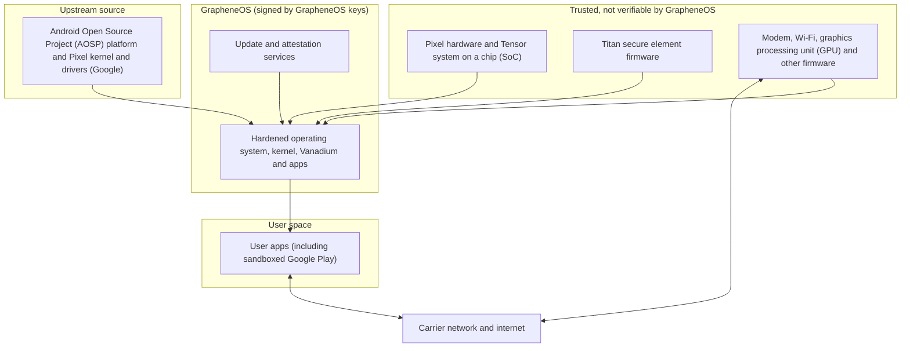

# GrapheneOS Security Assessment — Stage 1

> The document's control details are:
>
> | Field | Value |
> | --- | --- |
> | **Classification** | Client confidential (Traffic Light Protocol, TLP:AMBER) |
> | **Version** | 0.9 (for peer review) |
> | **Date** | 2026-11-24 |
> | **Author** | Raj |
> | **Reviewer** | _to be determined_ |
>
> **Limitations:** This is a desk-based assessment. It draws on public
> documentation, prior research and analyst knowledge. Stage 1 did not include:
>
> - hands-on testing;
> - code audit;
> - reverse engineering.
>
> Facts are current as of the date above. GrapheneOS and Google change quickly.
>
> **Confidence tags** (full definitions in §1.4):
>
> | Confidence tag | Meaning |
> | --- | --- |
> | **[Documented]** | A primary source. That is one of: • a first-party statement by the vendor or project concerned • the US Cybersecurity and Infrastructure Security Agency (CISA) Known Exploited Vulnerabilities (KEV) catalogue • the US National Vulnerability Database (NVD) • the original research publication |
> | **[Secondary]** | Press or third-party coverage only |
> | **[Observed]** | First-hand testing (none in Stage 1) |
> | **[Assessed]** | Analyst judgement or inference. Key assumptions are listed in Appendix A |

---

## 0. Executive Summary

Claims in this summary are tagged in the sections referenced.

**What GrapheneOS is**

GrapheneOS is a free, open-source, security-hardened version of Android built
by a small Canadian non-profit. It runs on Google Pixel phones (Pixel 8 to 10a
in scope; Pixel 11 not yet supported). It ships no Google services by default.
It adds these to stock Android:
- exploit mitigations;
- physical and forensic protections;
- privacy controls.

There is no (§3):
- vendor support;
- fleet console;
- certification.

**Verdict**

The verdict depends on who uses the device:

| Use | Verdict | Conditions or limits |
| --- | --- | --- |
| Supported Google Pixel, overall | Among the most hardened phone platforms available, alongside iPhone 17 with Lockdown Mode [Assessed] | Desk assessment only; no hands-on testing in Stage 1 |
| **High-risk individuals**, such as: • executives • journalists • activists | Good fit against commercial spyware and forensic extraction: raises attacker cost substantially but cannot guarantee defeat (§2.5) | With Profile B settings applied (§12.4) |
| **Managed fleet** | Can serve, but only with compensating controls | GrapheneOS offers: • no fleet console • no vendor support • little visibility into compromise |
| Determined nation-state | **No profile is proof against it** | The modem and firmware below the operating system (OS) remain trusted and closed |

All findings come from public sources; Stage 2 validates them.

**Top strengths**

The main strengths, and where each is covered:

| Strength | What it means | See |
| --- | --- | --- |
| **Exploit mitigation well beyond stock Android** | These measures make software bugs much harder to exploit: • a hardened memory allocator • hardware memory tagging (Memory Tagging Extension, MTE), on by default for the base OS and known-compatible user apps (optional for other apps) • per-app randomisation • kernel hardening | §6 |
| **Strong physical and forensic resistance** | • Auto-reboot returns devices to their encrypted "before first unlock" state • Universal Serial Bus (USB) data is blocked while the device is locked • a duress personal identification number (PIN) wipes the device • the secure element limits PIN guessing Leaked forensic-vendor material supports this resistance for Pixel 6–9 (§8.7). No equivalent data exists for the recommended Pixel 10a; work package 12 (WP12) tests it | §4, §8 |
| **Persistence resistance** | Verified boot and rollback protection stop an implant surviving a reboot by modifying the OS. Auto-reboot therefore also limits how long a memory-resident implant lasts | §4, §9.7 |
| **Privacy controls and no built-in Google services** | • Per-app network and sensor permissions • scoped storage and contacts • Google Play only as an optional, unprivileged app | §7 |
| **Well-designed updates** | Updates are: • signed • rollback-protected • installed even before first unlock • released frequently | §9.1 |

**Top areas to examine first**

The areas ranked highest in §11, in order:

| Rank | Area | Why it ranks here |
| --- | --- | --- |
| 1 | **Upstream dependency on Google** | Every fix and every new device depends on Google's release choices. Google has cut published source and bulletins, and Pixel 11 support is stalled on Google now. This is an adoption and continuity risk, not an exploit path |
| 2 | **Graphics processing unit (GPU) and accelerator drivers** | Mali has been exploited in the wild, and a bypass of MTE via GPU memory has been published |
| 3 | **Baseband and IP Multimedia Subsystem (IMS)** | Now with an in-the-wild Pixel modem exploit (CVE-2026-58704, a Common Vulnerabilities and Exposures identifier) |
| 4 | **Supply chain, governance and vulnerability handling** | 6–10 full-time developers. None of these is published: • key custody • a succession plan • a disclosure policy |
| 5 | **Messaging and media parser zero-click surface** | The main zero-click entry point for spyware |
| 6 | **Detection and incident response** | No on-device monitoring agent or intrusion log. Auditor proves only that the OS is unmodified, so an implant is unlikely to be detected |

For high-risk users, start with ranks 2, 3 and 5 (§11.3).

**Decision constraints**

Constraints that may decide adoption regardless of technical strength:

| Constraint | What it means | See |
| --- | --- | --- |
| **No certification** | None of these was found: • Common Criteria • Federal Information Processing Standards (FIPS) 140 • government accreditation Stock Pixel 9 and 10 on Android 16 hold US National Information Assurance Partnership (NIAP) Common Criteria certification; GrapheneOS does not inherit it (§13.1) | §3.3, §13.1; assumption A12 |
| **Limited fleet control** | A fleet cannot enforce or fully verify device-wide settings. It also has no device-wide remote wipe | §10.2 |
| **Legal exposure** | Using a duress PIN during a lawful search can expose a user to prosecution in some jurisdictions, with live examples in the US, UK and France | §8.8, §10.6 |
| **Credible alternatives** | • Stock Pixel with Advanced Protection • iOS with Lockdown Mode • certified purpose-built secure phones | §13, §13.5 |
| **Reversible** | Devices can return to stock Android, typically in under an hour per device [Assessed] | §12.8 |
| **Not solved by GrapheneOS** | • App or account compromise • phishing • carrier metadata • code running inside a compromised messenger | Not applicable |

**Device recommendation** (§5.3)

The recommended and avoided models:

| Device | Recommendation |
| --- | --- |
| Pixel 10a | Use for all profiles |
| Pixel 10 (non-Pro) | Use only where performance requires it. It brings the newer PowerVR GPU and video-processing driver, which have less public study and one known zero-click chain (§5.2.1) |
| Pro models | Not preferred for high-risk users (extra radios such as ultra-wideband (UWB); these can be disabled, so this is a preference, not a defect) |
| Foldables | Not preferred (more hardware and drivers, no security gain) |
| Pixel 8 series | Fine to keep until about 2030; do not buy new (shorter remaining support) |
| Pixel 11 | Avoid until supported and settled (§5.2.9) |

The Pixel 10a's Mali GPU driver is the most-exploited GPU driver on Android. It
is still preferred to the Pixel 10's PowerVR GPU and new video driver. Mali is
heavily patched and hardened, while PowerVR is largely unstudied and the Pixel
10's video driver was used in a 2026 zero-click chain. Work package 7 (WP7)
tests this choice. [Assessed]

**Reference secure phone** (§12)

The reference build is a Pixel 10a, installed and verified by the client
(§12.2). It comes in one of three configurations, one per profile (§2.1):

| Configuration | For whom |
| --- | --- |
| **A — Baseline** | A privacy-conscious individual facing theft and commercial forensics |
| **B — High-risk** | A targeted user, such as an executive or journalist, facing commercial spyware |
| **C — Managed fleet** | Organisation-managed devices; users who also face spyware get B settings inside C (C+B) |

Each configuration has a settings checklist that marks what the organisation
can and cannot enforce or verify (§12.7).

**Recommended next step.** A first Stage 2 phase ("Tier 1") of about 20–34
analyst days, plus client legal time; less if either the high-risk or the fleet
configuration is not needed (§14.2). The phase covers:
- patch-lag analysis;
- governance and signing-key custody;
- incident-response design;
- for Profile C, mobile device management (MDM) fit and an attestation data
  review;
- an attack-surface review of messaging and media parsers;
- for high-risk users, a duress-PIN legal review.

The engagement answers "can we trust and operate this?" before committing to
deeper technical research on the modem and GPU.

**Open questions for the client** are listed in §14.4. The main ones are:
- which user groups are in scope;
- whether certified products are required;
- which MDM and mandatory apps must work.

## 1. Scope, Method & Confidence

### 1.1 Purpose and Audience

This is a first, desk-based view of GrapheneOS for a client considering it as
the basis of a secure phone. It covers:
- what GrapheneOS protects;
- how GrapheneOS protects it;
- where GrapheneOS is weak;
- which areas deserve a deeper review first (§11);
- a reference secure-phone build for each profile (§12).

The audience is security leadership and technical reviewers.

### 1.2 Device Scope

The scope runs from the Pixel 8 series to the newest Pixel (Pixel 11 series).
The Pixel 8 is the floor for two reasons:
- it is the first generation with hardware memory tagging (Memory Tagging
  Extension, MTE);
- it has a 7-year support commitment.

Pixel 6 and 7 are still supported by GrapheneOS but are out of scope. Pixel 6
and 6 Pro are on legacy extended support and should be replaced.

Motorola announced a partnership with GrapheneOS in March 2026. [Documented]
Its Signature 27 is the first confirmed non-Pixel device (§4.7). Its
availability is unsettled:
- Motorola's US page reportedly indicates retail availability in November
  2026. [Secondary]
- GrapheneOS has indicated 2027 for Motorola devices. [Secondary]
  (assumption A07)

### 1.3 Method

The review drew on:
- GrapheneOS documentation;
- Google and press sources;
- published security research;
- leaked forensic-vendor material;
- analyst knowledge.

Fast-moving facts were checked on 2026-11-23 and 2026-11-24.

### 1.4 Confidence Labels

Each confidence tag used in this document means the following:

| Confidence tag | Meaning |
| --- | --- |
| **[Documented]** | A primary source, that is one of: • a first-party statement by the vendor or project concerned • the US Cybersecurity and Infrastructure Security Agency (CISA) Known Exploited Vulnerabilities (KEV) catalogue • the US National Vulnerability Database (NVD) • the original research publication Details are in the table below |
| **[Secondary]** | Press or third-party coverage only |
| **[Observed]** | First-hand testing (none in Stage 1) |
| **[Assessed]** | Analyst judgement or inference. Assumptions that could change a conclusion are also listed in Appendix A. They are cited by number, written "[Assessed] (assumption A05)" |

**Sources that count as [Documented]**

First-party statements are those by the vendor or project concerned. The
source types are:

| Source type | Includes |
| --- | --- |
| **First-party statements:** GrapheneOS website | Pages on the grapheneos.org site: • frequently asked questions (FAQ) • features • usage guide • releases • history • build guide |
| **First-party statements:** GrapheneOS developers | Developer posts (marked "project statement" where useful) on: • its forum • X • Mastodon • Bluesky |
| **First-party statements:** Google | • Security bulletins • store specification pages • security blogs • Project Zero • Google Threat Intelligence Group (GTIG) |
| **First-party statements:** other vendors | • Arm • Imagination • MediaTek • Apple • Samsung • Motorola |
| **Vulnerability catalogues** | CISA KEV and NVD |
| **Original research publications** | • Peer-reviewed papers • conference talks • technical reports by non-governmental organisations (NGOs), such as Amnesty Security Lab or Citizen Lab |

**Special cases**
- **Absence claims** are written "[Assessed] (absence — searched <what>,
  2026-11)". Not finding something is an inference, not proof.
- **Assessment notes** (quoted blocks headed "Assessment note") are [Assessed]
  unless a statement inside them is tagged otherwise.

Descriptive sections (§3–§10) are mostly [Documented]. §5.3 and §11–§14 are
analyst assessments.

### 1.5 Out of Scope for Stage 1

Stage 1 excluded:
- hands-on testing;
- source-code audit;
- reverse engineering;
- forensic extraction tests;
- client-specific app or mobile device management (MDM) testing.

These items are proposed as Stage 2 work packages (§14).

### 1.6 Assumptions

Every assumption that could change a conclusion is listed in Appendix A with
its impact and how to confirm it. The open questions for the client are in §14.4.

---

## 2. Reference Profiles

The client could not be consulted. The document is therefore written against
three reference profiles. Together they cover the realistic:
- personas;
- threat tiers;
- deployment models.

Persona-to-tier assignments are analyst judgement. [Assessed] (assumption A10)

### 2.1 Profiles used throughout the document

Each profile pairs a user group with the threats it is built to resist:

| Profile | Users | Threats |
| --- | --- | --- |
| **A — Baseline** | A privacy-conscious individual | Opportunistic theft and commercial forensics (T1 opportunistic theft or loss; T2 commercial forensic extraction) |
| **B — High-risk** | • Executives and very important persons (VIPs) • journalists • activists | • Targeted spyware (T3 commercial spyware) • nation-state attack (T4 nation-state) • coercion and border seizure |
| **C — Managed fleet** | Security and information technology (IT) staff, and field staff. Their devices are organisation-owned or bring your own device (BYOD) | • Loss and theft (T1 opportunistic theft or loss) • commercial forensics (T2 commercial forensic extraction) • also coercion and credential theft |

Users of profile C who face T3, such as privileged administrators, get C+B.

### 2.2 How a profile is chosen (two questions, applied in order)
1. **Threat tier sets the hardening level.** If the highest credible tier is
   T1–T2, apply A controls. If it is T3–T4, apply B controls.
2. **Ownership sets the management model.** An organisation-managed device
   (fleet or BYOD) gets C. If the user also faces T3–T4, apply B controls
   inside C, written **C+B**.

BYOD at T3–T4 is **not recommended**. A work profile cannot enforce device-wide
controls such as:
- auto-reboot;
- Universal Serial Bus Type-C (USB-C) mode;
- no Play;
- duress personal identification number (PIN).

Issue a dedicated device instead.

### 2.3 Persona summary

Each persona's assets, adversaries, highest credible threat tier and default
profile:

| Persona | Main assets | Likely adversaries | Highest credible tier | Default profile |
| --- | --- | --- | --- | --- |
| P1 Executive or very important person (VIP) | • Deal data • board communications • contacts • location | • Competitors • commercial spyware customers • states | T3 (T4 for some roles) | B, or C+B on a fleet |
| P2 High-risk person (for example journalist or activist) | • Sources • unpublished material • contacts • location | • Commercial spyware customers • states • border agents | T4 | B |
| P3 Security or IT staff | • Administrator credentials • multi-factor authentication (MFA) tokens • internal access | • Criminal groups • access brokers • states via supply chain | T2 (T3 for privileged administrators) | C (C+B for privileged administrators) |
| P4 Field or operational staff | • Operational data • location • organisation access | • Thieves • local authorities • coercion | T2 | C |
| P5 Privacy-conscious individual | • Personal data • accounts • location history | • Thieves • data brokers • ad tracking | T1–T2 | A |

### 2.4 Persona × deployment model → profile

The profile each persona gets under each deployment model:

| Persona | D1 Individually owned | D2 Organisation-owned fleet | D3 Bring your own device (BYOD) with work profile | D4 Minimal or communications-only |
| --- | --- | --- | --- | --- |
| P1 | B | C+B | Not recommended → issue D2 device | B |
| P2 | B | C+B (newsroom or non-governmental organisation (NGO) fleet) | Not recommended → issue D2 device | B |
| P3 | A (privileged administrators: not recommended → issue D2 device) | C (C+B for privileged administrators) | C (privileged administrators: not recommended → issue D2 device) | Not applicable |
| P4 | A | C | C | C (stripped-down) |
| P5 | A | Not applicable | C (work profile only; A settings on the personal side) | A |

### 2.5 Threat tier coverage by profile (what each profile is designed to resist)

How far each profile is designed to resist each threat tier:

| Tier | A Baseline | B High-risk | C Managed fleet | C+B |
| --- | --- | --- | --- | --- |
| T1 Opportunistic theft or loss | Yes | Yes | Yes | Yes |
| T2 Commercial forensic extraction | Partial¹ | Yes | Partial² | Yes |
| T3 Commercial spyware (one-click and zero-click) | Partial³ | Strong⁴ | Partial³ | Strong⁴ |
| T4 Nation-state | No | Partial⁵ | No | Partial⁵ |

"Yes" means the profile is designed to defeat the tier. "Strong" means it
raises the cost substantially but cannot be relied on to defeat it.

¹ The default 18-hour auto-reboot leaves a long after-first-unlock window. In
that window a seized, unlocked-since-boot device is more exposed.

² The organisation cannot enforce device-wide settings set by the user.
- Auditor shows some of them (§9.4):
  - auto-reboot timeout;
  - USB-C mode;
  - Android Debug Bridge (adb);
  - original equipment manufacturer (OEM) unlocking.
- Auditor does not report others (§10.2):
  - duress PIN;
  - cellular mode;
  - Wi-Fi calling.
- Fleets also tend to need sandboxed Google Play for work apps.

³ Exploit mitigations apply in every profile. Profiles A and C keep more attack
surface:
- Play services;
- more apps;
- more radios on.

⁴ Profile B's hardening cuts attack surface sharply. The hardening means:
- fewer apps;
- no Play;
- radios off;
- short auto-reboot.

Well-resourced spyware vendors can still find working chains.

⁵ No profile fully addresses T4. These attacks sit below the operating system
(OS):
- baseband attacks;
- firmware attacks;
- supply-chain attacks.

Profile B raises the cost; it does not remove the risk.

### 2.6 Residual risk with Profile B applied

This table shows what remains for a high-risk user even with all Profile B
controls (§12.4) in place. [Assessed]

| Tier or area | Residual risk |
| --- | --- |
| T1 Opportunistic theft or loss | Negligible |
| T2 Commercial forensic extraction | • After-first-unlock window up to the auto-reboot timer (1 hour) • vendor counter-measures to auto-reboot (§8.2) |
| T3 Commercial spyware | Zero-day exploit chains remain possible in: • the browser and WebView • messaging and media parsers • drivers Their cost is raised, not removed |
| T4 Nation-state | • Baseband and firmware attacks (now including an exploited Pixel modem bug, §4.5) • supply-chain compromise • signing-key compromise |
| Operational | • Settings drift • no remote wipe • app or account compromise |

---

## 3. GrapheneOS Overview

GrapheneOS is a security-hardened mobile operating system (OS) based on the
Android Open Source Project (AOSP). It runs Android apps, but changes large
parts of the operating system underneath them to make exploitation and data
extraction harder. A small non-profit team develops it. It currently runs only
on Google Pixel phones, with a first Motorola device confirmed.

### 3.1 Project Background, Governance, Funding and Infrastructure

**History**

The project's main milestones:

| Period | Event | Confidence |
| --- | --- | --- |
| Late 2014 | Founded by Daniel Micay as a solo hardening project | [Documented] |
| 2015–2018 | • Known as **CopperheadOS** while a company sponsored it • split from that company in 2018 in a contested dispute • the project's account of the split is one-sided and unverified | [Documented] (one-sided) |
| 2018–2019 | Renamed AndroidHardening, then **GrapheneOS**. The site does not date the GrapheneOS name, so 2019 is inferred | [Documented] / [Assessed] |
| March 2023 | **GrapheneOS Foundation** created as a Canadian non-profit | [Documented] |
| November 2025 | Left France and the hosting provider OVH, citing French pressure on encryption and device access | [Documented] |
| March 2026 | Partnership with **Motorola** announced at Mobile World Congress 2026 for an unnamed future device | [Documented] (Motorola press release) |
| September 2026 | • Motorola Signature 27 unveiled • GrapheneOS confirmed it as the first non-Pixel device (project statement) • Motorola's US page reportedly indicates November 2026 retail availability; GrapheneOS has indicated 2027 for Motorola devices [Secondary] (assumption A07) | [Documented]; dates [Secondary] |

**Governance and team**

What is known about the project's governance and team:

| Item | Detail | Confidence |
| --- | --- | --- |
| Legal form | The GrapheneOS Foundation is a **Canadian non-profit, not a registered charity**, based in Toronto | [Documented] |
| Team size | The project describes "multiple full-time and part-time developers" plus companies that collaborate with it. The core team is **6–10 full-time developers** (project statements on its forum; figures vary over time) | [Documented] |
| Formal governance | Public documentation does not describe a formal governance structure. It does not describe: • board composition • a decision process • a succession plan | [Assessed] (absence — searched grapheneos.org and the project forum, 2026-11) |
| Leadership | The founder has historically been the public face of the project. Whether he still leads it day to day, and how key decisions are made, is not documented on the official site | [Assessed] (absence — searched grapheneos.org, 2026-11) |
| **Vulnerability handling** | None of these was found: • a published bug bounty • a formal vulnerability disclosure policy • a published independent audit report This gap is a question for Stage 2 | [Assessed] (absence — searched grapheneos.org and the project forum, 2026-11) |
| External review | The frequently asked questions (FAQ) page describes continuous external review by researchers and organisations, for example France's National Agency for the Security of Information Systems (ANSSI) | [Documented] |

**Funding**

How the project is funded:

| Item | Detail | Confidence |
| --- | --- | --- |
| Donations | Funding is donations, made by: • bank transfer • PayPal • GitHub Sponsors • Interac • cryptocurrency Some servers are sponsored in kind. The FAQ states the project is "entirely funded by donations" and will remain a non-profit | [Documented] |
| Company collaborations | Company collaborations exist. Motorola contributes engineering time to port GrapheneOS to its devices but does **not** fund the project | [Secondary] |
| Commercial support | There is **no commercial support offering or service-level agreement (SLA)** | [Documented] |

**Infrastructure and jurisdiction**

The project left OVH in November 2025. The first rows describe current hosting,
per the project's servers article (modified 2026-10-21); the rest cover build
signing, update trust and jurisdiction:

| Item | Detail | Confidence |
| --- | --- | --- |
| Update mirrors | Dedicated servers, several of them sponsored, in: • Dallas • Frankfurt • Amsterdam • London • Los Angeles • Miami • Toronto | [Documented] |
| Domain Name System (DNS), ns1 | Anycast on Vultr | [Documented] |
| Domain Name System (DNS), ns2 | Anycast on: • Misaka.io • DataPacket • Xenyth | [Documented] |
| E-mail | Xenyth (Toronto) | [Documented] |
| Community services | Hosted on netcup (Manassas, US): • the forum • Matrix • Mastodon | [Documented] |
| Attestation service | netcup (Nuremberg, Germany) | [Documented] |
| Move status | No OVH servers are listed, so the move off OVH appears complete. Long-term Toronto colocation is only partly in place | [Assessed] (assumption A05) |
| Build and signing | Builds are made and signed on "hardened local machines" under the project's physical control [Documented]. Their location and jurisdiction are not published | [Documented] / [Assessed] (absence — searched grapheneos.org, 2026-11) |
| Update verification | Updates are verified by signature, with downgrade protection, at three points: • System Updater (over the air) • recovery (sideloaded updates) • verified boot | [Documented] |
| Mirror trust | The project states that "the update server isn't a trusted party". **A compromised or seized mirror could delay updates, but could not push malicious ones** unless the signing keys were also compromised | [Documented] |
| **Legal compulsion** | The legal entity is Canadian. The project says it builds and signs on local machines under its physical control, but does not publish where they are or under which jurisdiction (§9.2) | [Documented] / [Assessed] |
| Effect of compulsion or a stolen key | Per-device (serial-locked) update packages are rejected (§9.1). But a holder of the signing key, or someone compelling the project, could serve a validly signed malicious build only to chosen Internet Protocol (IP) addresses. Detection depends on the target or a third party comparing the installed build with a reproducible build | [Assessed] |

> **Assessment note — why this matters to the client**
>
> The factors that matter, and why:
>
> | Factor | Why it matters |
> | --- | --- |
> | **Concentration risk** | A small team maintains an OS the client may build a security programme on. The team: • has 6–10 members • is funded by donations • has no published governance or succession plan Signing-key custody sits with this team (§9.2) |
> | **No commercial recourse** | An organisation would carry the operational risk itself. There is no: • support contract • SLA • indemnity |
> | **Jurisdiction** | The legal entity is Canadian, and long-term infrastructure is planned in Toronto; current servers are spread across several countries (table above). The 2025 move shows the project will relocate under legal pressure. The move also shows service availability can be disrupted |
> | **Public disputes** | The project has been in public conflict, notably the CopperheadOS split. This history is a reputational factor for an organisation adopting GrapheneOS, not a technical flaw |
>
> This note feeds §11 area 4 (supply chain, governance and vulnerability
> handling) and §11 area 1 (upstream dependency on Google).

### 3.2 Design Philosophy

The principles that shape GrapheneOS:

| Principle | What it means | See | Confidence |
| --- | --- | --- | --- |
| **Security first, then privacy** | GrapheneOS treats strong exploit mitigation and sandboxing as the foundation. Privacy features are built on top of that foundation, not in place of it | Not applicable | [Documented] |
| **Harden the Android Open Source Project (AOSP), do not replace it** | GrapheneOS keeps the Android security model and makes it stronger. What it keeps and what it strengthens are in the table below | Table below | [Documented] |
| **Hardware requirements are non-negotiable** | Devices must offer, among other things: • hardware memory tagging, such as the Arm Memory Tagging Extension (MTE), or an equivalent • a secure element with StrongBox and Weaver • verified boot with user-installed keys • long-term firmware updates These requirements are why only Pixels qualify today | §4.1, §5; for Pixel 11 status, §5.2.9 | [Documented] |
| **No Google apps or services by default** | Like AOSP, GrapheneOS ships without them and says they will never be bundled. Users who need them can install Google Play as ordinary sandboxed apps with no special privileges | §7.4 | [Documented] |
| **No root access** | GrapheneOS does not provide a way to run apps as root. Root access would break the verified boot and sandbox guarantees the design depends on. Users who want root must make their own unsupported builds | Not applicable | [Documented] (project statements on its forum) |
| **App compatibility is preserved where possible** | Hardening that breaks apps is offered as per-app toggles rather than removed. These toggles create opt-outs worth examining | §6.7, §11 | [Documented] |

How GrapheneOS hardens the Android security model:

| Part | Includes |
| --- | --- |
| The model it keeps | • The app sandbox • verified boot • the permission system |
| The strengthening (§6, §7) | • A hardened memory allocator • hardware memory tagging • a stricter app sandbox • extra permissions • reduced attack surface |

### 3.3 What GrapheneOS Is Not

Common assumptions about GrapheneOS, set against what it actually is:

| Common assumption | Reality | Confidence |
| --- | --- | --- |
| A de-Googled, privacy-focused replacement Android build, like /e/OS or CalyxOS | • It is a hardening project first • privacy follows from sandboxing • it also allows sandboxed Google Play, which pure de-Googled replacement builds do not | [Documented] |
| Runs on many devices, like LineageOS | • It runs only on devices that meet its hardware requirements • currently that means Pixel 6 and newer (Pixel 6 and 6 Pro on legacy extended support) • the Motorola Signature 27 is confirmed as the first non-Pixel device (project statement); GrapheneOS has indicated 2027 for Motorola devices [Secondary] | [Documented] |
| Can be rooted or customised freely | • No root access • root would break verified boot and the security model • users who want root must make unsupported custom builds • the bootloader is re-locked with GrapheneOS keys after install | [Documented] (project statements) |
| An anonymity tool | It does not hide your identity from: • the mobile network • the carrier • the services you sign into Anonymity needs separate measures, for example Tor and careful account use | [Assessed] |
| A certified or accredited product | None of these was found: • Common Criteria • Federal Information Processing Standards (FIPS) 140 • government accreditation The FAQ discusses external review, not certification. Stock Pixel 9 and 10 on Android 16 hold US National Information Assurance Partnership (NIAP) Common Criteria certification; GrapheneOS does not inherit it (§13.1) | [Assessed] (absence — searched grapheneos.org and public certification listings, 2026-11) |
| An enterprise product with vendor support | It has no: • commercial support • SLA • fleet console • management service It supports Android Enterprise work profiles through standard mobile device management (MDM); see §10 | [Documented] / [Assessed] |
| Independent of Google | It depends on Google for (§4, §9.3): • hardware • firmware • security patches • AOSP source releases | [Documented] |

> **Assessment note.** For regulated clients, the lack of certification may rule
> GrapheneOS out for some uses regardless of its technical strength. Confirm the
> client's compliance needs (assumption A12).

### 3.4 Release Channels and Versioning

**Channels**

The release channels and what each is for:

| Channel | Purpose | Confidence |
| --- | --- | --- |
| **Alpha** | First public push, after developer testing | [Documented] |
| **Beta** | Pushed shortly after Alpha. Releases with problems are aborted and replaced by a new Beta release | [Documented] |
| **Stable** | Promoted after users on Beta have tested it. The project advises Stable for anyone who "cannot tolerate dealing with temporary issues" | [Documented] |
| **Security preview** | Opt-in releases carrying early AOSP patches ahead of the bulletins (for example 2026111801) | [Documented] |
| **Legacy extended support** | • Stopgap releases for end-of-life devices (currently Pixel 6 and 6 Pro) • patch level frozen at 2026-11-01 • the project recommends ending use of these devices | [Documented] |

**Versioning and cadence**

How builds are numbered and how often they ship:

| Item | Detail | Confidence |
| --- | --- | --- |
| Build numbers | Builds are numbered as 10-digit values such as **2026111800**. As of 2026-11-24, build 2026111800 is the latest | [Documented] |
| Platform base | Built on the Android 17 platform source (AOSP CP2A.260605.016). The Quarterly Platform Release 2 (QPR2) platform source has not yet been published to AOSP (§5.2.9) | [Documented] |
| Pixel components | Updated to Android 17 QPR2, with the 2026-11-05 patch level (§9.3): • firmware • drivers • hardware abstraction layers (HALs) • kernels | [Documented] |
| Number format | The number reads as a date (YYYYMMDD) plus a two-digit counter. The site does not define the format | [Documented] / [Assessed] |
| Cadence | Releases are frequent: about two dozen between early July and 18 November 2026, roughly one a week | [Assessed] (count of changelog entries) |

Update delivery and its security properties are described in §9.1.

> **Assessment note.** For fleet implications of the update model, see §9.1.
> For patch timing, see §9.3 and §11 area 1.

---

## 4. Platform Foundations & Trust Model

GrapheneOS's security rests on hardware it does not control. This section sets
out three things:

- what GrapheneOS relies on;
- what GrapheneOS verifies;
- what GrapheneOS has to trust blindly.

### 4.1 Why Pixel Only: Hardware Requirements

GrapheneOS publishes a list of requirements a device must meet before it is
supported. [Documented] The ones that matter most are in the table below.

| Requirement | Why it matters | Pixels meeting it |
| --- | --- | --- |
| Hardware memory tagging (Arm Memory Tagging Extension (MTE) or equivalent) | Catches many memory-corruption bugs at the point they occur (§6.3) | • Pixel 8 to 10a (GrapheneOS frequently asked questions (FAQ)) • Pixel 11 pending (§5.2.9) |
| Secure element with **StrongBox** keystore | Keys live in a separate tamper-resistant chip, not the main processor | All in-scope Pixels (Titan M2; Titan M3 on Pixel 11) |
| **Weaver** in the secure element | Rate-limits unlock attempts in hardware (§4.3) | Titan M family |
| Verified boot with **user-installed keys** and a re-lockable bootloader | Lets GrapheneOS sign the operating system (OS) with its own keys and still get full verified boot | Pixels |
| Long-term firmware and driver updates | Without vendor firmware patches, OS patches alone are not enough | Pixel 8 and later: 7 years |
| Isolation of radios and peripherals (input–output memory management unit, IOMMU) | Stops a compromised modem or Wi-Fi chip reading main memory directly | Pixels |

The published list requires isolated radios, GPU and other components; the FAQ
explains separately that baseband memory access is partitioned by the IOMMU.
[Documented]

Few Android original equipment manufacturers (OEMs) meet all of these
requirements, which is why device support is narrow. The FAQ's view is that for
most devices "the hardware and firmware will prevent providing a reasonably
secure device". [Documented]

### 4.2 Verified Boot with Custom Keys

The table shows how GrapheneOS keeps full verified boot while using its own
signing key.

| Element | Detail | Confidence |
| --- | --- | --- |
| Installation | Three steps: • the bootloader is unlocked • GrapheneOS is flashed • the bootloader is **re-locked with the GrapheneOS signing key enrolled** as the trusted key | [Documented] |
| Boot verification | From then on, every boot verifies the OS against that key using Android Verified Boot (AVB). A modified system partition fails to boot or is detected | [Documented] |
| **Rollback protection** | Prevents booting an older, vulnerable signed version | [Documented] |
| Key hash check | • Pixels show a yellow boot warning with the hash of the enrolled key at every boot • Users can check that hash against the published GrapheneOS value • The Auditor app (§9.4) verifies the hash cryptographically | [Documented] / [Assessed] |

### 4.3 Titan Secure Element

The table summarises what the Titan secure element provides and what is known
about its security record.

| Item | Detail | Confidence |
| --- | --- | --- |
| **Weaver** | The unlock credential is combined with a secret held by the secure element. The chip enforces **escalating delays between failed attempts**, so brute-forcing a personal identification number (PIN) is limited by hardware, not by the OS | [Documented] |
| **Weaver schedule** (GrapheneOS FAQ) | • Attempts 1 to 4 have no delay • After that, escalating delays apply (schedule below the table) • **Only 20 attempts are allowed in total** | [Documented] |
| Guessing odds | A random 6-digit PIN therefore has about a 1-in-50,000 chance (20 in 1,000,000) of being guessed, provided the secure element holds | [Assessed] (derived from the FAQ schedule) |
| **Insider attack resistance** | Secure element firmware can only be updated after the owner authenticates. Google or a supplier therefore cannot silently push firmware that weakens throttling on a locked device | [Documented] (Android and Pixel design) |
| **StrongBox** | Hardware-backed key storage used by apps and by attestation (§9.4) | [Documented] |
| **Generations** | • Titan M2 is on Pixel 8 to 10a • **Titan M3 is on Pixel 11** (Google store specification pages) • The M3 is new silicon and firmware with little public security research yet | • [Documented] (chips by device) • [Assessed] (research gap) |
| **Certification** | • Google lists Titan M2 under Common Criteria (protection profile PP0084, TrustCB) through Pixel 10 and 10a • Titan M3's Common Criteria entry is listed as "Ongoing" (Google Pixel certifications page) | [Documented] |
| **Track record** | The secure element itself has had exploitable bugs: • Quarkslab achieved code execution on the first-generation Titan M • The attack leaked StrongBox-protected keys (Common Vulnerabilities and Exposures (CVE) identifier CVE-2022-20233; Black Hat USA 2022) • That work followed "2021: A Titan M Odyssey" (Black Hat EU 2021) • The attack needed root or Serial Peripheral Interface (SPI) access and did not break Weaver | [Documented] |
| Titan M2 and M3 | No public break of Titan M2 or Titan M3 was found | [Assessed] (absence — searched Titan M2 and M3 vulnerability research and conference talks, 2026-11) |
| Forensic-vendor data | Leaked forensic-vendor data is consistent with Weaver holding: the vendor reportedly cannot brute-force Pixel passcodes (§8.7) | [Secondary] |

The table gives the Weaver delay schedule after the four free attempts, as
listed in the GrapheneOS FAQ (encryption section). [Documented]

| Failed attempt number | Delay before the next attempt |
| --- | --- |
| 1 to 4 | None |
| 5 | 1 minute |
| 6 | 5 minutes |
| 7 | 15 minutes |
| 8 | 30 minutes |
| 9 | 90 minutes |
| 10 | 4 hours |
| 11 | 12 hours |
| 12 | 36 hours |
| 13 | 4 days |
| 14 | 13 days |
| 15 | 41 days |
| 16 | 123 days |
| 17 | 1 year |
| 18 | 3 years |
| 19 | 9 years |
| 20 | No further attempts are permitted |

### 4.4 Storage Encryption

The table sets out how storage encryption works on GrapheneOS.

| Item | Detail | Confidence |
| --- | --- | --- |
| Encryption layers | **File-based encryption** protects user data, and **metadata encryption** protects the file system. Both are standard on modern Android | [Documented] |
| Key derivation | Keys are derived from the user's lock-screen credential **and** the Weaver secret in the secure element. As a result: • data cannot be decrypted off-device • a weak PIN is protected by hardware throttling | [Documented] |
| **Before First Unlock (BFU)** | User data is "at rest": it stays encrypted until the credential is entered. This is why GrapheneOS's auto-reboot feature (§8.2) is so effective | [Documented] |
| Password length | GrapheneOS raises the maximum password length to 128 characters (stock: 16), making a strong passphrase practical | [Documented] |

### 4.5 Baseband, Firmware and Peripheral Isolation

The table covers the closed firmware beneath GrapheneOS and how far the
hardware confines it.

| Item | Detail | Confidence |
| --- | --- | --- |
| **Closed-source firmware** | Several components run it: • the cellular modem • the Wi-Fi and Bluetooth chip • the graphics processing unit (GPU) firmware • other components | [Documented] / [Assessed] |
| Firmware suppliers | Google and its vendors supply that firmware. The vendors include: • Samsung • MediaTek (on Pixel 11) • Broadcom • Imagination and Arm | [Documented]; MediaTek on Pixel 11 [Secondary] (assumption A02) |
| GrapheneOS's role | GrapheneOS ships this firmware unchanged. It cannot audit or fix it | [Documented] / [Assessed] |
| **IOMMU** isolation | Pixels isolate these components with an IOMMU, so a compromised modem should not be able to read or write main memory directly | [Documented] |
| Limit of the IOMMU | An IOMMU stops arbitrary direct memory access (DMA). It does not stop malicious data placed in shared buffers that the driver then reads: • Project Zero used that route to go from Broadcom Wi-Fi firmware to the host (Project Zero, 2017) • the same idea underlies PeriScope (Network and Distributed System Security Symposium (NDSS) 2019) | [Documented] |
| Tensor configuration | No primary Google document describing the Tensor system memory management unit (SMMU) configuration was found. How tightly each component is confined is therefore an open question | [Assessed] (assumption A16) |
| **LTE-only mode** | LTE is Long-Term Evolution (4G). The mode disables the other generations: • 2G • 3G • 5G | [Documented] |
| Radio toggles | Radios can also be turned off individually | [Documented] |
| Limit of LTE-only mode | LTE-only mode shrinks the radio stack. It does **not** remove the IP Multimedia Subsystem (IMS) path described below. IMS carries Voice over LTE (VoLTE) and Wi-Fi calling | [Assessed] |

**Recent evidence** ([Documented] unless tagged otherwise). The table lists
each item, what it shows, the key details and the source.

| Evidence | What it shows | Detail | Source |
| --- | --- | --- | --- |
| **CVE-2026-58704**, Pixel modem elevation of privilege | First Pixel-specific baseband bug Google has marked as exploited; not a forensic bug | • A logic error that bypasses a permission check; the attack vector is not published • Fixed in patch level 2026-09-05 • Added to the US Cybersecurity and Infrastructure Security Agency (CISA) Known Exploited Vulnerabilities (KEV) catalogue on 2026-09-16 • Google marked it "under limited, targeted exploitation" • Exploitation likely needs a network position, such as a nearby or compromised cellular network [Secondary] | • Pixel Update Bulletin, September 2026 • CISA KEV catalogue • Kaspersky and 9to5Google [Secondary] |
| Project Zero Exynos disclosure through IMS | Remote reach before authentication, with no radio proximity needed | • Project Zero reported 18 bugs • 4 of them gave internet-to-baseband remote code execution through IMS, needing only the phone number • The interim mitigation was turning off Wi-Fi calling and VoLTE, so LTE-only mode alone is not enough | Project Zero, March 2023 |
| Google red team modem remote code execution through the 2G stack (CVE-2022-20170) | Supports disabling 2G | Google's red team achieved modem remote code execution through the 2G stack | Black Hat USA 2023 (Karimi et al.) |
| Compiler hardening of the Exynos baseband | Google is hardening the Samsung modem, with no equivalent for the MediaTek M90 | • Google has applied BoundSan and IntSan (bounds and integer-overflow sanitisers) to the Exynos baseband since December 2023 • Google describes the Pixel 9 baseband as the "most hardened", citing stack canaries and auto-initialisation • No equivalent statement exists for the MediaTek M90 on Pixel 11 [Assessed] (absence — searched Google and MediaTek security blogs, 2026-11) | Google Security Blog, December 2023 and October 2024 |
| 5G pre-authentication attacks (SNI5GECT; 5GBaseChecker) | Disabling 2G does not make pre-authentication parsing unreachable | • SNI5GECT injected pre-authentication messages without a fake base station (USENIX Security Symposium 2025) • 5GBaseChecker found pre-authentication flaws in commercial 5G basebands (USENIX Security Symposium 2024) | USENIX Security Symposium 2025 and 2024 |

The September 2026 bulletin that fixed CVE-2026-58704 also fixed the bugs
below. [Documented]

| Bug | Component and type |
| --- | --- |
| CVE-2026-56967 | Modem remote code execution (Critical) |
| CVE-2026-55306 | Modem denial of service (Critical) |
| CVE-2026-58731 | PowerVR GPU information disclosure (High) |

For a survey of the field see Carnot and Francillon, "SoK: Insecurity of
Cellular Basebands" (USENIX WOOT (Workshop on Offensive Technologies) 2026), a
Systematization of Knowledge (SoK) paper. [Documented]

**Residual risk:** The modem is the largest closed attack surface left on the
device. [Assessed]

- It is a known nation-state target.
- It now has an exploited Pixel bug.
- It is §11 area 3 (Baseband and IMS).

### 4.6 Trust Boundaries

Reading the diagram:

- Everything in the top box has to be trusted as delivered by Google and its
  suppliers.
- GrapheneOS's protections start at the OS layer.
- Verified boot proves the OS is the one GrapheneOS signed. Verified boot says
  nothing about the firmware beneath the OS.

### 4.7 Motorola Partnership

The table sets out what is known about the Motorola partnership so far.

| Item | Detail | Confidence |
| --- | --- | --- |
| Announcement | At Mobile World Congress (MWC) in March 2026, Motorola and GrapheneOS announced a partnership for an unnamed future device | [Documented] (Motorola press release, MWC 2026) |
| First device | In September 2026 Motorola unveiled the **Signature 27** (Qualcomm Snapdragon). GrapheneOS confirmed the Signature 27 as its first non-Pixel device | [Documented] (project statement) |
| Further reported details | From press coverage: • MTE • a secure element • 7-year support • Motorola engineers for porting and maintenance, but no project funding • 2027 Razr foldables next | [Secondary] |
| Retail availability | Motorola's US page reportedly indicates November 2026 for the Signature 27 | [Secondary] |
| GrapheneOS availability | GrapheneOS has indicated 2027 for Motorola devices; neither date is **confirmed** | [Secondary] (assumption A07) |

**Implications** [Assessed]:
- A second hardware vendor would reduce single-vendor dependence on Google.
- Qualcomm's components are a different attack surface from Tensor's:
  - the modem;
  - the GPU (Adreno);
  - the secure element.
- The partnership also adds a second firmware supply chain to trust.
- The partnership splits a small team's attention.

### 4.8 Attack-Surface Map

Typical Android spyware chains combine three bugs (Google Threat Intelligence
Group (GTIG) 2025 zero-day review; §11): [Documented]

| Chain stage | Where the bug is |
| --- | --- |
| Entry | One of: • the browser renderer • a messaging or media parser • the baseband |
| Sandbox escape | A sandbox escape |
| Kernel or driver | A kernel bug, or a GPU or accelerator driver bug |

The map below is an analyst summary [Assessed]. The controls are documented in
the sections cited.

| Surface | Reachable when | GrapheneOS-specific control | Residual risk | §11 area |
| --- | --- | --- | --- | --- |
| Browser (Vanadium) | • Unlocked • Remote: link, advert or network injection | • Just-in-time (JIT) compilation off by default • Strict site isolation • Reduced web application programming interfaces (APIs) (§6.6) | • Renderer zero-days in non-JIT code • Patch latency unmeasured | Area 8, Browser and WebView |
| WebView in apps | Unlocked; remote through app content | Vanadium WebView; per-app JIT toggle (§6.6) | JIT on by default; no site isolation | Area 8, Browser and WebView |
| Messaging apps and media or image parsers | • All states once the app runs, including After First Unlock (AFU) while locked • Remote zero-click | • hardened_malloc and MTE in app processes • Profile isolation • Network permission (§6, §7) | • Parser bugs inside the app's own process • Untested against 2025 chains | Area 5, Messaging and media parsers |
| Cellular radio: • 2G • LTE • 5G pre-authentication | • BFU • AFU • Unlocked • Radio on; nearby or network attacker | • LTE-only mode • 2G off • Airplane mode (§4.5, §7.7) | • Closed firmware • Exploited Pixel modem bug (CVE-2026-58704) • 5G and LTE pre-authentication parsing | Area 3, Baseband and IMS |
| • IMS (VoLTE and Wi-Fi calling) • Text and multimedia messages • Rich Communication Services (RCS) messages | • BFU • AFU • Unlocked • Remote, with the phone number | VoLTE and Wi-Fi calling toggles (§7.7) | Internet-to-baseband remote code execution class; LTE-only mode does not remove it | Area 3, Baseband and IMS |
| Wi-Fi | When enabled, all states; nearby | • Toggle • Auto-off timer • Media access control (MAC) address randomisation (§7.7) | Closed Wi-Fi firmware; shared-buffer path past the IOMMU | Area 14, Proximity radio firmware |
| Bluetooth | When enabled, all states; nearby | Toggle; auto-off timer (§7.7) | Closed firmware and host stack bugs | Area 14, Proximity radio firmware |
| Near-field communication (NFC) | When enabled; very close range | Toggle (§7.7) | Closed firmware; small attack surface, but reachable before authentication | Area 14, Proximity radio firmware |
| Universal Serial Bus Type-C (USB-C) port | Physical access, in BFU or in AFU while locked | USB-C port control; charging-only when locked by default (§8.3) | Unlocked-state and charging-path bugs | Area 13, Forensic claims |
| GPU and accelerator drivers: • Mali • PowerVR • Tensor video processing unit (VPU) | From any compromised app or renderer | MTE on kernel allocators (§6.3); none specific to GPU page tables | • GPU page-table bugs bypass MTE • Accelerator drivers new and unstudied (§5.2.1) | Area 2, GPU and accelerator drivers |
| Sandboxed Play layer | When installed, as an ordinary app | No privileged Google access (§7.4) | Compromise limited to its profile; dependency on Google code | Area 12, Sandboxed Play layer |
| App stores and sideloading | User or administrator action | Per-app permissions; GrapheneOS App Store (§7.9) | Malicious or compromised apps | Area 9, App sourcing |
| Update channel | Periodic, remote | • Signed updates • Verified boot • Rollback protection (§4.2, §9.1) | Signing-key or build compromise | Area 4, Supply chain and governance |
| Secure element | Physical access, or root on the main OS | Weaver throttling; insider attack resistance (§4.3) | • Titan bugs (Quarkslab, first-generation Titan M) • Titan M3 unstudied | • Area 13, Forensic claims • Area 11, Pixel 11 components |

> **Assessment note.** GrapheneOS can only be as strong as the hardware and
> firmware under it. The client's deeper review should focus on what sits below
> the OS:
>
> - GPU and accelerator drivers (§11 area 2);
> - modem firmware and IMS (§11 area 3);
> - the new Pixel 11 components (§11 area 11).

---

## 5. Device Generation Analysis (Pixel 8 → Latest)

### 5.1 Device Matrix

The table lists each in-scope device's main components, dates and GrapheneOS
status as of 2026-11-24. † marks press reports only [Secondary].

| Device | System on a chip (SoC) | Modem | Graphics processing unit (GPU) | Secure element | Fingerprint sensor | Released | Support end | GrapheneOS status |
| --- | --- | --- | --- | --- | --- | --- | --- | --- |
| Pixel 8 and 8 Pro | Tensor G3 | Exynos 5300 | Mali | Titan M2 | Optical | October 2023 | October 2030 | Supported |
| Pixel 8a | Tensor G3 | Exynos 5300 | Mali | Titan M2 | Optical | May 2024 | May 2031 | Supported |
| • Pixel 9 • Pixel 9 Pro • Pixel 9 Pro XL | Tensor G4 | Exynos 5400 | Mali | Titan M2 | Ultrasonic | August 2024 (9 Pro: September 2024) | August 2031 | Supported |
| Pixel 9 Pro Fold | Tensor G4 | Exynos 5400 | Mali | Titan M2 | Side capacitive | September 2024 | August 2031 | Supported |
| Pixel 9a | Tensor G4 | Exynos 5300 | Mali | Titan M2 | Optical | April 2025 | April 2032 | Supported |
| • Pixel 10 • Pixel 10 Pro • Pixel 10 Pro XL | Tensor G5 | Exynos 5400 | PowerVR DXT† | Titan M2 | Ultrasonic | August 2025 | August 2032 | Supported |
| Pixel 10 Pro Fold | Tensor G5 | Exynos 5400 | PowerVR† | Titan M2 | Side capacitive | October 2025 | October 2032 | Supported |
| Pixel 10a | Tensor G4 | Exynos 5400 | Mali | Titan M2 | Optical† | March 2026 | March 2033 | Supported |
| • Pixel 11 • Pixel 11 Pro • Pixel 11 Pro XL | Tensor G6 | MediaTek M90† | PowerVR C-Series† | Titan M3 | Ultrasonic† | August 2026 | August 2033 | **Not yet** |
| Pixel 11 Pro Fold | Tensor G6 | MediaTek M90† | PowerVR† | Titan M3 | Side capacitive† | August 2026† | August 2033 | **Not yet** |

Support end dates for Pixel 8 to 10a are from the GrapheneOS frequently asked
questions (FAQ) page. The FAQ calls them the "OEM minimum support end", where
OEM means original equipment manufacturer. GrapheneOS updates typically end
shortly after. [Documented]

The two foldables follow different rules: [Documented] (dates) / [Assessed]
(interpretation)

- The Pixel 9 Pro Fold's end date (August 2031) matches the Pixel 9 series
  launch, not its own September 2024 release.
- The Pixel 10 Pro Fold's end date (October 2032) runs from its own release.

The table gives the sources for the Pixel 11 and Pixel 10a entries.

| Fact | Source | Confidence |
| --- | --- | --- |
| The Pixel 11 series was announced, with orders opening on 2026-08-12 | Google blog | [Documented] |
| Pixel 11 retail availability on 2026-08-20; the Pixel 11 Pro Fold ship date is not confirmed by Google | Press reports | [Secondary] |
| Pixel 11: Titan M3 and 7-year support (to August 2033) | Google's store specification pages | [Documented] |
| Pixel 10a: Titan M2 | Google's specification page | [Documented] |
| Pixel 10a: optical fingerprint sensor type | Reviews | [Secondary] |

### 5.2 Security-Relevant Differences

**5.2.1 Graphics processing unit (GPU) and accelerator drivers.** The GPU kernel
driver is one of the most-exploited Android attack surfaces. Tensor's newer
media accelerators are joining it. The table lists the evidence for each
driver, with detail and source.

| Driver | Evidence (summary) | Detail | Source |
| --- | --- | --- | --- |
| **Mali** (Tensor G3 and G4, including Pixel 10a) | Repeated in-the-wild exploitation by commercial spyware [Documented] | Exploited Common Vulnerabilities and Exposures (CVE) identifiers: • CVE-2021-39793 (Pixel 6) • CVE-2022-22706 • CVE-2023-4211 • CVE-2023-26083 • CVE-2024-4610 (Intellexa) | • Pixel Update Bulletin, March 2022 • Arm advisories • Google Threat Intelligence Group (GTIG) 2025 zero-day review • GTIG, "Sanctioned but Still Spying" (Intellexa), December 2025 (CVE-2024-4610) |
| Mali: bypass of the Memory Tagging Extension (MTE) | **CVE-2025-0072** gave kernel code execution on a Pixel 8 with kernel MTE on [Documented] | A Mali use-after-free. It worked because **MTE does not cover memory the GPU reaches through its own page tables** | GitHub Security Lab, May 2025 |
| Mali: exploitation technique | PhantomMap turns ordinary kernel heap bugs into physical-memory read and write [Documented] | PhantomMap abuses Mali GPU page-table handling | Network and Distributed System Security Symposium (NDSS) 2026 |
| Mali: hardening | Google and Arm restricted the driver; a joint review found Pixel-specific bugs [Documented] | • Google and Arm restricted Mali input–output control (ioctl) calls with Security-Enhanced Linux (SELinux) (December 2025) • A 2024 joint review found bugs in Pixel-specific driver code (CVE-2023-48409 and CVE-2023-48421) | Google blogs, September 2024 and December 2025 |
| **PowerVR** (Tensor G5 and G6) | A steady stream of driver CVEs; no published hardening or in-the-wild exploitation found | • A steady stream of driver development kit (DDK) CVEs from 2024 to 2026 (examples below the table) [Documented] • No equivalent published hardening and no public in-the-wild exploitation were found [Assessed] (absence — searched Imagination advisories, US Cybersecurity and Infrastructure Security Agency (CISA) Known Exploited Vulnerabilities (KEV) catalogue and GTIG reports, 2026-11) • Little research is not evidence of robustness [Assessed] | Imagination GPU driver vulnerability page |
| **Tensor G5 video accelerator** (`/dev/vpu`) | Project Zero's Pixel 10 zero-click chain went through the new driver [Documented] | The chain started from a Dolby audio decoder bug (CVE-2025-54957). It went into the new video processing unit (VPU) driver, which could map arbitrary physical memory | Project Zero, May 2026 |
| Tensor G4 BigWave driver | Pixel 9 chain from a Dolby decoder into the BigWave driver [Documented] | Project Zero also found: • the Dolby fix reached Pixels 82 days after public disclosure (about 6 months after the report to Dolby) • stock MTE was on only under Advanced Protection • stock Pixel kernel address space layout randomisation (KASLR) was effectively absent (§6.5) | Project Zero, January 2026 |
| **Adreno** (Qualcomm; relevant to Motorola, §4.7) | GPU features give physical-memory read and write that bypasses software mitigations [Documented] | The bypassed mitigations are control-flow integrity (CFI) and write-xor-execute (W^X) memory protection | Google Android Red Team, Black Hat USA 2024 |

Examples of the PowerVR driver development kit CVEs [Documented]:

- CVE-2024-43702;
- CVE-2025-25178, CVE-2025-25179 and CVE-2025-25180;
- CVE-2025-46707.

The pattern is consistent: GPU and accelerator drivers give attackers direct
physical-memory primitives. These primitives sit outside the software
mitigations in §6. [Assessed] This is §11 area 2.

**5.2.2 Modem.** Detail and evidence are in §4.5. The table summarises the
modems in use and their research record.

| Point | Detail | Confidence |
| --- | --- | --- |
| Two Samsung modems are in use | • The Exynos 5300, in the Pixel 8 series (including the 8a) and the Pixel 9a • The Exynos 5400, in the Pixel 9 series (except the 9a) and the Pixel 10 series (including the 10a) | [Documented] |
| Public vulnerability record | Both Samsung modems have one. The record includes: • Project Zero's 2023 findings in the IP Multimedia Subsystem (IMS), which carries Voice over LTE (VoLTE; LTE is Long-Term Evolution, 4G) and Wi-Fi calling • the exploited CVE-2026-58704 (§4.5) | [Documented] |
| Satellite | The Exynos 5400 adds **satellite messaging and SOS**, a new radio path | [Secondary] |
| **Pixel 11 switches to MediaTek** | The first change of modem vendor in the Tensor era | [Secondary] |
| MediaTek research | Attackers research MediaTek basebands heavily too: • FirmWire emulates them for fuzzing (NDSS 2022) • BaseBridge showed MediaTek baseband remote code execution without an address space layout randomisation (ASLR) bypass (OffensiveCon 2025) • MediaTek's February 2025 bulletin fixed a rogue-base-station remote code execution bug (CVE-2025-20634) | [Documented] |
| MediaTek M90 | The M90 should not be treated as a less-studied target | [Assessed] |

**5.2.3 Secure element.** Titan M2 is used throughout, until the **Titan M3** on
Pixel 11. [Documented] See §4.3 for track record and certification status.

**5.2.4 Memory tagging (Memory Tagging Extension, MTE).** All supported devices
have MTE. In GrapheneOS, MTE is on by default for the base operating system (OS)
and known-compatible user apps (optional for other apps). [Documented] Pixel 11 MTE status is in §5.2.9.

**5.2.5 Fingerprint.** The table lists the fingerprint sensor type by device.

| Sensor type | Devices |
| --- | --- |
| Optical | • Pixel 8 • Pixel 8a • Pixel 9a • Pixel 10a |
| Ultrasonic | • Pixel 9 • Pixel 10 • Pixel 11 (non-Fold models) |
| Side capacitive | Fold models |

Spoofing resistance differs by type. GrapheneOS reduces most of the risk in two
ways: [Documented] / [Assessed]

- it caps fingerprint attempts at **5** (stock: 20);
- it offers two-factor unlock with fingerprint plus personal identification
  number (PIN).

**5.2.6 Radios.** Pro models add ultra-wideband (UWB), and newer models add
satellite. Each radio is extra attack surface; most can be disabled. [Assessed]
This is one reason §5.3 does not prefer Pro models for high-risk users.

**5.2.7 Support window remaining.** The table shows the support time left
from today. [Documented]

| Device | Support time left |
| --- | --- |
| Pixel 8 | About 4 years |
| Pixel 10a | About 6.3 years |
| Pixel 10 Pro Fold | About 6 years |

For procurement, a newer device means a longer lifetime value.

**5.2.8 Foldables.** Foldables add hardware: [Assessed]

- two displays;
- hinge sensors;
- more drivers.

Together these mean a larger attack surface for no security benefit.
[Assessed]

**5.2.9 Time to GrapheneOS support.** New Pixels have not had day-one support.
The table sets out the events for the Pixel 10 and Pixel 11.

| Device | Event | Confidence |
| --- | --- | --- |
| Pixel 10 | Support was delayed for two reasons: • Google published Android 16 Quarterly Platform Release 1 (QPR1) to the Android Open Source Project (AOSP) only on 2025-11-11 • Google stopped publishing Pixel device trees | [Documented] (project statements) |
| Pixel 10 | Experimental support followed in late November 2025 | [Documented] (project statements) |
| Pixel 10 | Stable support came in release 2026011000 | [Documented] (project statements) |
| **Pixel 11** | Released in August 2026 and **not yet supported** | [Documented] |
| Pixel 11 | In August 2026 GrapheneOS said the Pixel 11 might be skipped. At the time, MTE was not enabled in the Pixel 11 firmware | [Documented] (project statement) |
| Pixel 11 | On 2026-09-01 GrapheneOS found that Tensor G6 retains "at least bare minimum support for MTE at a hardware level" | [Documented] (project statement) |
| Pixel 11 | On 2026-11-11 GrapheneOS said Android 17 Quarterly Platform Release 2 (QPR2), released to Pixels on 2026-11-10, adds MTE support, and that its QPR2 port works on the Pixel 11. GrapheneOS is still evaluating performance and coverage | [Documented] (project statement) |
| Pixel 11 | Whether that MTE support is adequate is open | [Assessed] (assumption A17) |
| Supported Pixels (6 to 10a) | GrapheneOS release 2026111800 moved the supported Pixels to QPR2: • firmware • drivers • hardware abstraction layers (HALs) • kernels (6.18 base) This is groundwork for a Pixel 11 build, not a Pixel 11 build | [Documented] (project statement, November 2026) |
| Pixel 11 | Pixel 11 support **is waiting for Google to publish the QPR2 platform source to AOSP**. GrapheneOS says "Google has not pushed the QPR2 sources as promised" (GrapheneOS on X, https://x.com/GrapheneOS/status/2120727750235574616) | [Documented] (project statement, November 2026) |

The Pixel 11 wait is a concrete example of the project's dependence on Google's
release schedule (§11 area 1). **New Pixels should not be planned on day-one
GrapheneOS support.** [Assessed]

### 5.3 Device Recommendation by Profile

This is an analyst assessment [Assessed]. The table gives the device choice
for each profile; the device advice table below it explains each entry.

| Profile | Recommended | Alternative | Avoid |
| --- | --- | --- | --- |
| **Profile A (Baseline)** | Pixel 10a | Pixel 10 (non-Pro) | • Foldables • Pixel 8 series for new purchases • Pixel 11 until supported and settled |
| **Profile B (High-risk)** | Pixel 10a | Pixel 10 (non-Pro) | • Pro models • Foldables • Pixel 8 series for new purchases • Pixel 11 until supported and settled |
| **Profile C (Managed fleet)** | Pixel 10a | Pixel 10 (non-Pro) | • Foldables • Pixel 8 series for new purchases • Pixel 11 until supported and settled |
| **Profile C+B (managed fleet with high-risk controls)** | Pixel 10a | Pixel 10 (non-Pro) | As for Profile B |

The device advice table states the position on each device group.

| Device | Advice | Confidence |
| --- | --- | --- |
| Pixel 10a | Recommended for every profile (reasons below) | [Assessed] |
| Pixel 10 (non-Pro) | Only where performance requires it; brings the newer PowerVR GPU and video-processing driver, which have less public study and one known zero-click chain (§5.2.1) | [Assessed] |
| Pro models | Not preferred for high-risk users (extra radios such as ultra-wideband (UWB); these can be disabled, so this is a preference, not a defect) | [Assessed] |
| Foldables | Not preferred (more hardware and drivers, no security gain) | [Assessed] |
| Pixel 8 series | Fine to keep until about 2030; do not buy new (shorter remaining support) | [Assessed] |
| Pixel 11 | Avoid until supported and settled (§5.2.9) | [Assessed] |

**Why the Pixel 10a for every profile.** The table gives each reason.

| Reason | Detail | Confidence |
| --- | --- | --- |
| **Same security core as the Pixel 10** | Same secure element and modem as the Pixel 10 (Titan M2, Exynos 5400); the system on a chip differs (Tensor G4 versus G5) | [Documented] |
| **Mature GPU stack** | The Mali driver is well studied. It is also actively hardened and patched. The PowerVR driver in the Pixel 10 is new on Pixels and largely unstudied (§5.2.1) | [Assessed] |
| **No UWB** | • The Pixel 10a has the same radio set as the Pixel 10 non-Pro, including satellite SOS • The Pixel 10a has fewer radios than the Pro models • The Pixel 9a and 8a lack satellite but have shorter support and an older modem (§5.2.6) | [Assessed] |
| **Longest support** | March 2033, the latest end date of any supported device | [Documented] |
| **Lowest cost** | Also makes a single fleet model and spares practical | [Assessed] |

**Mali versus PowerVR.** The Pixel 10a's Mali GPU driver is the most-exploited
GPU driver on Android. It is still preferred to the Pixel 10's PowerVR GPU and
new video driver:

- Mali is heavily patched and hardened;
- PowerVR is largely unstudied, and the Pixel 10's video driver was used in a
  2026 zero-click chain.

Work package 7 (WP7) tests this choice. [Assessed]

**Pixel 11:** Re-evaluate once GrapheneOS support ships **and** has been through
two or three monthly releases (status: §5.2.9). Three Pixel 11 components
deserve a specific review before high-risk use (§11 area 11):

- the new modem;
- the new secure element;
- the new GPU generation.

---

## 6. Exploit Mitigations

GrapheneOS's main security value is making exploitation of software bugs much
harder. These protections apply in every profile.

Google reports that memory-safety bugs fell below 20% of Android
vulnerabilities in 2025, largely because new code is written in Rust (Google
blog, November 2025). [Documented] Legacy C and C++ code remains in three main
places: [Assessed]

- media codecs;
- graphics processing unit (GPU) user-space libraries;
- vendor binaries.

That legacy code is still where in-the-wild chains start (§5.2.1, §4.8). It is
also where hardened_malloc and the Memory Tagging Extension (MTE) add most
value. [Assessed]

### 6.1 hardened_malloc

hardened_malloc is GrapheneOS's own memory allocator, used across the operating
system (OS). [Documented] The table lists its main defences.

| Defence | What it does |
| --- | --- |
| **Separate metadata** | Metadata is stored separately from allocations, in regions with random bases |
| **Zero-on-free** | Freed memory is zeroed, with a check on reuse that detects writes after free |
| Random **canaries** and **guard pages** | Placed around allocations and slabs |
| **Quarantines** | Delay memory reuse, making use-after-free bugs harder to exploit |

**Independent review.** Synacktiv reviewed hardened_malloc in September 2025.
It is the only independent evaluation found. [Documented]

- Synacktiv found hardened_malloc markedly stronger than Android's default
  Scudo allocator, especially against use-after-free.
- Synacktiv noted that only slab allocations (up to about 128 kilobytes) are
  tagged; larger allocations get guard pages only.
- The review was qualitative, not a bypass study.

### 6.2 Hardened Bionic (the C Library)

Bionic, Android's C library, carries additional hardening that works with
hardened_malloc. [Documented] Stage 2 will review the Bionic hardening in
detail.

### 6.3 Hardware Memory Tagging (Memory Tagging Extension, MTE)

The table sets out how GrapheneOS uses MTE.

| Item | Detail | Confidence |
| --- | --- | --- |
| Where MTE is used | • **hardened_malloc**, for slab allocations (128 kilobytes and below) • the **main kernel allocators** • **Vanadium's** main allocator | [Documented] |
| Default state | MTE is on by default for the base OS and known-compatible user apps (optional for other apps). Base OS protections **cannot be turned off** | [Documented] |
| Tag assignment | hardened_malloc gives freed slots a **reserved tag**. It also guarantees distinct tags for adjacent allocations (hardened_malloc documentation) | [Documented] |
| **Exploit-protection compatibility mode** | Can be toggled per user app. The mode makes four changes: • it disables MTE, unless the app opted in • it switches to the standard Scudo allocator • it reduces address space from 48-bit to 39-bit • it allows ptrace | [Documented] |
| Cost of the opt-out | Scudo has published exploitation techniques, one still working at publication (Mao et al., USENIX WOOT (Workshop on Offensive Technologies) 2024, Best Paper). The opt-out is therefore a substantial loss of protection, not a slight one | • [Documented] (Scudo techniques) • [Assessed] (size of the loss) |
| Crash reporting | MTE crashes are always reported to the user. Silent memory corruption therefore becomes a visible crash | [Documented] |

**Limits of memory tagging.** MTE raises the cost of exploitation; it is not a
hard barrier. [Assessed]

| Limit | Source |
| --- | --- |
| Tags can be leaked speculatively. TikTag recovered tags on a Pixel 8 with over 95% success in under 4 seconds, including from Chrome and the kernel | Kim et al., arXiv 2406.08719, 2024 [Documented] |
| Random tags are weak against a determined attacker | StickyTags, Institute of Electrical and Electronics Engineers (IEEE) Symposium on Security and Privacy 2024 [Documented] |
| Kernel MTE is weaker than user-space MTE because of: • the match-all tag • direct memory access (DMA) • asynchronous checking The 16-byte granule also misses overflows within a granule | Project Zero, "MTE As Implemented", 2023 [Documented] |
| Memory the GPU reaches through its own page tables is not covered (Common Vulnerabilities and Exposures (CVE) identifier CVE-2025-0072, §5.2.1) | GitHub Security Lab, 2025 [Documented] |

hardened_malloc's reserved freed-memory tag and distinct neighbour tags partly
follow the deterministic-tagging direction StickyTags argues for. [Assessed]
Apple's comparable design differs: [Documented] / [Assessed]

- Apple's Memory Integrity Enforcement (MIE, with Enhanced MTE; September 2025)
  was designed against tag leakage.
- MIE goes deeper on newer Apple hardware.
- GrapheneOS goes broader across the OS and apps (§13).

### 6.4 Exec-Based App Spawning

The table compares stock Android's app spawning with GrapheneOS's and notes
the trade-offs.

| Item | Detail | Confidence |
| --- | --- | --- |
| Stock Android | Starts apps by forking a pre-initialised "zygote" process, so every app shares the same memory layout | [Documented] |
| GrapheneOS | Starts each app as a **fresh process**, giving each app its own randomised layout | [Documented] |
| Risk of a shared layout | Well established. With a shared zygote layout, one address leak in any app defeats address space layout randomisation (ASLR) in every app (Lee et al., "From Zygote to Morula", IEEE Symposium on Security and Privacy 2014) | [Documented] |
| Costs | • About 200 milliseconds slower app start • More memory | [Documented] |
| Opt-out | Exec-based spawning can be turned off in Settings, which weakens the protection | [Documented] |

### 6.5 Kernel and Toolchain Hardening

The table lists the kernel and toolchain hardening in GrapheneOS builds and
where each measure comes from. All rows are [Documented].

| Hardening | Detail | Where it comes from |
| --- | --- | --- |
| Address space | 48-bit address space and **33 bits of ASLR entropy** (stock: 24) | GrapheneOS-specific |
| Kernel memory | Extra zeroing of kernel memory as soon as it is freed; heap canaries | GrapheneOS-specific |
| Kernel integrity | **Forced kernel module signing** with per-build keys; kernel lockdown mode | GrapheneOS-specific |
| Runtime compilation | **Android Runtime (ART) just-in-time (JIT) compilation disabled** in favour of ahead-of-time compilation | GrapheneOS-specific |
| Code loading | Dynamic code loading blocked for nearly all base OS processes | GrapheneOS-specific |
| **Type-based control-flow integrity (CFI)** and **ShadowCallStack** | Compiler (Clang) features | Also present in stock Pixel builds; listed by GrapheneOS as enabled in its builds |
| **Pointer Authentication Code (PAC)** and **Branch Target Identification (BTI)** | ARMv8.x hardware features | Also present in stock Pixel builds; listed by GrapheneOS as enabled in its builds |

**Gaps.** The table sets out the two known gaps and the evidence for each.

| Gap | Finding | Confidence |
| --- | --- | --- |
| **Kernel address space layout randomisation (KASLR)** | Project Zero showed that stock Pixel KASLR was effectively absent, because of a fixed linear map and a fixed kernel load address (Project Zero, November 2025) | [Documented] |
| KASLR | Google treats the absence as intended | [Documented] |
| KASLR | GrapheneOS restored linear-map randomisation: • release 2025091000 ("fix linear region randomization by dropping memory hotplug support") for the 6.1, 6.6 and 6.12 kernels • release 2026102100 ("add back linear map randomization downstream") for the 6.18 kernel | [Documented] (GrapheneOS changelog, https://grapheneos.org/releases) |
| KASLR | The Pixel bootloader's fixed physical load address is outside GrapheneOS's control. How much KASLR entropy remains is a Stage 2 question | [Assessed] (assumption A15) |
| **Data-only kernel attacks** | Dirty Pagetable (N. Wu, 2023) and SLUBStick (USENIX Security Symposium 2024) turn ordinary heap bugs into page-table control | [Documented] |
| Data-only kernel attacks | These techniques bypass three mitigations: • CFI • PAC • KASLR | [Documented] |
| Data-only kernel attacks | No documented GrapheneOS page-table protection was found | [Assessed] (absence — searched GrapheneOS features page and forum, 2026-11) |

### 6.6 Vanadium Browser and WebView

The table covers Vanadium's hardening, the weaker WebView, and the evidence on
what disabling JIT achieves.

| Item | Detail | Confidence |
| --- | --- | --- |
| **JavaScript JIT disabled by default** | Applies in the browser, with a per-site toggle | [Documented] |
| Further browser hardening | • **Strict site isolation** • Type-based CFI • Zero-initialised variables | [Documented] |
| Web features disabled by default | • WebGPU • Third-party cookies • Payments • Background sync • Sensor application programming interfaces (APIs) • Digital rights management (DRM) | [Documented] |
| **WebView is weaker than the browser** | • JIT is **enabled by default** for user apps, with global and per-app toggles • WebView lacks the browser's strict site isolation, so all web content loaded by one app shares that app's renderer sandbox | [Documented] |
| GPU-process sandbox escape | CVE-2025-6558, a Chrome bug in ANGLE (Almost Native Graphics Layer Engine) and the GPU, was exploited in the wild in 2025 to escape the sandbox through the GPU process | [Documented] (US National Vulnerability Database (NVD)) |
| What JIT-off buys: Edge data | Microsoft's Edge data put about 45% of V8 CVEs in the JIT (2021) | [Documented] |
| What JIT-off buys: V8 team | Google's V8 team reports three findings (Groß, 2024): • about half of V8 bugs lie outside the JIT • MTE helps V8 little • the V8 sandbox is not yet a strong boundary | [Documented] |
| What JIT-off buys: net effect | JIT-off removes a large share of renderer bugs, not all of them | [Assessed] |
| **Threat evidence** | Intellexa's Predator Android first stages are Chrome renderer bugs (Google Threat Intelligence Group (GTIG), December 2025; Amnesty, Predator Files, 2023). Delivery routes: • one-time links • network injection • malicious adverts | [Documented] |
| Patch latency | Vanadium tracks upstream Chromium. No public data exists on Vanadium patch latency for in-the-wild Chromium zero-days. This gap is §11 area 8 | [Assessed] (absence — searched GrapheneOS releases and forum, 2026-11) |

### 6.7 Per-App Compatibility Toggles

The table lists the per-app and global toggles and what each one weakens.

| Toggle | What it weakens |
| --- | --- |
| Exploit-protection compatibility mode | • MTE • hardened_malloc (falls back to Scudo, §6.3) • Address-space size • Also allows ptrace |
| WebView JIT (per app) | Adds JIT attack surface to that app's web content |
| Secure app spawning (global) | Reverts to zygote forking (shared memory layout) |
| Network and Sensors permissions | Privacy rather than exploit protection |

> **Assessment note.** These toggles are necessary for app compatibility, but
> each toggle is an opt-out the organisation cannot see.
>
> - Compatibility mode in particular swaps hardened_malloc for an allocator
>   with published exploitation techniques.
> - An organisation should know how many of its required apps need
>   compatibility mode.
> - An organisation should prefer apps that do not need compatibility mode
>   (§11 area 15).

### 6.8 Coverage by Device Generation

All mitigations above apply to every in-scope supported device (Pixel 8 to 10a). The
differences are below the OS (§5.2):

- GPU and accelerator drivers;
- modem;
- secure element.

---

## 7. Privacy, Network & App Model

### 7.1 Network Permission

The Network permission is a per-app toggle. It blocks **all direct and
indirect network access**, including localhost. When the permission is off,
"GrapheneOS pretends the network is down". The permission is on by default for
compatibility, and can be turned off at install time. [Documented]

### 7.2 Sensors Permission

The Sensors permission blocks access to motion and environmental sensors, for
example:

- accelerometer;
- gyroscope;
- compass;
- barometer.

Blocked apps receive zeroed data. The permission is on by default, and can be
set to off by default for new apps. [Documented]

### 7.3 Storage Scopes and Contact Scopes

- **Storage Scopes:** an app is told it has the storage permission it asked for,
  but sees only its own files plus files or folders the user chooses.
  [Documented]
- **Contact Scopes:** an app gets **no contact access** by default. Write access
  is blocked. The user can grant access to: [Documented]
  - specific contacts;
  - groups;
  - data types.

### 7.4 Sandboxed Google Play

The table summarises how sandboxed Google Play works.

| Item | Detail | Confidence |
| --- | --- | --- |
| Sandboxing | Google Play services and the Play Store run as **ordinary sandboxed apps** with "absolutely no special access or privileges" | [Documented] |
| Compatibility layer | A **compatibility layer** lets Play work inside the standard app sandbox | [Documented] |
| Per-profile installation | Sandboxed Play is installed **per profile**, so it can be confined to one profile (§7.5, §12.6) | [Documented] |
| Location | Location requests are redirected to GrapheneOS's own implementation by default | [Documented] |
| Embedded subscriber identity modules (eSIMs) | • existing eSIMs keep working • adding or managing eSIMs needs proprietary Google components • these components are **off by default** and can be enabled in Settings | [Documented] |
| Android Auto | Supported. It is installed from the GrapheneOS App Store, with no privileged access by default | [Documented] |

> **Assessment note.** The compatibility layer is GrapheneOS code that sits
> between Google's closed-source Play services and the operating system (OS).
> The layer is a sensible design, but it is an inter-process communication
> (IPC) surface worth reviewing (§11 area 12).

### 7.5 User Profiles, Private Space and Work Profile

The table lists the profile features and their use.

| Feature | Detail | Confidence |
| --- | --- | --- |
| **User profiles** | Each separate profile has its own: • encryption keys • apps • virtual private network (VPN) settings | [Documented] |
| "End session" | GrapheneOS adds an "End session" option. "End session" locks a **secondary** profile's keys away again. The Owner profile's keys are cleared only by a reboot. | [Documented] |
| **Private Space** and **work profiles** | Available as on Android, each with its own VPN configuration | [Documented] |
| Isolation | Profiles are the main tool for isolating risky apps (for example Google Play) from sensitive ones | [Assessed] |

### 7.6 Default Outbound Connections

The table lists the main default connections. Most of them go to
**GrapheneOS's own servers**. [Documented]

| Connection | Default | Alternatives |
| --- | --- | --- |
| Connectivity checks | GrapheneOS | Google, or disabled |
| Private Domain Name System (DNS) check (DNS over Transport Layer Security, DNS-over-TLS), only when Private DNS is on | GrapheneOS | Google (follows the connectivity-check setting) |
| DNS | Network-provided | Private DNS (DNS-over-TLS) |
| Network time | GrapheneOS | Disabled |
| Attestation key provisioning | GrapheneOS | Google |
| Global Navigation Satellite System (GNSS) almanac (Predicted Satellite Data Service, PSDS) | GrapheneOS proxy | Google |
| Secure User Plane Location (SUPL), for assisted Global Positioning System (GPS) | GrapheneOS proxy | • carrier server • Google server • disabled |
| OS updates | GrapheneOS update server, which sees (frequently asked questions page): • the Internet Protocol (IP) address • device model • release channel • installed version | None |
| App Store updates | GrapheneOS | None |
| Vanadium component updates | GrapheneOS | None |
| Certificate Transparency log lists | GrapheneOS | Google, or off |

### 7.7 Radio and Network Controls

The table lists the radio and network controls.

| Control | Detail | Confidence |
| --- | --- | --- |
| **Wi-Fi media access control (MAC) address randomisation** | • scanning always uses a random MAC address • by default, **each connection gets a new random MAC address** • Dynamic Host Configuration Protocol (DHCP) state is flushed between connections • Android 11 and later use stable Internet Protocol version 6 (IPv6) link-local addresses only when MAC randomisation is off. With the default setting, stable link-local addresses are therefore not used. | [Documented] |
| Wi-Fi and Bluetooth scanning for location | Off by default | [Documented] |
| **Bluetooth and Wi-Fi auto-off** | Both can be set to turn off after a timeout when not connected | [Documented] |
| Radios off by default | • near-field communication (NFC) • Bluetooth • ultra-wideband (UWB) | [Documented] |
| **Long-Term Evolution (LTE)-only mode** | • disables every generation except 4G • cuts legacy and new 5G attack surface • cuts fake-base-station exposure • 2G can also be turned off on its own | [Documented] |
| **Voice over LTE (VoLTE) and Wi-Fi calling** | Separate toggles; both run over the IP Multimedia Subsystem (IMS). • LTE-only mode does **not** remove the IMS path. Project Zero's 2023 internet-to-baseband remote code execution bugs were reached through IMS, with only the phone number (§4.5). • turning off Wi-Fi calling removes that path. So does turning off VoLTE, where the carrier allows voice without VoLTE. Both steps may cost voice service (§12.4). | • IMS path: [Documented] • turning the services off: [Assessed] |
| **Always-on VPN with "block connections without VPN"** | Standard Android; available per profile | [Documented] (Android documentation) |
| **Private DNS** (DNS-over-TLS) | Available (standard Android) | [Documented] (Android documentation) |

### 7.8 Carrier Exposure

The table shows what the carrier can see and the protections that apply.

| Item | Detail | Confidence |
| --- | --- | --- |
| What the carrier sees | The carrier still sees the following, and GrapheneOS cannot change this: • the device's International Mobile Subscriber Identity (IMSI) • the device's International Mobile Equipment Identity (IMEI) • cell location • call and Short Message Service (SMS) metadata • mobile-data metadata | [Assessed] |
| Subscriber identity module (SIM) personal identification number (PIN) | A SIM PIN protects a removed SIM. PIN scrambling also applies to SIM PIN entry. | [Documented] |
| Duress PIN and eSIMs | The duress PIN **wipes installed eSIMs** along with the device | [Documented] |

### 7.9 App Sourcing Supply Chain

The table compares the app sources and their trust models.

| Source | Trust model | Notes |
| --- | --- | --- |
| **GrapheneOS App Store** | GrapheneOS-signed; signature and downgrade checks | Carries: • GrapheneOS apps • sandboxed Play • Android Auto • Accrescent |
| **Accrescent** | Security-focused third-party store; developer-signed apps | • distributed through the GrapheneOS App Store [Documented] (project statement) • recommended by GrapheneOS [Documented] (project statement) • small catalogue [Assessed] |
| **Google Play (sandboxed)** | Google-reviewed; developer-signed | Largest catalogue; needs a Google account [Documented] |
| **F-Droid** | Builds and signs many apps itself; open-source only | GrapheneOS has publicly criticised its signing and update model [Documented] (project statements) |
| **Direct Android Package (APK) download or Obtainium** | Trust each developer's releases directly | Higher risk; no store-level review [Assessed] |

> **Assessment note.** For most users, the apps they install are a bigger risk
> than the OS. Profiles B and C should define approved apps and sources (§12.6).

### 7.10 Metadata Exposure to GrapheneOS Infrastructure

By default, these GrapheneOS servers see the device's **IP address and
timing**: [Documented]

- the update server;
- the connectivity-check server;
- the time server;
- the attestation server;
- the location-assistance servers.

The update server also sees: [Documented] (frequently asked questions page)

- the device model;
- the release channel;
- the installed version.

This exposure is far less than what stock Android sends to Google. However,
GrapheneOS becomes a party that sees which IP addresses run GrapheneOS (§11
area 16). [Assessed] Users in Profile B can route traffic through a VPN or
switch some services off.

### 7.11 Messaging and Media Parsers

Messaging apps decode content from strangers before the user does anything,
including:

- images;
- video;
- audio;
- documents.

This decoding is a leading zero-click entry point on phones. [Assessed] (§4.8;
Google Threat Intelligence Group 2025 zero-day review)

- **Where parsing runs.** The Android Open Source Project (AOSP) isolates audio
  and video codecs in separate, restricted processes. [Documented] (AOSP media
  framework hardening) Some image decoding and parsing is done by an app itself,
  including through libraries the app bundles. That work runs inside the app's
  own process, with all of the app's data and permissions. [Assessed]
- **Recent messaging cases (Android, plus one iOS chain for comparison)** are
  listed below, with Common Vulnerabilities and Exposures (CVE) identifiers.
  Two of the 2025 cases are on Android (LANDFALL, Paragon Graphite). One is on
  iOS and macOS (WhatsApp and Apple, August 2025); it shows the same
  messenger-plus-OS-parser pattern. [Documented]

| Case | Entry point | What it shows |
| --- | --- | --- |
| Project Zero, Samsung Qmage (2020, CVE-2020-8899) | Multimedia Messaging Service (MMS) image; zero-click | Vendor image codec reachable from SMS or MMS |
| Paragon Graphite (Citizen Lab, March 2025) | WhatsApp zero-click | Spyware loaded inside WhatsApp, then escaped the Android sandbox and infected other apps on the device |
| WhatsApp CVE-2025-55177 and Apple CVE-2025-43300 (August 2025; iOS and macOS) | WhatsApp linked-device synchronisation messages (iOS and macOS) and an Apple ImageIO parser | Messenger bug chained with an OS parser bug |
| LANDFALL (Unit 42, November 2025): Samsung Quram image bug CVE-2025-21042 | Malformed Digital Negative (DNG) image, likely sent through WhatsApp (inferred from file names) | Exploited for about nine months before the fix |

The next table compares parser isolation with iOS and Samsung, and lists
GrapheneOS's levers.

| Point | Detail | Confidence |
| --- | --- | --- |
| **No OS-provided equivalent of BlastDoor for third-party messengers** | • iOS sandboxes iMessage parsing in BlastDoor • AOSP, Pixel and GrapheneOS have no OS-provided equivalent for third-party messengers • Samsung Message Guard is partial (below the table) | • iOS design: [Documented] • Message Guard scope: [Documented] (Samsung Newsroom, February 2023) / [Assessed] • gap on AOSP, Pixel and GrapheneOS: [Assessed] (absence — searched GrapheneOS documentation and AOSP, 2026-11) |
| **GrapheneOS lever:** memory hardening | hardened_malloc and Memory Tagging Extension (MTE) apply inside app processes (§6.1, §6.3). They have not been tested against these specific exploits. | [Assessed] |
| **GrapheneOS lever:** profiles | Messengers can be isolated in a separate profile (§7.5) | [Documented] |
| **GrapheneOS lever:** Network permission | The Network permission limits what other apps can send out (§7.1) | [Documented] |
| Bug class on Pixels | Pixels do not ship Samsung's Quram library. The bug class still exists in AOSP and in libraries that apps bundle themselves: complex image and media formats parsed in C or C++. | [Assessed] |

**BlastDoor and Message Guard in detail:**

- iOS parses iMessage content in a tightly sandboxed BlastDoor service
  (Project Zero 2021).
- Samsung Message Guard (Galaxy S23 and later) sandboxes image parsing for
  Samsung Messages and Google Messages, but not WhatsApp or Signal.

> **Assessment note.** Code running inside a compromised messenger already has
> that messenger's messages. OS hardening only limits the next steps, such as
> sandbox escape (which Graphite achieved) and persistence. Messaging and media
> parser zero-click surface is §11 area 5.
> [Assessed]

---

## 8. Physical & Forensic Resistance

### 8.1 Before First Unlock (BFU) versus After First Unlock (AFU)

The table describes the two lock states and the related evidence.

| State or point | Detail | Confidence |
| --- | --- | --- |
| **Before First Unlock (BFU)** | The state after a reboot, before the personal identification number (PIN) is entered: • user data keys are not in memory • data is cryptographically inaccessible without the PIN • the secure element throttles PIN guesses | [Documented] |
| **After First Unlock (AFU)** | The state after the first unlock: • encryption keys stay in memory even when the screen is locked • "End session" purges the keys for **secondary profiles only** • the Owner profile's keys are cleared only by a reboot, which the auto-reboot timer (§8.2) forces • an attacker who can exploit the locked device can reach data | [Documented] / [Assessed] |
| **Device Encrypted (DE) storage** | Readable before first unlock by design. DE storage holds what the phone needs to boot and ring. GrapheneOS has announced a toggle to effectively disable DE data. We did not find the toggle in a release. | • announcement: [Documented] (project statement) • not in a release: [Assessed] (absence — searched releases page, 2026-11) |
| Forensic targeting | Forensic extraction overwhelmingly targets AFU devices (Johns Hopkins study: Zinkus, Jois and Green 2021) | [Documented] |
| Keys in random-access memory (RAM) | Keys in RAM can also be recovered by physical attacks: • the FROST cold-boot attack (Applied Cryptography and Network Security conference, ACNS 2013) • "One key to rule them all" by Friedrich-Alexander-Universität Erlangen-Nürnberg (FAU), presented at Digital Forensic Research Workshop Europe (DFRWS EU) 2021. It showed that 7 of 13 tested phones used a key derivation that let the file-based-encryption master key be recovered from a RAM image. | [Documented] |

**Getting devices back to BFU is the main goal** of the features below.

### 8.2 Auto-Reboot Timer

The table sets out how the timer works and how it compares.

| Item | Detail | Confidence |
| --- | --- | --- |
| Timer setting | The timer reboots the device if it has not been unlocked for a set time: • **18 hours by default** • configurable from **10 minutes to 72 hours**, or off | [Documented] |
| Enforcement | The timer starts at each lock. It runs in `init`. If `init` crashes, the kernel panics and the device reboots anyway. The timer is **enforced by the operating system (OS)**, so an attacker with OS-level code execution could in principle stop it. | [Documented] / [Assessed] |
| iOS comparison | By comparison, iOS uses a **fixed 72-hour** inactivity reboot enforced by the Secure Enclave (Classen 2024 reverse engineering of iOS 18.1) | [Documented] |
| Counter-measures against iOS | Forensic vendors try to defeat such timers. GrayKey's reported "Evidence Preservation Mode" keeps iPhones in AFU across the reboot (404 Media, October 2026). | [Secondary] |
| Counter-measures against GrapheneOS | No equivalent counter-measure against GrapheneOS has been reported | [Assessed] (absence — searched press and project forum, 2026-11) |

Whatever the enforcement mechanism, a shorter timer shortens the AFU exposure
window. [Assessed]

### 8.3 Universal Serial Bus Type-C (USB-C) Port Control

The USB-C port control has five modes. The default is **"Charging-only when
locked"**. [Documented]

| Mode | Effect |
| --- | --- |
| Off | No data or charging |
| Charging-only | Never any data |
| Charging-only when locked (**default**) | Data only while unlocked |
| Charging-only when locked, except Before First Unlock | Data also allowed before first unlock |
| On | Standard behaviour |

Blocking USB data while locked removes the main attack path that forensic tools
use. [Assessed]

A real example from February 2025: [Documented]

- Amnesty documented a Cellebrite chain of three Linux USB driver bugs. Their
  Common Vulnerabilities and Exposures (CVE) identifiers are:
  - CVE-2024-53104;
  - CVE-2024-53197;
  - CVE-2024-50302.
- All three are in the US Cybersecurity and Infrastructure Security Agency
  (CISA) Known Exploited Vulnerabilities (KEV) catalogue.
- The chain was used to unlock a locked Samsung phone.
- Amnesty cited GrapheneOS's USB-C control as a defence.

GrapheneOS states two things: [Documented] (project statement)

- its USB-C control blocks all three bugs at the USB controller and kernel
  level;
- it shipped the fixes earlier through long-term support (LTS) kernels.

We have not tested these claims; a replay test is a Stage 2 item. [Assessed]

### 8.4 Duress Personal Identification Number (PIN) or Password

The duress PIN is a separate PIN or password. Entering it **irreversibly wipes
the device and its embedded subscriber identity modules (eSIMs)**.
[Documented]

- No reboot is needed.
- The wipe cannot be interrupted.
- The duress PIN also works when entered as the second factor of fingerprint
  unlock.

The wipe is enforced by the OS, not the secure element. [Documented] The
duress PIN therefore does not help against an attacker who already has code
execution on the device. [Assessed] Legal exposure: §8.8 and §10.6.

### 8.5 Personal Identification Number (PIN) Scrambling and Two-Factor Fingerprint Unlock

The table lists the lock-screen protections and one known weakness.

| Feature | Detail | Confidence |
| --- | --- | --- |
| **PIN scrambling** | Randomises the keypad layout for the lock screen and the subscriber identity module (SIM) PIN. Scrambling makes it harder to work out a PIN from physical proximity or a side channel, for example shoulder-surfing. | [Documented] |
| **Two-factor fingerprint unlock** | Requires a PIN after the fingerprint. Wrong PINs count toward the normal attempt limit. | [Documented] |
| **Fingerprint attempt cap** | Fingerprint attempts are capped at 5 in total (stock: 20) | [Documented] |
| Lock-screen logic as attack surface | Lock-screen logic is itself attack surface. CVE-2022-20465 let anyone with a spare SIM bypass the Pixel lock screen through the SIM PIN Unblocking Key (PUK) flow, in the AFU state only. A short auto-reboot timer is the backstop against such bugs. | • bug: [Documented] • backstop: [Assessed] |

### 8.6 Secure Element Brute-Force Throttling

See §4.3 for the throttling schedule. Even with an exploit against the main OS,
guessing the PIN is limited by the secure element (20 attempts in total).
[Documented] A **6-digit PIN is the practical minimum**. Profile B should use a
passphrase. [Assessed]

### 8.7 Leaked Forensic-Vendor Capability Matrices

The table lists the two leaked capability matrices and what they reportedly
show.

| Leak | What it reportedly shows | Confidence |
| --- | --- | --- |
| October 2025 Cellebrite "Android OS Access Support Matrix" (details below the table) | • covers **Pixel 6–9 only** • **Locked GrapheneOS Pixels: no access**, apart from builds older than about 2022 | [Secondary] |
| November 2024 GrayKey capability list (reported by 404 Media) | • stock Pixels up to Pixel 9: "partial" access • AFU only • no GrapheneOS entries reported | [Secondary] |

**Further details of the October 2025 Cellebrite matrix** [Secondary]:

- The matrix was screenshotted from a sales briefing and reported by 404 Media.
  Cellebrite declined to comment.
- Pixel 10, 10a and 11 are not in it.
- Stock Pixel 6–9 are extractable:
  - BFU extraction yields limited data without the passcode;
  - AFU and unlocked extraction yield much more.
- Cellebrite reportedly cannot brute-force Pixel passcodes.
- The matrix reportedly shows only partial extraction for unlocked GrapheneOS
  devices.

**Limits** of these leaks: [Assessed]

- They are leaked sales documents, not tests.
- They cover two vendors and Pixel 6–9 at most. They say nothing directly about
  Pixel 10, 10a or 11. No equivalent data exists for the recommended Pixel 10a;
  work package 12 (WP12) tests it.
- They are months old by the time they surface.
- They show capability the vendor offers widely, not what a state agency might
  have privately.
- Absence of a capability in a matrix is evidence, not proof.

Lab validation is §11 area 13.

### 8.8 Coercion and Border Scenarios

The table maps coercion and border scenarios to the relevant profile and
controls. [Assessed]

| Scenario | Profile | Controls |
| --- | --- | --- |
| Device seized at a border, powered on | B | • short auto-reboot timer, for example 30 minutes to 1 hour • reboot before crossing • USB-C port set to charging-only |
| Forced to unlock | B | • duress PIN • minimal data on the device • travel profile, with sensitive data in a separate profile that is ended before crossing |
| Theft of an unlocked phone | A and C | • short screen-lock timeout • profiles • remote account revocation |
| Visible GrapheneOS boot screen | B | • the yellow boot warning shows a non-stock OS • border officers may notice the non-stock boot warning; no reported case found • consider whether a travel device is wiser |

> **Legal caveat.** Entering a duress PIN under legal compulsion or at a border
> may be treated as destruction of evidence or obstruction. The risk is not
> hypothetical:
>
> - US v. Tunick (Northern District of Georgia): a traveller was charged under
>   18 U.S.C. (United States Code) §2232(a) for allegedly wiping a phone —
>   reportedly a Pixel running GrapheneOS — around a US Customs and Border
>   Protection search in January 2025. The wipe method is not confirmed in the
>   public record. The case is pending: a suppression motion was pending at last
>   report (August 2026), with no ruling found by November 2026. [Secondary]
> - In the UK, refusing to give a password is an offence under a Schedule 7
>   border examination or after a UK Regulation of Investigatory Powers Act 2000
>   (RIPA) section 49 notice. [Documented]
> - In France, refusing to give an unlock code "can be" an offence under
>   article 434-15-2 of the Code pénal. [Documented]
>
> Seek legal advice for each jurisdiction before adopting the duress PIN as
> policy (§10.6). [Assessed]

### 8.9 Track Record

Public incidents relevant to physical and forensic resistance on Pixels and
GrapheneOS:

| Incident | Date | Affected | GrapheneOS impact or response | Confidence |
| --- | --- | --- | --- | --- |
| Pixel lock-screen bypass through the SIM PUK flow (CVE-2022-20465) | November 2022 | Stock Pixels and GrapheneOS, AFU only | Fixed by the Pixel patch; a short auto-reboot timer limits exposure (§8.5) | [Documented] |
| Titan M code execution (Quarkslab, CVE-2022-20233) | 2021–2022 | First-generation Titan M; needed root or Serial Peripheral Interface (SPI) access | No Weaver break; no public break of Titan M2 or M3 found (§4.3) | [Documented] / [Assessed] |
| Pixel firmware zero-days used by forensic firms: fastboot RAM leak (CVE-2024-29745) and wipe interruption (CVE-2024-29748, CVE-2024-32896) | April–June 2024 | All Pixels; all three bugs are in CISA KEV | Reported to Google by GrapheneOS; Pixel fastboot now zeroes RAM | [Documented] |
| GrayKey capability leak | November 2024 | Stock Pixels up to Pixel 9 (AFU, partial) | No GrapheneOS entries reported (§8.7) | [Secondary] |
| Cellebrite USB driver chain (Amnesty) | February 2025 | Locked Samsung phone (Linux USB drivers) | GrapheneOS states its USB-C control blocks the chain; untested (§8.3) | [Documented] |
| Cellebrite capability leak | October 2025 | Pixel 6–9 | Locked GrapheneOS: no access except builds older than about 2022 (§8.7) | [Secondary] |
| Exploited Pixel modem bug (CVE-2026-58704) | September 2026 | Pixel modems | • elevation of privilege in the modem • attack vector not published (likely needs a network position) • not a forensic bug; see §4.5 and §9.3 | • bug: [Documented] • likely network position: [Secondary] |

No public in-the-wild exploitation of a current GrapheneOS release was found.
[Assessed] (absence — searched the sources below, 2026-11)

- the CISA KEV catalogue;
- Pixel bulletins;
- Amnesty;
- Citizen Lab;
- Google Threat Intelligence Group (GTIG);
- the GrapheneOS forum.

This is weak evidence. GrapheneOS devices were exposed to the exploited modem
bug CVE-2026-58704 until patched. Limited detection (§9.7) and a small user base
also make exploitation less likely to be seen. [Assessed]

---

## 9. Operations & Lifecycle

### 9.1 Update Pipeline

Releases move through three stages in order: [Documented]

1. Alpha;
2. Beta;
3. Stable.

Users can choose the Stable or Beta channel (channels and versioning: §3.4).
[Documented] The table shows how updates are delivered.

| Property | Detail | Confidence |
| --- | --- | --- |
| Background checks | Automatic background updates check about **every six hours** when connected | [Documented] |
| Installation to a secondary copy | Updates install to a **secondary copy of the operating system (OS)**. The copy becomes active only after the update completes. If the new version fails to boot, the device rolls back. | [Documented] |
| Incremental updates | Updates are **incremental (delta)** when available. A full package can upgrade from any past version. | [Documented] |
| Locked and idle devices | Updates work while the device is **locked and idle, including before first unlock**, so devices kept in the most secure state still get patched | [Documented] |
| Signing and downgrade protection | Every package is **signed and checked, with downgrade protection**. The updater rejects device-specific (serial-locked) packages, but not selective delivery of a signed build (§9.2). | • signing and serial-lock rejection: [Documented] • selective delivery still possible: [Assessed] |
| Update conditions | Users can set update conditions: • restrict updates to non-roaming or unmetered networks • require charging or a minimum battery level • opt in to automatic reboot | [Documented] |
| No delay setting | There is **no setting to delay updates**. The usage guide documents only disabling the System Updater app, and warns that updates stop until it is re-enabled. | [Documented] |
| Sideloading | Updates can also be sideloaded from recovery with Android Debug Bridge (adb), without enabling adb in the OS | [Documented] |

> **Assessment note.** The update design is strong. Updates are:
>
> - signed;
> - rollback-protected;
> - installed even before first unlock;
> - protected against device-specific (serial-locked) packages (selective
>   delivery: §9.2).
>
> The gap for an organisation is **no staged rollout control**. A fleet cannot
> pin or defer a version, so a bad Stable release reaches all devices at roughly
> the same time. The compensating control is to run a few devices on Beta as
> early warning (§12.5). Patch timing depends on Google (§9.3). [Assessed]

### 9.2 Signing-Key Custody and Build Transparency

The table summarises what is and is not known about signing and build
verification.

| Point | Detail | Confidence |
| --- | --- | --- |
| Signing-key custody | GrapheneOS lists "hardened local build and signing infrastructure" as a feature. It does **not publish**: • where or how the OS signing keys are stored • where the local build and signing machines are, or under which jurisdiction • who holds the keys • how a compromise would be handled The one disclosure is that "GrapheneOS servers do not have access to GrapheneOS signing keys" (frequently asked questions page). | • not published: [Assessed] (absence — searched the grapheneos.org frequently asked questions, features and build pages, 2026-11) • disclosure: [Documented] |
| Building from source | Anyone can **build GrapheneOS from source** | [Documented] |
| Reproducible builds | Official builds are **reproducible**, excluding signatures. Proprietary firmware cannot be rebuilt, so reproducibility verifies the OS only (details below the table). | • reproducibility: [Documented] (GrapheneOS build guide) • independent reproduction: [Assessed] (assumption A13) • method: [Documented] |
| Kernel module signing | Forced, with per-build 4096-bit Rivest–Shamir–Adleman (RSA) keys | [Documented] |
| **No public transparency log** | Google publishes a Pixel Binary Transparency log, so anyone can check that a stock Pixel image is the one Google released. No equivalent log for GrapheneOS releases was found. | • Google log: [Documented] • no GrapheneOS log: [Assessed] (absence — searched grapheneos.org and GitHub, 2026-11) |
| **Platform keys do leak** | In 2022, platform certificates of these vendors were found signing Android malware: • Samsung • LG • MediaTek | [Secondary] (Rapid7, reporting Google's Android Partner Vulnerability Initiative disclosure) |

**Reproducible builds in detail:**

- The build guide documents how to rebuild official releases and compare them,
  excluding signatures. It also documents verifying Secure Shell (SSH)-signed
  source tags.
- Independent reproduction is still worth doing.
- Pöll and Roland's analysis of Android Open Source Project (AOSP) build
  reproducibility gives a method for the test (Association for Computing
  Machinery Conference on Security and Privacy in Wireless and Mobile Networks,
  ACM WiSec 2022).

**Legal compulsion** to sign a malicious update is discussed in §3.1. A
compelled or stolen key would allow selective delivery (table below).

> **Assessment note.** Key custody is the single most important trust question
> for an organisation. Key custody is the core of §11 area 4. [Assessed]
>
> A useful benchmark for Stage 2 is The Update Framework (TUF; Samuel et al.,
> ACM Conference on Computer and Communications Security, CCS 2010). TUF uses:
> [Documented] / [Assessed]
>
> - separate signing roles;
> - threshold signatures;
> - an offline root key.
>
> With these measures, one stolen key is not enough to push an update.
>
> The table sets out what a signing-key compromise would mean. [Assessed]
>
> | Aspect | Assessment |
> | --- | --- |
> | **What a compromise would mean** | An attacker holding the OS signing key could sign an update that any GrapheneOS device would accept and install automatically, with no user prompt. It could go to all devices or only to chosen ones (next row). |
> | **Selective delivery** | Per-device (serial-locked) update packages are rejected. But a holder of the signing key, or someone compelling the project, could serve a validly signed malicious build only to chosen Internet Protocol (IP) addresses. Detection depends on the target or a third party comparing the installed build with a reproducible build. |
> | Detection | **Auditor cannot detect a malicious signed update.** Auditor and attestation check that the device runs an OS signed with the expected key at the expected patch level. A malicious update signed with the genuine key passes those checks. |
> | **Recovery** | Recovery would need a new signing key and a full reinstall of every device (the §9.5 sequence), because verified boot trusts the old key until it is replaced |
> | Reproducible builds | Reproducible builds (above) help others spot a release that does not match its source, but only if someone rebuilds and compares it |

### 9.3 Patch Timing versus Google

The table summarises how Google's publishing changes affect GrapheneOS patch
timing.

| Point | Detail | Confidence |
| --- | --- | --- |
| GrapheneOS patch delivery | GrapheneOS ships Pixel security patches as Google releases them. The latest release carries the 2026-11-05 patch level (releases page). | [Documented] |
| Google's publishing changes | Google has changed how it publishes Android fixes: • **full Android security bulletins are now quarterly**; monthly bulletins carry only high-risk fixes • **AOSP source is published only in the second and fourth quarters** • Pixel monthly patches continue | [Documented] (Google Android Enterprise notice) / [Secondary] (press reports of Google's Android Open Source Project statement) |
| Effect on bulletins | Under this risk-based update system (RBUS), the July 2025 Android bulletin listed no fixes, while the September 2025 bulletin listed 119 | [Secondary] |
| Device trees and kernel source | Google no longer publishes Pixel device trees, and Pixel kernel source is harder to obtain. These changes make GrapheneOS's porting work slower and more dependent on reverse engineering Google's releases (§11 area 1). GrapheneOS says its adevtool tooling, which extracts device support from Google's stock images, meant the loss of device trees did not halt porting. | • Google's changes: [Secondary] • effect on porting: [Assessed] • adevtool: [Documented] (project statement) |

**Patch-lag evidence (desk data, 2026)**

The table compares Google's Pixel bulletin dates with the GrapheneOS releases
that carried them.

| Pixel bulletin | Published by Google | GrapheneOS release carrying it | Approximate lag |
| --- | --- | --- | --- |
| August 2026 | 2026-08-04 | 2026080500 (full 2026-08-05 Pixel patch level) | About 1 day |
| September 2026 (includes the exploited modem bug CVE-2026-58704; CVE stands for Common Vulnerabilities and Exposures) | 2026-09-15 | • 2026091700 backported the new modem firmware • 2026092500 completed the firmware update • 2026100200 raised the listed patch level to 2026-09-05 | • about 2 days for the modem firmware (assumed to carry the fix) • 10 days for all firmware • 17 days until the reported patch level changed (release 2026100200), which is what Auditor and mobile device management (MDM) compliance checks see |
| October 2026 | 2026-10-06 | 2026100600 (full 2026-10-05 patch level) | Same day |
| November 2026 (Android 17 Quarterly Platform Release 2 (QPR2)) | 2026-11-10 | 2026111800: full 2026-11-05 patch level, with QPR2 firmware and kernels | About 8 days |

Sources: Pixel bulletin pages and the GrapheneOS releases page. [Documented]

- Release dates are read from the build numbers. We assume the 2026091700 modem
  firmware carries the CVE-2026-58704 fix. [Assessed]
- Four months is a small sample. No published measurement of GrapheneOS patch
  lag exists. [Assessed] (absence — searched press and research literature,
  2026-11)
- A fuller measurement, including Vanadium against Chrome releases, is Stage 2
  work (§14.2).

### 9.4 Auditor and Hardware Attestation

The table describes what Auditor checks and how.

| Point | Detail | Confidence |
| --- | --- | --- |
| What Auditor verifies | The **Auditor** app uses Android's hardware attestation to verify that a device: • runs genuine, unmodified GrapheneOS • has the expected signing key • is at the expected patch level | [Documented] |
| **Pairing** | The first verification pins a hardware-backed key. Later checks confirm integrity and that the device is the **same device**. The first pairing is trust-on-first-use. | [Documented] |
| Verification methods | Verification can be done in two ways: • **locally**, by another Android device running Auditor and scanning Quick Response (QR) codes • through the **attestation.app** service. The service runs scheduled verification. It e-mails an alert when a device fails to provide a valid attestation in time. | [Documented] |
| Fleet use and hosting | For a fleet, the remote service gives a basic integrity dashboard. The service is run and hosted by GrapheneOS (location: §3.1). | • dashboard: [Documented] • hosting: [Documented] |

**What Auditor reports.** The table lists what Auditor reports [Documented]
(source code of Auditor and AttestationServer; attestation.app documentation).
It also lists the §12.7 settings that Auditor does not report [Assessed]
(absence — searched the Auditor and AttestationServer source, 2026-11). Hardware-verified items are
signed by the secure element or Trusted Execution Environment (TEE). Other
reported items are security-relevant settings reported by the verified OS.

| Item | Status |
| --- | --- |
| Device model | Hardware-verified |
| OS (unmodified official release) | Hardware-verified |
| OS version | Hardware-verified |
| Patch levels: • OS • vendor • boot | Hardware-verified |
| Verified boot key hash and verified boot hash | Hardware-verified |
| Key security level (StrongBox or TEE) | Hardware-verified |
| Auditor app version | Hardware-verified |
| First and last verification time | Recorded by the verifier (not hardware-verified) |
| Lock screen set ("user profile secure") | Reported by the OS |
| Enrolled biometrics | Reported by the OS |
| Accessibility services enabled | Reported by the OS |
| Device administrators enabled (system only or third-party) | Reported by the OS |
| adb enabled | Reported by the OS |
| Adding users from the lock screen | Reported by the OS |
| Original equipment manufacturer (OEM) unlocking allowed | Reported by the OS |
| Whether the main user is in use | Reported by the OS |
| **Auto-reboot timeout** | Reported by the OS |
| **Universal Serial Bus Type-C (USB-C) port security mode** | Reported by the OS |
| Number of user profiles | Reported by the OS |
| Personal identification number (PIN) length or passphrase strength | **Not reported** |
| PIN scrambling | **Not reported** |
| Duress PIN | **Not reported** |
| Two-factor fingerprint unlock | **Not reported** |
| Cellular mode (2G off or Long-Term Evolution (LTE)-only) | **Not reported** |
| Voice over LTE (VoLTE) and Wi-Fi calling | **Not reported** |
| Per-app exploit-protection compatibility mode | **Not reported** |
| WebView just-in-time (JIT) compilation | **Not reported** |
| Network and Sensors permission defaults | **Not reported** |
| Bluetooth and near-field communication (NFC) state | **Not reported** |
| Virtual private network (VPN) and Private Domain Name System (DNS) | **Not reported** |
| Sandboxed Play placement | **Not reported** |

The next table adds notes on the reported items.

| Point | Detail | Confidence |
| --- | --- | --- |
| Trust in OS-reported items | OS-reported items are only as trustworthy as the OS. An attacker who controls the running OS could report false values. | [Assessed] |
| Alerting | The service alerts only on **missed or failed attestations**, not on a change of reported setting. Changes are visible in each device's history on the dashboard. | [Documented] (AttestationServer source) |
| **Forged attestation elsewhere** | • Android key attestation has been forged with leaked device keyboxes and relays (Guardsquare, January 2026). • Auditor's pairing pins a per-device key, so a forged chain from another key fails after the first pairing. • Google rotated the attestation root in 2026. The new root signs remotely provisioned chains from 1 February 2026. A self-hosted verifier must trust both roots. | • forgery: [Documented] • pairing defence: [Documented] / [Assessed] • root rotation: [Documented] (Android Developers, key attestation) |

**Data protection.** attestation.app stores the following: [Documented]
(AttestationServer source, privacy policy)

- accounts, with:
  - username;
  - password hash;
  - alert e-mail addresses;
- each device's pinned certificates and verified boot key;
- the items above;
- the attestation history;
- connection logs, kept by the web server.

Retention periods are not published. [Assessed] (absence — searched the
attestation.app privacy policy and AttestationServer source, 2026-11)
Organisations may
need a data-protection review before using attestation.app. Alternatively,
they can self-host the open-source attestation server. [Assessed]

### 9.5 Installation and Procurement

The table covers installation and procurement.

| Item | Detail | Confidence |
| --- | --- | --- |
| Installers | Install using the **web installer** (WebUSB in a Chromium browser) or the command-line installer. Both installers, in order: • unlock the bootloader • flash GrapheneOS • re-lock the bootloader | [Documented] |
| **OEM unlocking** requirement | • the device must allow OEM unlocking • carrier-locked units, notably many **Verizon** Pixels, cannot be used • buy unlocked devices from Google or trusted retailers | • carrier-locked units cannot be used: [Documented] (GrapheneOS install guide) • buying advice: [Assessed] |
| Verification | Verify the install with Auditor (§9.4) and the boot-key hash (§4.2) | [Documented] |
| Profile B purchasing | For Profile B, consider buying in person or through an intermediary, to reduce the risk of interdiction | [Assessed] |
| **Install-time supply chain** | • never accept devices with GrapheneOS pre-installed by a reseller. Install GrapheneOS yourself from a trusted computer. • after install, confirm with Auditor that OEM unlocking is off and that the verified boot key matches GrapheneOS's. • avoid second-hand units for Profile B. | [Assessed] |

### 9.6 Backup and Recovery

- There is **no cloud backup by default**. The built-in option (Seedvault) is
  limited. Many users rely on app-level exports, for example Signal's encrypted
  backup. [Assessed]
- **Trade-off:** less backup means less data exposed in a backup provider, but
  a higher risk of data loss. For Profile C, organisation data should live in
  managed services, not on the device. [Assessed]

### 9.7 Detection and Incident Response

The table sets out what detection is and is not possible.

| Point | Detail | Confidence |
| --- | --- | --- |
| **No root and no mobile threat-defence agent** | No agent with deep system access, by design. This design keeps the attack surface small, but means **a compromise may well go unnoticed**. | [Assessed] |
| What Auditor proves | **Auditor proves OS integrity**, not the absence of an in-memory or user-space implant | [Documented] / [Assessed] |
| **Persistence resistance** | Verified boot and rollback protection stop an implant surviving a reboot by modifying the OS. A reboot therefore clears memory-resident implants, and the attacker must re-exploit. | [Documented] / [Assessed] |
| **No intrusion log** | Stock Android 16 Advanced Protection includes intrusion logging for later forensic review. No GrapheneOS equivalent was found. | • stock feature: [Documented] • no equivalent: [Assessed] (absence — searched features page and releases, 2026-11) |
| Memory Tagging Extension (MTE) crash reports | MTE crash reports can show exploitation attempts. Users can share the reports with GrapheneOS. | [Documented] |
| Triage tools | Triage tools such as the **Mobile Verification Toolkit (MVT)** can analyse backups and adb output, with limits on a non-rooted device | [Assessed] |
| **Code inside an app** | Paragon Graphite loaded inside WhatsApp and then escaped the Android sandbox into other apps (§7.11). Code running inside a messenger needs no OS exploit to read that app's data; OS hardening limits the sandbox escape that follows. | • Graphite: [Documented] (Citizen Lab, March 2025) • effect of hardening: [Assessed] |

**Realistic response** to a suspected compromise, in order: [Assessed]

| Step | Action | Detail |
| --- | --- | --- |
| 1 | **Isolate the device** | Airplane mode; do not reboot |
| 2 | **Capture evidence first** | • screenshots • MVT and adb output • MTE crash reports |
| 3 | Revoke credentials and rotate account sessions | Done from another device |
| 4 | **Reflash and re-enrol, or replace** the device | Only after step 2: the reboot that removes a memory-resident implant also destroys volatile evidence |
| 5 | Document this procedure in a runbook | Profile C (§12.5) |

> **Assessment note.** Limited detection is a gap for any organisation with a
> security operations function. Detection and incident response is §11 area 6.
> [Assessed]

---

## 10. Enterprise & Compatibility

### 10.1 Android Enterprise and Mobile Device Management (MDM)

The table summarises mobile device management (MDM) support.

| Point | Detail | Confidence |
| --- | --- | --- |
| **Work profiles** | Supported. Standard Android Enterprise MDM apps can manage them. | [Documented] / [Assessed] |
| Device-owner provisioning | GrapheneOS's documentation **does not cover full device-owner (fully managed) provisioning**, and does not list MDM products that work | [Assessed] (absence — searched the GrapheneOS usage guide, features page and frequently asked questions, 2026-11) |
| MDM compatibility | Compatibility depends on each MDM. Some MDMs need Google Play services; for those, use sandboxed Play in the managed profile. | [Assessed] |

### 10.2 No Fleet Console

GrapheneOS has none of the following: [Documented] / [Assessed]

- a management console;
- a support contract;
- a bulk provisioning tool.

Compensating controls:

- MDM for the work profile;
- the attestation.app service (or a self-hosted equivalent) for integrity;
- a documented build standard and hardening checklist (§12.7);
- a few devices on Beta as an early-warning channel.

The table lists the gaps that compensating controls do not close.

| Gap | What it means | Confidence |
| --- | --- | --- |
| **Lost-device remote wipe** | With no Google services there is no device-wide remote wipe (no Find My Device). A work-profile MDM wipe removes only the work profile; the rest of the device stays intact. Rely instead on: • encryption • a short auto-reboot timer • credential revocation | [Assessed] |
| **Fleet enforcement** | A work profile cannot **enforce** these device-wide settings: • auto-reboot timer • Universal Serial Bus Type-C (USB-C) port mode • personal identification number (PIN) scrambling • cellular mode • duress PIN | [Assessed] |
| **Fleet verification is partial** | Auditor and attestation.app verify operating system (OS) integrity and patch level in hardware. They also show some settings reported by the OS, but not others (next table and §9.4). | [Documented] |

Auditor shows some of the device-wide settings (full list in §9.4):

- auto-reboot timeout;
- USB-C mode;
- Android Debug Bridge (adb);
- original equipment manufacturer (OEM) unlocking.

The next table lists the settings that Auditor and attestation.app do not show.

| Setting | Shown by Auditor and attestation.app | Confidence |
| --- | --- | --- |
| PIN scrambling | **No** | [Assessed] (absence — searched the Auditor source) |
| Duress PIN | **No** | [Assessed] (absence — searched the Auditor source) |
| Cellular mode | **No** | [Assessed] (absence — searched the Auditor source) |
| Voice over Long-Term Evolution (VoLTE) and Wi-Fi calling | **No** | [Assessed] (absence — searched the Auditor source) |
| Per-app compatibility mode | **No** | [Assessed] (absence — searched the Auditor source) |
| WebView just-in-time (JIT) compilation | **No** | [Assessed] (absence — searched the Auditor source) |
| Permission defaults | **No** | [Assessed] (absence — searched the Auditor source) |

The service does not alert on a setting change. Drift in the visible settings
is found only by reviewing each device's history. Drift in the other settings
is not found at all. These settings rely on users keeping them. [Assessed]

### 10.3 Play Integrity and Banking or Corporate Apps

The table summarises app compatibility.

| Point | Detail | Confidence |
| --- | --- | --- |
| Play Integrity | GrapheneOS passes Play Integrity's basic check. It **fails the device-integrity and strong-integrity checks**, because Google does not certify GrapheneOS. Apps that enforce those checks will refuse to run. | [Documented] |
| GrapheneOS's request to developers | GrapheneOS asks app developers to use **standard hardware attestation and allow GrapheneOS's signing keys** instead. It publishes a guide for developers. | [Documented] |
| Banking apps | Banking apps vary: • many work with sandboxed Play • some explicitly allow GrapheneOS • some block GrapheneOS, for example Revolut (publicly disputed in 2026) | [Secondary] |
| **Corporate apps** | Corporate apps need testing one by one, including: • MDM agents • virtual private network (VPN) clients • conditional-access apps | [Assessed] |

### 10.4 Feature Compatibility

The table shows the status of commonly needed features.

| Feature | Status | Confidence |
| --- | --- | --- |
| Android Auto | Supported through the sandboxed Play compatibility layer | [Documented] |
| Embedded subscriber identity module (eSIM) | Existing eSIMs work; adding eSIMs needs an opt-in toggle | [Documented] |
| Google Wallet tap-to-pay | • not available: requires a Google-certified OS [Secondary] (TechTimes, 2026; GrapheneOS forum) • alternatives: contactless cards, and watches with their own near-field communication (NFC) • some bank apps offer their own NFC payments | [Documented] / [Secondary] |
| Rich Communication Services (RCS) in Google Messages | • works through sandboxed Play • includes end-to-end encrypted chats • can break with carrier or Google changes | [Secondary] |
| Wear OS | Mixed user reports; some watches, including Pixel Watch, work with sandboxed Play | [Secondary] |
| Push notifications | Through sandboxed Play (Firebase Cloud Messaging, FCM) or app-specific alternatives | [Documented] / [Assessed] |

### 10.5 Usability versus Security by Profile

The table lists the main usability costs of each profile. [Assessed]

| Profile | Main usability costs |
| --- | --- |
| A | Some apps need sandboxed Play; occasional app breakage |
| B | • no Play, so fewer apps and no Google push • short auto-reboot timer, so frequent PIN entry • duress PIN needs training |
| C | • MDM compatibility testing • no vendor support • release timing outside the information technology team's control |

### 10.6 Legal and Regulatory Fit

GrapheneOS features that protect a user can conflict with an organisation's
legal duties, and with the law where a device is used. The table lists the
main conflicts.

| Issue | Conflict with GrapheneOS use | Confidence |
| --- | --- | --- |
| Regulated-communications recording: • US Financial Industry Regulatory Authority and Securities and Exchange Commission (FINRA and SEC) record-keeping • UK Financial Conduct Authority (FCA) • EU Markets in Financial Instruments Directive II (MiFID II) | Business communications must be captured and kept. Capture is defeated by: • Signal • disappearing messages • a duress wipe This applies unless business messaging goes through an approved, archived channel | [Assessed] |
| Litigation hold and e-discovery | A duress wipe, or disappearing messages, after a hold may count as destruction of evidence | [Assessed] |
| Employee privacy (bring your own device, BYOD) | Monitoring is limited to the work profile. Employment and data-protection law (for example the General Data Protection Regulation, GDPR) limit what may be collected from the personal side anyway | [Assessed] |
| Import or export of encryption devices | • phones are generally covered by mass-market encryption exemptions • some destinations restrict import or use of encryption • check before travel | [Assessed] |
| Wiping during a border search (US) | • a pending US prosecution over a phone wipe at a border search (§8.8) • earlier, US v. Basart ended in a guilty plea for remotely wiping an iPhone (Middle District of Florida, 2022) | • pending case: [Secondary] • Basart: [Documented] |
| Compelled biometrics (US) | • circuit split • US v. Payne (Ninth Circuit, 9th Cir. 2024) allowed a compelled thumb unlock • US v. Brown (District of Columbia Circuit, D.C. Cir. 2025) held a compelled thumb unlock testimonial • the split favours PIN-only or two-factor fingerprint unlock for Profile B | [Documented] |
| Compelled passwords (UK) | • refusing to give a password is an offence under a Schedule 7 border examination (Terrorism Act 2000; R v Rabbani, 2017) • it is also an offence after a UK Regulation of Investigatory Powers Act 2000 (RIPA) section 49 notice • failing to comply with a section 49 notice (section 53) carries up to 2 years (5 years in national-security or child-indecency cases) | [Documented] |
| Compelled passwords (France) | Cour de cassation, Assemblée plénière, 7 November 2022 (n° 21-83.146): refusing to give an unlock code protecting encryption can be an offence (article 434-15-2 of the Code pénal) | [Documented] |

> **Assessment note.** [Assessed]
>
> - For Profile C, recording and e-discovery duties may rule out the duress PIN
>   and disappearing messages on work devices.
> - For Profile B, travel to any of these countries makes the duress PIN a legal
>   decision, not only a technical one:
>   - the United States;
>   - the United Kingdom;
>   - France.
> - A legal review per jurisdiction is a Stage 2 item (§11 area 10).

---

## 11. Areas to Examine First (Ranked)

### 11.1 How Areas Are Rated

Each area gets four ratings. The table shows what each rating measures.

| Rating | What it measures |
| --- | --- |
| Likelihood | How plausible it is that the weakness is exploited or matters in practice, given §4–§10 |
| Impact | What happens if it does. The outcomes considered are: • device compromise • data exposure • fleet-wide failure • loss of the security guarantees the client is buying |
| Risk | Impact-weighted, rated High, Medium or Low (combinations in the next table) |
| Verification effort | How much Stage 2 work it takes to confirm or rule out the area. It feeds costing (§14) and is used only as the last tie-break |

Risk combines impact and likelihood as follows.

| Risk | Impact and likelihood |
| --- | --- |
| **High** | High impact with Medium or High likelihood |
| **Medium** | • High impact with Low likelihood • Medium impact with Medium or High likelihood |
| **Low** | Every other combination |

The table shows how the ratings are applied, including the tie-breaks in the
order they are used.

| Rule | Meaning |
| --- | --- |
| Profile basis | Likelihood and impact are rated for the most exposed profile the area applies to. That is normally Profile B (high-risk). §11.3 shows how much each area matters to each profile |
| Rank | Risk sets the rank |
| Tie-break 1 | Within a risk band, higher likelihood first |
| Tie-break 2 | Then areas that decide whether the client can adopt GrapheneOS at all |
| Tie-break 3 | Then lower verification effort |
| Remaining ties | Analyst judgement |

All ratings are analyst judgement from desk research [Assessed]. They will be
revised with client input and Stage 2 results.

### 11.2 Ranked Areas

Each "Why it raises eyebrows" cell is a summary. The detailed evidence for
each area, with confidence tags, is in Appendix G (Evidence by area).

The first table gives each area's risk event and ratings. The risk event is
what is likely to happen if the area's weakness is realised. The second table
gives why each area raises eyebrows, which devices and profiles it affects,
and the proposed test.

| Area | Risk event | Likelihood | Impact | Risk | Verification effort |
| --- | --- | --- | --- | --- | --- |
| 1. Upstream dependency on Google | A fix or device support is delayed long enough to leave devices exposed or unsupported | High | High | **High** | Medium |
| 2. Graphics processing unit (GPU) and accelerator drivers | A driver bug lets a compromised app or browser renderer take over the kernel | High | High | **High** | High |
| 3. Baseband and IP Multimedia Subsystem (IMS) | A modem bug is exploited over the air or through IMS | High | High | **High** | High |
| 4. Supply chain, governance and vulnerability handling | Signing-key compromise or project discontinuity | Medium | High | **High** | Medium |
| 5. Messaging and media parser zero-click surface | Malicious media sent to a messaging app runs code inside that app with no user action | Medium | High | **High** | Medium |
| 6. Detection and incident response | A compromise goes undetected | Medium | High | **High** | Medium |
| 7. Enterprise manageability | Fleet devices drift from policy, or cannot be managed or wiped as the client requires | High | Medium | **Medium** | Medium |
| 8. Browser and WebView | Web content exploits a renderer bug before the fix reaches devices | Medium | Medium | **Medium** | Low |
| 9. App sourcing supply chain | A malicious or compromised app is installed | Medium | Medium | **Medium** | Low |
| 10. Legal and regulatory fit | A duress wipe, a refusal to unlock or the messaging set-up exposes a person or the organisation to legal action | Medium | Medium | **Medium** | Low |
| 11. Pixel 11 new components | Little-studied new Pixel 11 hardware carries exploitable flaws once deployed | Medium | Medium | **Medium** | High |
| 12. Sandboxed Play compatibility layer | A bug in the compatibility layer lets Play services act beyond their sandbox | Low | High | **Medium** | Medium |
| 13. Forensic claims | A forensic tool extracts data from a seized device despite the documented protections | Low | High | **Medium** | High |
| 14. Proximity radio firmware | An attacker in radio range exploits Wi-Fi, Bluetooth or near-field communication (NFC) firmware | Low | High | **Medium** | High |
| 15. Memory Tagging Extension (MTE) and hardened_malloc opt-outs | An app in compatibility mode loses hardening and is easier to exploit | Medium | Low | **Low** | Low |
| 16. Default network and attestation data | Device and usage data reach GrapheneOS-run servers without agreed processing terms | Medium | Low | **Low** | Low |
| 17. Biometric differences | A fingerprint spoof unlocks a device | Low | Low | **Low** | Medium |

**Scope and proposed test for each area**

The table gives, for each area, the summary of why it matters, the devices
and profiles affected, and the proposed Stage 2 test.

| Area | Why it raises eyebrows | Devices | Profiles | Proposed Stage 2 test |
| --- | --- | --- | --- | --- |
| 1. Upstream dependency on Google | • Every fix comes from Google, from firmware and drivers up to the platform • Google has cut back the source and bulletins it publishes • Live now: Pixel 11 support is waiting on Google's Android 17 Quarterly Platform Release 2 (QPR2) platform source (§5.2.9, §9.3) | All; Tensor G5 and later most affected | All | Patch-lag timeline over 12 months; track upstream changes and porting delays |
| 2. Graphics processing unit (GPU) and accelerator drivers | • Repeated in-the-wild spyware use of Mali drivers, including on Pixel • MTE does not cover memory the GPU reaches through its own page tables • Little public research on the PowerVR stack in Pixel 10 and Pixel 11 • Project Zero's 2026 Pixel 10 zero-click chain used the new video-accelerator driver (§5.2.1, §6.3) | All | B, C | • Mali and PowerVR patch-status review • Accelerator-driver attack-surface mapping: video processing unit (VPU) and BigWave • Fuzzing scope and harness design |
| 3. Baseband and IP Multimedia Subsystem (IMS) | • Largest closed attack surface • Pixel modem bug CVE-2026-58704 (a Common Vulnerabilities and Exposures identifier), an elevation of privilege with no published attack vector, is under limited, targeted exploitation • A remote path to the modem through IMS needs only the phone number • New MediaTek modem on Pixel 11 (§4.5, §5.2.2) | All; Pixel 11 new | B | • Modem CVE history and patch status per generation • IMS call-path testing on a software-defined radio (SDR) network • Input–output memory management unit (IOMMU) isolation review • Firmware reverse-engineering scope |
| 4. Supply chain, governance and vulnerability handling | • Small, donation-funded team with no published succession plan • **Signing-key custody not published** • Reproducible builds not independently confirmed • A signing-key holder, or someone compelling the project, could serve a signed malicious build only to chosen Internet Protocol (IP) addresses • No bug bounty, disclosure policy or published independent audit report found (§3.1, §9.2) | All | B, C | • Governance and key-custody interview, including the disclosure process • Reproducible-build test • Hosting review • Advisory and fix history |
| 5. Messaging and media parser zero-click surface | • Of the 2025 messaging cases, two were on Android and one on iOS and macOS, all with the same messenger-plus-parser pattern • Media parsing runs inside the messaging app's own process • No operating-system-provided equivalent of Apple's BlastDoor exists on Pixel or GrapheneOS for third-party messengers • hardened_malloc and MTE apply but are untested against these exploits (§7.11) | All | All | Attack-surface review of the client's messengers and their bundled parsers; per-profile isolation design |
| 6. Detection and incident response | • No root access and no mobile threat defence agent • A compromise may go unseen • Auditor proves operating system (OS) integrity only • A reboot clears memory-resident implants but destroys volatile evidence (§9.7) | All | B, C | • Incident-response runbook dry run • Evaluate log and MTE crash-report options • Evaluate Mobile Verification Toolkit (MVT) triage |
| 7. Enterprise manageability | • No fleet console and no staged rollout • Fully managed mobile device management (MDM) is undocumented • A work profile cannot enforce device-wide settings, and Auditor misses some of them • No device-wide remote wipe from a work-profile MDM • Play Integrity blocks some apps (§10.2, §10.3) | All | C | • MDM compatibility matrix with the client's MDM • Corporate app tests • Configuration-verification and remote-wipe options |
| 8. Browser and WebView | • Vanadium patch latency versus Chromium zero-days • Spyware first stages are often Chrome renderer bugs • **WebView keeps just-in-time (JIT) compilation on and lacks site isolation** • No public Vanadium patch-latency data (§6.6) | All | A, B | Patch-latency study; WebView usage census of required apps |
| 9. App sourcing supply chain | Apps, not the OS, are the usual compromise path; store trust models differ (§7.9) | All | All | Store trust review; approved-app list |
| 10. Legal and regulatory fit | • A phone wipe around a US border search has led to a pending prosecution (US v. Tunick) [Secondary] • Refusing to give a password is an offence in the UK in some circumstances, and can be in France • Disappearing messages may breach recording obligations • A duress wipe, triggered by the duress personal identification number (PIN), conflicts with litigation holds • Export rules and bring-your-own-device (BYOD) monitoring limits apply (§8.8, §10.6) | All | B, C | Legal review for each jurisdiction of residence and travel; duress-PIN and messaging policy |
| 11. Pixel 11 new components | • New secure element: Titan M3, with Common Criteria certification still "Ongoing" • New modem: MediaTek M90 • New GPU: PowerVR C-Series • MTE: Tensor G6 keeps at least bare-minimum hardware support; GrapheneOS says its QPR2 port's MTE works on Pixel 11, with performance and coverage still being evaluated • Not yet supported (§5.2.9) | Pixel 11 | B | • Readiness review after support ships • Research scope: secure element and modem • Research scope: MTE coverage |
| 12. Sandboxed Play compatibility layer | • GrapheneOS code bridging closed Play services and the OS • Inter-process communication (IPC) surface • Embedded subscriber identity module (eSIM) path (§7.4) | All | A, C | Code review of the compatibility layer; IPC fuzzing |
| 13. Forensic claims | • Strong on paper and in leaks covering Pixel 6–9 (§8.7); no equivalent data exists for the recommended Pixel 10a; work package 12 (WP12) tests it • Forensic vendors are adapting, including a 2025 Universal Serial Bus (USB) exploit chain • Forensic firms used Pixel firmware zero-days in 2024 • GrayKey reportedly keeps iPhones in After First Unlock (AFU) state across reboots (§8.1–§8.3, §8.9) | All | A, B | Lab extraction tests per generation at default and hardened settings; replay of the 2025 USB chain |
| 14. Proximity radio firmware | • Closed firmware reachable by anyone in radio range • Wi-Fi and Bluetooth chips have a record of remote exploits • A Critical Pixel Bluetooth bug was fixed in October 2026 • Scope includes the NFC chip • Turning radios off when unused is the main lever (§7.7) | All | B | Firmware CVE history and patch status per chip; attack-surface review of each radio stack |
| 15. Memory Tagging Extension (MTE) and hardened_malloc opt-outs | • Per-app compatibility mode silently drops protections • Opted-out apps fall back to Scudo • Scudo has a published exploitation technique (§6.3, §6.7) | All | A, C | Opt-out census of the client's required apps |
| 16. Default network and attestation data | • GrapheneOS servers see IP addresses and timing; the update server also sees device and version details • Remote attestation sends device data to a GrapheneOS-run service • No published data-processing terms found (§7.6, §7.10, §9.4) | All | All | • Traffic capture and analysis • Attestation data-flow review, including data-processing terms • Assess self-hosting |
| 17. Biometric differences | Sensor types differ, but the 5-attempt cap and two-factor unlock limit the risk (§5.2.5) | Per device | A, B | Spoof testing per sensor type |

**Evidence by area** is in Appendix G.

**Rationale for ranking.** The table explains each risk band, with the key
exceptions shown as their own rows.

| Band or area | Why it ranks here |
| --- | --- |
| **High band (areas 1–6)** | • Area 1 ranks first: its likelihood is High, and it decides whether GrapheneOS can be adopted at all. The Pixel 11 wait shows the dependency causing problems now • Areas 2 and 3 are rated High likelihood: both have current in-the-wild exploitation on Pixel hardware (CVE-2026-58704 for the modem) • Area 4 leads the Medium-likelihood group, because it decides whether the client can trust the project • Area 5 follows as the most common 2025 entry point |
| **Area 6 (High band)** | Rated Medium likelihood rather than High, because it matters only once another area has been exploited. The impact is High because a compromise is then likely to go unnoticed |
| **Medium band (areas 7–14)** | • Area 7 has the highest likelihood in the band: its gaps exist on every fleet device, and it decides whether Profile C (managed fleet) is practical • Area 11 ends the Medium-likelihood group: Pixel 11 cannot be deployed yet, and verifying it takes the most work • Areas 12–14, the Low-likelihood areas, follow, lowest verification effort first |
| **Area 10 (Medium band)** | • Likelihood is Medium for staff who live in or travel to the countries with live legal examples (§8.8): one pending prosecution and two unlock-offence regimes • Impact is Medium: the harm is legal or regulatory exposure for a person or the organisation, not device compromise or data loss • Recording obligations apply on any platform, so the area shapes policy rather than deciding adoption |
| **Low band (areas 15–17)** | • Area 15: the impact is confined to the opted-out app, which keeps roughly stock-Android hardening rather than none • The client can limit opt-outs through the approved-app list and training, but cannot enforce or verify them (§12.7) |

### 11.3 Areas by Profile

The table shows how much each area matters to each profile. Ratings are High,
Medium or Low; "—" means the area does not apply.

| Area | Profile A (baseline) | Profile B (high-risk) | Profile C (managed fleet) | Profile C+B |
| --- | --- | --- | --- | --- |
| 1. Upstream dependency on Google | Medium | High | High | High |
| 2. GPU and accelerator drivers | Medium | High | Medium | High |
| 3. Baseband and IMS | Low | High | Low | High |
| 4. Supply chain, governance and vulnerability handling | Low | High | High | High |
| 5. Messaging and media parser zero-click surface | Medium | High | Medium | High |
| 6. Detection and incident response | Low | High | High | High |
| 7. Enterprise manageability | — | — | High | High |
| 8. Browser and WebView | Medium | High | Medium | High |
| 9. App sourcing supply chain | High | High | Medium | High (MDM approved-app list covers the work profile only) |
| 10. Legal and regulatory fit | Low | High | Medium | High |
| 11. Pixel 11 new components | Low | Medium | Low | Medium |
| 12. Sandboxed Play compatibility layer | Medium | Low (no Play in Owner profile) | High | Medium |
| 13. Forensic claims | Medium | High | Medium | High |
| 14. Proximity radio firmware | Low | Medium (radios off when unused) | Low | Medium |
| 15. MTE and hardened_malloc opt-outs | Medium | Low (no opt-outs) | Medium | Low |
| 16. Default network and attestation data | Low | Medium | Medium | Medium |
| 17. Biometric differences | Low | Low (fingerprint off or two-factor unlock) | Low | Low |

**Reading the table.** For each profile, the table below gives the areas to
start with and what to do after or alongside them.

| Profile | Start with | Then |
| --- | --- | --- |
| **Profile B** | In this order: 1. area 2, GPU and accelerator drivers 2. area 3, baseband and IMS 3. area 5, messaging and media parser zero-click surface 4. area 6, detection and incident response 5. area 1, upstream dependency on Google 6. area 4, supply chain, governance and vulnerability handling | Then areas 8, 9 and 13 (also High for Profile B). Settle area 10 (legal and regulatory fit) by legal review in parallel. Areas 1 and 4 come after the technical areas because Tier 1 (WP1, WP2) covers them for every profile. |
| **Profile C** | • area 1, upstream dependency on Google • area 4, supply chain, governance and vulnerability handling • area 6, detection and incident response • area 7, enterprise manageability • area 12, sandboxed Play compatibility layer | Check area 16 (default network and attestation data) before enrolling devices in attestation.app |

---

## 12. Reference Secure-Phone Configurations

These configurations are an analyst assessment [Assessed]. They are starting
configurations, to be tailored with the client. Settings paths follow current
GrapheneOS menus and may move between releases.

### 12.1 Hardware Selection

**Pixel 10a for all profiles**, with one model fleet-wide for Profile C.
Alternatives and models to avoid are in §5.3.

**Procurement.** The table lists the procurement rules and the profiles they
apply to.

| Rule | Applies to |
| --- | --- |
| Buy **unlocked** units directly from Google or a trusted retailer | All profiles |
| Never buy carrier-locked (Verizon) units | All profiles |
| Never buy second-hand units | Profile B |
| Buy in person or through an intermediary, and keep chain of custody until install | Profile B |
| Never accept units with GrapheneOS pre-installed by a reseller (§9.5) | All profiles |
| Install before first connection to any network where possible | All profiles |

### 12.2 Installation and Verification

Follow these steps in order. A dash (—) means nothing further applies.

| Step | Action | Check or outcome |
| --- | --- | --- |
| 1 | Enable original equipment manufacturer (OEM) unlocking (Settings > System > Developer options). Then use the **GrapheneOS web installer** from a trusted computer. | — |
| 2 | Flash, then **re-lock the bootloader**. Disable OEM unlocking again. | — |
| 3 | Check the **boot-key hash** shown at boot | Matches the published value |
| 4 | Pair with **Auditor**, either by local pairing between two devices or through the remote attestation service for fleets. Record the first attestation. | The first attestation shows OEM unlocking and Android Debug Bridge (adb) as off (§9.4) |
| 5 | Apply the profile settings (§12.7), then check for and install updates | — |

### 12.3 Profile A — Baseline

Profile A is for:

- privacy-conscious individuals;
- P3 (security and information technology staff) and P4 (field and operational
  staff) on individually owned devices not enrolled with the organisation (D1,
  individually owned and user-managed).

Privileged P3 administrators should not use personal devices; issue them a C+B
device instead.

Profile A:

- keeps defaults where they are already strong;
- adds app discipline;
- allows sandboxed Play where apps need it.

### 12.4 Profile B — High-risk

Profile B is for P1 (executives) and P2 (high-risk individuals such as
journalists and activists). It minimises attack surface and the After First
Unlock (AFU) window.

The table lists the Profile B settings. Setting names match the §12.7
checklist rows; the Notes column adds reasons and caveats not shown there. A
dash (—) means nothing further applies.

| Setting | Profile B value | Notes |
| --- | --- | --- |
| Sandboxed Google Play | **None** in the Owner profile | If Play is unavoidable, put it in a **secondary profile** and end that session when not in use |
| Universal Serial Bus Type-C (USB-C) port | **Charging-only** at all times | — |
| Auto-reboot | **1 hour** (30 minutes while travelling) | — |
| Duress personal identification number (PIN) | Set and practised | — |
| Cellular | **Long-Term Evolution (LTE)-only** mode | • LTE-only mode also turns off every other cellular generation, so 5G speeds are lost • check emergency-call behaviour in LTE-only mode during Stage 2 testing |
| Voice over LTE (VoLTE) and Wi-Fi calling | **Wi-Fi calling off. VoLTE off where the carrier allows voice without it** | • LTE-only mode does not remove the IP Multimedia Subsystem (IMS) path (§7.7) • on many carriers, LTE-only without VoLTE means **no voice calls**. In that case, either keep VoLTE on and accept the residual risk, or rely on Signal calls over data. • check emergency calling |
| Short-range radios | **Bluetooth and near-field communication (NFC) off** when not in use | Set the Bluetooth (and Wi-Fi) auto-off timeout |
| Virtual private network (VPN) | **Always-on, with "block connections without VPN"** | — |
| Lock credential | Strong passphrase | — |
| Fingerprint | **Off**, or on with two-factor PIN | — |
| Network permission for new apps | **Off at install** | Grant per app (§12.6) |
| Sensors permission for new apps | **Off by default** | — |
| WebView just-in-time (JIT) compilation | **Off globally** | — |
| Exploit-protection compatibility mode | Never | — |

### 12.5 Profile C — Managed Fleet

Profile C is for P3 and P4 on organisation devices. The table lists the
elements of Profile C; device settings are in the §12.7 checklist.

| Element | Detail |
| --- | --- |
| **Work profile** | Managed by the organisation's mobile device management (MDM). Sandboxed Play is installed **only in the work profile**, if the MDM or apps need it. |
| **Attestation** | Enrol each device in Auditor and attestation.app, with alerting |
| **Compensating controls** | • a written build standard • the hardening checklist (§12.7) • an approved-app list • **2–3 pilot devices on the Beta channel** as early warning |
| **Incident response runbook** | For a suspected compromise, in order (§9.7): • isolate the device (airplane mode; do not reboot) • capture evidence (what to capture: §9.7) • revoke credentials • reflash and re-enrol, or replace The runbook also records the lost-device and duress-wipe procedures (§12.8). |
| **C+B variant** | Apply the Profile B device settings in §12.7 to fleet devices issued to: • P1 and P2 • P3 privileged administrators (the highest-risk P3 group, tier T3, facing commercial spyware vendors) Other P3 staff use Profile C. |
| **Enforcement limit** | The MDM controls only the work profile. Device-wide settings are user-set; see §10.2 and the last column of §12.7. Auditor shows some of them (§9.4): • auto-reboot timeout • USB-C mode • adb and OEM unlocking These settings cannot be verified: • PIN scrambling • cellular mode • duress PIN • VoLTE and Wi-Fi calling |

### 12.6 App Policy

The table sets out the app policy for each profile.

| Profile | Google Play | Approved sources | Rule |
| --- | --- | --- | --- |
| A | Allowed (Owner profile) | • GrapheneOS App Store • Accrescent • Play | Install only what is needed; review permissions |
| B | Not in Owner profile; optional in an ended secondary profile | • GrapheneOS App Store • Accrescent • named exceptions | • approved list only • Network permission off at install • grant Network permission per app |
| C | Work profile only | As MDM policy; GrapheneOS App Store | Organisation apps through MDM; personal apps in the Owner profile at the user's risk |

Messaging: prefer **Signal** (or Molly) for sensitive communications across all
profiles. [Assessed]

### 12.7 Hardening Checklist

Numbered notes in the table are explained directly below it.

| Setting | Profile A: baseline | Profile B: high-risk | Profile C: managed fleet | How enforced or verified (Profile C) |
| --- | --- | --- | --- | --- |
| Device | Pixel 10a | Pixel 10a | Pixel 10a | Auditor verifies model and operating system (OS) in hardware |
| adb and OEM unlocking | Off | Off | Off | Auditor shows |
| Lock credential | 6+ digit PIN | Passphrase (6+ random words) | 8+ digit PIN (note 1) | MDM sets complexity; Auditor shows lock set (note 1) |
| Fingerprint | Allowed | Off, or two-factor with PIN | Two-factor with PIN | Auditor shows enrolment only (note 2) |
| PIN scrambling | Optional | On | On | User-set; not verifiable |
| Duress PIN | Optional | **On** | Per policy (on for C+B only where the work package 6 (WP6) legal review allows it) | User-set; not verifiable |
| Auto-reboot | 18 hours (default) or 8 hours | **1 hour** (30 minutes when travelling) | 8–12 hours | User-set; Auditor shows |
| USB-C port | Charging-only when locked (default) | **Charging-only** (note 3) | Charging-only when locked | User-set; Auditor shows |
| Screen-lock timeout | 1 minute | 30 seconds | 1 minute (MDM) | MDM, through the work profile |
| Lock-screen notifications | Hide sensitive content | Hide all | Hide sensitive content | MDM (work profile only); user-set for personal apps |
| Sandboxed Google Play | If needed | None in Owner profile | Work profile only | MDM (work profile only); Owner profile not visible |
| Exploit-protection compatibility mode | Only if an app needs it | Never | Exception list only | User-set; not verifiable |
| WebView JIT compilation | Default | Off globally | Off by default | User-set; not verifiable |
| Network permission for new apps | Default (on) | Off at install | Default | User-set; not verifiable |
| Sensors permission for new apps | Default (on) | Off by default | Default | User-set; not verifiable |
| Cellular | 2G off | **LTE-only** (note 4) | 2G off | User-set; not verifiable |
| VoLTE and Wi-Fi calling | Default | **Off where possible** (note 5) | Per policy | User-set; not verifiable |
| Wi-Fi media access control (MAC) address | Per-connection random (default) | Per-connection random | Per-connection random | Default; not verifiable |
| Short-range radios: • Bluetooth • NFC • ultra-wideband (UWB) | As needed | Off when not in use; Bluetooth auto-off timeout on | As needed | User-set; not verifiable |
| Location | As needed | Off by default; Secure User Plane Location (SUPL) off | As needed | User-set; not verifiable |
| VPN | Optional | **Always-on; block connections without VPN** | Organisation VPN always-on in work profile | MDM (work profile only) |
| Private Domain Name System (DNS) | Optional | On (if the VPN does not cover DNS) | Per organisation policy | User-set; not verifiable |
| Updates | Automatic, Stable | Automatic, Stable | Automatic, Stable; pilots on Beta | Auditor verifies patch level in hardware |
| Auditor and attestation | Optional | Local pairing, or remote with alerts | Remote attestation with alerts | Attestation verifies; alerts on missed check-in |
| Secondary profiles | Optional | Used for risky apps; end session after use | Work profile | MDM (work profile only) |

Notes to the table:

1. **Lock credential, Profile C.** The 8+ digit PIN corresponds to the MDM
   "high" password complexity. The MDM sets the required complexity for the
   device lock through the work profile. The exact length cannot be enforced.
   Auditor shows only that a lock is set.
2. **Fingerprint, Profile C.** Auditor shows whether biometrics are enrolled.
   The two-factor setting is not visible. The MDM can only disable fingerprint
   entirely.
3. **USB-C port, Profile B.** Off is an alternative to Charging-only, when
   charging by other means is acceptable.
4. **Cellular, Profile B.** LTE-only mode turns off every cellular
   generation except 4G (§12.4).
5. **VoLTE and Wi-Fi calling, Profile B.** Turn Wi-Fi calling off. Turn VoLTE
   off where the carrier allows voice without it. Check emergency calling.

How to read the last column, which applies to Profile C (and C+B):

- "User-set; not verifiable" means the organisation can neither enforce the
  setting nor detect if it is changed.
- "Auditor shows" means the value appears in attestation results as reported by
  the OS. No alert is raised when the value changes (§9.4, §10.2).
- Settings marked "User-set; not verifiable" depend on: [Assessed]
  - the written build standard;
  - user training;
  - periodic manual checks.

### 12.8 Lifecycle and Exit

The table covers each device from issue to disposal, and how to leave
GrapheneOS if needed. Actions are an analyst assessment, to be tailored with
the client.

| Event | Actions | See | Confidence |
| --- | --- | --- | --- |
| **Onboarding and training** | • install and verify the device yourself (§12.2) and apply the profile settings • record the first attestation • train the user on screen locking and the auto-reboot timer • train the user on profiles and, where approved, the duress PIN | §12.2, §12.7 | [Assessed] |
| **Lost or stolen device** | • revoke credentials and sessions from another device • wipe the work profile through the MDM (Profile C); there is no device-wide remote wipe • remove the device from attestation.app • rely on encryption and the auto-reboot timer to return the device to Before First Unlock (BFU) | §8.1, §10.2 | [Assessed] |
| **After a duress wipe** | • treat as a lost device for credentials • reinstall and re-verify before reuse (§12.2), then re-enrol • record the circumstances for the legal review | §8.4, §10.6 | [Assessed] |
| **End of support** | Replace the device before GrapheneOS support for the model ends (Pixel 10a: March 2033). Legacy extended-support releases are a stopgap, not a plan. | §3.4, §5.1 | [Assessed] |
| **Offboarding and disposal** | • wipe the device (factory reset from Settings or recovery) • remove it from attestation.app • dispose of it, or reissue it after a fresh install | §9.4, §12.2 | [Assessed] |
| **Exit to stock Pixel with Advanced Protection** | • flash the Google factory image and re-lock the bootloader; typically under an hour per device • turn on Advanced Protection (§13.1) and re-enrol in the MDM • exit triggers are listed below the table | §9.2, §9.3, §13.1 | [Assessed] |

Exit triggers (any one is enough): [Assessed]

- compromise of the GrapheneOS signing key;
- the project inactive (no releases) for more than 60 days;
- patch lag over the work package 1 (WP1) threshold (§14.2).

---

## 13. Comparative Positioning

Ratings are relative and qualitative (analyst judgement, [Assessed]) unless
tagged.

### 13.1 GrapheneOS versus Stock Pixel (Android 16 and 17)

Stock Pixel and GrapheneOS share:

- the same hardware;
- the same secure element;
- the same verified boot design.

The table sets out stock Advanced Protection, certification and where
GrapheneOS differs.

| Item | Detail | Confidence |
| --- | --- | --- |
| **Stock Advanced Protection** | Since Android 16 (2025), stock Android offers an opt-in **Advanced Protection mode**. Its controls, per Google's support page, are the stock column of the next table. | [Documented] |
| Memory tagging in Advanced Protection | On Pixel 8 and later, the mode also enables Memory Tagging Extension (MTE) for some components and apps | [Secondary] |
| **Certification** | Stock Pixel 9 and Pixel 10 on Android 16 hold US National Information Assurance Partnership (NIAP) Common Criteria certification against the Mobile Device Fundamentals Protection Profile (validation number VID11647, 2026). GrapheneOS does not inherit this certification. | [Documented] |
| **Where GrapheneOS differs: scope and default strength** | Many controls exist on both. GrapheneOS applies them: • more widely • more strongly • or by default | [Documented] (GrapheneOS features page; Android Open Source Project documentation for the stock column) |

The table compares the controls on each side.

| Area | Stock Pixel with Advanced Protection | GrapheneOS |
| --- | --- | --- |
| Memory Tagging Extension (MTE) | Supported apps and some components, when the mode is on | On by default for the base operating system (OS) and known-compatible user apps (optional for other apps) |
| Memory allocator | Standard (Scudo) | hardened_malloc |
| App spawning | Zygote (shared address-space layout) | Exec spawning |
| Inactivity reboot | Fixed 72 hours | Configurable from 10 minutes to 72 hours; 18 hours by default |
| Universal Serial Bus Type-C (USB-C) port | USB data protection while locked (charging-only for new connections) | Five modes, including always charging-only |
| 2G and cellular modes | 2G blocked on supported devices | 2G off, or Long-Term Evolution (LTE)-only (4G only) |
| Wi-Fi | Turns off auto-connect to insecure Wi-Fi networks: • open networks • Wired Equivalent Privacy (WEP) • Opportunistic Wireless Encryption (OWE) Auto-connect can be turned back on for individual networks | • per-connection media access control (MAC) address randomisation • Wi-Fi and Bluetooth auto-off timeouts |
| Sideloading | Blocked | Allowed per app through the standard install permission |
| Play Protect | Kept on | Not present; Google Play is optional and sandboxed |
| Browser JavaScript optimiser | Chrome's JavaScript optimiser turned off | Vanadium: JavaScript just-in-time (JIT) compilation off by default, with a per-site toggle (§6.6) |
| Intrusion logging | Yes | None found (§9.7) |
| Duress personal identification number (PIN) | None | Yes; wipes the device and its embedded subscriber identity modules (eSIMs) |
| Per-app permissions and Scopes: • Network permission • Sensors permission • Storage and Contact Scopes | No | Yes |
| Fingerprint attempt cap | 20 | 5 |
| Privileged Google services | Yes (Play services with system privileges) | None; Play optional and sandboxed |

- Stock adds: [Documented]
  - Google Play Protect;
  - Play Integrity certification (banking and Wallet);
  - Google's own detection and theft-protection features;
  - vendor support;
  - Common Criteria certification.
- Forensics: leaked vendor matrices show stock Pixel 6–9 extractable, and locked
  GrapheneOS Pixels largely not (Pixel 10a not covered; §8.7). [Secondary]

### 13.2 GrapheneOS versus iOS with Lockdown Mode

The table compares the two, aspect by aspect. The Favours column shows which
side the point counts as a strength for.

| Aspect | Favours | Detail | Confidence |
| --- | --- | --- | --- |
| Hardware and software integration | iOS | Integrated hardware and software from one vendor, with Apple's Secure Enclave | [Documented] (Apple) |
| Lockdown Mode | iOS | Lockdown Mode cuts attack surface: • blocks most message attachment types other than certain images, video and audio • blocks certain complex web technologies, including just-in-time (JIT) JavaScript compilation • requires the device to be unlocked to connect to an accessory or computer | [Documented] (Apple support page; Apple newsroom, July 2022) |
| Support | iOS | Commercial support, and wide app and mobile device management (MDM) support | [Assessed] |
| Inactivity reboot | iOS | Inactivity reboot after 72 hours (since iOS 18.1), enforced by the Secure Enclave | [Documented] (Classen 2024) |
| **Parsing sandbox** | iOS | • iMessage content is parsed in the BlastDoor sandbox. • no OS-provided equivalent of Apple's BlastDoor exists on the Android Open Source Project (AOSP), Pixel or GrapheneOS for third-party messengers. • Samsung Message Guard (Galaxy S23 and later) sandboxes image parsing for Samsung Messages and Google Messages, but not WhatsApp or Signal (§7.11). | • BlastDoor: [Documented] • gap: [Assessed] |
| **Memory tagging: depth versus breadth** | iOS for depth; GrapheneOS for breadth | • Apple's Memory Integrity Enforcement (MIE) is an enhanced MTE designed against tag leakage. MIE is available on A19-class iPhones (iPhone 17 models and iPhone Air) and later. Older iPhones get only its allocator hardening. • GrapheneOS applies standard MTE more broadly on Pixel 8 and later: on by default for the base OS and known-compatible user apps (optional for other apps) (§6.3). | • Apple: [Documented] • GrapheneOS: [Documented] / [Assessed] |
| Per-app network and sensor control | GrapheneOS | Available on GrapheneOS | [Documented] |
| Vendor account | GrapheneOS | No mandatory vendor account | [Documented] |
| Auto-reboot timing | GrapheneOS | User control of auto-reboot timing | [Documented] |
| Duress PIN | GrapheneOS | Available on GrapheneOS | [Documented] |
| Source code | GrapheneOS | Open source | [Documented] |
| Nation-state zero-click chains | Neither | **Both** remain targets of nation-state zero-click chains. Neither is proof against T4 (nation-state attackers). | [Assessed] |

### 13.3 GrapheneOS versus Samsung Knox

The table compares the two, aspect by aspect. The Favours column shows which
side the point counts as a strength for.

| Aspect | Favours | Detail | Confidence |
| --- | --- | --- | --- |
| Certification | Knox | Common Criteria, and government approvals in several countries | [Documented] (Samsung Knox certifications) |
| Fleet management | Knox | Mature fleet management (Knox Manage, Knox Suite) | [Documented] (Samsung Knox product pages) |
| Vendor support | Knox | Vendor support and service-level agreements (SLAs) | [Documented] (Samsung Knox product pages) |
| Hardware choice | Knox | Broad hardware choice | [Assessed] |
| Knox Vault | Neither (comparable to Titan M2, §4.3) | A separate secure processor, memory and storage, isolated from the main system on a chip (Galaxy S21 and later). A hardware monitor wipes Knox Vault storage if it detects a physical attack. | [Documented] (Samsung Knox whitepaper) |
| Real-time Kernel Protection (RKP) | Knox | A security monitor, in a thin hypervisor or in TrustZone depending on the model, protects kernel code and critical kernel data from modification. No equivalent kernel-integrity monitor on Pixel or GrapheneOS was found. | • RKP: [Documented] (Samsung Knox whitepaper) • no equivalent: [Assessed] (absence — searched GrapheneOS features page and Pixel security documentation, 2026-11) |
| Message Guard | Knox | Sandboxes image parsing for Samsung Messages and Google Messages (Galaxy S23 and later), but not WhatsApp or Signal. Nothing comparable exists on Pixel or GrapheneOS (§7.11). | • feature: [Documented] (Samsung Newsroom, February 2023) • scope and gap: [Assessed] |
| Exploit mitigation | GrapheneOS | Stronger user-space exploit mitigation: • hardened_malloc • MTE by default for compatible apps • exec spawning | [Assessed] |
| Patching | GrapheneOS | Typically ships Pixel patches within days (§9.3); Samsung flagships also patch monthly, mid-range models less often | [Assessed] |
| Pre-installed software and telemetry | GrapheneOS | Less pre-installed software and telemetry | [Assessed] |
| Attack surface | GrapheneOS (**Knox weakness**) | Knox has a larger attack surface (vendor apps and services) | [Assessed] |
| Modem firmware | Neither | Both Knox devices and Pixels trust proprietary modem firmware; Pixel 8–10 use Samsung Exynos modems. Proprietary modem firmware is therefore not a Knox-specific weakness. | • Exynos modems: [Documented] • not Knox-specific: [Assessed] |

### 13.4 Summary Comparison

The table summarises the four platforms on each dimension. Ratings are
[Assessed] unless tagged otherwise.

| Dimension | GrapheneOS (Pixel) | Stock Pixel with Advanced Protection | iOS with Lockdown Mode | Samsung Knox |
| --- | --- | --- | --- | --- |
| Exploit mitigation | Very high | High (MTE for supported apps) | High (very high on iPhone 17, iPhone Air and later) | Medium–High |
| Forensic resistance (locked) | Very high [Secondary] | Medium–High [Secondary]: • 72-hour reboot • USB protection • Pixel 6–9 extractable (§8.7) | High | Medium–High |
| Attack surface reduction | High (user-controlled) | Medium: • 2G blocked • sideloading blocked • insecure Wi-Fi auto-connect off | High (Lockdown) | Medium |
| Privacy from vendor | Very high | Low | Medium | Low–Medium |
| Patch speed | High (bounded by Google) | High | High | Medium |
| Fleet management | Low (work-profile MDM only) | High | High | Very high |
| App compatibility | Medium–High | High (Play apps; sideloading blocked) | Very high | Very high |
| Certification | None known; does not inherit stock Pixel certification (§13.1) | Yes: NIAP Common Criteria (§13.1) [Documented] | Yes (several) | Yes (several) |
| Vendor support or service-level agreement | None | Yes | Yes | Yes |
| Supply-chain concentration | Small team and Google | Google | Apple | Samsung |

> **Assessment note.** GrapheneOS leads on technical hardening and privacy. It
> trails on:
>
> - manageability;
> - certification;
> - support.
>
> The right choice depends on the client's main risk:
>
> - targeted exploitation favours GrapheneOS or iOS Lockdown;
> - fleet governance and compliance favour Knox or iOS;
> - a mandatory government accreditation may point to a certified
>   purpose-built secure phone (§13.5).

### 13.5 Certified Purpose-Built Secure Phones

A further category is the certified purpose-built secure phone: a hardened
Android build or a custom secure handset, accredited by a government security
agency for official or restricted use. Specific products were not assessed in
Stage 1. The table compares the category, in general terms, with GrapheneOS.

| Aspect | Certified purpose-built secure phones | GrapheneOS | Confidence |
| --- | --- | --- | --- |
| Certification | Accredited by one or more national agencies; scope and level vary by product and country | None; does not inherit stock Pixel certification (§13.1) | [Assessed] |
| Management | Vendor or agency management platform, usually included and often mandatory | Work-profile MDM only; no fleet console (§10.2) | [Assessed] |
| Cost | Typically a high device price plus service fees; sales are often limited to government or approved buyers | Pixel hardware price; no licence or service fee | [Assessed] |
| Hardening | Varies by product; often reduced features and a restricted app set. Independent public evidence is usually limited. | Strong and publicly documented; open source (§6, §8) | [Assessed] |
| Support | Vendor support and service-level agreements | None | [Assessed] |

> **Assessment note.** If the client needs a government-accredited device,
> named products should be compared in Stage 2 against the same criteria.
> [Assessed]

---

## 14. Recommendations & Proposed Stage 2

### 14.1 Key Findings

The table summarises the nine key findings with their evidence, confidence
and cross-references. Findings 1, 3 and 4 have more detail in the lists
directly below the table.

| Number | Finding | Evidence | Confidence | See |
| --- | --- | --- | --- | --- |
| 1 | **Technically, GrapheneOS is among the strongest mobile platforms available.** | • It goes well beyond stock Android, including stock Android's Advanced Protection mode • Its strengths are in exploit mitigations and physical protections (listed below the table) • Leaked forensic-vendor material (Pixel 6–9) is consistent with this assessment, within its limits; no equivalent data exists for the recommended Pixel 10a, and work package 12 (WP12) tests it | [Assessed] | • §6, §8, §13.1 • §8.7 (leaked material) |
| 2 | **The mitigations raise cost; they are not hard barriers.** | Published research shows: • Memory Tagging Extension (MTE) tags can be leaked speculatively • kernel MTE is weaker than user-space MTE • memory the graphics processing unit (GPU) reaches through its own page tables is not covered at all (Common Vulnerabilities and Exposures identifier CVE-2025-0072) | [Documented] | §6.3, §5.2.1 |
| 3 | **Its biggest risks sit outside its own code.** | • GrapheneOS depends on Google for four things (listed below the table) • Google has recently made that dependency harder to manage (changes listed below the table) • The dependency is visible now: Pixel 11 support is waiting for Google to publish the Android 17 Quarterly Platform Release 2 (QPR2) platform source | • Overall: [Assessed] • Pixel 11 point: [Documented] | §5.2.9, §9.3 (Pixel 11 point) |
| 4 | **What lies beneath the operating system (OS) is under active attack.** | • A Pixel modem elevation-of-privilege bug (CVE-2026-58704), with no published attack vector, is under limited, targeted exploitation (September 2026) • The IP Multimedia Subsystem (IMS) offers a remote path to the modem. IMS carries Wi-Fi calling and voice over Long-Term Evolution (LTE), known as Voice over LTE (VoLTE). LTE-only mode does not close that path • GPU and accelerator drivers feature in recent Pixel exploit chains • On Pixel 11, three new components arrive together (listed below the table) • Pixel 11 MTE is still being evaluated: GrapheneOS says its QPR2 port's MTE works on Pixel 11, with performance and coverage not yet settled | [Documented] | §4.5, §5.2 |
| 5 | **Messaging apps are a common way in.** | • The 2025 messaging cases were two on Android (LANDFALL, Paragon Graphite) and one on iOS and macOS (WhatsApp and Apple, August 2025), which shows the same messenger-plus-OS-parser pattern • Paragon Graphite loaded inside WhatsApp, then escaped the Android sandbox and infected other apps on the device • OS hardening limits that next step but does not stop code running inside the app | • Cases: [Documented] • OS hardening: [Assessed] | §7.11 |
| 6 | **Trust concentrates in a small team.** | • 6–10 full-time developers • donation funding • no published key-custody or succession arrangements • no published disclosure policy • no commercial support | [Assessed] | §3.1, §9.2 |
| 7 | **It suits high-risk individuals better than managed fleets.** | The gaps for a fleet are: • no fleet console • no staged rollout • limited detection • no way to enforce or verify device-wide settings from a work profile • Play Integrity blocks some apps A fleet is possible but needs compensating controls. | [Assessed] | §9.7, §10.2 |
| 8 | **Legal exposure is real for some users.** | • A phone wipe around a US border search has led to a pending prosecution (US v. Tunick) • Refusing to give a password is an offence in the UK under a Schedule 7 border examination or after a Regulation of Investigatory Powers Act 2000 (RIPA) section 49 notice, and can be an offence in France • Regulated firms must square disappearing messages with recording obligations | • US case: [Secondary] • UK and France law: [Documented] • Recording obligations: [Assessed] | §8.8, §10.6 |
| 9 | **The recommended device today is the Pixel 10a, for all profiles.** | • Pixel 10 (non-Pro): only where performance requires it; brings the newer PowerVR GPU and video-processing driver, which have less public study and one known zero-click chain (§5.2.1) • Pixel 11: avoid until supported and settled (§5.2.9) | [Assessed] | §5.3 |

**Finding 1 — GrapheneOS's strengths:**

- Exploit mitigations:
  - hardened_malloc;
  - MTE on by default for the base OS and known-compatible user apps
    (optional for other apps);
  - exec spawning;
  - kernel hardening.
- Physical protections:
  - auto-reboot;
  - Universal Serial Bus Type-C (USB-C) port control;
  - duress personal identification number (PIN);
  - secure-element throttling.

**Finding 3 — the dependency on Google:**

- GrapheneOS depends on Google for:
  - hardware;
  - firmware;
  - patches;
  - source releases.
- Google has recently made that dependency harder to manage:
  - no device trees;
  - Android Open Source Project (AOSP) source only twice a year;
  - quarterly bulletins.

**Finding 4 — the three new components on Pixel 11:**

- a new modem vendor;
- a new secure element;
- a new GPU generation.

### 14.2 Stage 2 Work Packages

Effort is in analyst days, indicative only [Assessed]. Each Stage 2 work
package is numbered: work package 1 (WP1) to work package 16 (WP16). The work
packages are grouped into three tiers. The table shows what each tier covers.

| Tier | What it covers |
| --- | --- |
| **Tier 1** | The questions that decide whether the client can trust and operate GrapheneOS at all, at modest cost |
| **Tier 2** | Deeper technical research on the highest-risk components |
| **Tier 3** | Work that can wait |

Some work packages apply only if the client needs a given profile: Profile B
(high-risk) or Profile C (managed fleet). Area numbers refer to §11.2.

| Work package | §11 area | Scope | Effort (days) | Tier | Decision it informs and threshold |
| --- | --- | --- | --- | --- | --- |
| WP1 | Area 1, upstream dependency on Google | • 12-month patch-lag timeline (Google bulletin → Pixel → GrapheneOS) • Impact of the AOSP schedule change • Porting-delay history | 3–5 | **1** | • Decides: keep or lower the area 1 likelihood • Measure: median lag from Google fix to GrapheneOS release, for in-the-wild bugs • More than 14 days: confirms area 1 as High • 7 days or fewer: lowers its likelihood • In between: no change |
| WP2 | Area 4, supply chain, governance and vulnerability handling | • Key-custody and governance questionnaire and interview • Vulnerability-handling and disclosure questions • Reproducible-build attempt • Selective-delivery check: whether a validly signed build could be served only to chosen Internet Protocol (IP) addresses, and how the client would detect it by comparing installed builds with a reproducible build • Infrastructure and jurisdiction review | 5–8 | **1** | • Decides: whether the client can trust the project • Stop condition: an independent build does not match the official image • Stop condition: no answer on key custody • Either condition stops Profiles B and C until resolved |
| WP3 | Area 5, messaging and media parser zero-click surface | • Attack-surface review of the client's messengers and their bundled image and media libraries • Which parsers run in-app versus in isolated processes • Per-profile isolation design | 3–5 | **1** | • Decides: which messengers are approved, and where they run • Threshold: a required messenger that parses untrusted media in-process, with no isolation option, is confined to a separate user profile |
| WP4 | Area 6, detection and incident response | • Design and dry-run an incident-response runbook • Test MTE crash reporting and log options on GrapheneOS • Test the Mobile Verification Toolkit (MVT) on GrapheneOS | 3–5 | **1** | • Decides: whether a suspected compromise can be handled • Threshold: if the dry run cannot produce usable evidence before a reboot, the runbook defaults to isolate-and-replace • In that case the client accepts no forensic follow-up |
| WP5 | Areas 7 and 16, enterprise manageability, and default network and attestation data | • Compatibility matrix with the client's mobile device management (MDM) tool, for work-profile and fully managed modes • Corporate-app and Play Integrity tests • attestation.app data-flow and data-processing review • Self-hosting option | 5–8 | **1** (if Profile C) | • Decides: whether Profile C is viable • Fails if more than one mandatory corporate app fails • Fails if attestation data cannot meet the client's data-protection terms • On failure, Profile C needs a redesign or is dropped |
| WP6 | Area 10, legal and regulatory fit | • Brief the client's legal counsel on duress-wipe behaviour and messaging retention • Collect counsel's position for each jurisdiction of residence and travel • Recording-obligation and litigation-hold check • Draft duress-PIN and messaging policy | 1–3 (plus client legal time) | **1** (if Profile B) | • Decides: when the duress PIN may be enabled • Threshold: any jurisdiction where counsel sees a criminal-liability risk gets a "duress PIN off when travelling there" rule |
| WP7 | Area 2, GPU and accelerator drivers | • Mali and PowerVR patch-status review • PowerVR and accelerator-driver attack-surface mapping: video processing unit (VPU) and BigWave • Fuzzing scope and harness design | 10–20 | 2 | • Decides: GPU choice between Pixel 10a (Mali) and Pixel 10 or Pixel 11 (PowerVR) • Threshold: unpatched known bugs on either stack at review time change the device recommendation in §5.3 |
| WP8 | Area 3, baseband and IMS | • Exynos 5300 and Exynos 5400 CVE history and patch status • IMS call-path testing (VoLTE and Wi-Fi calling) on a software-defined radio (SDR) test network • Input–output memory management unit (IOMMU) isolation review • Firmware reverse-engineering scoping | 17–28 | 2 (Profile B) | • Decides: Profile B radio settings • If IMS reaches the modem with VoLTE and Wi-Fi calling off: Profile B needs a different voice arrangement • If not: the §12.4 settings stand |
| WP9 | Area 8, browser and WebView | Vanadium patch latency versus Chromium in-the-wild zero-days; WebView use in required apps | 2–3 | 2 | • Decides: browser policy • A median Vanadium lag behind Chrome of more than 3 days, for in-the-wild fixes, raises the area 8 likelihood • Apps that load untrusted web content in WebView are moved off the approved list |
| WP10 | Areas 9 and 15, app sourcing supply chain, and MTE and hardened_malloc opt-outs | Approved-app list; compatibility-mode and WebView census of required apps | 2–4 | 2 | • Decides: the approved-app list • Threshold: any required app needing compatibility mode is either replaced or confined to a separate profile |
| WP11 | Area 12, sandboxed Play compatibility layer | Source review of the compatibility layer; inter-process communication (IPC) fuzzing | 5–10 | 2 | • Decides: whether Play may run in Profile C's managed profile • Threshold: a reachable memory-safety or permission bug in the layer moves area 12 to High |
| WP12 | Area 13, forensic claims | • Lab extraction tests per generation at default and Profile B settings • Replay of the 2025 Cellebrite USB chain against GrapheneOS's USB-C control • Needs access to commercial forensic tools | 10–15 | 2 | • Decides: lock settings for Profile A (baseline) and Profile B • Trigger: any After First Unlock (AFU) extraction at Profile B settings • Trigger: the USB chain getting past the USB-C control • Either trigger changes the §12.4 and §8 conclusions |
| WP13 | Area 11, Pixel 11 new components | • Readiness review after GrapheneOS support ships • Research scope: Titan M3 and the MediaTek modem • Research scope: MTE coverage | 5–10 | 3 (later) | • Decides: when Pixel 11 can be recommended • Precondition: full MTE coverage comparable to Pixel 10 • Precondition: Titan M3 certification complete |
| WP14 | Area 14, proximity radio firmware | Firmware CVE history and patch status for each proximity radio chip (see §11 area 14); attack-surface review | 3–5 | 3 | • Decides: radio settings for Profile B • Threshold: a Wi-Fi or Bluetooth firmware bug exploited in the wild and unpatched on a recommended device makes "off when unused" mandatory |
| WP15 | Area 16, default network and attestation data | Traffic capture of default connections per profile | 2 | 3 | • Decides: whether defaults need changing • Threshold: any connection not listed in §7.6 is investigated before rollout |
| WP16 | Area 17, biometric differences | Spoof testing per sensor type | 3–5 | 3 | • Decides: fingerprint policy • Threshold: a successful spoof on the recommended device's sensor means fingerprint unlock is turned off for Profile B |

**Tier totals** (sum of the ranges above):

| Tier | Work packages | Effort (days) |
| --- | --- | --- |
| 1 | WP1–WP6 | 20–34 (3–5 + 5–8 + 3–5 + 3–5 + 5–8 + 1–3) |
| 2 | WP7–WP12 | 46–80 (10–20 + 17–28 + 2–3 + 2–4 + 5–10 + 10–15) |
| 3 | WP13–WP16 | 13–22 (5–10 + 3–5 + 2 + 3–5) |

**Suggested first engagement:** Tier 1 (WP1–WP6), **20–34 days**.

- The total is lower if Profile B or Profile C is not needed: WP5 applies only
  to Profile C, and WP6 only to Profile B.
- Tier 1 answers "can we trust and operate this?" before spending on deep
  technical research (Tier 2, 46–80 days).
- Tier 3 adds 13–22 days later.

### 14.3 Lab Requirements

The table lists the lab equipment and access Stage 2 needs, and what each
item is for.

| Item | Purpose |
| --- | --- |
| One device per system on a chip (SoC) generation: • **Pixel 8** (Tensor G3) • **Pixel 10a** (Tensor G4, the recommended device) • **Pixel 10** (Tensor G5) • **Pixel 11** (Tensor G6, once supported) | Generation differences (§5) |
| A **stock Pixel with Advanced Protection** on for each test device | Baseline for comparison (§13.1) |
| Locally built GrapheneOS **userdebug** images | Dynamic instrumentation (Frida, debuggers) needs root, which production builds do not allow |
| • IDA Pro or Ghidra • Frida • AFL++ or syzkaller | • Reverse engineering • Instrumentation • Fuzzing |
| Commercial forensic tooling (or a partner lab with it) | WP12; access is usually restricted to law enforcement |
| Radio-frequency-shielded enclosure and an SDR test network (for example srsRAN) | Baseband testing without touching live networks (WP8) |
| An IMS core on the SDR test network, plus an evolved Packet Data Gateway (ePDG) for Wi-Fi calling | VoLTE and Wi-Fi calling path tests (WP8) |
| The client's MDM tenant and required apps | WP5, WP10 |

### 14.4 Open Questions for the Client

Most are taken from the assumption register (Appendix A). The table lists
each question with any examples or note, and the related assumption, section
or work package. A dash (—) means none is given.

| Number | Question | Examples or note | Related |
| --- | --- | --- | --- |
| 1 | Which personas and deployment models do you actually have? | — | Assumptions A10 and A11 |
| 2 | Are certified products (Common Criteria, Federal Information Processing Standards (FIPS) 140) required? | — | Assumption A12 |
| 3 | Are any staff subject to regulated-communications recording obligations? | Examples: • US Financial Industry Regulatory Authority (FINRA) and Securities and Exchange Commission (SEC) rules • UK Financial Conduct Authority (FCA) rules • EU Markets in Financial Instruments Directive II (MiFID II) | §10.6, §11 area 10 |
| 4 | Which countries do staff live in and travel to? | — | §8.8, §11 area 10 |
| 5 | What is your legal position on duress wipes in those jurisdictions? | — | §11 area 10, WP6 |
| 6 | What data-protection requirements would apply to sending device data to attestation.app, a GrapheneOS-run service? | — | §11 area 16 |
| 7 | Do you need a device now (Pixel 10a) or can you wait for Pixel 11? | — | Assumption A01 |
| 8 | Which MDM do you use, and do you need fully managed devices? | — | Assumption A14 |
| 9 | Are there any restrictions on the following? | • hardware origin • carriers • regions of use | Assumption A09 |
| 10 | Which apps are mandatory? | Typical categories: • banking • corporate • messaging | §10.3, WP10 |
| 11 | Is there a security operations function that would need device telemetry? | — | §9.7 |
| 12 | Do you need device-wide remote wipe, rather than wiping only a work profile? | — | §11 area 7 |
| 13 | What platform do staff use today, and what is your risk appetite for moving away from it? | None | None |
| 14 | Would you consider funding or contracting with the GrapheneOS project (for example for support or audits)? | Such an arrangement would reduce the §11 area 4 risk | §11 area 4 |
| 15 | What budget and timeline do you have for Stage 2? | None | None |

### 14.5 Stage 2 Exit Criteria

Stage 2 is complete when every criterion in the table that applies is met.

| Number | Exit criterion | Applies |
| --- | --- | --- |
| 1 | Every Tier 1 work package has reported against its threshold in §14.2 | Always |
| 2 | Each §11 area covered by a Tier 1 work package has revised §11.1 ratings | Always |
| 3 | The client has a go or no-go decision for each profile it needs (the profiles are defined in §2.1), with any conditions written down | Always |
| 4 | These assumptions (Appendix A) are confirmed or replaced: • A01 • A10 • A11 • A12 • A14 | Always |
| 5 | The dependencies to monitor (Appendix A) have an owner | Always |
| 6 | Profile B has a signed-off duress-PIN and messaging policy | If Profile B is needed |
| 7 | Profile C has a tested MDM configuration | If Profile C is needed |
| 8 | The Tier 2 scope is agreed, or the client has decided not to proceed | Always |

---

# Appendices

## Appendix A — Assumption Register

The table lists every assumption that could change a conclusion. Confirming
these with the client is the first step of Stage 2. Area numbers refer to
§11.2.

| Identifier | Assumption | Impact if wrong | How to confirm |
| --- | --- | --- | --- |
| A01 | The client wants a phone they can deploy now, so the reference device is the Pixel 10a (Pixel 10 where more performance is needed), not Pixel 11 | Recommendation changes to "wait for Pixel 11" | Ask client; re-check the GrapheneOS frequently asked questions (FAQ) page before delivery |
| A02 | Pixel 11 uses a MediaTek M90 modem and PowerVR C-Series graphics processing unit (GPU) (press reports only) [Secondary] | Changes to: • §5.2 • §11 area 2 • §11 area 3 • §11 area 11 | Google spec sheet or teardown |
| A04 | Pixel 10a has Titan M2 [Documented] (Google spec page) and an optical fingerprint sensor [Secondary] (reviews) | §5.2.5 biometric comparison | Teardown or hands-on check in Stage 2 |
| A05 | The infrastructure move off OVH (announced November 2025) is complete: the GrapheneOS servers article (modified 2026-10-21) lists no OVH servers [Documented]. Long-term Toronto colocation is only partly in place [Assessed] | §3.1 and the §11 area 4 risk rating | GrapheneOS servers article and announcements; Domain Name System (DNS) and Internet Protocol (IP) ownership lookup |
| A07 | The Motorola Signature 27 will ship with GrapheneOS support. The Motorola partnership was announced in March 2026 [Documented] (Motorola press release, Mobile World Congress (MWC) 2026). Motorola's US page reportedly indicates November 2026 retail availability, and GrapheneOS has indicated 2027 for Motorola devices [Secondary] | §4.7 and non-Pixel recommendation | Motorola and GrapheneOS announcements |
| A08 | Pixel monthly patches continue despite quarterly full security bulletins and twice-yearly Android Open Source Project (AOSP) source releases, so GrapheneOS patch level stays current | §9.3 patch-lag analysis; §11 area 1 | Compare GrapheneOS patch levels against Pixel bulletins over 12 months (Stage 2 work package 1 (WP1)) |
| A09 | The client is not restricted to US- or EU-sourced hardware, or to a specific carrier | §12.1 device choice | Ask client |
| A10 | Highest credible tier per persona is as in §2.3. For example, persona P1 (executive) is at tier T3 (commercial spyware vendor), and persona P2 (journalist or activist) is at tier T4 (nation-state) | Profile assignment and §11 priorities shift | Ask client which personas they actually have |
| A11 | Organisation-owned devices can be issued to high-risk staff instead of relying on bring your own device (BYOD) | Profile C+B and the BYOD "not recommended" guidance may not be acceptable | Ask client about device ownership policy |
| A12 | The client has no hard requirement for certified products, such as: • Common Criteria • Federal Information Processing Standards (FIPS) 140 • government accreditation | GrapheneOS may be ruled out for regulated uses regardless of technical strength. Stock Pixel 9 and 10 on Android 16 hold National Information Assurance Partnership (NIAP) Common Criteria certification; GrapheneOS does not inherit it (§13.1) | Ask client about compliance obligations |
| A13 | Official GrapheneOS builds are reproducible from source (the project documents how to reproduce them; not independently confirmed) | • §9.2 • §11 area 4 rating • work package 2 (WP2) | Attempt a reproducible build in Stage 2 (WP2) |
| A14 | Device-owner (fully managed) mobile device management (MDM) provisioning works on GrapheneOS | Profile C design changes to work-profile-only | Test with the client's MDM in Stage 2 (WP5) |
| A15 | GrapheneOS's restored linear-map randomisation gives meaningful kernel address space layout randomisation (KASLR) despite the fixed physical load address. GrapheneOS restored it after Project Zero showed stock Pixel KASLR was effectively absent (November 2025): release 2025091000 for 6.1, 6.6 and 6.12 kernels, and release 2026102100 for 6.18 [Documented] (GrapheneOS changelog). The Pixel bootloader's fixed physical load address is outside GrapheneOS's control [Assessed] | How much KASLR entropy remains changes the §6.5 kernel-hardening assessment and the §11 area 2 likelihood | Ask the project (WP2); inspect kernel configuration and measure randomisation on a release build in Stage 2 |
| A16 | The Tensor system memory management unit (SMMU), Arm's form of input–output memory management unit (IOMMU), confines each of these to its own memory region: • the modem • Wi-Fi • the GPU No primary Google document describes the configuration | • §4.5 • §4.6 • §11 area 2 • §11 area 3 • §11 area 14 | IOMMU isolation review (WP8); ask Google or the project |
| A17 | GrapheneOS's Pixel 11 Memory Tagging Extension (MTE) support will reach coverage comparable to Pixel 8–10a. Tensor G6 keeps at least bare-minimum hardware support; on 2026-11-11 the project said its Quarterly Platform Release 2 (QPR2) port's MTE works on Pixel 11, with performance and coverage still being evaluated [Documented] (project statements) | • §5.2.4 • §5.2.9 • §11 area 11 • Pixel 11 recommendation | GrapheneOS release notes; readiness review (WP13) |

**Dependencies to monitor.** These are documented facts, not assumptions, but
a change in either would change conclusions. The table lists them.

| Identifier | Dependency | Why it matters | Where to watch |
| --- | --- | --- | --- |
| A03 | Pixel 11 GrapheneOS support is waiting for Google to publish the Android 17 Quarterly Platform Release 2 (QPR2) platform source to AOSP; timing depends on Google (project statement, November 2026) [Documented] | Pixel 11 stays out of scope for longer, or becomes available sooner than planned (§5.2.9; §11 areas 1 and 11) | GrapheneOS releases page and announcements |
| A06 | Team size is 6–10 full-time developers (project statements on its forum; figures vary over time) [Documented] | Bus-factor rating in §11 area 4 | Project statements; commit-author analysis |

## Appendix B — Threat Tiers and Deployment Models

Personas are defined in §2.3.

**Threat tiers**

The table defines the four threat tiers used in the document.

| Identifier | Tier | Typical capability |
| --- | --- | --- |
| T1 | Opportunistic theft or loss | Physical access, no exploits |
| T2 | Commercial forensic extraction | Commercial tools (for example Cellebrite or GrayKey), used in these settings: • after seizure • at borders • in legal process |
| T3 | Commercial spyware vendor | One-click and zero-click exploit chains sold to governments and others |
| T4 | Nation-state | • Private zero-click chains • Baseband and firmware attacks • Supply-chain interdiction |

**Deployment models**

The table defines the four deployment models used in the document.

| Identifier | Model | Notes |
| --- | --- | --- |
| D1 | Individually owned, user-managed | Full user control |
| D2 | Organisation-owned, managed fleet | Organisation sets device-wide policy |
| D3 | Bring your own device (BYOD) with work profile | Organisation controls only the work profile |
| D4 | Minimal or communications-only | Single-purpose device, few apps |

## Appendix C — Glossary

Every abbreviation used in the document, plus key terms, in alphabetical
order. Each entry gives the expansion (for abbreviations; "—" for other terms)
and a one-line plain-English meaning.

| Term | Expansion | Meaning |
| --- | --- | --- |
| 9th Cir. | US Court of Appeals for the Ninth Circuit | US federal appeals court, cited in the legal sources |
| ACM | Association for Computing Machinery | Professional body that runs computing conferences, including CCS and WiSec |
| ACNS | Applied Cryptography and Network Security | Academic security conference, cited in Appendix F |
| adb | Android Debug Bridge | Developer tool for controlling a phone from a computer; should be off on deployed devices |
| AFU | After First Unlock | State after the first unlock since boot: encryption keys stay in memory even when the screen is locked |
| ANGLE | Almost Native Graphics Layer Engine | Graphics translation layer used by Chrome; source of CVE-2025-6558 |
| ANSSI | Agence nationale de la sécurité des systèmes d'information | French national cybersecurity agency |
| AOSP | Android Open Source Project | Google's open-source Android base, on which GrapheneOS is built |
| API | application programming interface | A defined way for one piece of software to call another |
| APK | Android Package | The file format used to install Android apps |
| ART | Android Runtime | The component that runs Android app code |
| ASLR | address space layout randomisation | Places code and data at unpredictable memory addresses so exploits cannot rely on fixed locations |
| Auditor | — | GrapheneOS app that verifies a device's operating system using hardware attestation |
| AVB | Android Verified Boot | Checks at boot that the operating system is signed by the enrolled key |
| Baseband | — | The cellular modem processor and its firmware |
| BFU | Before First Unlock | State after a reboot, before the PIN is entered; user data keys are not in memory |
| BTI | Branch Target Identification | Arm processor feature that limits where indirect jumps can land, hindering code-reuse attacks |
| BYOD | bring your own device | Staff use personally owned phones for work |
| CBP | US Customs and Border Protection | US agency that inspects travellers, and can search their devices, at the border |
| CC | Common Criteria | International standard for certifying the security of technology products |
| CCS | Conference on Computer and Communications Security | ACM's main security conference |
| CDT | Center for Democracy & Technology | US digital-rights non-profit, cited in Appendix F |
| CFI | control-flow integrity | Blocks hijacking of program control flow |
| CISA | US Cybersecurity and Infrastructure Security Agency | US federal agency that publishes the KEV catalogue |
| CVE | Common Vulnerabilities and Exposures (identifier) | Public identifier for one specific vulnerability, for example CVE-2026-58704 |
| D.C. Cir. | US Court of Appeals for the District of Columbia Circuit | US federal appeals court, cited in the legal sources |
| DDK | driver development kit | Vendor software package that contains a GPU kernel driver |
| DE | Device Encrypted (storage) | Storage protected only by device keys, so it is readable before first unlock |
| DFRWS | Digital Forensic Research Workshop | Digital forensics conference, cited in Appendix F |
| DHCP | Dynamic Host Configuration Protocol | How a device gets an IP address from a network |
| DMA | direct memory access | Lets a peripheral read or write memory without the main processor; an IOMMU limits it |
| DNG | Digital Negative | A raw image file format; malformed DNG files were used in 2025 spyware attacks |
| DNS | Domain Name System | Internet service that translates names into network addresses |
| DOJ | US Department of Justice | US federal prosecuting department, cited in Appendix F |
| DRM | digital rights management | Copy-protection technology for media |
| Duress PIN | — | A PIN that wipes the device when entered |
| ePDG | evolved Packet Data Gateway | Carrier network node that connects Wi-Fi calling to the IMS core |
| eSIM | embedded subscriber identity module | A SIM built into the phone and provisioned by software |
| Exec spawning | — | Starting each app as a fresh process instead of forking a shared template (zygote) |
| FAQ | frequently asked questions | A published question-and-answer page |
| FAU | Friedrich-Alexander-Universität Erlangen-Nürnberg | German university whose researchers published Android memory-forensics work |
| FBE | file-based encryption | Android encryption that protects files with keys tied to the device and the user's credentials |
| FCA | UK Financial Conduct Authority | UK regulator of financial firms, including their record-keeping |
| FCM | Firebase Cloud Messaging | Google service that delivers push notifications to apps |
| FINRA | US Financial Industry Regulatory Authority | US self-regulatory body for broker-dealers, including communications records |
| FIPS | Federal Information Processing Standards | US government standards; FIPS 140 certifies cryptographic modules |
| FROST | Forensic Recovery of Scrambled Telephones | 2013 research showing encryption keys can be recovered from a frozen phone's memory |
| GDPR | General Data Protection Regulation | EU data-protection law |
| GNSS | Global Navigation Satellite System | Satellite positioning systems such as GPS and Galileo |
| GPS | Global Positioning System | US satellite positioning system |
| GPU | graphics processing unit | Processor for graphics and parallel work; its drivers are a frequent exploit target |
| GTIG | Google Threat Intelligence Group | Google team that tracks exploited vulnerabilities and threat actors |
| HAL | hardware abstraction layer | Vendor code that connects Android to a device's hardware |
| hardened_malloc | — | GrapheneOS's hardened memory allocator |
| IEEE | Institute of Electrical and Electronics Engineers | Professional body that runs the S&P symposium |
| IMEI | International Mobile Equipment Identity | Unique hardware identifier of a phone, visible to the mobile network |
| IMS | IP Multimedia Subsystem | The carrier service behind VoLTE and Wi-Fi calling, handled by the modem |
| IMSI | International Mobile Subscriber Identity | Unique subscriber identifier stored on the SIM, visible to the mobile network |
| ioctl | input–output control | System call that apps and drivers use to send device-specific commands; a common driver attack surface |
| IOMMU | input–output memory management unit | Hardware that limits which memory a peripheral (for example the modem) can access |
| IP | Internet Protocol | Network addressing protocol; an IP address identifies a device's network connection |
| IPC | inter-process communication | The ways separate processes exchange data; a common attack surface |
| IPv6 | Internet Protocol version 6 | The current version of the Internet Protocol, with longer addresses |
| IT | information technology | Computing and systems administration |
| JIT | just-in-time (compilation) | Compiling code while it runs; speeds up web pages but adds attack surface |
| KASLR | kernel address space layout randomisation | ASLR applied to the operating system kernel |
| KEV | Known Exploited Vulnerabilities (catalogue) | CISA's list of vulnerabilities confirmed as exploited in the wild |
| LTE | Long-Term Evolution (4G) | Fourth-generation cellular standard |
| LTS | long-term support | A software release line that receives fixes for an extended period |
| M.D. Fla. | US District Court for the Middle District of Florida | US federal court, cited in Appendix F |
| MAC address | media access control address | Hardware identifier of a network interface, visible to nearby networks |
| MDFPP | Mobile Device Fundamentals Protection Profile | NIAP Common Criteria requirements used to certify phones |
| MDM | mobile device management | Software that lets an organisation configure and control its phones |
| MFA | multi-factor authentication | Login that needs more than one proof of identity |
| MIE | Memory Integrity Enforcement | Apple's memory-tagging protection, on A19-class iPhones (iPhone 17 models and iPhone Air) and later |
| MiFID II | EU Markets in Financial Instruments Directive II | EU rules that include recording of financial communications |
| MMS | Multimedia Messaging Service | Carrier messaging that carries pictures and other media |
| MTE | Memory Tagging Extension | Arm hardware feature that detects memory-safety bugs |
| MVT | Mobile Verification Toolkit | Forensic triage tool for detecting spyware |
| MWC | Mobile World Congress | Annual mobile industry trade show |
| N.D. Ga. | US District Court for the Northern District of Georgia | US federal trial court where US v. Tunick is being heard |
| NDSS | Network and Distributed System Security Symposium | Academic security conference |
| NFC | near-field communication | Very short-range radio used for contactless payment and pairing |
| NGO | non-governmental organisation | A non-profit organisation independent of government |
| NIAP | US National Information Assurance Partnership | US body that runs Common Criteria certification for national-security use |
| NVD | US National Vulnerability Database | US government database that describes and scores CVEs |
| OEM | original equipment manufacturer | The company that builds and ships the device, such as Google for Pixel |
| OS | operating system | The core software that runs the phone and its apps |
| OWE | Opportunistic Wireless Encryption | Wi-Fi mode that encrypts open networks without a password but does not authenticate them |
| PAC | Pointer Authentication Code | Arm feature that signs pointers so tampering is detected |
| PIN | personal identification number | Numeric unlock code |
| Play Integrity | — | Google application programming interface that apps use to check a device is Google-certified |
| PSDS | Predicted Satellite Data Service | Downloaded satellite data that speeds up location fixes |
| PUK | PIN Unblocking Key | Code that unblocks a SIM after too many wrong SIM PIN attempts |
| QPR | Quarterly Platform Release | Android feature release between major versions, for example QPR2 |
| QR | Quick Response (code) | Two-dimensional barcode |
| RAM | random-access memory | Working memory; its contents are lost when power is removed |
| RBUS | Risk-Based Update System | Google's 2025 change to put only high-risk fixes in monthly Android bulletins |
| RCE | remote code execution | An attacker running code on a device over a network, without physical access |
| RCS | Rich Communication Services | Carrier messaging standard that succeeds plain text messaging |
| RIPA | UK Regulation of Investigatory Powers Act 2000 | UK law that includes powers to compel disclosure of keys and passwords |
| RKP | Real-time Kernel Protection | Samsung Knox hypervisor feature that protects kernel memory |
| RSA | Rivest–Shamir–Adleman | A widely used public-key cryptography algorithm |
| S&P | IEEE Symposium on Security and Privacy | Academic security conference run by IEEE |
| Sandboxed Google Play | — | Google Play services run as ordinary, unprivileged apps |
| Scudo | — | Stock Android's memory allocator, used by GrapheneOS apps in compatibility mode |
| SDR | software-defined radio | Radio hardware controlled by software, used to run a private test cellular network |
| SEC | US Securities and Exchange Commission | US securities regulator, including communications record-keeping |
| SELinux | Security-Enhanced Linux | Kernel access-control system that confines what each process may do |
| SIM | subscriber identity module | Card or chip that identifies the subscriber to the mobile carrier |
| SLA | service-level agreement | A contracted commitment, for example on patch or response times |
| SMMU | system memory management unit | Arm's name for an IOMMU |
| SMS | Short Message Service | Carrier text messaging |
| SoC | system on a chip | The single chip holding the main processor and related hardware; Tensor on Pixel |
| SoK | Systematization of Knowledge | Academic paper type that surveys a field, cited in Appendix F |
| SPI | Serial Peripheral Interface | A hardware bus that connects chips, such as the secure element |
| SSH | Secure Shell | A cryptographic protocol; GrapheneOS uses SSH keys to sign source tags |
| StrongBox | — | Android keystore backed by a separate secure element |
| SUPL | Secure User Plane Location | Protocol that fetches location assistance data from a network server |
| TEE | Trusted Execution Environment | An isolated area of the main processor for sensitive code |
| Titan M2, Titan M3 | — | Google's secure element chips in Pixels |
| TLP | Traffic Light Protocol | Labels (for example AMBER) that tell readers how widely they may share a document |
| TLS | Transport Layer Security | The protocol that encrypts web and DNS-over-TLS traffic |
| TUF | The Update Framework | A design for secure software-update systems |
| U.S.C. | United States Code | The official compilation of US federal statutes |
| URL | uniform resource locator | A web address |
| USB | Universal Serial Bus | Wired data and charging port; USB-C is the connector on current Pixels |
| USENIX | — (name of the Advanced Computing Systems Association) | Organisation that runs the USENIX Security Symposium and USENIX WOOT |
| UWB | ultra-wideband | Short-range radio used to locate nearby devices precisely |
| Vanadium | — | GrapheneOS's hardened Chromium-based browser and WebView |
| VID | validation identifier | Number NIAP assigns to a certified product, cited in Appendix F |
| VIP | very important person | A high-profile individual, such as a senior executive |
| VoLTE | Voice over LTE | Voice calls carried over IMS on LTE networks |
| VPN | virtual private network | Encrypted tunnel that routes traffic through a chosen server |
| VPU | video processing unit | Hardware block that encodes and decodes video |
| W^X | write-xor-execute | Rule that memory may be writable or executable, but never both at once |
| Weaver | — | Secure-element service that throttles unlock attempts |
| WEP | Wired Equivalent Privacy | Obsolete, broken Wi-Fi encryption scheme |
| WiSec | ACM Conference on Security and Privacy in Wireless and Mobile Networks | Academic conference on wireless and mobile security |
| WOOT | Workshop on Offensive Technologies | USENIX workshop on attack research |
| WP | work package | A unit of proposed Stage 2 work in §14.2, numbered WP1 to WP16 |

## Appendix D — Device Specification Detail

See the device matrix in §5.1.

## Appendix E — Hardening Settings Reference

Settings locations for the controls in §12.7. Paths quoted from GrapheneOS
documentation are marked [Documented]. The other paths are approximate and
should be checked on a device in Stage 2.

| Control | Path |
| --- | --- |
| Universal Serial Bus Type-C (USB-C) port | Settings > Security > Exploit protection [Documented] (as worded in the usage guide; menu may read "Security & privacy") |
| Duress personal identification number (PIN) or password | Settings > Security & privacy > Device unlock > Duress Password [Documented] |
| Secure app spawning | Settings > Security & privacy > Exploit protection > Secure app spawning [Documented] |
| Sensors permission default | Settings > Security & privacy > More security & privacy [Documented] |
| Embedded subscriber identity module (eSIM) support | Settings > Network & internet > eSIM support [Documented] |
| Android Auto permissions | Settings > Apps > Sandboxed Google Play > Android Auto [Documented] |
| Auto-reboot | Not documented; check on a device (not the updater's "Automatic reboot" option under System update) |
| PIN scrambling | Not documented; check on a device |
| Per-app exploit protection | Settings > Apps > (app) > Exploit protection compatibility mode [Documented] |
| System Updater | Settings > System > System update [Documented] |
| Long-Term Evolution (LTE)-only mode and 2G | Settings > Network & internet > SIMs > (SIM) > Preferred network type [Documented]; "Allow 2G" (path not documented) |

## Appendix F — References and Sources

All web addresses (uniform resource locators, URLs) were accessed on 2026-11-23
and 2026-11-24. Each claim in the body carries its confidence tag. Source
titles and publisher names are given as published; Appendix C expands the
abbreviations they contain.

**GrapheneOS project and governance**

- GrapheneOS history: https://grapheneos.org/history/
- GrapheneOS releases: https://grapheneos.org/releases
- GrapheneOS usage guide (Updates): https://grapheneos.org/usage
- GrapheneOS FAQ (including Weaver throttling schedule): https://grapheneos.org/faq
- GrapheneOS features: https://grapheneos.org/features
- GrapheneOS forum, Foundation: https://discuss.grapheneos.org/d/4047-grapheneos-foundation
- GrapheneOS on X, infrastructure post (November 2025): https://x.com/GrapheneOS/status/1993035936800584103
- The Register, GrapheneOS leaves OVH: https://www.theregister.com/2025/11/28/grapheneos_ovhcloud/
- GrapheneOS, servers article (current infrastructure; modified 2026-10-21): https://grapheneos.org/articles/grapheneos-servers

**Upstream and devices**

- Google Store, Pixel 11 tech specs: https://store.google.com/product/pixel_11_specs
- Google Store, Pixel 10a tech specs: https://store.google.com/us/product/pixel_10a_specs
- Android Authority, Google's risk-based Android security updates (July 2025 bulletin with no fixes; September 2025 with 119): https://www.androidauthority.com/android-Risk-Security-updates-3597466
- Android Authority, AOSP twice a year: https://www.androidauthority.com/aosp-source-code-schedule-3630018/
- Android Enterprise, bulletin cadence (may require sign-in): https://www.androidenterprise.community/kb/announcements/change-in-cadence-of-android-security-bulletins/12154
- Android Developers, Android 17 QPR2 beta release notes: https://developer.android.com/about/versions/17/qpr2/release-notes
- 9to5Google, Android 17 QPR2 November Pixel update (release on 2026-11-10): https://9to5google.com/2026/11/10/android-17-qpr2-november-pixel-update/
- Privacy Guides, GrapheneOS says Pixel 11 MTE works with its QPR2 port; support still waits for QPR2 source in AOSP (12 Nov 2026): https://www.privacyguides.org/news/2026/11/12/grapheneos-announces-pixel-11-support-can-be-completed-now/
- Privacy Guides, Pixel 11 has hardware MTE (Sept 2026): https://www.privacyguides.org/news/2026/09/01/pixel-11-has-hardware-mte-support-may-still-be-usable-for-grapheneos/
- GrapheneOS on X, Pixel 11 support and QPR2 source (Nov 2026): https://x.com/GrapheneOS/status/2120727750235574616
- Android Authority, Tensor G5: https://www.androidauthority.com/google-tensor-g5-3583168/
- TechSpot, Pixel 11 / Tensor G6 / Titan M3: https://www.techspot.com/news/113458-google-unveils-pixel-11-series-featuring-tensor-g6.html
- Google, Pixel security certifications (Titan M2 Common Criteria; Titan M3 "Ongoing"): https://support.google.com/pixelphone/answer/11062200
- 9to5Google, Motorola partnership: https://9to5google.com/2026/03/01/motorola-confirms-grapheneos-partnership-for-a-future-smartphone-porting-features/
- Notebookcheck, Motorola plans: https://www.notebookcheck.net/GrapheneOS-reveals-full-Motorola-plans-7-year-updates-Razr-support-more.1375825.0.html

**Memory safety and exploit mitigations**

- Google, Rust in Android (Nov 2025): https://blog.google/security/rust-in-android-move-fast-fix-things/
- Synacktiv, review of hardened_malloc (Sept 2025): https://synacktiv.com/en/publications/exploring-grapheneos-secure-allocator-hardened-malloc
- Kim et al., TikTag (2024): https://arxiv.org/abs/2406.08719
- StickyTags (IEEE S&P 2024): https://download.vusec.net/papers/stickytags_sp24.pdf
- Project Zero, MTE As Implemented (2023): https://projectzero.google/2023/08/summary-mte-as-implemented.html
- Apple Security Research, Memory Integrity Enforcement: https://security.apple.com/blog/memory-integrity-enforcement/
- Mao et al., Scudo exploitation (USENIX WOOT '24): https://www.usenix.org/conference/woot24/presentation/mao
- Lee et al., From Zygote to Morula (IEEE S&P 2014): https://tc.gtisc.gatech.edu/cs8803/2014/r/morula.pdf
- Project Zero, defeating Pixel KASLR (Nov 2025): https://projectzero.google/2025/11/defeating-kaslr-by-doing-nothing-at-all.html
- Nicolas Wu, Dirty Pagetable (2023): https://yanglingxi1993.github.io/dirty_pagetable/dirty_pagetable.html
- Maar et al., SLUBStick (USENIX Security 2024): https://www.usenix.org/conference/usenixsecurity24/presentation/maar-slubstick
- V8 sandbox (2024): https://v8.dev/blog/sandbox
- Microsoft Edge, Super Duper Secure Mode (2021): https://microsoftedge.github.io/edgevr/posts/Super-Duper-Secure-Mode/

**Graphics processing units (GPUs) and drivers**

- Pixel Update Bulletin, March 2022 (CVE-2021-39793): https://source.android.com/docs/security/bulletin/pixel/2022-03-01
- Arm, Mali GPU driver vulnerabilities: https://developer.arm.com/Arm%20Security%20Center/Mali%20GPU%20Driver%20Vulnerabilities
- Google Threat Intelligence, 2025 zero-day review: https://cloud.google.com/blog/topics/threat-intelligence/2025-zero-day-review/
- GitHub Security Lab, bypassing MTE with CVE-2025-0072: https://github.blog/security/vulnerability-research/bypassing-mte-with-cve-2025-0072/
- PhantomMap (NDSS 2026): https://www.ndss-symposium.org/ndss-paper/phantommap-gpu-assisted-kernel-exploitation/
- Google, further hardening Android GPUs (Dec 2025): https://blog.google/security/further-hardening-android-gpus/
- Google and Arm, raising the bar on GPU security (2024): https://security.googleblog.com/2024/09/google-arm-raising-bar-on-gpu-security.html
- Imagination Technologies, GPU driver vulnerabilities: https://imaginationtech.com/gpu-driver-vulnerabilities
- Project Zero, Pixel 10 exploit (May 2026): https://projectzero.google/2026/05/pixel-10-exploit.html
- Project Zero, Pixel 0-click part 3 (Jan 2026): https://projectzero.google/2026/01/pixel-0-click-part-3.html
- Google Android Red Team, GPU exploitation (Black Hat USA 2024): https://i.blackhat.com/BH-US-24/Presentations/REVISED02-US24-Gong-The-Way-to-Android-Root-Wednesday.pdf
- Project Zero, Mind the Gap (Mali, Pixel 6): https://projectzero.google/2022/11/mind-the-gap.html
- TechTarget, spyware vendor exploiting Mali driver (CVE-2023-4211): https://www.techtarget.com/cybersecurity/news/366554254/Spyware-vendor-exploiting-kernel-flaw-in-Arm-Mali-GPU-drivers

**Baseband and radios**

- Kaspersky, Google Pixel September 2026 security update: https://www.kaspersky.com/blog/google-pixel-september-2026-security-update/56488/
- Song et al., PeriScope: an effective probing and fuzzing framework for the hardware-OS boundary, NDSS 2019: https://lirias.kuleuven.be/retrieve/596810
- Android Security Bulletin, Pixel, September 2026 (CVE-2026-58704 and others): https://source.android.com/docs/security/bulletin/pixel/2026/2026-09-01
- 9to5Google, targeted Pixel modem zero-day (Sept 2026): https://9to5google.com/2026/09/16/google-pixel-targeted-zero-day-modem-attack/
- Android Security Bulletin, Pixel, October 2026 (CVE-2026-55330, Bluetooth): https://source.android.com/docs/security/bulletin/pixel/2026/2026-10-01
- Project Zero, internet-to-baseband RCE (2023): https://projectzero.google/2023/03/multiple-internet-to-baseband-remote-rce.html
- Karimi et al., Over the Air, Under the Radar (Black Hat USA 2023): https://i.blackhat.com/BH-US-23/Presentations/US-23-Karimi-Over-the-Air-Under-the-Radar.pdf
- Google, hardening cellular basebands (Dec 2023): https://security.googleblog.com/2023/12/hardening-cellular-basebands-in-android.html
- Google, Pixel proactive security for cellular modems (Oct 2024): https://security.googleblog.com/2024/10/pixel-proactive-security-cellular-modems.html
- Luo et al., SNI5GECT (USENIX Security 2025): https://www.usenix.org/conference/usenixsecurity25/presentation/luo-shijie
- Tu et al., 5GBaseChecker (USENIX Security 2024): https://usenix.org/conference/usenixsecurity24/presentation/tu
- Project Zero, exploiting Broadcom Wi-Fi (2017): https://projectzero.google/2017/10/over-air-vol-2-pt-3-exploiting-wi-fi.html
- Exodus Intelligence, Broadpwn (2017): https://blog.exodusintel.com/2017/07/26/broadpwn/
- ASSET Research Group, BrakTooth (2021): https://asset-group.github.io/disclosures/braktooth/
- Hernandez et al., FirmWire (NDSS 2022)
- Carnot & Francillon, SoK: Insecurity of Cellular Basebands (USENIX WOOT 2026): https://www.usenix.org/conference/woot26/presentation/carnot
- BaseBridge, MediaTek baseband RCE (OffensiveCon 2025): https://citation.thinkst.com/talk/96286
- MediaTek product security bulletin, February 2025 (CVE-2025-20634): https://corp.mediatek.com/product-security-bulletin/February-2025

**Forensics and physical access**

- 404 Media, GrayKey bypasses iPhone inactivity reboot (Oct 2026): https://www.404media.co/cops-can-bypass-iphone-automatic-inactivity-reboot-graykey/
- 404 Media, leaked GrayKey capability documents (Nov 2024): https://404media.co/leaked-documents-show-what-phones-secretive-tech-graykey-can-unlock-2
- Android Developers, key attestation (root certificates and rotation): https://developer.android.com/privacy-and-security/security-key-attestation
- Android Authority, Cellebrite leak and GrapheneOS: https://www.androidauthority.com/cellebrite-leak-google-pixel-grapheneos-security-3611794/
- 404 Media, Cellebrite Teams call leak (Oct 2025): https://www.404media.co/someone-snuck-into-a-cellebrite-microsoft-teams-call-and-leaked-phone-unlocking-details/
- Schneier on Security, what GrayKey can and can't unlock (Nov 2024): https://www.schneier.com/blog/archives/2024/11/what-graykey-can-and-cant-unlock.html
- Osservatorio Nessuno, phone unlocking tools overview (May 2026): https://osservatorionessuno.org/blog/2026/05/demystifying-phone-unlocking-tools-a-technical-overview/
- Zinkus, Jois & Green, data security on mobile devices (2021): https://arxiv.org/abs/2105.12613
- NVD, CVE-2024-29745: https://nvd.nist.gov/vuln/detail/CVE-2024-29745
- GrapheneOS forum, vulnerabilities exploited in the wild fixed from GrapheneOS reports: https://discuss.grapheneos.org/d/11860-vulnerabilities-exploited-in-the-wild-fixed-based-on-grapheneos-reports
- GrapheneOS forum, device-encrypted data toggle: https://discuss.grapheneos.org/d/20401
- Amnesty Security Lab, Cellebrite zero-day used against a Serbian student activist (Feb 2025): https://securitylab.amnesty.org/latest/2025/02/cellebrite-zero-day-exploit-used-to-target-phone-of-serbian-student-activist/
- GrapheneOS forum, response to the Cellebrite USB exploits: https://discuss.grapheneos.org/d/20402-cellebrite-exploits-used-to-target-serbian-student-activist
- Privacy Guides, leaked video on bypassing iPhone automatic reboot (Oct 2026): https://www.privacyguides.org/news/2026/10/01/leaked-video-shows-that-police-can-bypass-iphones-automatic-reboot-feature/
- Classen, reverse engineering the iOS 18 inactivity reboot (2024): https://naehrdine.blogspot.com/2024/11/reverse-engineering-ios-18-inactivity.html
- Groß et al., "One key to rule them all" (DFRWS EU 2021); Müller & Spreitzenbarth, FROST (ACNS 2013)
- TechCrunch, iOS inactivity reboot: https://techcrunch.com/2024/11/14/new-apple-security-feature-reboots-iphones-after-3-days-researchers-confirm
- Quarkslab, attacking Titan M with only one byte (2022): https://blog.quarkslab.com/attacking-titan-m-with-only-one-byte.html
- Rossi Bellom et al., 2021: A Titan M Odyssey (Black Hat Europe 2021): https://i.blackhat.com/EU-21/Wednesday/EU-21-Rossi-Bellom-2021-A-Titan-M-Odyssey.pdf

**Spyware and parsers**

- Android media framework hardening: https://source.android.com/docs/core/media/framework-hardening
- Unit 42, LANDFALL (Nov 2025): https://unit42.paloaltonetworks.com/landfall-is-new-commercial-grade-android-spyware/
- Citizen Lab, Paragon's spyware operations (Mar 2025): https://citizenlab.ca/2025/03/a-first-look-at-paragons-proliferating-spyware-operations/
- Project Zero, iMessage in iOS 14 (BlastDoor, 2021): https://projectzero.google/2021/01/a-look-at-imessage-in-ios-14.html
- Google Threat Intelligence, Intellexa zero-day exploits (Dec 2025): https://cloud.google.com/blog/topics/threat-intelligence/intellexa-zero-day-exploits-continue
- Amnesty International, Predator Files (2023)

**Supply chain and updates**

- GrapheneOS Auditor source (what it verifies and reports): https://github.com/GrapheneOS/Auditor
- GrapheneOS AttestationServer source (what attestation.app stores and alerts on): https://github.com/GrapheneOS/AttestationServer
- GrapheneOS build documentation (reproducing official builds): https://grapheneos.org/build
- GrapheneOS forum, reproducible builds: https://discuss.grapheneos.org/d/23877-reproducible-builds
- Rapid7, leaked Android platform certificates (2022): https://www.rapid7.com/blog/post/2022/12/02/leaked-android-platform-certificates-create-risks-for-users/
- Google, Pixel Binary Transparency (2023): https://security.googleblog.com/2023/08/pixel-binary-transparency-verifiable.html
- The Update Framework (Samuel et al., ACM CCS 2010): https://theupdateframework.io/
- Pöll & Roland, accountable builds (ACM WiSec 2022): https://doi.org/10.1145/3507657.3528537
- Guardsquare, bypassing the key attestation API (Jan 2026): https://www.guardsquare.com/blog/bypassing-key-attestation-api
- Auditor / attestation.app: https://attestation.app/about

**Enterprise, apps and comparators**

- Samsung Newsroom, Samsung Message Guard (February 2023): https://news.samsung.com/global/samsung-message-guard-protects-you-from-new-and-invisible-threats
- Samsung Knox whitepaper, Knox Vault: https://docs.samsungknox.com/admin/fundamentals/whitepaper/samsung-knox-mobile-security/system-security/knox-vault/
- Samsung Knox whitepaper, Real-time Kernel Protection: https://docs.samsungknox.com/admin/fundamentals/whitepaper/samsung-knox-mobile-security/system-security/real-time-kernel-protection/
- Google, Advanced Protection for Android (help page): https://support.google.com/android/answer/16339980
- Apple, About Lockdown Mode: https://support.apple.com/en-us/105120
- Apple Newsroom, Apple expands industry-leading commitment to protect users from highly targeted mercenary spyware (Lockdown Mode), July 2022: https://www.apple.com/newsroom/2022/07/apple-expands-commitment-to-protect-users-from-mercenary-spyware/
- GrapheneOS attestation compatibility guide: https://grapheneos.org/articles/attestation-compatibility-guide
- Android Authority, Revolut blocking GrapheneOS: https://androidauthority.com/revolut-blocking-grapheneos-3695551
- TechTimes, GrapheneOS daily driver / Google Pay blocked (Jul 2026): https://www.techtimes.com/articles/322270/20260730/grapheneos-passes-daily-driver-test-most-apps-work-google-pay-permanently-blocked.htm
- Android Authority, GrapheneOS RCS support: https://androidauthority.com/grapheneos-messaging-rcs-support-secure-paste-3708317
- sec-certs, stock Pixel NIAP Common Criteria MDFPP certification (VID11647): https://sec-certs.org/cc/3cb11fb7adbdf59a/

**Legal**

- 404 Media, man charged for wiping phone before CBP search (US v. Tunick): https://www.404media.co/man-charged-for-wiping-phone-before-cbp-could-search-it/
- Privacy Guides, Atlanta activist charged with wiping phone before CBP search (Dec 2025): https://www.privacyguides.org/news/2025/12/10/atlanta-activist-charged-with-wiping-phone-before-cbp-search/
- CDT, circuit split on compelled biometric unlocking (US v. Brown; US v. Payne): https://cdt.org/insights/circuit-court-split-lays-the-groundwork-for-scotus-case-on-biometric-cell-phone-unlocking/
- US v. Basart, guilty plea for a remote iPhone wipe (US DOJ, M.D. Fla., 2022)
- R v Rabbani (2017), Schedule 7 judgment: https://www.statewatch.org/media/documents/news/2017/sep/rabbani-judgment-25-sept-2017.pdf
- Cour de cassation, Assemblée plénière, 7 November 2022, n° 21-83.146 (refusal to disclose an unlock code)

## Appendix G — Evidence by Area

This appendix gives the evidence behind each area ranked in §11.2. Each area
with three or more evidence points has a table, and every point carries a
confidence tag. Areas 6, 9, 11, 12 and 17 have no separate entry: their row in
the §11.2 scope table holds all the evidence, and the sections it cites give
the tags.

**Area 1 — Upstream dependency on Google**

Evidence for area 1:

| Evidence | Confidence | See |
| --- | --- | --- |
| Every fix comes from Google, from firmware and drivers up to the platform. If Google withholds or delays fixes, GrapheneOS ships them late or not at all | [Assessed] | §9.3 |
| Google has reduced what it publishes: • device trees are no longer published • Pixel kernel source is harder to obtain • Android Open Source Project (AOSP) source is released only twice a year • full security bulletins are quarterly • all firmware is closed | [Documented] | §9.3 |
| Live example: Pixel 11 support is waiting for Google to publish the Android 17 Quarterly Platform Release 2 (QPR2) platform source. GrapheneOS says Google "has not pushed the QPR2 sources as promised" | [Documented] (project statement) | §5.2.9, §9.3 |

**Area 2 — Graphics processing unit (GPU) and accelerator drivers**

Evidence for area 2:

| Evidence | Confidence | See |
| --- | --- | --- |
| Mali drivers have repeated in-the-wild spyware use, including on Pixel | [Documented] | §5.2.1 |
| A Mali bug (CVE-2025-0072, a Common Vulnerabilities and Exposures identifier) gave kernel code execution on a Pixel 8 with kernel Memory Tagging Extension (MTE) on. The reason: **MTE does not cover memory the GPU reaches through its own page tables** | [Documented] | §6.3 |
| GPU page-table abuse turns ordinary heap bugs into physical-memory access (PhantomMap, Network and Distributed System Security Symposium (NDSS) 2026) | [Documented] | §5.2.1 |
| The PowerVR stack on Pixel 10 and Pixel 11 has little public research | [Assessed] | §5.2.1 |
| Project Zero's 2026 Pixel 10 zero-click chain went through the new Tensor G5 video-accelerator driver | [Documented] | §5.2.1 |

**Area 3 — Baseband and IP Multimedia Subsystem (IMS)**

Evidence for area 3:

| Evidence | Confidence | See |
| --- | --- | --- |
| The baseband is the largest closed attack surface | [Assessed] | §4.5 |
| **CVE-2026-58704** is an elevation of privilege in the Pixel modem, under limited, targeted exploitation. Its attack vector is not published, and it is not a forensic bug. Sources: the September 2026 bulletin, and the US Cybersecurity and Infrastructure Security Agency (CISA) Known Exploited Vulnerabilities (KEV) catalogue | [Documented] | §4.5 |
| Exploiting CVE-2026-58704 likely needs a network position | [Secondary] | §4.5 |
| Project Zero's 2023 internet-to-baseband remote code execution bugs needed only the phone number. They went through IMS, which carries Wi-Fi calling and voice over Long-Term Evolution (LTE), known as Voice over LTE (VoLTE). LTE-only mode therefore does not remove that path | [Documented] | §5.2.2 |
| 5G pre-authentication parsing stays reachable with 2G off | [Documented] | §5.2.2 |
| Pixel 11 uses a MediaTek modem | [Secondary] (assumption A02) | §4.5, §5.2.2 |

**Area 4 — Supply chain, governance and vulnerability handling**

Evidence for area 4:

| Evidence | Confidence | See |
| --- | --- | --- |
| The team is 6–10 full-time developers and donation-funded | [Documented] (assumption A06) | §3.1 |
| **Signing-key custody is not published** | [Assessed] (absence — searched grapheneos.org and the project forum, 2026-11) | §9.2 |
| Reproducibility is documented but not independently confirmed | [Assessed] (assumption A13) | §9.2 |
| No succession plan is published | [Assessed] (absence — searched grapheneos.org and the project forum, 2026-11) | §3.1 |
| Infrastructure was moved off OVH under legal pressure in 2025; the move appears complete | • Move: [Documented] • Completion: [Assessed] (assumption A05) | §3.1 |
| None of the following was found: • a bug bounty • a disclosure policy • a published independent audit report The frequently asked questions (FAQ) page describes continuous external review by researchers and organisations | [Assessed] (absence — searched grapheneos.org and the project forum, 2026-11) | §3.1 |
| Over-the-air updates reject device-specific (serial-locked) packages. A holder of the signing key, or someone compelling the project, could still serve a validly signed malicious build only to chosen Internet Protocol (IP) addresses. Detection depends on the target or a third party comparing the installed build with a reproducible build | [Assessed] | §9.1, §9.2 |
| Context: Google publishes a binary-transparency log for stock Pixel images; no equivalent log for GrapheneOS was found | • Google log: [Documented] • No GrapheneOS log: [Assessed] (absence — searched grapheneos.org and the project forum, 2026-11) | §9.2 |
| Context: leaked original equipment manufacturer (OEM) platform keys signed malware in 2022 | [Secondary] (Rapid7, reporting Google's Android Partner Vulnerability Initiative disclosure) | §9.2 |

**Area 5 — Messaging and media parser zero-click surface**

Evidence for area 5:

| Evidence | Confidence | See |
| --- | --- | --- |
| The 2025 messaging cases were two on Android (LANDFALL, Paragon Graphite) and one on iOS and macOS (WhatsApp and Apple, August 2025), which shows the same messenger-plus-OS-parser pattern | [Documented] | §7.11 |
| LANDFALL: a malformed Digital Negative (DNG) image exploiting a Samsung image library, likely sent through WhatsApp (inferred from file names); exploited for about nine months | [Documented] | §7.11 |
| Paragon Graphite loaded inside WhatsApp, then escaped the Android sandbox and infected other apps on the device (Citizen Lab, March 2025) | [Documented] | §7.11 |
| Image and media parsing inside an app runs in that app's process | [Documented] | §7.11 |
| No operating-system-provided equivalent of Apple's BlastDoor exists on AOSP, Pixel or GrapheneOS for third-party messengers. Samsung Message Guard (Galaxy S23 and later) sandboxes image parsing for Samsung Messages and Google Messages, but not WhatsApp or Signal | [Assessed] | §7.11 |
| hardened_malloc and MTE apply, but are untested against these exploits | [Assessed] | §7.11 |

**Area 7 — Enterprise manageability**

Evidence for area 7:

| Evidence | Confidence | See |
| --- | --- | --- |
| There is no fleet console and no staged rollout | [Documented] | §10.2 |
| Fully managed mobile device management (MDM) is undocumented | [Assessed] (absence — searched grapheneos.org and the project forum, 2026-11) | §10.1 |
| A work profile cannot enforce device-wide settings | [Documented] | §10.2 |
| Auditor reports some device-wide settings: • auto-reboot timeout • Universal Serial Bus Type-C (USB-C) mode • Android Debug Bridge (adb) • OEM unlocking | [Documented] | §9.4 |
| Auditor does not report others: • cellular mode • Wi-Fi calling • duress personal identification number (PIN) • compatibility mode | [Documented] | §9.4 |
| Auditor alerts only on failed or missed check-ins, so drift in the unreported settings goes undetected | [Documented] | §10.2 |
| There is no device-wide remote wipe from a work-profile MDM | [Documented] | §10.2 |
| Play Integrity blocks some apps | [Documented] | §10.3 |

**Area 8 — Browser and WebView**

Evidence for area 8:

| Evidence | Confidence | See |
| --- | --- | --- |
| The question is Vanadium patch latency versus Chromium zero-days | [Assessed] | §6.6 |
| Spyware first stages are often Chrome renderer bugs | [Documented] | §6.6 |
| **WebView keeps just-in-time (JIT) compilation on by default and lacks site isolation** | [Documented] | §6.6 |
| No public Vanadium patch-latency data was found | [Assessed] (absence — searched grapheneos.org and the project forum, 2026-11) | §6.6 |

**Area 10 — Legal and regulatory fit**

Evidence for area 10. The last three rows are the analyst's assessment of
compliance conflicts.

| Evidence | Confidence | See |
| --- | --- | --- |
| US v. Tunick (Northern District of Georgia): a traveller was charged under 18 U.S.C. §2232(a) for allegedly wiping a phone — reportedly a Pixel running GrapheneOS — around a US Customs and Border Protection search in January 2025. The wipe method is not confirmed in the public record. The case is pending; a suppression motion was pending at last report (August 2026), with no ruling found by November 2026 | [Secondary] | §8.8 |
| UK: refusing to give a password is an offence under a Schedule 7 border examination or after a Regulation of Investigatory Powers Act 2000 (RIPA) section 49 notice. France: refusal can be an offence under article 434-15-2 of the Code pénal | [Documented] | §10.6 |
| Messaging with disappearing messages may breach recording obligations, under these regimes: • US Financial Industry Regulatory Authority (FINRA) and Securities and Exchange Commission (SEC) rules • UK Financial Conduct Authority (FCA) rules • EU Markets in Financial Instruments Directive II (MiFID II) | [Assessed] | §10.6 |
| A duress wipe conflicts with litigation holds | [Assessed] | §10.6 |
| Export rules and bring-your-own-device (BYOD) monitoring limits apply | [Assessed] | §10.6 |

**Area 13 — Forensic claims**

Evidence for area 13. Rows 2–4 show that forensic vendors are adapting.

| Evidence | Confidence | See |
| --- | --- | --- |
| Forensic resistance is strong on paper and in leaked vendor material covering Pixel 6–9. No equivalent data exists for the recommended Pixel 10a; work package 12 (WP12) tests it | • Leaked material: [Secondary] • Pixel 10a gap: [Assessed] | §8.7 |
| Amnesty documented a Cellebrite USB exploit chain (February 2025). The chain is of the class GrapheneOS's USB-C control is designed to block | [Documented] | §8.3 |
| Forensic firms used Pixel firmware zero-days in 2024, fixed after GrapheneOS reports | [Documented] | §8.9 |
| GrayKey reportedly keeps iPhones in After First Unlock (AFU) state across reboots | [Secondary] | §8.2 |

**Area 14 — Proximity radio firmware**

Evidence for area 14:

| Evidence | Confidence | See |
| --- | --- | --- |
| The area covers Wi-Fi and Bluetooth firmware, and near-field communication (NFC) firmware | [Assessed] | §7.7 |
| The firmware is closed and reachable by anyone in radio range. Examples: • Broadcom Wi-Fi remote code execution (Broadpwn; Project Zero 2017) • BrakTooth Bluetooth flaws (2021) • a Critical Pixel Bluetooth elevation of privilege (CVE-2026-55330, October 2026 bulletin) | [Documented] | §7.7 |
| Turning radios off when unused is the main lever | [Assessed] | §7.7 |

**Area 15 — Memory Tagging Extension (MTE) and hardened_malloc opt-outs**

Area 15 has two evidence points:

- Per-app compatibility mode silently drops protections and falls back to
  Scudo [Documented] (§6.7).
- Scudo has a published exploitation technique (USENIX WOOT (Workshop on
  Offensive Technologies) '24) [Documented] (§6.3).

**Area 16 — Default network and attestation data**

Evidence for area 16:

| Evidence | Confidence | See |
| --- | --- | --- |
| The update server sees: • the device's IP address • the device model • the release channel • the installed version Other GrapheneOS servers see IP addresses and timing | [Documented] (FAQ) | §7.6, §7.10 |
| Remote attestation sends the following to a GrapheneOS-run service: • device attestation data • check-in history • alert e-mail addresses | [Documented] | §9.4 |
| No published data-processing terms were found | [Assessed] (absence — searched attestation.app and grapheneos.org, 2026-11) | §9.4 |
