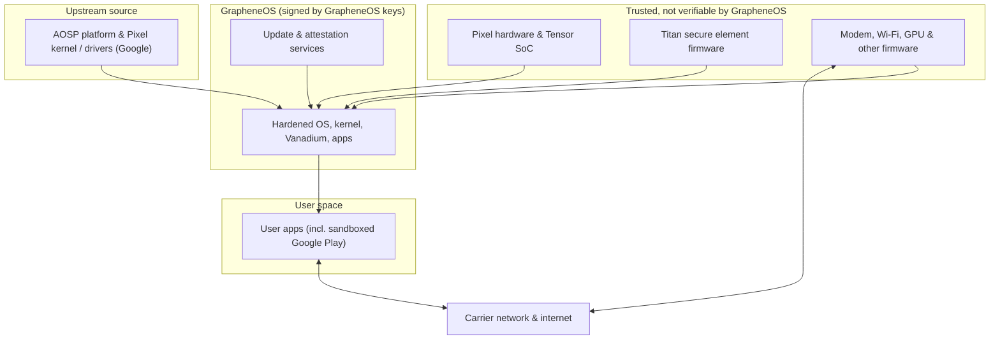

# GrapheneOS Security Assessment — Stage 1

> **Classification:** Client confidential (TLP:AMBER)
> **Version:** 0.1 draft · **Date:** 2026-11-24 · **Author:** Raj · **Reviewer:** _TBD_
>
> **Limitations:** This is a desk-based assessment. It draws on public
> documentation, prior research and analyst knowledge. No hands-on testing, code
> audit or reverse engineering was done in Stage 1. Facts are current as of the
> date above; GrapheneOS and Google change quickly.
>
> **Confidence tags:** **[D]** Documented — stated by GrapheneOS or Google ·
> **[S]** Secondary — press or third-party reporting only · **[A]** Assumed —
> analyst judgement, listed in the assumption register (Appendix A).

---

## 0. Executive Summary

_To be written last (plan task 4.3)._

## 1. Scope, Method & Confidence

_To be written._

## 2. Reference Profiles

_To be transferred from the plan (§2.1–§2.5)._

---

## 3. GrapheneOS Overview

GrapheneOS is a security-hardened mobile operating system based on the Android
Open Source Project (AOSP). It runs Android apps, but changes large parts of the
operating system underneath them to make exploitation and data extraction harder.
It is developed by a small non-profit team and currently runs only on Google Pixel
phones, with a first Motorola device announced.

### 3.1 Project Background, Governance, Funding and Infrastructure

**History**

| Period | Event | Tag |
| --- | --- | --- |
| Late 2014 | Founded by Daniel Micay as a solo project, starting with hardening work such as porting OpenBSD malloc to Android's C library and PaX kernel patches | [D] |
| Late 2015 – 2018 | A company was incorporated and became the main sponsor; the OS was known as **CopperheadOS** during this period. The project says it was agreed GrapheneOS would stay independently owned and controlled by its founder | [D] |
| 2018 | Split from the sponsor. The project's account says the company's CEO seized infrastructure and donations. This is the project's own account of a contested dispute and has not been independently verified | [D] (one-sided) |
| 2018–2019 | Rebranded to AndroidHardening, then to **GrapheneOS** (the site gives no dates; 2019 for the GrapheneOS name is analyst knowledge) | [D] / [A] |
| March 2023 | **GrapheneOS Foundation** created as a Canadian non-profit to receive and distribute donations | [D] |
| November 2025 | Left France and the hosting provider OVH, citing French pressure on encryption and device access | [D] |
| March 2026 | Long-term partnership with **Motorola** announced; the Motorola Signature 27 is to be the first non-Pixel device | [S] |

**Governance and team**

- The GrapheneOS Foundation is a **Canadian non-profit, not a registered
  charity**, based in Toronto. [D]
- The project describes "multiple full-time and part-time developers" plus
  companies that collaborate with it. [D] Public figures put the core development
  team at **roughly 6–10 full-time developers**. [S] [A06]
- Public documentation does not describe a formal governance structure: no board
  composition, decision process or succession plan. [A]
- The founder has historically been the public face of the project. Whether he
  still leads it day to day, and how key decisions are made, is not documented
  on the official site. [A]

**Funding**

- Mostly **donations** (bank transfer, PayPal, cryptocurrency). The FAQ states it
  is "entirely funded by donations" and will remain a non-profit. [D]
- Company collaborations exist. Motorola contributes engineering time to port
  GrapheneOS to its devices but does **not** fund the project. [S]
- There is **no commercial support offering or service-level agreement**. [D]

**Infrastructure and jurisdiction**

- After leaving OVH in November 2025, update mirrors run on **sponsored servers**
  (US; London as a temporary location). DNS runs on anycast networks with Vultr
  and BuyVM. Email, Matrix, the forum, Mastodon and the **attestation service**
  were moving to Netcup (Germany) short term and **colocated servers in Toronto**
  long term. [D] Whether that move is complete is unverified. [A05]
- Updates are verified by signature with downgrade protection at three layers
  (System Updater, update_engine, verified boot), and the project states that "the
  update server isn't a trusted party". **A compromised or seized mirror could
  delay updates, but could not push malicious ones** unless the signing keys were
  also compromised. [D]

> **Assessment note — why this matters to the client**
> - **Concentration risk.** A team of about ten, funded by donations, with no
>   published governance or succession plan, maintains an OS the client may build
>   a security programme on. Signing-key custody sits with this team (§9.2).
> - **No commercial recourse.** No support contract, SLA or indemnity. An
>   organization would carry the operational risk itself.
> - **Jurisdiction.** The legal entity and long-term infrastructure are in
>   Canada. The 2025 move shows the project will relocate under legal pressure,
>   which is reassuring on intent but shows that service availability can be
>   disrupted (it delayed early Pixel 10 support).
> - **Public disputes.** The project is involved in public conflicts (the
>   CopperheadOS split; disputes with press and other projects). This is a
>   reputational factor for an organization adopting it, not a technical flaw.
>
> Feeds §11 area #2 (Supply chain, governance & infrastructure).

### 3.2 Design Philosophy

- **Security first, then privacy.** GrapheneOS treats strong exploit
  mitigation and sandboxing as the foundation; privacy features are built on top
  of that, not in place of it. [D]
- **Harden AOSP, don't replace it.** It keeps the Android security model (app
  sandbox, verified boot, permission system) and makes it stronger: hardened
  memory allocator, hardware memory tagging, stricter app sandbox, extra
  permissions and reduced attack surface (§6, §7). [D]
- **Hardware requirements are non-negotiable.** Devices must offer, among other
  things, hardware memory tagging (ARM MTE or equivalent), a secure element with
  StrongBox and Weaver, verified boot with user-installed keys, and long-term
  firmware updates. This is why only Pixels qualify today, and why Pixel 11
  support waited for MTE enablement (§4.1, §5). [D]
- **No Google apps or services by default.** Like AOSP, GrapheneOS ships without
  them and says they will never be bundled. Users who need them can install Google
  Play as ordinary sandboxed apps with no special privileges (§7.4). [D]
- **No root access.** GrapheneOS does not provide a way to run apps as root,
  because it would break the verified boot and sandbox guarantees the design
  depends on. [A] — confirm wording in plan task 4.1.
- **App compatibility is preserved where possible.** Hardening that breaks apps is
  offered as per-app toggles rather than removed, which creates opt-outs worth
  examining (§6.7, §11). [D]

### 3.3 What GrapheneOS Is Not

| Common assumption | Reality | Tag |
| --- | --- | --- |
| A "de-Googled privacy ROM" like /e/OS or CalyxOS | It is a hardening project first; privacy follows from sandboxing. It also allows sandboxed Google Play, which pure de-Googled ROMs don't | [D] |
| Runs on many devices, like LineageOS | Runs only on devices that meet its hardware requirements: currently Pixel 6 and newer (Pixel 6/6 Pro on legacy extended support), with Motorola to follow | [D] |
| Can be rooted or customized freely | No root access; the bootloader is re-locked with GrapheneOS keys after install | [A] / [D] |
| An anonymity tool | It does not hide your identity from the mobile network, carrier or the services you sign into. Anonymity needs separate measures (e.g. Tor, careful account use) | [A] |
| A certified or accredited product | No known Common Criteria, FIPS 140 or government accreditation. The FAQ discusses external review, not certification | [A] |
| An enterprise product with vendor support | No commercial support, SLA, fleet console or management service. It supports Android Enterprise work profiles via standard MDM (§10) | [D] / [A] |
| Independent of Google | It depends on Google for hardware, firmware, security patches and AOSP source releases (§4, §9.3) | [D] |

> **Assessment note.** For regulated clients, the lack of certification may rule
> GrapheneOS out for some uses regardless of its technical strength. Confirm the
> client's compliance needs (assumption A12).

### 3.4 Release Channels and Versioning

**Channels**

| Channel | Purpose | Tag |
| --- | --- | --- |
| **Alpha** | First public push, after developer testing | [D] |
| **Beta** | Pushed shortly after Alpha. Releases with problems are aborted and replaced by a new Beta release | [D] |
| **Stable** | Promoted after users on Beta have tested it. The project advises Stable for anyone who "cannot tolerate dealing with temporary issues" | [D] |
| **Legacy extended support** | Stopgap releases for end-of-life devices (currently Pixel 6 and 6 Pro). Patch level is frozen; the project advises these are a last resort | [D] |

**Versioning and cadence**

- Builds are numbered as 10-digit values such as **2026111800** (latest as of
  2026-11-24, based on Android 17 QPR2 with the 2026-11-05 Pixel security patch
  level). The number reads as date (YYYYMMDD) plus a two-digit counter; the site
  does not define the format. [D] / [A]
- Releases are frequent: about two dozen between early July and 18 November 2026,
  roughly one a week. [A] (count of changelog entries)

**How updates are delivered**

- Automatic background updates, checking about **every six hours** when
  connected. [D]
- Updates install to a **secondary copy of the OS**, which becomes active only
  after the update completes; if the new version fails to boot, the device rolls
  back. [D]
- Uses **incremental (delta) updates** when available; a full package can upgrade
  from any past version. [D]
- Works while the device is **locked and idle, including before first unlock**,
  so devices kept in the most secure state still get patched. [D]
- Every package is **signed and checked, with downgrade protection**; updates
  carrying a serial-number constraint (i.e. targeted at one device) are
  rejected. [D]
- Users can restrict updates to non-roaming or unmetered networks, require
  charging or a minimum battery level, and opt in to automatic reboot. There is
  **no setting to delay updates**; the only way to stop them is to disable the
  System Updater app, which the project strongly advises against. [D]
- Updates can also be sideloaded from recovery with adb, without enabling adb in
  the OS. [D]

> **Assessment note.** The update design is strong: signed, rollback-protected,
> works before first unlock, and resistant to targeted (per-device) updates.
> The gaps for an organization are:
> - **No staged rollout control.** A fleet cannot pin or defer a version, so a
>   bad Stable release reaches all devices at roughly the same time. The
>   compensating control is to run a few devices on Beta as early warning.
> - **Patch timing depends on Google.** GrapheneOS says it can only fully deliver
>   security updates while the OEM releases them, and Google's switch to
>   quarterly full bulletins and twice-yearly AOSP source drops affects when fixes
>   arrive (§9.3, §11 area #1).

---

## 4. Platform Foundations & Trust Model

GrapheneOS's security rests on hardware it does not control. This section sets
out what it relies on, what it verifies, and what it has to trust blindly.

### 4.1 Why Pixel Only: Hardware Requirements

GrapheneOS publishes a list of requirements a device must meet before it is
supported. [D] The ones that matter most:

| Requirement | Why it matters | Pixels meeting it |
| --- | --- | --- |
| Hardware memory tagging (ARM MTE or equivalent) | Catches most memory-corruption bugs at the point they occur (§6.3) | Pixel 8 and later |
| Secure element with **StrongBox** keystore | Keys live in a separate tamper-resistant chip, not the main processor | Pixel 3 and later (Titan M family) |
| **Weaver** in the secure element | Rate-limits unlock attempts in hardware (§4.3) | Titan M family |
| Verified boot with **user-installed keys** and a re-lockable bootloader | Lets GrapheneOS sign the OS with its own keys and still get full verified boot | Pixels |
| Long-term firmware and driver updates | Without vendor firmware patches, OS patches alone are not enough | Pixel 8+: 7 years |
| Isolation of radios and peripherals (IOMMU) | Stops a compromised modem or Wi-Fi chip reading main memory | Pixels |

Few Android OEMs meet all of these, which is why device support is narrow. The
FAQ's view is that for most devices "the hardware and firmware will prevent
providing a reasonably secure device". [D]

### 4.2 Verified Boot with Custom Keys

- During installation the bootloader is unlocked, GrapheneOS is flashed, and the
  bootloader is **re-locked with the GrapheneOS signing key enrolled** as the
  trusted key. [D]
- From then on, every boot verifies the OS against that key using Android
  Verified Boot (AVB). A modified system partition fails to boot or is
  detected. [D]
- **Rollback protection** prevents booting an older, vulnerable signed version. [D]
- Pixels show a yellow boot warning with the hash of the enrolled key at every
  boot. Users can check that hash against the published GrapheneOS value; the
  Auditor app (§9.4) verifies it cryptographically. [D] / [A]

### 4.3 Titan Secure Element

- **Weaver:** The unlock credential is combined with a secret held by the secure
  element. The chip enforces **escalating delays between failed attempts**, so
  brute-forcing a PIN is limited by hardware, not by the OS. [D]
- **Insider attack resistance:** Secure element firmware can only be updated after
  the owner authenticates, so Google or a supplier cannot silently push firmware
  that weakens throttling on a locked device. [D] (Android / Pixel design)
- **StrongBox:** Hardware-backed key storage used by apps and by attestation
  (§9.4). [D]
- **Generations:** Titan M2 on Pixel 8 to 10a; **Titan M3 on Pixel 11** — new
  silicon and firmware with little public security research yet. [S]
- The October 2025 leaked Cellebrite matrix reportedly shows the vendor
  **cannot brute-force passcodes on Pixels** even on stock Android, which is
  consistent with Weaver doing its job. [S]

### 4.4 Storage Encryption

- **File-based encryption** for user data plus **metadata encryption** for the
  file system, both standard on modern Android. [D]
- Keys are derived from the user's lock-screen credential **and** the Weaver
  secret in the secure element, so data cannot be decrypted off-device and a weak
  PIN is protected by hardware throttling. [D]
- **Before First Unlock (BFU)**, user data keys are not in memory at all. This is
  why GrapheneOS's auto-reboot feature (§8.2) is so effective. [D]
- GrapheneOS raises the maximum password length to 128 characters (stock: 16),
  making a strong passphrase practical. [D]

### 4.5 Baseband, Firmware and Peripheral Isolation

- The cellular modem, Wi-Fi/Bluetooth chip, GPU firmware and other components run
  **closed-source firmware** supplied by Google and its vendors (Samsung,
  MediaTek on Pixel 11, Broadcom, Imagination/Arm). GrapheneOS ships these
  unchanged; it cannot audit or fix them. [D] / [A]
- Pixels isolate these components with an **IOMMU**, so a compromised modem should
  not be able to read or write main memory directly. The attack path then runs
  through the drivers that talk to the component. [D] / [A]
- GrapheneOS reduces exposure with options such as **LTE-only mode** (disables
  2G/3G and 5G legacy fallback paths) and the ability to turn radios off. [A]
- **Residual risk:** The modem is the largest closed attack surface left on the
  device and a known nation-state target. It is §11 area #3.

### 4.6 Trust Boundaries

Reading the diagram: everything in the top box has to be trusted as delivered by
Google and its suppliers. GrapheneOS's protections start at the OS layer.
Verified boot proves the OS is the one GrapheneOS signed; it says nothing about
the firmware beneath it.

### 4.7 Motorola Partnership

- Announced at MWC on 2026-03-01 as a long-term partnership. The **Motorola
  Signature 27** (Qualcomm Snapdragon, with MTE and a secure element, 7-year
  support) is to be the first non-Pixel device; 2027 Razr foldables are next. [S]
- Motorola provides engineers for porting and maintenance; it does **not** fund
  the project. [S]
- Launch date and GrapheneOS availability on the Signature 27 are **not
  confirmed**. [A07]
- **Implications:** A second hardware vendor would reduce single-vendor dependence
  on Google, and Qualcomm's modem and secure element are a different attack
  surface from Tensor's. It also adds a second firmware supply chain to trust and
  splits a small team's attention.

> **Assessment note.** GrapheneOS can only be as strong as the hardware and
> firmware under it. The client's deeper review should focus on what sits below
> the OS: modem firmware and drivers (§11 #3), GPU drivers (#4) and the new Pixel 11
> components (#5).

---

## 5. Device Generation Analysis (Pixel 8 → Latest)

### 5.1 Device Matrix

Status as of 2026-11-24. † = press reports only (Secondary).

| Device | SoC | Modem | GPU | Secure element | Fingerprint | Released | Support end | GrapheneOS |
| --- | --- | --- | --- | --- | --- | --- | --- | --- |
| Pixel 8 / 8 Pro | Tensor G3 | Exynos 5300 | Mali | Titan M2 | Optical | Oct 2023 | Oct 2030 | Supported |
| Pixel 8a | Tensor G3 | Exynos 5300 | Mali | Titan M2 | Optical | May 2024 | May 2031 | Supported |
| Pixel 9 / 9 Pro / 9 Pro XL | Tensor G4 | Exynos 5400 | Mali | Titan M2 | Ultrasonic | Aug 2024 | Aug 2031 | Supported |
| Pixel 9 Pro Fold | Tensor G4 | Exynos 5400 | Mali | Titan M2 | Side capacitive | Sep 2024 | Aug 2031 | Supported |
| Pixel 9a | Tensor G4 | Exynos 5300 | Mali | Titan M2 | Optical | Apr 2025 | Apr 2032 | Supported |
| Pixel 10 / 10 Pro / 10 Pro XL | Tensor G5 | Exynos 5400 | PowerVR DXT† | Titan M2 | Ultrasonic | Aug 2025 | Aug 2032 | Supported |
| Pixel 10 Pro Fold | Tensor G5 | Exynos 5400 | PowerVR† | Titan M2 | Side capacitive | Oct 2025 | Oct 2032 | Supported |
| Pixel 10a | Tensor G4 | Exynos 5400 | Mali | Titan M2† | Optical† | Mar 2026 | Mar 2033 | Supported |
| Pixel 11 / 11 Pro / 11 Pro XL | Tensor G6 | MediaTek M90† | PowerVR C-Series† | Titan M3† | Ultrasonic† | Aug 2026 | Aug 2033† | **Not yet** |
| Pixel 11 Pro Fold | Tensor G6 | MediaTek M90† | PowerVR† | Titan M3† | Side capacitive† | 2026† | † | **Not yet** |

Support end dates for Pixel 8–10a are from the GrapheneOS FAQ ("OEM minimum
support end"); GrapheneOS updates typically end shortly after. [D]

### 5.2 Security-Relevant Differences

**5.2.1 Memory tagging (MTE).** All in-scope devices have MTE, and GrapheneOS uses
it by default for the base OS and known-compatible apps. [D] Pixel 11 shipped
without MTE enabled in Google's software; it was added in Android 17 QPR2, which
is why GrapheneOS support is late. [S]

**5.2.2 GPU driver.** The GPU kernel driver is one of the most-exploited Android
attack surfaces.
- **Mali (G3, G4, Pixel 10a):** a documented history of in-the-wild exploitation
  by commercial spyware vendors — e.g. CVE-2021-39793 (used against Pixel 6),
  CVE-2022-22706, CVE-2023-4211. [S] Well studied, so both attackers and
  defenders know it.
- **PowerVR (G5, G6):** a new driver stack on Pixels, with little public research
  history. Unknown is not the same as safe. [A]

**5.2.3 Modem.**
- Exynos 5300 (Pixel 8, 8a, 9a) and 5400 (Pixel 9, 10, 10a) are Samsung modems
  with a public vulnerability record (e.g. Project Zero's 2023 Exynos modem
  findings). [A]
- The 5400 adds **satellite messaging / SOS**, a new radio path. [S]
- **Pixel 11 switches to MediaTek** — the first change of modem vendor in the
  Tensor era, with its own separate vulnerability history. [S]

**5.2.4 Secure element.** Titan M2 throughout, until the **Titan M3** on Pixel 11. [S]

**5.2.5 Fingerprint.** Optical (8, 8a, 9a, 10a), ultrasonic (9, 10, 11 non-Fold),
side capacitive (Folds). Spoofing resistance differs by type, but GrapheneOS
caps fingerprint attempts at **5** (stock: 20) and offers fingerprint + PIN
two-factor unlock, which removes most of the risk. [D] / [A]

**5.2.6 Radios.** Pro models add UWB, and newer models add satellite. Each radio
is extra attack surface; most can be disabled. [A]

**5.2.7 Support window remaining.** From today: Pixel 8 ≈ 4 years left; Pixel 10a
≈ 6.3 years; Pixel 10 Pro Fold ≈ 6 years. For procurement, newer = longer
lifetime value. [D]

**5.2.8 Foldables.** Two displays, hinge sensors and more drivers mean a larger
attack surface for no security benefit. [A]

**5.2.9 Time to GrapheneOS support.** Pixel 10 support was delayed partly by the
November 2025 infrastructure move; Pixel 11 has been unsupported for over three
months because of MTE gating. **New Pixels should not be planned on day-one
GrapheneOS support.** [D] / [S]

### 5.3 Device Recommendation by Profile

| Profile | Recommended | Acceptable | Avoid | Reasoning |
| --- | --- | --- | --- | --- |
| **A Baseline** | Pixel 10a | Pixel 9a, Pixel 9 / 10 | — | Longest support (Mar 2033), lowest cost, mature Mali/Exynos stack |
| **B High-risk** | Pixel 10 / 10 Pro | Pixel 9 / 9 Pro | Foldables; Pixel 8 series for new purchases; Pixel 11 until supported and settled | Newest supported flagship generation, long support (Aug 2032). GPU trade-off (PowerVR unknown vs Mali known-exploited) does not clearly favour either |
| **C Managed fleet** | Pixel 10a | Pixel 9a, Pixel 10 | Foldables (cost, repair) | Single model across the fleet simplifies attestation and support; long support |
| **C+B** | Pixel 10 | Pixel 9 | As for B | As for B, standardized |

**Pixel 11:** Re-evaluate once GrapheneOS support ships **and** has been through
two or three monthly releases. Its new modem, secure element and GPU generation
deserve a specific review before high-risk use (§11 #5).

---

## 6. Exploit Mitigations

GrapheneOS's main security value is making exploitation of software bugs much
harder. These protections apply in every profile.

### 6.1 hardened_malloc

GrapheneOS's own memory allocator, used across the OS. [D]
- Metadata stored **separately** from allocations, in regions with random bases.
- **Zero-on-free**, with a check on reuse that detects writes after free.
- Random **canaries** and **guard pages** around allocations and slabs.
- **Quarantines** that delay memory reuse, making use-after-free bugs harder to
  exploit.

### 6.2 Hardened Bionic (libc)

Android's C library carries additional hardening that works with
hardened_malloc. [D] (Detail to be expanded in Stage 2.)

### 6.3 Hardware Memory Tagging (MTE)

- Used in **hardened_malloc** for allocations of 128 KB and below, in the **main
  kernel allocators**, and in **Vanadium's** main allocator. [D]
- Enabled by default for the base OS and known-compatible user apps. [D] Base OS
  protections **cannot be turned off**. [D]
- For user apps, an **exploit-protection compatibility mode** can be toggled per
  app. It disables MTE (unless the app opted in), switches to the standard Scudo
  allocator, reduces address space from 48-bit to 39-bit, and allows ptrace. [D]
- MTE crashes are reported to the user, which turns silent memory corruption into
  a visible crash. [A]

### 6.4 Exec-Based App Spawning

Stock Android starts apps by forking a pre-initialized "zygote" process, so every
app shares the same memory layout. GrapheneOS starts each app as a **fresh
process**, giving each its own randomized layout. [D] Cost: about 200 ms slower
app start and more memory. It can be turned off in Settings, which weakens the
protection. [D]

### 6.5 Kernel and Toolchain Hardening

[D] unless noted:
- 48-bit address space and **33 bits of ASLR entropy** (stock: 24).
- Zeroing of freed and newly allocated kernel memory; heap canaries.
- **Forced kernel module signing** with per-build keys; kernel lockdown mode.
- ARMv9 protections: **BTI, PAC, ShadowCallStack, type-based CFI**.
- **ART JIT disabled** in favour of ahead-of-time compilation; dynamic code loading
  blocked for nearly all base OS processes.

### 6.6 Vanadium Browser and WebView

- **JavaScript JIT disabled by default** in the browser, with a per-site toggle. [D]
- **Strict site isolation** in the browser; type-based CFI; zero-initialized
  variables. [D]
- WebGPU, third-party cookies, payments, background sync, sensor APIs and DRM
  disabled by default. [D]
- **WebView is weaker than the browser:** JIT is **enabled by default** for user
  apps (with global and per-app toggles), and WebView **does not support site
  isolation** — all instances share one sandbox. [D]
- Vanadium tracks upstream Chromium; patch latency for in-the-wild Chromium 0-days
  is §11 area #7.

### 6.7 Per-App Compatibility Toggles

| Toggle | What it weakens |
| --- | --- |
| Exploit-protection compatibility mode | MTE, hardened_malloc, address-space size; allows ptrace |
| WebView JIT (per app) | Adds JIT attack surface to that app's web content |
| Secure app spawning (global) | Reverts to zygote forking (shared memory layout) |
| Network / Sensors permissions | Privacy rather than exploit protection |

> **Assessment note.** These toggles are necessary for app compatibility, but each
> one is a silent opt-out. An organization should know how many of its required
> apps need compatibility mode, and should prefer apps that don't (§11 #10).

### 6.8 Coverage by Device Generation

All mitigations above apply to every in-scope device (Pixel 8 and later). The
differences are below the OS: GPU driver, modem and secure element (§5.2).

---

## 7. Privacy, Network & App Model

### 7.1 Network Permission

A per-app toggle that blocks **all direct and indirect network access**,
including localhost. When it is off, "GrapheneOS pretends the network is
down". It is on by default for compatibility and can be turned off at install
time. [D]

### 7.2 Sensors Permission

Blocks access to motion and environmental sensors (accelerometer, gyroscope,
compass, barometer, etc.); blocked apps receive zeroed data. On by default; can
be set off by default for new apps. [D]

### 7.3 Storage Scopes and Contact Scopes

- **Storage Scopes:** an app is told it has the storage permission it asked for,
  but sees only its own files plus files or folders the user chooses. [D]
- **Contact Scopes:** an app gets **no contact access** by default; the user can
  grant specific contacts, groups or data types. Write access is blocked. [D]

### 7.4 Sandboxed Google Play

- Google Play services and the Play Store run as **ordinary sandboxed apps** with
  "absolutely no special access or privileges". [D]
- A **compatibility layer** lets Play work inside the standard app sandbox. [D]
- Installed **per profile**, so it can be confined to one profile (§7.5, §12.6). [D]
- Location requests are redirected to GrapheneOS's own implementation by
  default. [D]
- **eSIM:** existing eSIMs keep working. Adding or managing eSIMs needs
  proprietary Google components that are **off by default** and can be enabled in
  Settings. [D]
- **Android Auto** is supported, installed from the GrapheneOS App Store, with no
  privileged access by default. [D]

> **Assessment note.** The compatibility layer is GrapheneOS code that sits
> between Google's closed-source Play services and the OS. It is a sensible
> design, but it is an IPC surface worth reviewing (§11 #8).

### 7.5 User Profiles, Private Space and Work Profile

- Separate **user profiles** have separate encryption keys, apps and VPN
  settings; GrapheneOS adds an "End session" option to lock a profile's keys
  away again. [D]
- **Private Space** and **work profiles** are available as on Android, each with
  its own VPN configuration. [D]
- Profiles are the main tool for isolating risky apps (e.g. Google Play) from
  sensitive ones.

### 7.6 Default Outbound Connections

GrapheneOS sends these default connections to **its own servers**: [D]

| Connection | Default | Alternatives |
| --- | --- | --- |
| Connectivity checks | GrapheneOS | Google, or disabled |
| Network time | GrapheneOS | Disabled |
| Attestation key provisioning | GrapheneOS | Google |
| GNSS almanac (PSDS) | GrapheneOS proxy | Google |
| SUPL (assisted GPS) | GrapheneOS proxy | Carrier/Google server, or disabled |
| OS updates | GrapheneOS update server (sees IP address and current version only) | — |
| Vanadium component updates | GrapheneOS | — |

### 7.7 Radio and Network Controls

- **Wi-Fi MAC randomization:** always random for scanning; **a new random MAC for
  each connection** by default, with DHCP state flushed between connections.
  Stable IPv6 link-local addresses are disabled. [D]
- Wi-Fi and Bluetooth scanning for location are off by default. [D]
- **LTE-only mode** and the ability to **disable 2G** reduce exposure to fake base
  stations and legacy protocols. [A]
- **Always-on VPN with "block connections without VPN"** (standard Android)
  is available per profile. [A]
- **Private DNS** (DNS-over-TLS) is available (standard Android). [A]

### 7.8 Carrier Exposure

- The carrier still sees the device's **IMSI, IMEI, cell location and metadata**
  for calls, SMS and data. GrapheneOS cannot change this. [A]
- A **SIM PIN** protects a removed SIM; PIN scrambling also applies to SIM PIN
  entry. [D]
- The duress PIN **wipes installed eSIMs** along with the device. [D]

### 7.9 App Sourcing Supply Chain

| Source | Trust model | Notes |
| --- | --- | --- |
| **GrapheneOS App Store** | GrapheneOS-signed, signature and downgrade checks | GrapheneOS apps, sandboxed Play, Android Auto, Accrescent |
| **Accrescent** | Security-focused third-party store; developer-signed apps | Recommended by GrapheneOS; small catalogue [A] |
| **Google Play (sandboxed)** | Google-reviewed; developer-signed | Largest catalogue; needs a Google account [D] |
| **F-Droid** | Builds and signs many apps itself; open-source only | GrapheneOS has publicly criticized its signing and update model [A] |
| **Direct APK / Obtainium** | Trust each developer's releases directly | Higher risk; no store-level review |

> **Assessment note.** For most users, the apps they install are a bigger risk
> than the OS. Profiles B and C should define approved apps and sources (§12.6).

### 7.10 Metadata Exposure to GrapheneOS Infrastructure

By default the update, connectivity, time, attestation and location-assist
servers see the device's **IP address and timing**, and the update server sees
the installed version. [D] This is far less than stock Android sends to Google,
but GrapheneOS becomes a party that sees which IP addresses run GrapheneOS
(§11 #13). Users in Profile B can route traffic through a VPN or switch some
services off.

---

## 8. Physical & Forensic Resistance

### 8.1 BFU vs AFU

- **BFU (Before First Unlock):** after a reboot, before the PIN is entered. User
  data keys are not in memory; data is cryptographically inaccessible without
  the PIN, which the secure element throttles. [D]
- **AFU (After First Unlock):** keys are in memory even when the screen is
  locked. An attacker who can exploit the locked device can reach data. [D]
- Most forensic extraction targets AFU devices. **Getting devices back to BFU is
  the main goal** of the features below.

### 8.2 Auto-Reboot Timer

- Reboots the device if it has not been unlocked for a set time: **18 hours by
  default**, configurable from **10 minutes to 72 hours** or off. [D]
- The timer starts at each lock. It runs in `init`; if it crashes, the kernel
  panics and the device reboots anyway. [D]
- Cellebrite's Spring 2026 release reportedly advertises a "Safeguard Mode" meant
  to stop seized devices dropping back to BFU, a direct counter to this feature.
  [S] A short timer reduces the window for that.

### 8.3 USB-C Port Control

Five modes; default **"Charging-only when locked"**. [D]

| Mode | Effect |
| --- | --- |
| Off | No data or charging |
| Charging-only | Never any data |
| Charging-only when locked (**default**) | Data only while unlocked |
| Charging-only when locked, except BFU | Data also allowed before first unlock |
| On | Standard behaviour |

Blocking USB data while locked removes the main attack path forensic tools use.

### 8.4 Duress PIN / Password

A separate PIN or password that **irreversibly wipes the device and its eSIMs**
when entered. No reboot is needed and the wipe cannot be interrupted. It also
works when entered as the second factor of fingerprint unlock. [D]

### 8.5 PIN Scrambling and Two-Factor Fingerprint Unlock

- **PIN scrambling** randomizes the keypad layout for the lock screen and SIM PIN,
  defeating shoulder-surfing and smudge attacks. [D]
- **Two-factor fingerprint unlock** requires a PIN after the fingerprint; wrong
  PINs count toward the normal attempt limit. [D]
- **Fingerprint attempts are capped at 5** in total (stock: 20). [D]

### 8.6 Secure Element Brute-Force Throttling

See §4.3. Even with an exploit against the main OS, guessing the PIN is limited
by the secure element. A **6-digit PIN is the practical minimum**; Profile B
should use a passphrase. [A]

### 8.7 Leaked Forensic-Vendor Capability Matrices

| Leak | What it reportedly shows | Tag |
| --- | --- | --- |
| April 2024 Cellebrite documents | GrapheneOS devices with patches from late 2022 onward not supported for extraction | [A] (analyst recollection of press reporting; source to add in Phase 4) |
| Oct 2025 Cellebrite "Android OS Access Support Matrix" (leaked from a sales briefing) | Stock Pixel 6–9 extractable in BFU, AFU and unlocked states; **locked GrapheneOS Pixels: no access**, apart from builds older than about 2022; possible loss of full extraction even on unlocked GrapheneOS devices | [S] |

**Limits:** These are leaked sales documents, not tests. They cover one vendor,
are months old by the time they surface, and show capability the vendor offers
widely — not what a state agency might have privately. Absence of a capability in
a matrix is evidence, not proof. Lab validation is §11 area #11.

### 8.8 Coercion and Border Scenarios

| Scenario | Profile | Controls |
| --- | --- | --- |
| Device seized at a border, powered on | B | Short auto-reboot (e.g. 30 min–1 h); reboot before crossing; USB charging-only |
| Forced to unlock | B | Duress PIN; minimal data on device; travel profile with sensitive data in a separate profile ended before crossing |
| Theft of an unlocked phone | A, C | Short screen-lock timeout; profiles; remote account revocation |
| Visible GrapheneOS boot screen | B | The yellow boot warning shows a non-stock OS; in some jurisdictions this may itself attract attention. Consider whether a travel device is wiser |

---

## 9. Operations & Lifecycle

### 9.1 Update Pipeline

Covered in §3.4: Alpha → Beta → Stable; automatic background updates every ~6
hours; secondary-slot install with rollback; delta updates; works before first
unlock; signed with downgrade protection; no deferral setting. [D]

### 9.2 Signing-Key Custody and Build Transparency

- GrapheneOS lists "hardened local build and signing infrastructure" as a feature
  but does **not publish** where or how the OS signing keys are stored, who holds
  them, or how a compromise would be handled. [D] (absence)
- Anyone can **build GrapheneOS from source**. [D] Whether official builds are
  **independently reproducible** (byte-for-byte) is not stated on the features
  page and needs checking. [A13]
- Kernel modules are signed with per-build keys that are discarded. [D]

> **Assessment note.** Key custody is the single most important trust question
> for an organization: whoever holds the keys can sign an update every device will
> accept. It is the core of §11 area #2.

### 9.3 Patch Timing vs Google

- GrapheneOS ships Pixel security patches as Google releases them; the latest
  release carries the 2026-11-05 patch level. [D]
- Google now publishes **full Android security bulletins quarterly** (monthly
  bulletins carry only high-risk fixes) and **AOSP source only in Q2 and Q4**.
  Pixel monthly patches continue. [D] / [S]
- Google no longer publishes Pixel device trees, and Pixel kernel source is
  harder to obtain. [S] This makes GrapheneOS's porting work slower and more
  dependent on reverse-engineering Google's releases (§11 area #1).

### 9.4 Auditor and Hardware Attestation

- The **Auditor** app uses Android's hardware attestation to verify that a device
  runs genuine, unmodified GrapheneOS with the expected signing key and patch
  level. [D]
- It uses **pairing**: the first verification pins a hardware-backed key, and
  later checks confirm both integrity and that it is the **same device**. [D]
- Verification can be done **locally** (one phone scanning another's QR code) or
  through the **attestation.app** service, which can email alerts if a device
  stops checking in or fails. [D]
- For a fleet, the remote service gives a basic integrity dashboard, but it is a
  GrapheneOS-run service (hosting moving to Canada; §3.1). [D] / [A]

### 9.5 Installation and Procurement

- Install using the **web installer** (WebUSB in a Chromium browser) or the
  command-line installer. Both unlock, flash and re-lock the bootloader. [D]
- The device must allow **OEM unlocking**. Carrier-locked units — notably many
  **Verizon** Pixels — cannot be used. Buy unlocked devices from Google or trusted
  retailers. [A]
- Verify the install with Auditor (§9.4) and the boot-key hash (§4.2).
- For Profile B, consider buying in person or through an intermediary to reduce
  the risk of interdiction. [A]

### 9.6 Backup and Recovery

- There is **no cloud backup by default**. The built-in option (Seedvault) is
  limited; many users rely on app-level exports (e.g. Signal's encrypted backup).
  [A]
- **Trade-off:** less backup means less data exposed in a backup provider, but a
  higher risk of data loss. For Profile C, organization data should live in
  managed services, not on the device.

### 9.7 Detection and Incident Response

- **No root and no mobile threat-defence agent** with deep system access, by
  design. This keeps the attack surface small but means **compromise may go
  unnoticed**. [A]
- **Auditor proves OS integrity**, not the absence of an in-memory or
  user-space implant. [D] / [A]
- MTE crash reports can show exploitation attempts, and users can share them with
  GrapheneOS. [A]
- Triage tools such as **MVT** (Mobile Verification Toolkit) can analyse backups
  and adb output, with limits on a non-rooted device. [A]
- **Realistic response:** treat a suspected device as compromised; **reflash and
  replace**, revoke credentials, and rotate account sessions. Document this in a
  runbook (Profile C). [A]

> **Assessment note.** This is a gap for any organization with a security
> operations function. It is §11 area #6.

---

## 10. Enterprise & Compatibility

### 10.1 Android Enterprise and MDM

- **Work profiles** are supported, and standard Android Enterprise MDM apps can
  manage them. [D] / [A]
- GrapheneOS's documentation **does not cover full device-owner (fully managed)
  provisioning** or list MDM products that work. [D] (absence) Compatibility
  depends on each MDM; some need Google Play services (use sandboxed Play in the
  managed profile). [A]

### 10.2 No Fleet Console

There is no GrapheneOS management console, support contract or bulk
provisioning tool. [D] / [A] Compensating controls:
- MDM for the work profile;
- the attestation.app service (or a self-hosted equivalent) for integrity;
- a documented build standard and hardening checklist (§12.7);
- a few devices on Beta as an early-warning channel.

### 10.3 Play Integrity and Banking / Corporate Apps

- GrapheneOS passes Play Integrity's basic check but **fails the device-integrity
  and strong-integrity checks**, because Google does not certify it. Apps that
  enforce those checks will refuse to run. [D]
- GrapheneOS asks app developers to use **standard hardware attestation and
  allow GrapheneOS's signing keys** instead; it publishes a guide. [D]
- Many banking apps work with sandboxed Play; some explicitly allow GrapheneOS,
  some block it (e.g. Revolut, publicly disputed in 2026). [S]
- **Corporate apps** (MDM agents, VPN, conditional access) need testing one by one.

### 10.4 Feature Compatibility

| Feature | Status | Tag |
| --- | --- | --- |
| Android Auto | Supported via sandboxed Play compatibility layer | [D] |
| eSIM | Existing eSIMs work; adding eSIMs needs an opt-in toggle | [D] |
| Google Wallet tap-to-pay | Not available (fails Play Integrity) | [A] |
| RCS (Google Messages) | Works for many users with sandboxed Play; not guaranteed | [A] |
| Wear OS | Partial; depends on companion apps and Play | [A] |
| Push notifications | Via sandboxed Play (FCM) or app-specific alternatives | [D] / [A] |

### 10.5 Usability vs Security by Profile

| Profile | Main usability costs |
| --- | --- |
| A | Some apps need sandboxed Play; occasional app breakage |
| B | No Play means fewer apps and no Google push; short auto-reboot means frequent PIN entry; duress PIN needs training |
| C | MDM compatibility testing; no vendor support; release timing outside IT's control |

---

## 11. Areas to Examine First (Ranked)

_To be written (plan task 3.1)._

## 12. Reference Secure-Phone Configurations

_To be written (plan task 3.3)._

## 13. Comparative Positioning

Ratings are relative and qualitative (analyst judgement, [A]) unless tagged.

### 13.1 GrapheneOS vs Stock Pixel (Android 16/17)

- Same hardware, secure element and verified boot design.
- GrapheneOS adds: hardened_malloc, MTE for the OS and most apps by default,
  exec spawning, stronger kernel hardening, Vanadium, Network/Sensors
  permissions, Scopes, auto-reboot, USB-C control, duress PIN, 5-attempt
  fingerprint cap. [D]
- Stock adds: Google Play Protect, Play Integrity certification (banking and
  Wallet), Google's own detection and theft-protection features, vendor support.
- Forensics: leaked matrices show stock Pixels extractable in all states and
  locked GrapheneOS Pixels largely not. [S]

### 13.2 GrapheneOS vs iOS with Lockdown Mode

- **iOS strengths:** integrated hardware/software from one vendor; Apple's
  Secure Enclave; Lockdown Mode cuts attack surface (message attachments,
  JIT, wired connections when locked); commercial support; wide app and MDM
  support; inactivity reboot (added in iOS 18).
- **GrapheneOS strengths:** MTE across the OS and most apps (Apple's comparable
  Memory Integrity Enforcement arrived only with iPhone 17 hardware [A]);
  per-app network and sensor control; no mandatory vendor account; user
  control of auto-reboot timing; duress PIN; open source.
- **Both** remain targets of nation-state 0-click chains; neither is proof
  against T4.

### 13.3 GrapheneOS vs Samsung Knox / Hardened Android Enterprise

- **Knox strengths:** certified (Common Criteria, government approvals in
  several countries); mature fleet management (Knox Manage, Knox Suite);
  vendor support and SLAs; broad hardware choice.
- **GrapheneOS strengths:** much stronger exploit mitigation; faster and more
  consistent patching on supported devices; less pre-installed software and
  telemetry.
- **Knox weakness:** larger attack surface (vendor apps, services); Samsung
  modem and Exynos/Snapdragon firmware still trusted.

### 13.4 Summary Comparison

| Dimension | GrapheneOS (Pixel) | Stock Pixel | iOS + Lockdown Mode | Samsung Knox |
| --- | --- | --- | --- | --- |
| Exploit mitigation | Very high | High | High (very high on iPhone 17+) | Medium–High |
| Forensic resistance (locked) | Very high [S] | Medium [S] | High | Medium–High |
| Attack surface reduction | High (user-controlled) | Low–Medium | High (Lockdown) | Medium |
| Privacy from vendor | Very high | Low | Medium | Low–Medium |
| Patch speed | High (bounded by Google) | High | High | Medium |
| Fleet management | Low (work profile MDM only) | High | High | Very high |
| App compatibility | Medium–High | Very high | Very high | Very high |
| Certification | None known | Some | Yes (several) | Yes (several) |
| Vendor support / SLA | None | Yes | Yes | Yes |
| Supply-chain concentration | Small team + Google | Google | Apple | Samsung |

> **Assessment note.** GrapheneOS leads on technical hardening and privacy. It
> trails on manageability, certification and support. The right choice depends
> on whether the client's main risk is targeted exploitation (favours
> GrapheneOS or iOS Lockdown) or fleet governance and compliance (favours Knox or
> iOS).

---

## 14. Recommendations & Proposed Stage 2

_To be written (plan task 3.4)._

---

## Appendices

- **A.** Assumption register — see plan; to be transferred at delivery
- **B.** Persona, threat-tier and deployment-model definitions
- **C.** Glossary
- **D.** Device specification detail
- **E.** Hardening settings reference
- **F.** References and sources

### Sources used so far

- GrapheneOS history: https://grapheneos.org/history/
- GrapheneOS releases: https://grapheneos.org/releases
- GrapheneOS usage guide (Updates): https://grapheneos.org/usage
- GrapheneOS FAQ: https://grapheneos.org/faq
- GrapheneOS infrastructure post, November 2025: https://xcancel.com/GrapheneOS/status/1993035936800584103
- The Register, GrapheneOS leaves OVH: https://www.theregister.com/2025/11/28/grapheneos_ovhcloud/
- 9to5Google, Motorola partnership: https://9to5google.com/2026/03/01/motorola-confirms-grapheneos-partnership-for-a-future-smartphone-porting-features/
- Notebookcheck, Motorola plans: https://www.notebookcheck.net/GrapheneOS-reveals-full-Motorola-plans-7-year-updates-Razr-support-more.1375825.0.html
- GrapheneOS forum, Foundation: https://discuss.grapheneos.org/d/4047-grapheneos-foundation
- GrapheneOS features: https://grapheneos.org/features
- GrapheneOS attestation compatibility guide: https://grapheneos.org/articles/attestation-compatibility-guide
- Android Authority, Cellebrite leak and GrapheneOS: https://www.androidauthority.com/cellebrite-leak-google-pixel-grapheneos-security-3611794/
- Osservatorio Nessuno, phone unlocking tools overview (May 2026): https://osservatorionessuno.org/blog/2026/05/demystifying-phone-unlocking-tools-a-technical-overview/
- TechTarget, spyware vendor exploiting Mali driver (CVE-2023-4211): https://www.techtarget.com/cybersecurity/news/366554254/Spyware-vendor-exploiting-kernel-flaw-in-Arm-Mali-GPU-drivers
- Project Zero, Mind the Gap (Mali, Pixel 6): https://projectzero.google/2022/11/mind-the-gap.html
- Android Authority, Revolut blocking GrapheneOS: https://androidauthority.com/revolut-blocking-grapheneos-3695551
- Android Authority, Tensor G5: https://www.androidauthority.com/google-tensor-g5-3583168/
- TechSpot, Pixel 11 / Tensor G6 / Titan M3: https://www.techspot.com/news/113458-google-unveils-pixel-11-series-featuring-tensor-g6.html
- Android Authority, AOSP twice a year: https://www.androidauthority.com/aosp-source-code-schedule-3630018/
- Android Enterprise, bulletin cadence: https://www.androidenterprise.community/kb/announcements/change-in-cadence-of-android-security-bulletins/12154
